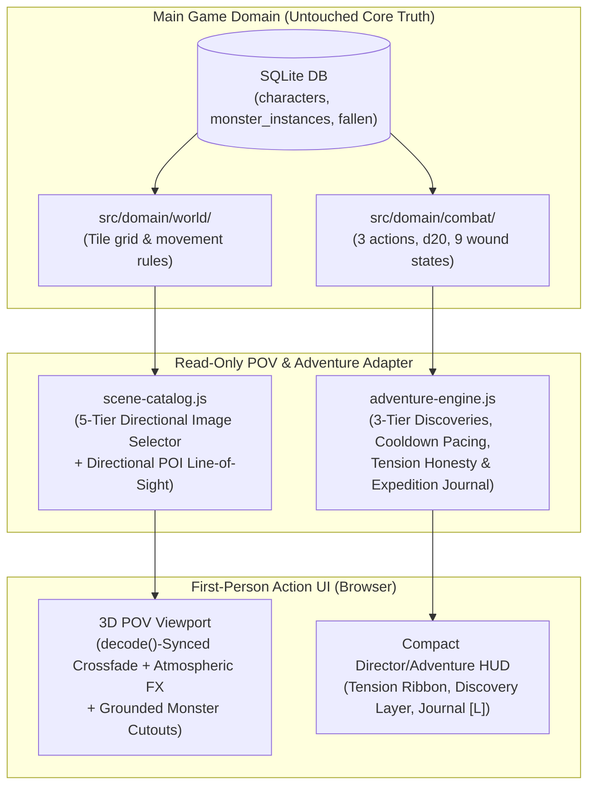

# Darkgrid — Future Adventure Gameplay Blueprint

**Document Scope:** Critical Game Design Analysis & Architectural Roadmap (`action-ui-lab/`)  
**Objective:** Evaluate what worked in the Adventure Experience Lab prototype, critically analyze candidate mechanics (`A–H`), and chart a safe, non-destructive roadmap for evolving Darkgrid's First-Person exploration loop.

---

## 1. Vision: What Makes Darkgrid Special

Darkgrid sits at a rare intersection of two genres:
1. **Classic First-Person Grid Crawlers (*Eye of the Beholder*, *Dungeon Master*, *Lands of Lore*):** Tactile `90°` step-and-turn spatial navigation, hand-painted dark fantasy vistas, and immediate visual presence inside the world.
2. **High-Stakes Shared-World Permadeath RPG:** Server-side D20 truth, hidden monster HP (`9` descriptive wound states), persistent monsters that grow stronger (`+10% HP`) and claim fallen heroes' gear when a player dies, and a living sanctuary (`Oakhaven`) that anchors every expedition.

What makes Darkgrid special is **consequential atmosphere**: every step away from Oakhaven should feel like wading deeper into a hostile, ancient frontier where reading the environment—claw marks on bark, sweet-rot pollen over bog water, or a cracked watchhorn in a ruined tower—matters as much as swinging a sword.

---

## 2. Analysis of Current Strengths

After building and playtesting the Action UI Lab (`Current` vs `Adventure ★` modes), Darkgrid's strongest pillars are:

1. **Five-Tier Directional Scene Engine (`640` Views from `49` Paintings):**
   - Combining exact landmark POVs (Tier 1), approach views (Tier 2), transition borders (Tier 3), biome-directional views (Tier 4), and impassable barrier vistas (Tier 5) makes the 15×15 world feel cohesive and spatially legible.
2. **Directional Line-of-Sight POI Inspection:**
   - Requiring the player to actually face the Runestone (`NORTH` at `[7,5]`), Stonefang Crag (`WEST` at `[7,5]`), or the Ancient Oak (`NORTH/EAST/WEST` at `[7,3]`) transforms camera rotation (`A/D`) from a cosmetic pan into an active observation tool.
3. **Integrated Monster Cutouts with Grounded Contact Shadows:**
   - Placing monsters directly inside the painted 3D viewport (rather than opening a detached popup window) keeps combat anchored in the space the player just explored.
4. **Tiered Non-Modal Discovery Presentation (`AMBIENT` / `NOTICEABLE` / `IMPORTANT`):**
   - Rendering discoveries at the base of the viewport in three distinct weights preserves exploration momentum while giving major discoveries (`IMPORTANT`) meaningful 2–3 choice agency.
5. **Three-Tier Tension Honesty (`ATMOSPHERE` vs `GENUINE SIGN` vs `ACTIVE THREAT`):**
   - Separating atmospheric mood from genuine monster evidence solved one of the biggest frustrations of baseline exploration: players now trust that a `GENUINE SIGN` badge means real danger or an actionable clue is nearby.

---

## 3. Core Gameplay Gaps (Between Lab Prototype & Full Main-Game Loop)

While the Adventure Experience prototype succeeds as a 15–20 minute vertical slice, four structural gaps remain before this experience could sustain 10+ hours of replayable progression:

1. **Static vs Procedural Clue Placement:**
   - In the Lab, discoveries are drawn from a 18-entry catalog with coordinate/biome rules. In the full game, genuine monster clues (`GENUINE_EVIDENCE`) should dynamically reflect **real persistent monsters** residing on or adjacent to `(x, y)` in the SQLite database (`monster_instances`).
2. **Return-Journey Resource Pressure:**
   - Walking back to Oakhaven completes the Expedition Arc in the Lab, but in the main game, the return journey becomes truly nail-biting when the hero is carrying unbanked loot, low HP, or a scarce potion count.
3. **Directional Scouting Across Adjacent Tiles:**
   - Currently,Tier 2 approach views show upcoming landmarks visually, but persistent monster signs on the tile *ahead* (`ahead1`) could dynamically project subtle visual/textual forewarnings before the player steps onto the hostile tile.
4. **Cross-Player Traces (Shared-World Echoes):**
   - Darkgrid's main database already tracks fallen heroes (`fallen.ejs`) and persistent monsters holding player loot. Surfacing subtle environmental echoes of fallen players on the exact tile where they died would connect first-person exploration directly to Darkgrid's shared-world permadeath pillar.

---

## 4. Idea Evaluation Matrix (Categories A–H)

Below is a rigorous evaluation of the 8 candidate gameplay systems (`A–H`) across all 8 required engineering and design dimensions:

| ID | Candidate System | 1. Gameplay Value | 2. Alignment with Darkgrid Vision | 3. Reuse of Existing Systems | 4. Implementation Complexity | 5. Maintenance Risk | 6. Compatibility with Main Game | 7. Performance Impact | 8. Recommendation |
|---|---|---|---|---|---|---|---|---|---|
| **A** | **Exploration Discoveries** (3-tier environmental signs with cooldown & anti-oscillation pacing) | **High (9/10):** Eliminates "empty corridor steps" and rewards attentive travel. | **High:** Reinforces dark-fantasy frontier tone without turning the game into a dialogue-heavy visual novel. | **High:** Uses existing tile biome/coordinate metadata and viewport overlay layer. | **Low–Medium:** Already proven in `adventure-engine.js` (`18` entries). | **Low:** Pure data catalog (`DISCOVERY_CATALOG`). | **High:** Can remain client/session-scoped or lightly persisted per hero expedition. | **Negligible:** Simple JSON lookup per step. | **Adopt Now** *(Proven in Lab)* |
| **B** | **Environmental Events** (Dynamic weather shifts, collapsing paths, timed hazards) | **Medium (5/10):** Visually cool, but timed/twitch hazards conflict with turn-based stepping. | **Low–Medium:** Darkgrid is deliberate and turn-based; real-time hazards undermine tactical pacing. | **Medium:** Could reuse Atmospheric FX canvas, but path mutation breaks static map truth. | **High:** Mutating walkability or adding timers complicates server truth. | **High:** Edge cases with stranded players or desynced maps. | **Low:** Conflicts with shared-world static tile coordinates. | **Low–Medium:** Extra canvas/timer overhead. | **Reject** *(Keep weather purely atmospheric; avoid timed hazards)* |
| **C** | **Monster Tracking & Forewarning** (Genuine tracks/webs/spores tied to real adjacent/tile monsters) | **Very High (10/10):** Turns random encounters into readable hunting/avoidance decisions. | **Very High:** Directly supports permadeath fairness—observant players spot lethal threats before blundering in. | **High:** Bridges `monster_instances` / Gaussian encounter tables with the Lab's `GENUINE_EVIDENCE` ribbon. | **Medium:** Requires reading adjacent tile threat state on step. | **Low:** Stateless query over existing world/monster tables. | **Very High:** Enhances core persistent monster loop without changing combat math. | **Negligible:** 4-neighbor query on step. | **Adopt Now** *(Top priority for main-game bridge)* |
| **D** | **Dynamic Encounter Presentation** (Pre-combat ambush framing, monster scale/grounding, tactical readout strip) | **High (9/10):** Makes combat feel like a natural climax of exploration rather than an abrupt UI swap. | **High:** Preserves hidden monster HP (`9` wound states) while clarifying stance and monster traits. | **Very High:** Uses existing 3-action combat engine + cutout standee layer. | **Low:** Already implemented and verified in Lab Phase 5. | **Low:** Pure CSS/UI presentation over existing combat state. | **Very High:** Zero changes to d20 rolls, AC, or damage formulas. | **Negligible:** CSS transforms & contact shadow divs. | **Adopt Now** *(Proven in Lab)* |
| **E** | **Points of Interest & Directional Micro-Interactions** (Line-of-Sight `visibleFacings` + contextual 2–3 choice cards) | **High (9/10):** Gives landmarks physical presence and makes `90°` turning meaningful. | **Very High:** Turns first-person camera orientation into a core gameplay verb. | **Very High:** Extends `LANDMARK_CATALOG` (`12` POIs) with `visibleFacings` and `facingViews`. | **Low:** Data-driven lookup (`getInspectableLandmark(x, y, facing)`). | **Low:** Declarative per-landmark config. | **Very High:** Compatible with existing world coordinates. | **Zero:** O(1) lookup. | **Adopt Now** *(Proven in Lab)* |
| **F** | **Risk & Reward Decisions** (Contextual discovery choices granting minor readiness/ward buffs vs caution/bypass) | **High (8/10):** Gives players meaningful micro-decisions outside of combat. | **High:** Fits grimdark survival when kept grounded (readiness, tracking clues, minor field dressing). | **Medium–High:** In Lab, uses `state.adventure.memory.activeBuffs`; in main game, would need strict bounds. | **Medium:** Must ensure buffs never unbalance D20 math or create infinite HP farming. | **Medium:** Needs strict once-per-coordinate exhaustion (`resolvedCoordDiscoveryKeys`). | **Medium:** Keep purely informational/readiness-focused in main game unless explicitly designed into combat rules. | **Negligible.** | **Prototype Later** *(Keep buffs Lab-local for now; port informational/tracking choices first)* |
| **G** | **Return Journeys & Safe Haven Tension** (Outbound objective vs Return-to-Oakhaven phase with expedition completion) | **High (8.5/10):** Gives every outing a clear beginning, middle, climax, and homecoming. | **Very High:** Oakhaven as the sole sanctuary in a lethal world is central to Darkgrid's identity. | **High:** Uses existing Oakhaven `[7,7]` hub and Expedition Arc state machine. | **Low–Medium:** Clean 4–5 stage checklist per regional route. | **Low:** Self-contained expedition tracker. | **High:** Works as an optional "Expedition Contract / Patrol Log" layer without requiring a sprawling RPG quest engine. | **Negligible.** | **Adopt Now** *(Proven in Lab)* |
| **H** | **Long-Term Exploration Progression** (Expedition Journal, Cartography memory, Fallen Hero echoes) | **High (8/10):** Rewards thorough world mastery and connects sessions together. | **High:** Especially compelling when tied to Darkgrid's graveyard/fallen heroes and persistent monsters. | **High:** Reuses `📖 Journal [L]` UI + main game's `fallen` and `monster_instances` records. | **Medium:** Requires a lightweight `hero_journal` or client-synced discovery log table if persisted across logins. | **Low–Medium:** Append-only log data. | **High:** Orthogonal to combat/economy balance. | **Negligible.** | **Prototype Later** *(Milestone 2–3 after core POV + tracking integration)* |

---

## 5. Top 5 Recommended Gameplay Additions (Prioritized)

Based on empirical playtesting in the Lab and strict adherence to Darkgrid's core pillars, here are the **Top 5 additions** in priority order:

### #1. Directional Line-of-Sight POI & Landmark System (`Category E`)
- **Why #1:** It is 100% non-intrusive, zero-risk to game balance, and immediately makes the First-Person POV feel genuinely 3D. Looking `NORTH` at Crossroads `[7,5]` to read the Runestone and turning `WEST` to survey Stonefang Crag gives every rotation purpose.

### #2. Honest Three-Tier Tension & Monster Forewarning (`Category C`)
- **Why #2:** Separating `ATMOSPHERE` (mood) from `GENUINE SIGN` (real monster tracks/spores/webs) and `ACTIVE THREAT` (encounter) makes exploration tense and fair—a critical requirement in a permadeath RPG.

### #3. Three-Tier Environmental Discovery System with Step-Cooldown Pacing (`Category A`)
- **Why #3:** Solves the "empty walk" problem on intermediate tiles while respecting player flow: `AMBIENT` notes never interrupt stepping, `NOTICEABLE` ribbons offer optional expansion, and `IMPORTANT` cards reserve full 2–3 choice pauses for major landmarks and caches.

### #4. Integrated Cutout Combat Polish & Tactical Readout Strip (`Category D`)
- **Why #4:** Grounding monster cutouts with multi-point contact shadows (such as the Giant Spider's 4 leg-tip shadows and `1.15x` scale boost) and showing stance + monster habitat traits (`Canopy Ambush`, `Mire Constriction`) makes combat visually cohesive and tactically readable without exposing hidden HP numbers.

### #5. Regional Expedition Arcs & Expedition Journal (`Categories G & H`)
- **Why #5:** Structuring outings as round-trip expeditions (`Oakhaven → Frontier Objective → Return to Oakhaven`) recorded in the `📖 Journal [L]` transforms aimless tile-stepping into a memorable 15–20 minute adventure loop.

---

## 6. Ideas We Should Reject or Postpone

To protect Darkgrid's focus and avoid feature creep, we explicitly recommend **rejecting or postponing** the following:

1. **REJECT — Real-Time / Twitch Environmental Hazards (`Category B` subset):**
   - Timed traps, moving hazards, or real-time stamina drain conflict with Darkgrid's turn-based D20 foundation and first-person contemplation.
2. **REJECT — Heavy Dialogue Trees or NPC Quest Hubs:**
   - Darkgrid's magic comes from solitude in a bleak, dangerous wilderness. Long branching NPC conversations dilute environmental storytelling.
3. **REJECT — Unbounded Stat/HP Farming from Exploration Nodes:**
   - Discovery choices must never become a way to infinitely farm HP or bypass Darkgrid's potion scarcity. Once-per-coordinate exhaustion (`resolvedCoordDiscoveryKeys`) and informational/readiness advantages keep discoveries balanced.
4. **POSTPONE — Multi-Monster Cutout Formations:**
   - Darkgrid's combat engine is tightly balanced around 1v1 duels with persistent monsters. Multi-monster viewport compositing should wait until if/when group combat is ever designed at the domain level.

---

## 7. Proposed Architecture for Safe Future Integration

When the user eventually decides to bring elements of `action-ui-lab/` into the main game (or a feature-flagged `/game/pov` route), the integration should follow a strict **Read-Only Domain Adapter + Isolated Presentation Layer** pattern:

### Key Architectural Guarantees
1. **Zero Mutation of Combat/Economy Tables:** `scene-catalog.js` and `adventure-engine.js` operate as pure functions over `(x, y, facing, tileBiome, adjacentMonsters, expeditionMemory)`.
2. **Feature-Flagged Experience Mode (`CURRENT` vs `ADVENTURE`):** Just as implemented in the Lab, the entire Adventure Experience layer can be toggled on or off via a single mode flag (`adventure.mode`).

---

## 8. Step-by-Step Roadmap (Next 3 Milestones)

### Milestone 1 — Live Human Playtest & Tuning in `action-ui-lab/` (Immediate)
- Playtest the 3 completed Expedition Arcs (**Into the Mirkwood**, **The Ruined Watchpost**, **Into the Rotten Lands**) on `http://localhost:3100`.
- Use the `Experience: Current | Adventure ★` toggle and `🎬 Director [G]` modal to evaluate discovery frequency (`DISCOVERY_MIN_STEP_COOLDOWN = 2`) and choice text.

### Milestone 2 — Persistent Monster Sign Binding (Lab Prototype Extension)
- Connect `GENUINE_EVIDENCE` discoveries in `action-ui-lab/` to simulated persistent monster instances on adjacent tiles (`ahead1`, `left1`, `right1`) so players can use directional tracks/webs/spores to deduce *which specific adjacent tile* holds a lurking monster—or carries a fallen hero's loot.

### Milestone 3 — Opt-In Main-Game Bridge (When Approved by User)
- Expose `scene-catalog.js` and `adventure-engine.js` as a read-only visual presentation layer over the main game's authenticated character session, preserving 100% of Darkgrid's SQLite schema, D20 combat rules, and permadeath persistence.
