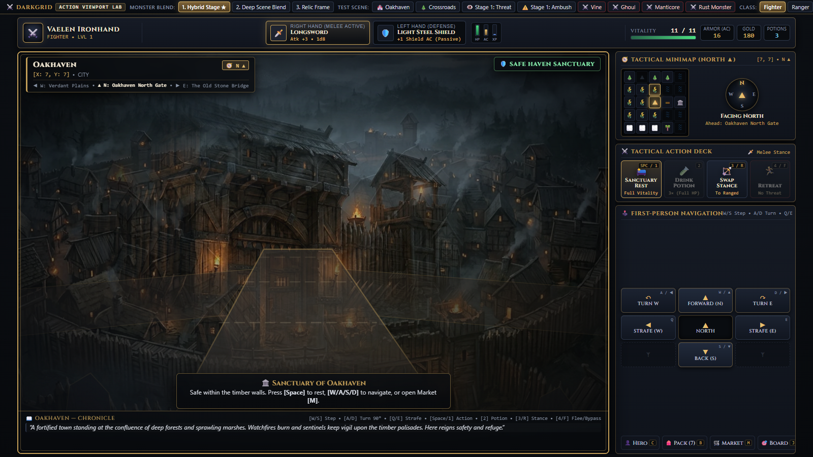
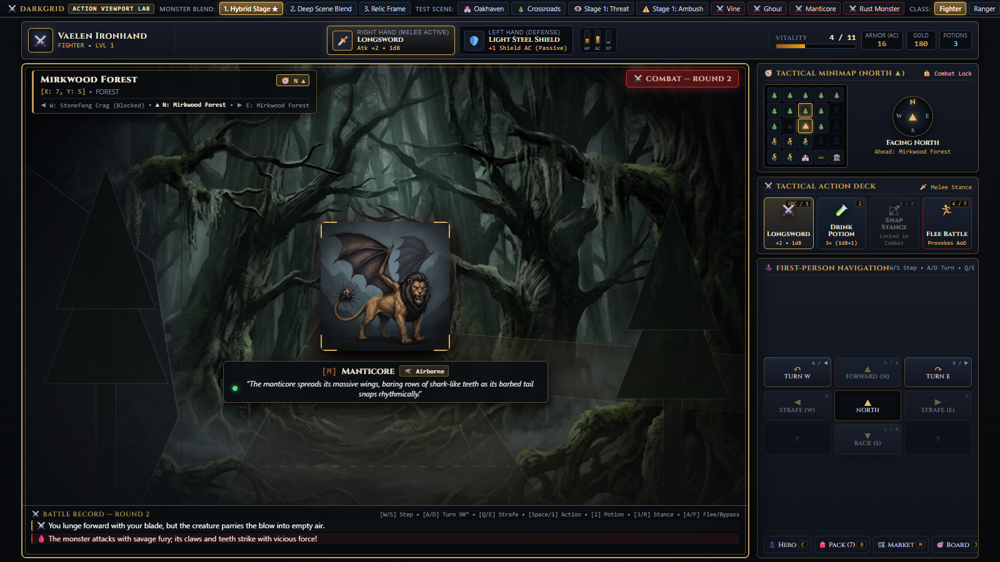
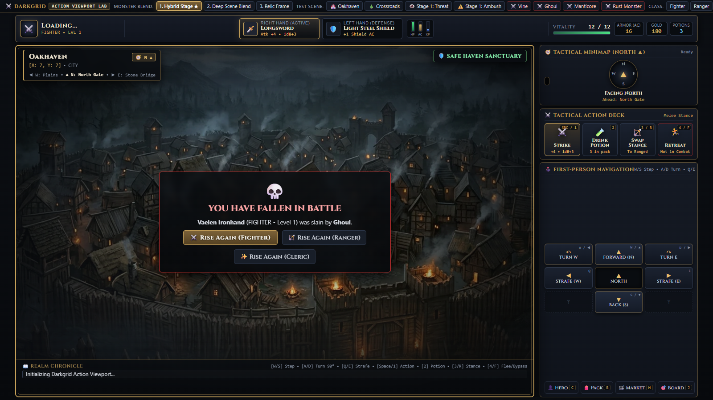
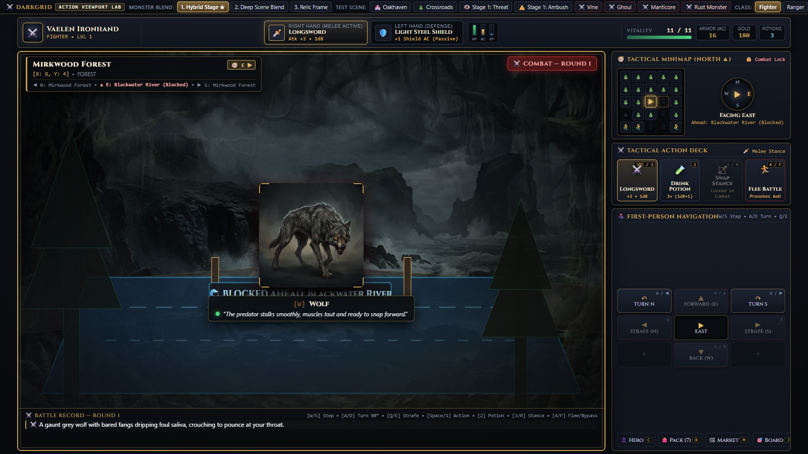
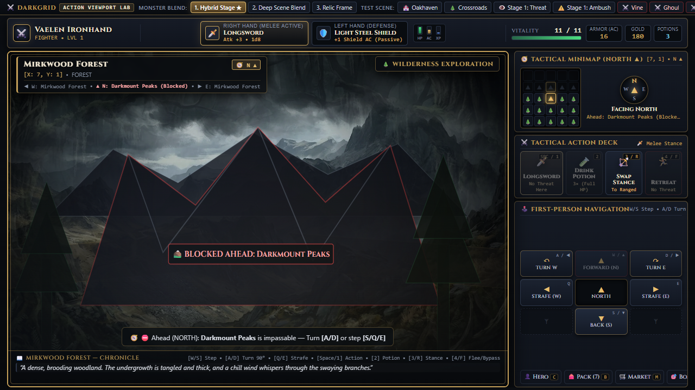
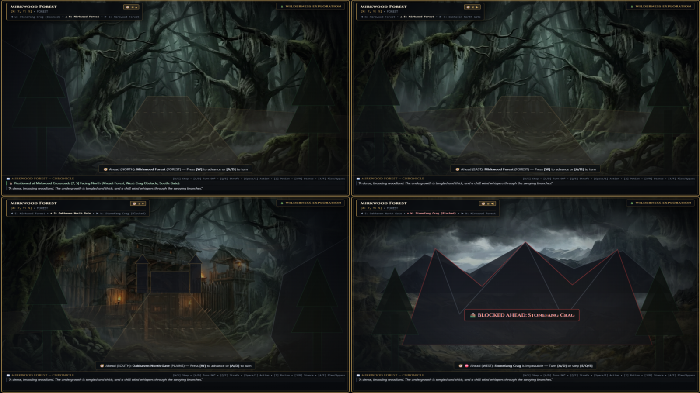

# Óháð úttekt — Darkgrid Action UI Lab (`action-ui-lab/`)

**Dagsetning:** 20. október 2026 (prófun 11:00–11:20)
**Útgáfa sem var prófuð:** `server.js`, `public/action-ui.js`, `public/action-ui.css` og `public/index.html` eins og þær stóðu kl. 11:00. Ég staðfesti með SHA-256 að skrárnar breyttust ekki á meðan prófað var.
**Umfang:** Eingöngu `action-ui-lab/`. Engum kóða var breytt. Prófað var á sérstökum þjóni (port 3031) með nýjum gagnagrunni utan verkefnisins. `data/action_lab.sqlite` var aðeins lesinn (read-only).

> [!NOTE]
> Fyrri tilraun til úttektar (kl. 10:00) var hætt af því að annar agent var að breyta kóðanum á sama tíma. Engar niðurstöður úr þeirri tilraun eru notaðar hér.

---

## 1. Stutt heildarmat

Á góðum augnablikum lítur útgáfan vel út. Málverkin, skuggi í þokunni með vísbendingartexta, skrímslið í senunni og siguryfirlitið skapa raunverulegt andrúmsloft. Áttaviti, minimap og hreyfispjald eru samræmd og uppfærast rétt eftir sjónstefnu.

**Sem leikur er hún þó ekki enn spilanleg samfellt:**

1. **Dauði hetjunnar frystir viðmótið** (staðfest þrisvar). Leikurinn situr fastur í bardaga og ekkert inntak virkar nema endurhleðsla.
2. **Prófunarsvæðið „mengast“ varanlega.** Þegar Lab-hnappur drepur hetju á `(7,5)` verður til varanlegt skrímsli á reitnum. Eftir það mætir nýr spilari því í öðru skrefi frá Oakhaven.
3. **Flæðið býður upp á að halda W inni.** Hvert skref framhjá ógn er ókeypis og áhættulaust. Spilarinn getur gengið framhjá öllu án þess að taka eina einustu ákvörðun.

Bardaginn sjálfur er læsilegur en snýst um einn hnapp. Á 1. stigi er hann mjög banvænn (11 HP, eitt úlfshögg tók 7).

---

## 2. Hvað var skoðað og prófað

| Svið | Aðferð |
| :--- | :--- |
| Fyrsta upplifun | Spilaði sem nýr spilari í Headless Chrome (1600×900) með raunverulegum lyklaborðsatburðum (CDP), áður en fyrri skýrslur voru lesnar |
| Hreyfing | Allar 4 sjónstefnur, W/S/Q/E, A/D, smellur á minimap, hindranir (klettur, á, fjöll), kortamörk |
| Encounters | Náttúruleg slembifundir, Engage (Space), framhjáganga með skrefi, F/4, Lab-hnapparnir Stage 1/Ambush |
| Bardagi | Heilir bardagar (Wolf ✔ sigur, Stirge ✔ sigur, Manticore ✖ ×4 dauði, Ghoul ✖ dauði, Rust Monster flótti), drykkur, flóttastaðfesting |
| Tækni | Hröð og haldin inntök, tvöfaldar `ATTACK` beiðnir samtímis, endurhleðsla í öllum stöðum (`DISCOVERED`, `IN_COMBAT`, `VICTORY`, `FALLEN`), modal + flýtilyklar, ógild inntök í API, villur í vafra |
| Gluggastærðir | 1920×1080, 1600×900, 1280×720, 1024×768, 768×1024 |
| Tíðni encounters | 160 sjálfvirk skref á venjulegum skógarreitum og 60 á `(7,5)` |
| Kóði | `server.js`, `action-ui.js`, `index.html`, CSS-brot og viðeigandi föll í `src/domain/` |
| Sjálfvirk próf | `node --test action-ui-lab/tests/action-lab.test.js` skilaði **11/11 pass** |

Skjáskot eru í [`docs/screenshots/independent-review/`](screenshots/independent-review/).

---

## 3. Fyrsta upplifun nýs spilara

Skráð áður en fyrri skýrslur voru lesnar:

- **Fyrsti skjár:** Mjög mikið að lesa. Lab-stika, efri stika með höndum, súlum og fjórum tölum, leikgluggi með þremur yfirlagsplötum, minimap, áttaviti, fjögur aðgerðaspjöld, 3×3 hreyfispjald og fjórir gluggahnappar. Hvað á ég að gera? Neðsta platan („Press [Space] to rest, [W/A/S/D] to navigate…“) svarar því en hún er lítil. Hún segir líka W/A/S/D þó A/D snúi aðeins.
  
- **Fyrstu skrefin:** W virkaði strax og stefnan var skýr: áttaviti, ör á minimap, `▲ N: …` lína og „Ahead: …“ segja allt það sama. Þegar ég horfði norður frá North Gate sá ég hins vegar *hliðið sjálft* (reitinn sem ég stend á), ekki skóginn fram undan.
- **Hreyfitilfinning:** Stutt hreyfing sést við skref en tveir skógarreitir í röð líta nánast eins út. Flatir, hálfgegnsæir SVG-þríhyrningar (tré) og trapisulaga „vegur“ ofan á málverkinu virka eins og bráðabirgðateikning.
- **Fyrsta ógnin:** Kom í 3. skrefi. „Shadow in the Mist Ahead“, rauð augu í skugga og góð vísbending („A low, resonant croak…“). Mjög vel heppnað. Svo ýtti ég aftur á W til að „ganga áfram að skugganum“ og laumaðist þá *framhjá* honum, og í næsta skrefi kom ný ógn. Ég hafði ekki tekið neina ákvörðun.
- **Fyrsti bardagi (Wolf):** Skýrt hver var á ferð. Skrímslamyndin og textinn eru flottir. „Miss“ birtist en ekki augljóst *hver* geigaði. Mest var þetta Space, Space, Space. Eitt högg tók 7 af 11 HP.
- **Eftir sigur:** Siguryfirlitið er skýrt (`+XP`, `+Gold`, herfang) og það er þægilegt að geta gengið beint af stað. Þegar yfirlitinu er lokað hverfa verðlaunin þó alveg úr annálnum.
- **Fyrsti dauði:** Leikurinn fraus á „Combat — Round 2“ með 4/11 HP. Ekkert gerðist þegar ég ýtti á takka. Ég komst ekki að því að ég væri dauður fyrr en ég endurhlóð síðuna.

**Hvað vakti áhuga:** Skugginn og vísbendingin, skrímslið í senunni, sjónstefnan og að sjá klettavegg eða á fram undan.
**Hvað varð fljótt þreytandi:** Sama skógarmynd, Space-hamar, og að þurfa að lesa margar endurteknar staðsetningarupplýsingar (sama stefnan birtist á 5 stöðum).

---

## 4. Helstu styrkleikar (varðveita)

1. **Leynd á `DISCOVERED` heldur.** API skilar aðeins `id,status,combat_round,isAmbush,isRangerSpecial,resolvedDescription`, ekkert nafn, engin mynd og ekkert HP. Staðfest í prófun.
2. **Samræmd stefnuvísun.** Minimap-ör, áttaviti, hnappamerki („Turn W“, „Forward (N)“, „Strafe (E)“) og FOV-lína uppfærast saman eftir hverja snúningsaðgerð.
3. **Skýrar hindranir þegar landslag er ólíkt.** Á, klettur og fjöll birtast sem greinileg fyrirstaða og spilarinn fær skýr skilaboð (`Path blocked: Stonefang Crag (MOUNTAINS) is impassable.`).
4. **Áreiðanlegt þjónsástand.** `expectedRound` stöðvar tvöfalda árás. Tvær samtímis `ATTACK` beiðnir gáfu eina umferð. Endurhleðsla varðveitir sjónstefnu, `DISCOVERED`, `IN_COMBAT` og `VICTORY` án tvöfaldra verðlauna.
5. **Modal-gluggar loka á flýtilykla** og `Escape` lokar þeim. Engar óvæntar aðgerðir bárust á meðan gluggi var opinn.
6. **Bardagatexti og ástandslýsingar** („The beast limps heavily…“) bera falda HP-kerfið vel.
7. **Siguryfirlit án staðfestingar.** Rétta hugmyndin fyrir þetta form.
8. **Lab-stikan** er gagnlegt prófunartól, þó hún þurfi endurstillingu (sjá V3).

---

## 5. Villur og veikleikar með sönnunargögnum

Flokkun: **[Staðfest villa]** = endurtekið í prófun eða skýrt í kóða. **[Hönnunarmat]** = mitt mat á upplifun. **[Tilgáta]** = þarf frekari prófun.

### V1 — [Staðfest villa · Alvarleg] Dauði hetju í bardaga frystir viðmótið

- **Skref:**
  1. Ræstu bardaga við sterkt skrímsli (t.d. Lab „⚔️ Manticore“).
  2. Ýttu á Space þar til hetjan deyr.
  3. Ýttu svo á W og Space.
- **Vænt hegðun:** Dauðaröðin spilast og „YOU HAVE FALLEN“ birtist með Rise Again hnöppum.
- **Raunveruleg hegðun:** Viðmótið stendur fast á „⚔️ Combat — Round 2“ með 4/11 HP og virkum hnöppum. W og Space gera ekkert. Í vafranum kemur `TypeError: Cannot read properties of undefined (reading 'class')`. Endurtekið 4 sinnum (3 náttúruleg Manticore-dauðsföll og 1 með Lab).
  
- **Áhrif:** Permadeath, mikilvægasta augnablik leiksins, birtist ekki. Leikurinn virðist hruninn.
- **Orsök:** Í [`renderGameState`](../public/action-ui.js#L826-L855) er `combatSequence` greinin keyrð *á undan* `FALLEN` athuguninni. Hún kallar á [`renderTopBarAndDeckSnapshot`](../public/action-ui.js#L857), sem les `state.character.class`, en `character` er ekki til í `FALLEN` stöðu. `currentState` er þá þegar orðið `FALLEN`, svo `dispatchRelativeMove` hættir strax og `handleSlot1Click` finnur ekkert `encounter`. Engin leið er út nema endurhleðsla.
- **Tillaga:** Annaðhvort athuga `state.mode === 'FALLEN'` áður en röðin spilast, eða láta röðina þola `character === null`, spila dauðabeats og enda í `renderFallenScreen`. Bæta við einföldu biðlaraprófi sem keyrir `renderGameState` með vistuðum svörum (sigur, dauði, flótti).

### V2 — [Staðfest villa · Mikil] Fallen-skjár eftir endurhleðslu sýnir rangar gervitölur

- **Skref:** Deyðu og endurhlaðið síðuna.
- **Raunveruleg hegðun:** Hetjuheiti „LOADING…“, staðsetning „Oakhaven“, „Longsword Atk +4 • 1d8+3“, „12 / 12“, tómt minimap og „Initializing Darkgrid Action Viewport…“ í annál. Þetta eru fastagildi úr `index.html`. Fighter-hetjan var í raun með `+3 • 1d8` og 11 HP. Hreyfihnappar líta út fyrir að vera virkir.
  
- **Orsök:** [`renderFallenScreen`](../public/action-ui.js#L1530) skiptir aðeins um miðjusvið og annað stendur óbreytt.
- **Tillaga:** Hreinsa eða fela efri stiku, minimap og spjöld í `FALLEN`. Fjarlægja fölsk fastagildi úr HTML (nota `—`).

### V3 — [Staðfest villa · Mikil fyrir tilraunavinnu] Lab-hnappar menga upphafssvæðið varanlega

- **Skref:**
  1. Smelltu á „⚔️ Manticore“ og láttu hetjuna deyja (gerist í 2 umferðum).
  2. Smelltu á Rise Again.
  3. Gakktu W, W frá Oakhaven.
- **Raunveruleg hegðun:**
  - Manticore (CR 5) varð varanlegt skrímsli á `(7,5)` (`kill_count: 5` í lok prófunar).
  - **Hvert einasta skref inn á `(7,5)` kallaði fram encounter (60 af 60).** Á venjulegum skógarreitum var tíðnin 39 af 160 (≈24%).
  - Næstu þrjár náttúrulegu viðureignir mínar voru allar þessi Manticore og allar enduðu með dauða á 2 umferðum.
  - Þinn eigin `data/action_lab.sqlite` (aðeins lesinn) er nú þegar með virkan Ghoul á `(7,5)` og Hippogriff á `(3,2)`.
- **Orsök:** [`LAB_SCENARIO`](../server.js#L1508) setur Crossroads, Stage 1 og Stage 2 öll á `(7,5)` ([L1535](../server.js#L1535), [L1552](../server.js#L1552)). Stage 1 velur slembiskrímsli úr hópi sem inniheldur Manticore ([L1563](../server.js#L1563)) óháð stigi hetjunnar. Dauði í Lab-bardaga fer í gegnum raunverulega persistence-kerfið. Engin „Reset sandbox“ aðgerð er til.
- **Áhrif:** Nýr spilari mætir CR 5 skrímsli í öðru skrefi, og prófanir á hreyfingu og fyrstu upplifun skila villandi niðurstöðum.
- **Tillaga:**
  - Bæta við „Reset World“ í Lab-stikunni sem hreinsar `monster_instances`, `encounters` og dánar hetjur.
  - Setja Lab-bardaga á sér reit fjarri upphafsleiðinni.
  - Merkja Lab-encounter (t.d. `combat_state_json.labScenario`) svo dauði í þeim búi ekki til varanlegt skrímsli.

### V4 — [Staðfest villa · Miðlungs] Hröð inntök tapast og haldnir takkar gera aðeins eitt skref

- **Prófun:**
  - 7 × D með 40 ms millibili gáfu 2 snúninga (búist við 7, endastefna WEST en varð SOUTH).
  - 5 × W með 60 ms millibili gáfu 4 skref.
  - W haldið inni í 1,2 s gaf 1 skref.
- **Orsök:** [`dispatchAction`](../public/action-ui.js#L89-L90) hættir strax ef `isBusy` er satt (engin biðröð), og [keydown](../public/action-ui.js#L1686) hunsar `e.repeat`.
- **Áhrif:** Snúningur „gleypir“ inntök og spilarinn endar í rangri átt. Þetta eru þó *góðar* fréttir fyrir öryggi: hraður W-hamar fer ekki í gegnum 5 reiti.
- **Tillaga:** Eitt-inntaks biðminni (síðasta skipun er geymd og send þegar svar kemur), eins og í Grimrock. Halda áfram að hunsa `repeat` fyrir hreyfingu, eða leyfa hana með takmörkun (t.d. 1 skref á svar).

### V5 — [Staðfest villa · Miðlungs] Hindrunarmerki skarast við skrímslið í bardaga

- **Skref:** Lentu í bardaga á reit þar sem ófær reitur er fram undan (t.d. `(8,4)` horft í austur að Blackwater River).
- **Raunveruleg hegðun:** „🌊 BLOCKED AHEAD: BLACKWATER RIVER“ er teiknað þvert í gegnum nafnaplötu skrímslisins og úlfurinn stendur ofan í ánni.
  
- **Orsök:** [`buildForwardObstacleSvg`](../public/action-ui.js#L515) er alltaf teiknað, óháð því hvað er á miðjusviðinu.
- **Tillaga:** Fela hindrunarmerkið (eða færa það efst) þegar encounter eða sigur er á miðjusviði.

### V6 — [Staðfest villa · Minniháttar] Ósamræmi og röng merki

- Á meðan röð spilast stendur „Combat — Round 2“ í borðanum en „Battle Record — Round 1“ í annálnum ([`roundNumber`](../server.js#L669) táknar umferðina sem er verið að reikna, borðinn næstu).
- Á `DISCOVERED` stendur „Swap Stance — Locked in Combat“ þó enginn bardagi sé í gangi.
- Í siguryfirliti sýnir Slot 1 „No Threat Here“ sem óvirkt, en Space lokar samt yfirlitinu.
- XP-súlan notar fast `xp % 1300` og lágmarkið 12% ([L954](../public/action-ui.js#L954)). Hún er því röng frá 2. stigi og sýnir framvindu við 0 XP.
- Borgartextinn segir „[W/A/S/D] to navigate“ en A/D snúa.
- „Miss“ segir ekki *hver* geigaði. Engin aðgreining er á hetju og skrímsli nema lítið tákn í annál.

### V7 — [Staðfest villa · Miðlungs] Viðmótið skerst í minni gluggum

- **1280×720:** Lab-stikan klippist og Manticore, Rust Monster og Class-hnapparnir verða óaðgengilegir. „Board“ klippist.
- **768×1024:** Aðgerðaspjöldin klippast („Retrea…“), hetjuheitið hverfur úr efri stiku og „Board“ hverfur. SVG-textinn aflagast (`preserveAspectRatio="none"`, [L496](../public/action-ui.js#L496)).
- **1600×900:** Um 130 px tómt bil er efst í „First-Person Navigation“ spjaldinu.

### V8 — [Hönnunarmat · Mikilvægt] Framhjáganga er ókeypis, sjálfvirk og staðbundið röng

- Hvaða skref sem er (W/S/Q/E) frá `DISCOVERED` er framhjáganga án kasts, kostnaðar eða áhættu ([`ignoreEncounter`](../server.js#L1197)). Á 1. stigi eru fyrirsátir alveg óvirkar í lénsreglunum.
- **Staðbundin þversögn:** Skugginn er teiknaður *fram undan* en encounterinn er á reitnum sem þú stendur á. Að ganga *áfram* að skugganum þýðir að laumast framhjá honum.
- Í fyrstu göngunni minni kom ógn í tveimur skrefum í röð og ég fór framhjá báðum án þess að ætla mér það.
- Snúningur heldur skugganum „fram undan“ í hvaða átt sem horft er. Í bardaga má líka snúa sér og skrímslið fylgir með.
- Flótti skilur hetjuna eftir á sama reit.

### V9 — [Hönnunarmat] Sami lífheimur lítur eins út og SVG-lögin draga úr gæðum

- Á Crossroads eru norður og austur nánast eins (sjá samsetta mynd). Suður (hlið) og vestur (fjöll) eru greinileg, þannig að fjölbreytnin kemur *eingöngu* frá terrain-skiptum.
  
- Flatir SVG-hlutir (þríhyrningstré, trapisuvegur í vegalausum skógi, fjallaþríhyrningar ofan á máluðum fjöllum) keppa við málverkin í stað þess að styðja þau.
- Grunnmyndin er *núverandi* reitur, ekki það sem er fram undan. Þegar horft er norður frá North Gate sést hliðið sjálft.

### V10 — [Hönnunarmat] Bardaginn er læsilegur en ekki ákvarðanaríkur

- Í bardaga er eina raunhæfa aðgerðin Space. Drykkur læknaði 2 HP (1d8+1) og kostaði umferð. Flótti kostaði 3 HP.
- Margar umferðir „Miss / Miss“ í röð (úlfur: 3 af 4 umferðum).
- 380 ms milli beats er hæfilegt og ekki þreytandi. Spilarinn getur hraðað sér með því að ýta aftur, sem er gott.
- Frumkvæðið er ósýnilegt. Í mörgum lotum réðst skrímslið á undan hetjunni án þess að það væri útskýrt.

### V11 — [Tilgáta] Dauði eftir FLEE eða POTION frýs líklega á sama hátt

Sama kóðaleið (`combatSequence` + `character === null`) á við þegar parting blow eða gagnárás drepur hetjuna eftir drykk eða flótta. Ég endurtók það ekki sérstaklega.

### V12 — [Tilgáta] Sjálfstæðið er minna en skjölin segja

README og framkvæmdaskýrslan segja „100% sjálfstæð“. Gagnagrunnurinn er vissulega einangraður, en `server.js` les beint `../src/domain/*`, `../src/db/*` og `../public/images`. Breytingar í aðalleiknum geta því brotið tilraunina, og öfugt geta lab-kröfur ýtt á breytingar í `src/`. Þetta er í lagi fyrir frumgerð en ætti að standa skýrt í skjölunum.

---

## 6. Mat eftir sviðum

### Hreyfing og staðarskyn
- **Samræmi stýringa, áttavita, minimap og glugga:** Gott. Engin villa fannst í stefnureikningi (öll 4 horn, W/S/Q/E og minimap-smellur prófuð).
- **Tenging útsýnis við kort:** Raunveruleg við terrain-skipti, veik innan sama lífheims.
- **Að þekkja staði aftur:** Aðeins á sérstökum reitum (hlið, brú, klettur). Mirkwood er eitt endurtekið málverk.
- **Hindranir:** Skýrar, bæði sjónrænt og í texta.
- **Hreyfimyndir:** Stuttar (220–260 ms), stefnubundnar, trufla ekki og virða `prefers-reduced-motion`.
- **Einhæfni:** Já, eftir 3–4 skref í skógi.
- **Of mikið um staðsetningu:** Sama stefnuupplýsingin birtist á 5 stöðum (plata, FOV-lína, áttaviti, „Ahead:“, hnappamerki) og tekur pláss frá glugganum.

### Könnun og encounters
- **Taktur:** ≈24% á venjulegum reitum er hæfilegt. 100% á reitum með varanlegt skrímsli er of harkalegt þegar spilarinn hefur engar upplýsingar. Minimap sýnir 💀 á reitnum, en aðeins *eftir* að einhver hefur dáið þar.
- **Ógnin birtist vel í senunni** (skuggi, augu, texti). Vísbendingartextarnir eru besti hluti könnunarinnar.
- **Engage og framhjáganga eru skiljanleg** á plötunni en óvart framhjáganga er of auðveld (V8).
- **Ekkert stöðvaði mig án ástæðu.** Engin lás eftir sigur og enginn lás á `DISCOVERED`.
- **Tilgangur könnunar:** Enn enginn utan bardaga. Engir hlutir, kennileiti eða val á leið.

### Bardagi og áframhald
- **Röð aðgerða:** Læsileg í annál (eitt atvik í einu). Högg og skaði sjást í HP-súlu og með sprettitexta.
- **Dauði skrímslis:** Læsilegur. **Dauði hetju: óvirkur** (V1).
- **Ákvarðanir:** Nánast engar (V10).
- **Sigur → næsta skref:** Gott flæði, en verðlaun hverfa úr annál og Space-hamar getur lokað yfirliti áður en spilarinn les það.
- **Erfiðleikastig á 1. stigi:** Mjög bratt. 11 HP, úlfur tók 7 í einu höggi, og Lab-pottur með CR 5 skrímsli.

### Viðmót
- **Upplýsingaforgangur:** Leikglugginn er ≈1165×790 við 1600×900, sem er gott. Hægri dálkurinn er hins vegar fullur af endurteknu efni og tómu bili.
- **Óvirkir hnappar:** Í könnun eru 3 af 4 aðgerðaspjöldum gráir mest allan tímann (Strike „No Threat Here“, Potion „Full HP“, Retreat „No Threat“). Stærsti hnappurinn er því dauður mestallan tímann.
- **Mús og lyklaborð:** Samræmt. Smellur á skrímsli, hendi og Slot 1 gera það sama. Smellur á aðliggjandi reit í minimap gengur *án* þess að snúa hetjunni, sem er rökrétt en ekki útskýrt.
- **Flýtilyklar:** Engir árekstrar fundust. Modal lokar á þá.
- **Litaskil:** Góð í texta. Gráir óvirkir hnappar eru á mörkum læsileika.

---

## 7. Ferskar tillögur (4)

### T1 — Ógnin er á reitnum *fram undan*, ekki þínum
1. **Vandamál:** Staðbundna þversögnin í V8, og að W fer óvart framhjá öllu.
2. **Áhrif:** Skugginn sem þú sérð *er* á reitnum sem þú horfir á. W = ganga inn í hann (Engage). S/Q/E eða snúningur og ganga = forðast. Í fyrsta sinn verður ákvörðun að *staðsetningu* en ekki hnappi, og það fellur að Dungeon Master forminu.
3. **Minnsta tilraun:** Í `MOVE` á biðlara: ef `DISCOVERED` er til og skipunin er `FORWARD`, senda `INVESTIGATE` í staðinn. Hinar áttirnar haldast óbreyttar. Engin breyting á þjóni. Prófa 10 göngur og telja óviljandi framhjágöngur.
4. **Kostnaður:** Lítill. Gallinn er að encounterinn er gagnamódelslega enn á núverandi reit, svo þetta er sjónræn túlkun þar til gagnamódelið fylgir.

### T2 — Framhjáganga kostar eitthvað
1. **Vandamál:** Það er alltaf rétt að fara framhjá og aldrei áhætta (V8).
2. **Áhrif:** „Slip Past“ verður raunverulegt val. Vísbendingartextinn fær þá gildi sem upplýsing („nimble hunter“ = erfiðara að laumast).
3. **Minnsta tilraun:** DEX-kast í lab-þjóninum fyrir framhjágöngu. Ef það mistekst breytist encounterinn í `IN_COMBAT` án opnunarhöggs. Engin breyting á `src/`.
4. **Kostnaður:** Lítill í kóða en eykur erfiðleika á 1. stigi. Þarf að fara saman við T4.

### T3 — Ein aukaákvörðun í bardaga, ekki fleiri hnappar
1. **Vandamál:** Space-hamar (V10).
2. **Áhrif:** Ein raunveruleg spurning í hverri umferð: *ráðast á eða verjast?* „Guard“ (+AC þessa umferð, enginn skaði gefinn) er nóg til að ástandslýsingin („ready to snap forward“) fái merkingu sem viðvörun. Það kemur í stað Swap Stance, sem er hvort eð er læst í bardaga.
3. **Minnsta tilraun:** Nota Slot 3 í bardaga sem `GUARD` í lab-þjóninum (tímabundið AC í `combat_state_json`). Skrá hversu oft spilari velur Guard þegar ástandslýsingin er ógnvekjandi.
4. **Kostnaður:** Miðlungs. Snertir bardagareglur. Gallinn er að án skýrra viðvarana verður þetta bara hægari leið.

### T4 — Sanngjarn fyrsti hringur: „safe ring“ og takmörkun á CR
1. **Vandamál:** Dauði í 2 umferðum við fyrstu kynni (V3, V10). Permadeath hefur ekkert vægi þegar dauðinn er tilviljun.
2. **Áhrif:** Fyrstu 10–15 mínúturnar kenna kerfið. Fyrsti dauðinn verður val spilarans, ekki slembilukka.
3. **Minnsta tilraun:**
   - Í lab-þjóninum: CR ≤ stig hetjunnar innan 3 reita frá Oakhaven.
   - Lab-scenario fá CR-síu.
   - Mæla dauðatíðni í 10 nýjum göngum.
4. **Kostnaður:** Lítill. Gallinn er að það dregur úr „dark fantasy“ hættutilfinningu nálægt borginni.

---

## 8. Forgangsraðaður listi yfir næstu skref

1. **Laga V1 og V2** (dauði og fallen-skjár) og bæta við biðlaraprófi fyrir `renderGameState` með vistuðum svörum. *Lítið verk, opnar fyrir permadeath.*
2. **„Reset World“ og einangrun Lab-scenario frá persistence (V3).** *Lítið verk, gerir allar frekari prófanir marktækar.*
3. **Prófa T1** (W = Engage á `DISCOVERED`). *Mjög lítið verk, mest áhrif á tilfinningu.*
4. **Eitt-inntaks biðminni (V4)** og felling hindrunarmerkis í bardaga (V5).
5. **T4: CR-takmörkun nálægt Oakhaven.**
6. **Einfalda hægri dálkinn:** Fjarlægja tvítekna stefnuvísun og tóma bilið, og laga 1280×720 (V7).
7. **Lagfæra minniháttar merki (V6).**
8. **Síðar:** T2 (kostnaður við framhjágöngu), T3 (Guard), og fjölbreytni innan sama lífheims (fleiri myndir á terrain, eða kennileiti á völdum reitum í stað SVG-forma).

### Hvað á að einfalda eða fjarlægja
- **SVG-tré, trapisuvegur og fjallaþríhyrningar ofan á málverkum.** Þau virka eins og bráðabirgðaefni. Hindrunarmerkin (texti) má halda.
- **Tvítekin stefnuvísun** á 5 stöðum. Áttaviti og minimap duga.
- **Monster Blend valið** (3 hamir) þegar ákvörðun hefur verið tekin.
- **Swap Stance í Action Deck** (óvirkt í bardaga, sem er eina skiptið sem það skiptir máli).

### Hönnunarforsendur sem gætu verið rangar
- *„Zero-stop“ hreyfing er alltaf betri.* Hún fjarlægði líka eina ákvörðun könnunarinnar. Stöðvun er góð þegar hún krefst ákvörðunar.
- *Fjölbreytni kemur frá seed-hliðrun og SVG.* Í raun kemur hún aðeins frá terrain-skiptum. Seed-hliðrun á sama málverki er nánast ósýnileg.
- *Fleiri aðgerðir í bardaga.* Ein aukaákvörðun með skýrri viðvörun er líklega meira virði en fjórir virkir hnappar.

---

## 9. Takmarkanir úttektarinnar

- Prófað í **Headless Chrome** með sjálfvirkum lyklaborðs- og músaratburðum (CDP), ekki af manneskju við skjá. Hljóð, raunverulegur músarhraði og tilfinning fyrir hreyfimyndum í rauntíma eru ekki metin til hlítar.
- Aðeins Chrome. Engir aðrir vafrar og engin snertitæki.
- **Fighter** var spilaður ítarlega. Ranger og Cleric voru aðeins prófaðir lauslega (stéttaskipti, stöðuskipti, Divine Heal merki).
- Market, Board og Equip/Unequip voru ekki prófuð efnislega (aðeins að Pack-glugginn opnast og loki á flýtilykla).
- Sumir dauðar urðu vegna Lab-hnappa eða beinna API-kalla í prófun (sjá V3). Erfiðleikamatið byggir því á fáum bardögum (6) og er vísbending, ekki tölfræði.
- Fyrri skýrslur (`docs/action-viewport-implementation-report.md` og `../docs/action-viewport-flow-report.md`) voru lesnar *eftir* leikprófun. Fullyrðingar í þeim um „0 console errors“ og „100% einangruð“ standast ekki að fullu í þessari útgáfu (V1, V12).

---

## Þrjú mikilvægustu næstu verkefnin

1. **Laga dauðafrystinguna og fallen-skjáinn (V1 + V2), með biðlaraprófi.**
   Permadeath er kjarni Darkgrid. Í dag sér spilarinn aldrei sinn eigin dauða, heldur frosinn skjá. Öll 11 sjálfvirku prófin standast þrátt fyrir þetta, af því að þau prófa aðeins þjóninn. Lítið prófunarlag fyrir `renderGameState` kæmi í veg fyrir að sama villutegund endurtaki sig.

2. **„Reset World“ og aðskilnaður Lab-scenario frá varanlegum skrímslum (V3), ásamt CR-takmörkun nálægt Oakhaven (T4).**
   Þangað til er hver leikprófun menguð af fyrri prófunum. Nýr spilari mætir CR 5 skrímsli í öðru skrefi og deyr á 2 umferðum. Án þessa er ekki hægt að meta fyrstu upplifun eða takt á marktækan hátt.

3. **Prófa „W = Engage“ á `DISCOVERED` (T1).**
   Þetta er minnsta breytingin sem bætir mest. Hún lagar staðbundnu þversögnina, kemur í veg fyrir óviljandi framhjágöngu og gerir fyrstu ákvörðunina staðbundna (ganga að eða frá ógninni), sem er kjarninn í fyrstu persónu reitaleik. Hún krefst nánast engrar breytingar á þjóni og niðurstaðan sést strax í leikprófun.
