# Darkgrid Action UI Lab — Pathfinder 1e Monster Size & Adaptive Visual Scaling System

**Dagsetning:** 20. október 2026  
**Umfang:** Eingöngu einangrað tilraunaverkefni í `action-ui-lab/` (engin breyting á aðalleik, aðalgagnagrunni, bardagareglum eða samþykktum upprunalegum skrímslamyndum).  
**Sjálfvirk gæðapróf:** 32/32 eininga- og samþættingarpróf í `action-ui-lab/tests/action-lab.test.js` ✅ • 10/10 sjónræn stærðarpróf í `action-ui-lab/tests/size-scaling-visual-qa.js` ✅ • 13/13 sjónræn regression-próf í `action-ui-lab/tests/visual-regression.js` ✅

---

## Yfirlit (Executive Summary)

Í eldra viðmóti `action-ui-lab/` voru öll skrímsli í Card-ham birt í sama fasta ferningslaga ramma (`clamp(125px, 23vh, 250px)`, þ.e. `248×248 px` við `1920×1080`), óháð því hvort um var að ræða **1 feta blóðsugu (Stirge — Tiny)** eða **14 feta tröll (Troll — Large)**. Þetta olli því að smávaxin skrímsli virtust óeðlilega risavaxin í fyrstu persónu sjónarhorninu á meðan stór skrímsli skorti alla ógnandi yfirburði.

Til að leysa þetta höfum við hannað og útfært **Pathfinder 1e Monster Size & Adaptive Visual Scaling System** í `action-ui-lab/monster-size-catalog.js`, tengt það við bæði bardagavélina í `action-ui-lab/` og gagnvirka samanburðarsviðið (**⚖️ Scale Arena**), og sannreynt birtinguna við `1920×1080`, `1440×900` og `1280×800`.

Helstu niðurstöður:
1. **Heildarúttekt á gagnagrunni (Phase 1):** Öll **68 kjarnaskrímslin** (úr seeds `002–006`) ásamt **30 viðbótarskrímslum** (úr seed `010`, samtals **98 skrímsli**) voru rannsökuð með read-only aðgangi og borin saman við opinbera Pathfinder 1e stærðarflokka á *Archives of Nethys* (`aonprd.com`) og *d20pfsrd*.
2. **Stuðningur við alla 9 Pathfinder 1e stærðarflokka:** Kerfið styður alla níu opinbera stærðarflokka Pathfinder 1e: `FINE`, `DIMINUTIVE`, `TINY`, `SMALL`, `MEDIUM`, `LARGE`, `HUGE`, `GARGANTUAN` og `COLOSSAL`.
3. **18 líffræðileg líkamslög (Visual Body Profiles — Phase 2):** Skrímsli í sama Pathfinder stærðarflokki fá **ekki** sömu myndhlutföll. Til dæmis eru `Skeletal Champion` (uppréttur, `225×289 px`), `Ghoul` (boginn, `253×239 px`), `Wolf` (lágt ferfætlingalag, `243×211 px`), `Giant Spider` (breiður köngulóarferill, `268×181 px`) og `Harpy` (svífandi vængjaferill, `316×272 px`) öll í `MEDIUM` stærðarflokki en fá gjörólíka hæð, breidd, jarðsnertingu og skugga.
4. **Mældir myndrammar (Pixel Content Bounds) og jaðaleiðrétting (Phase 3):** Öll 98 spjaldamálverkin (`1024×1024`) og öll 7 RGBA cutout-skrímslin voru mæld pixla fyrir pixla. Kerfið leiðréttir sjálfkrafa fyrir gegnsæjum PNG-jöðrum og dökkum vignette-römmum (t.d. `Wolf` með 22,3% dökkan efri jaðar og `Dire Rat` með 16,8% efri jaðar) án þess að breyta upprunalegum myndaskrám.

---

## 1. Heildartafla yfir öll skrímsli og staðfesta Pathfinder 1e stærðarflokka

### 1.1 Niðurstaða gagnagrunnsúttektar (Phase 1 Audit)

- **Skráning í núverandi `monsters` töflu:** Í núverandi SQLite gagnagrunni aðalleiksins eru dálkarnir `name, base_hp, armor_class, attack_bonus, damage_dice, xp_reward, challenge_rating, solo_level, habitat, movement_type, special_abilities, creature_type, creature_subtype, source_url`, en **opinber Pathfinder 1e stærðarflokkur (`size_category`) var hvergi skráður í gagnagrunninum**.
- **Dreifing skrímsla í gagnagrunni eftir Pathfinder 1e stærðarflokkum:**

| Pathfinder 1e Stærðarflokkur | PF1e Space | PF1e Reach | PF1e Size Mod | Dæmigerð hæð/lengd | Kjarnaskrímsli (68) | Viðbót Seed 010 (30) | Samtals í DB (98) | Viðmiðunarsýni í Lab |
| :--- | :---: | :---: | :---: | :---: | :---: | :---: | :---: | :---: |
| **1. Fine** | 0,5 ft | 0 ft | +8 | < 6 in. | 0 | 0 | **0** | 1 (*Spore Mite*) |
| **2. Diminutive** | 1 ft | 0 ft | +4 | 6 in. – 1 ft. | 0 | 0 | **0** | 1 (*Cave Toad*) |
| **3. Tiny** | 2,5 ft | 0 ft | +2 | 1 – 2 ft. | 4 | 1 | **5** | — |
| **4. Small** | 5 ft | 5 ft | +1 | 2 – 4 ft. | 10 | 3 | **13** | — |
| **5. Medium** | 5 ft | 5 ft | +0 | 4 – 8 ft. | 36 | 16 | **52** | — |
| **6. Large** | 10 ft | 10 ft | -1 | 8 – 16 ft. | 18 | 10 | **28** | — |
| **7. Huge** | 15 ft | 15 ft | -2 | 16 – 32 ft. | 0 | 0 | **0** | 1 (*Ancient Treant / Giant*) |
| **8. Gargantuan** | 20 ft | 20 ft | -4 | 32 – 64 ft. | 0 | 0 | **0** | 1 (*Deep Crag Wyrm*) |
| **9. Colossal** | 30 ft | 30 ft | -8 | 64+ ft. | 0 | 0 | **0** | 1 (*World-Root Titan*) |
| **Samtals** | — | — | — | — | **68** | **30** | **98** | **5** |

### 1.2 Óviss, tvíræð eða sérsniðin tilvik sem fundust við úttekt

Við samanburð á `monsters` töflunni, `source_url` slóðum og opinberum Pathfinder 1e reglum á *Archives of Nethys* komu í ljós **7 sérstök tilvik** sem eru skráð sérstaklega í `MONSTER_SIZE_CATALOG`:

1. **Spriggan (`id: 2786`, Seed 010) — Tvöfaldur stærðarflokkur (`VERIFIED_DUAL_FORM`):**  
   Í Pathfinder 1e (*Bestiary 2*) er Spriggan **Small Fey (3 ft)** í grunnformi en hefur hæfileikann *Size Alteration (Su)* til að stækka í **Large (12 ft)** að vild. Í töflunni er grunnstærðin skráð sem `SMALL` (`BIPED_SMALL_DUAL_SIZE`), en reikniritið styður `overridePfSize: 'LARGE'` þegar Spriggan beitir stækkun.
2. **Giant Water Strider (`id: 2782`, Seed 010) — Tvær mismunandi útgáfur í Pathfinder (`VERIFIED_BESTIARY_VARIANT`):**  
   Í Darkgrid vísar `source_url` á *d20pfsrd* Nymph Water Strider (**Small Vermin**, CR 1/2), en á *Archives of Nethys* er einnig til fullvaxinn Giant Water Strider (**Large Vermin**, CR 1). Þar sem Darkgrid tölfræðin er CR 0.5 / 9 HP / AC 14 samsvarar skrímslið **Small** útgáfunni (`ARACHNID_SMALL_SKIMMER`).
3. **Marsh Horrors (`id: 2808`, Seed 010) — Sérsniðin Darkgrid samsetning (`CUSTOM_DARKGRID_VARIANT`):**  
   `source_url` vísar á `Bog Strider` á AoN (*Medium Aberration/Monstrous Humanoid*), en nafnið í Darkgrid er fleirtöluhugtakið *Marsh Horrors*. Skráð sem **Medium** (`BIPED_HEAVY_MEDIUM`) í samræmi við AoN heimildina.
4. **Cursed Townsfolk (`id: 2809`, Seed 010) — Sérsniðið Darkgrid afbrigði (`CUSTOM_DARKGRID_VARIANT`):**  
   `source_url` vísar á `Mongrelman` á AoN (*Medium Monstrous Humanoid*). Skráð sem **Medium** (`BIPED_MEDIUM`).
5. **Bog Mummy (`id: 2804`, Seed 010) — Sérsniðið mýrarafbrigði af Mummy (`CUSTOM_DARKGRID_VARIANT`):**  
   `source_url` vísar á opinbera `Mummy` færslu á AoN (*Medium Undead*). Skráð sem **Medium** (`BIPED_MEDIUM`).
6. **Timber Wolf (`id: 2796`, Seed 010) — Nefndur úlfur byggður á Wolf (`CUSTOM_DARKGRID_VARIANT`):**  
   Byggir á opinbera Pathfinder 1e `Wolf` (*Medium Animal*, CR 1) með lítillega hækkaðri tölfræði (CR 2). Skráð sem **Medium** (`QUADRUPED_LOW`, `statureMultiplier: 1.04`).
7. **Swamp Lurker (`id: 2799`, Seed 010) — Nefnt afbrigði af Bog Strider (`CUSTOM_DARKGRID_VARIANT`):**  
   `source_url` vísar á `Bog Strider` á AoN (*Medium*). Skráð sem **Medium** (`BIPED_HEAVY_MEDIUM`).

---

### 1.3 Tafla A: Öll 68 kjarnaskrímslin (Seeds 002–006)

*(Sýnileg stærð í töflu miðast við `1920×1080` viewport í 12 feta sýndarfjarlægð; hlutfallsleg breyting er miðað við eldri `248×248 px` fasta rammann).*

| # | Skrímsli (`slug`) | CR | PF1e Stærð | Líkamslag (`visualBodyProfile`) | Áætluð hæð / lengd | Mæld nýting myndar | Skali | Sýnileg stærð @ 1080p | Staðsetning | Staðfesting | Sérstakur fáni |
| :---: | :--- | :---: | :---: | :--- | :---: | :---: | :---: | :---: | :---: | :--- | :---: |
| 1 | **Assassin Vine** (`assassin_vine`) | 3 | **Large** (10 ft) | `PLANT_MASS_LARGE` | 10 ft / 20 ft | 95%×95% (Cutout (97%×97%)) | `1.29×` | **361×376 px** (+52%) | GROUNDED_ROOTED | ✅ Staðfest (AoN) | `CLOSEUP_FRAMED_PLANT` |
| 2 | **Wolf** (`wolf`) | 1 | **Medium** (5 ft) | `QUADRUPED_LOW` | 3.2 ft / 5.5 ft | 95%×75% (Cutout (97%×97%)) | `0.73×` | **243×211 px** (-15%) | GROUNDED_PAWS | ✅ Staðfest (AoN) | `HIGH_VIGNETTE_MARGIN` |
| 3 | **Troll** (`troll`) | 5 | **Large** (10 ft) | `BIPED_TALL_BRUTE` | 14 ft / 6 ft | 95%×94% (Cutout (99%×99%)) | `1.54×` | **367×447 px** (+80%) | GROUNDED_HEAVY_BIPED | ✅ Staðfest (AoN) | — |
| 4 | **Ghoul** (`ghoul`) | 1 | **Medium** (5 ft) | `BIPED_CROUCHED` | 5.2 ft / 3.5 ft | 95%×89% (Cutout (97%×97%)) | `0.83×` | **253×239 px** (-4%) | GROUNDED_CROUCH | ✅ Staðfest (AoN) | — |
| 5 | **Giant Spider** (`giant_spider`) | 1 | **Medium** (5 ft) | `ARACHNID_WIDE` | 2.5 ft / 5.5 ft | 95%×95% (Cutout (99%×98%)) | `0.63×` | **268×181 px** (-27%) | GROUNDED_ARACHNID | CORRECTED_INTERNAL_MISMATCH | `WIDE_LOW_ARACHNID` |
| 6 | **Choker** (`choker`) | 2 | **Small** (5 ft) | `BIPED_SMALL_STALKER` | 3.4 ft / 2.5 ft | 95%×95% (Card) | `0.73×` | **198×211 px** (-15%) | GROUNDED_CROUCH | ✅ Staðfest (AoN) | — |
| 7 | **Rust Monster** (`rust_monster`) | 3 | **Medium** (5 ft) | `ARACHNID_WIDE` | 3.5 ft / 5.2 ft | 95%×95% (Card) | `0.65×` | **277×187 px** (-25%) | GROUNDED_ARACHNID | ✅ Staðfest (AoN) | — |
| 8 | **Manticore** (`manticore`) | 5 | **Large** (10 ft) | `WINGED_LARGE_PREDATOR` | 7 ft / 10 ft | 95%×91% (Cutout (97%×96%)) | `1.29×` | **458×375 px** (+51%) | AIRBORNE_HOVER | ✅ Staðfest (AoN) | — |
| 9 | **Kobold** (`kobold`) | 0.25 | **Small** (5 ft) | `BIPED_SMALL` | 3 ft / 2 ft | 91%×84% (Card) | `0.65×` | **159×189 px** (-24%) | GROUNDED_BIPED | ✅ Staðfest (AoN) | `HIGH_VIGNETTE_MARGIN` |
| 10 | **Goblin** (`goblin`) | 0.33 | **Small** (5 ft) | `BIPED_SMALL` | 3.2 ft / 2 ft | 95%×95% (Card) | `0.67×` | **164×195 px** (-21%) | GROUNDED_BIPED | ✅ Staðfest (AoN) | `CLOSEUP_PORTRAIT_CROP` |
| 11 | **Human Skeleton** (`human_skeleton`) | 0.33 | **Medium** (5 ft) | `BIPED_MEDIUM` | 5.8 ft / 2.2 ft | 95%×95% (Card) | `0.98×` | **222×284 px** (+15%) | GROUNDED_BIPED | ✅ Staðfest (AoN) | — |
| 12 | **Hobgoblin** (`hobgoblin`) | 0.5 | **Medium** (5 ft) | `BIPED_MEDIUM` | 5.6 ft / 2.4 ft | 95%×95% (Card) | `0.98×` | **222×284 px** (+15%) | GROUNDED_BIPED | ✅ Staðfest (AoN) | — |
| 13 | **Human Zombie** (`human_zombie`) | 0.5 | **Medium** (5 ft) | `BIPED_CROUCHED` | 5.7 ft / 2.5 ft | 95%×95% (Card) | `0.84×` | **260×245 px** (-1%) | GROUNDED_CROUCH | ✅ Staðfest (AoN) | — |
| 14 | **Troglodyte** (`troglodyte`) | 1 | **Medium** (5 ft) | `BIPED_MEDIUM` | 5.5 ft / 2.8 ft | 95%×95% (Card) | `0.96×` | **217×278 px** (+12%) | GROUNDED_BIPED | ✅ Staðfest (AoN) | — |
| 15 | **Darkmantle** (`darkmantle`) | 1 | **Small** (5 ft) | `AMORPHOUS_SMALL_LURKER` | 3.5 ft / 3.5 ft | 86%×86% (Card) | `0.60×` | **179×175 px** (-29%) | GROUNDED_ROOTED | ✅ Staðfest (AoN) | `HIGH_VIGNETTE_MARGIN` |
| 16 | **Lizardfolk** (`lizardfolk`) | 1 | **Medium** (5 ft) | `BIPED_HEAVY_MEDIUM` | 6.5 ft / 3.5 ft | 95%×95% (Card) | `1.11×` | **283×322 px** (+30%) | GROUNDED_BIPED | ✅ Staðfest (AoN) | — |
| 17 | **Hyena** (`hyena`) | 1 | **Medium** (5 ft) | `QUADRUPED_LOW` | 3 ft / 5 ft | 95%×75% (Card) | `0.70×` | **232×202 px** (-19%) | GROUNDED_PAWS | ✅ Staðfest (AoN) | `HIGH_VIGNETTE_MARGIN` |
| 18 | **Gnoll** (`gnoll`) | 1 | **Medium** (5 ft) | `BIPED_HEAVY_MEDIUM` | 6.8 ft / 2.8 ft | 95%×90% (Card) | `1.13×` | **289×328 px** (+32%) | GROUNDED_BIPED | ✅ Staðfest (AoN) | — |
| 19 | **Giant Frog** (`giant_frog`) | 1 | **Medium** (5 ft) | `QUADRUPED_LOW` | 2.8 ft / 5 ft | 95%×86% (Card) | `0.68×` | **228×198 px** (-20%) | GROUNDED_PAWS | ✅ Staðfest (AoN) | `HIGH_VIGNETTE_MARGIN` |
| 20 | **Boar** (`boar`) | 2 | **Medium** (5 ft) | `QUADRUPED_LOW` | 3.2 ft / 5.2 ft | 95%×95% (Card) | `0.72×` | **240×209 px** (-16%) | GROUNDED_PAWS | ✅ Staðfest (AoN) | — |
| 21 | **Yellow Musk Creeper** (`yellow_musk_creeper`) | 2 | **Medium** (5 ft) | `PLANT_MASS_MEDIUM` | 5.2 ft / 6 ft | 95%×95% (Card) | `0.92×` | **256×267 px** (+8%) | GROUNDED_ROOTED | ✅ Staðfest (AoN) | — |
| 22 | **Bugbear** (`bugbear`) | 2 | **Medium** (5 ft) | `BIPED_HEAVY_MEDIUM` | 6.8 ft / 3 ft | 95%×95% (Card) | `1.16×` | **294×334 px** (+35%) | GROUNDED_BIPED | ✅ Staðfest (AoN) | — |
| 23 | **Boggard** (`boggard`) | 2 | **Medium** (5 ft) | `BIPED_HEAVY_MEDIUM` | 5.2 ft / 3.2 ft | 95%×94% (Card) | `1.05×` | **268×304 px** (+23%) | GROUNDED_BIPED | ✅ Staðfest (AoN) | — |
| 24 | **Death Dog** (`death_dog`) | 2 | **Medium** (5 ft) | `QUADRUPED_LOW` | 3.6 ft / 5.8 ft | 95%×84% (Card) | `0.76×` | **253×220 px** (-11%) | GROUNDED_PAWS | CORRECTED_INTERNAL_MISMATCH | `HIGH_VIGNETTE_MARGIN` |
| 25 | **Giant Crab** (`giant_crab`) | 2 | **Medium** (5 ft) | `ARACHNID_WIDE` | 2.2 ft / 5.2 ft | 95%×95% (Card) | `0.60×` | **256×173 px** (-30%) | GROUNDED_ARACHNID | ✅ Staðfest (AoN) | — |
| 26 | **Ettercap** (`ettercap`) | 3 | **Medium** (5 ft) | `BIPED_CROUCHED` | 5.4 ft / 3 ft | 95%×93% (Card) | `0.84×` | **260×245 px** (-1%) | GROUNDED_CROUCH | ✅ Staðfest (AoN) | — |
| 27 | **Cockatrice** (`cockatrice`) | 3 | **Small** (5 ft) | `AVIAN_SMALL_RUNNER` | 3 ft / 4 ft | 95%×87% (Card) | `0.62×` | **190×179 px** (-28%) | AIRBORNE_LOW_FLUTTER | ✅ Staðfest (AoN) | — |
| 28 | **Ankheg** (`ankheg`) | 3 | **Large** (10 ft) | `ARACHNID_CHITIN_LARGE` | 5.5 ft / 10 ft | 95%×87% (Card) | `1.01×` | **376×294 px** (+19%) | GROUNDED_ARACHNID | ✅ Staðfest (AoN) | `HIGH_VIGNETTE_MARGIN` |
| 29 | **Ogre** (`ogre`) | 3 | **Large** (10 ft) | `BIPED_TALL_BRUTE` | 10 ft / 4.5 ft | 95%×95% (Card) | `1.43×` | **339×414 px** (+67%) | GROUNDED_HEAVY_BIPED | ✅ Staðfest (AoN) | — |
| 30 | **Shadow** (`shadow`) | 3 | **Medium** (5 ft) | `INCORPOREAL_FLOAT` | 6 ft / 2.5 ft | 95%×94% (Card) | `1.02×` | **254×295 px** (+19%) | AIRBORNE_HOVER | ✅ Staðfest (AoN) | — |
| 31 | **Owlbear** (`owlbear`) | 4 | **Large** (10 ft) | `QUADRUPED_MASSIVE` | 8.5 ft / 9 ft | 95%×95% (Card) | `1.16×` | **390×336 px** (+35%) | GROUNDED_PAWS | ✅ Staðfest (AoN) | — |
| 32 | **Minotaur** (`minotaur`) | 4 | **Large** (10 ft) | `BIPED_TALL_BRUTE` | 8.8 ft / 4.5 ft | 95%×95% (Card) | `1.40×` | **333×406 px** (+64%) | GROUNDED_HEAVY_BIPED | ✅ Staðfest (AoN) | — |
| 33 | **Yeti** (`yeti`) | 4 | **Large** (10 ft) | `BIPED_TALL_BRUTE` | 9.5 ft / 4.5 ft | 95%×94% (Card) | `1.43×` | **339×414 px** (+67%) | GROUNDED_HEAVY_BIPED | ✅ Staðfest (AoN) | — |
| 34 | **Gargoyle** (`gargoyle`) | 4 | **Medium** (5 ft) | `WINGED_HOVER_MEDIUM` | 5.8 ft / 8.5 ft | 95%×90% (Card) | `0.98×` | **328×283 px** (+14%) | AIRBORNE_HOVER | ✅ Staðfest (AoN) | — |
| 35 | **Basilisk** (`basilisk`) | 5 | **Medium** (5 ft) | `QUADRUPED_LOW` | 2.8 ft / 12 ft | 95%×94% (Card) | `0.73×` | **243×211 px** (-15%) | GROUNDED_PAWS | ✅ Staðfest (AoN) | — |
| 36 | **Mummy** (`mummy`) | 5 | **Medium** (5 ft) | `BIPED_MEDIUM` | 6 ft / 2.4 ft | 95%×95% (Card) | `1.00×` | **225×289 px** (+17%) | GROUNDED_BIPED | ✅ Staðfest (AoN) | — |
| 37 | **Ochre Jelly** (`ochre_jelly`) | 5 | **Large** (10 ft) | `AMORPHOUS_LARGE_OOZE` | 3.8 ft / 10 ft | 95%×95% (Card) | `0.84×` | **338×245 px** (-1%) | GROUNDED_ROOTED | ✅ Staðfest (AoN) | `WIDE_OOZE_SPRAWL` |
| 38 | **Winter Wolf** (`winter_wolf`) | 5 | **Large** (10 ft) | `QUADRUPED_MASSIVE` | 5.2 ft / 9 ft | 95%×95% (Card) | `1.09×` | **368×317 px** (+28%) | GROUNDED_PAWS | ✅ Staðfest (AoN) | — |
| 39 | **Stirge** (`stirge`) | 0.5 | **Tiny** (2.5 ft) | `WINGED_TINY_PEST` | 1 ft / 2 ft | 95%×95% (Card) | `0.43×` | **140×125 px** (-50%) | AIRBORNE_HOVER | ✅ Staðfest (AoN) | `CLOSEUP_PORTRAIT_CROP` |
| 40 | **Dire Rat** (`dire_rat`) | 0.33 | **Small** (5 ft) | `QUADRUPED_SMALL_LOW` | 1.8 ft / 4 ft | 95%×81% (Card) | `0.48×` | **170×139 px** (-44%) | GROUNDED_PAWS | ✅ Staðfest (AoN) | `HIGH_VIGNETTE_MARGIN` |
| 41 | **Viper** (`viper`) | 0.5 | **Tiny** (2.5 ft) | `SERPENTINE_TINY` | 0.8 ft / 2 ft | 95%×95% (Card) | `0.35×` | **126×102 px** (-59%) | GROUNDED_COIL | ✅ Staðfest (AoN) | `CLOSEUP_PORTRAIT_CROP` |
| 42 | **Giant Centipede** (`giant_centipede`) | 0.5 | **Medium** (5 ft) | `SERPENTINE_COILED` | 2.4 ft / 6 ft | 95%×93% (Card) | `0.74×` | **244×214 px** (-14%) | GROUNDED_COIL | ✅ Staðfest (AoN) | — |
| 43 | **Iron Cobra** (`iron_cobra`) | 2 | **Small** (5 ft) | `SERPENTINE_SMALL_COILED` | 2.2 ft / 4 ft | 93%×86% (Card) | `0.58×` | **181×168 px** (-32%) | GROUNDED_COIL | ✅ Staðfest (AoN) | `HIGH_VIGNETTE_MARGIN` |
| 44 | **Skeletal Champion** (`skeletal_champion`) | 2 | **Medium** (5 ft) | `BIPED_MEDIUM` | 6.1 ft / 2.5 ft | 95%×95% (Cutout (99%×99%)) | `1.00×` | **225×289 px** (+17%) | GROUNDED_BIPED | ✅ Staðfest (AoN) | — |
| 45 | **Blink Dog** (`blink_dog`) | 2 | **Medium** (5 ft) | `QUADRUPED_LOW` | 3.2 ft / 5 ft | 92%×84% (Card) | `0.71×` | **238×207 px** (-17%) | GROUNDED_PAWS | ✅ Staðfest (AoN) | `HIGH_VIGNETTE_MARGIN` |
| 46 | **Duergar** (`duergar`) | 0.33 | **Medium** (5 ft) | `BIPED_STOCKY_MEDIUM` | 4.4 ft / 2.6 ft | 95%×88% (Card) | `0.73×` | **198×211 px** (-15%) | GROUNDED_BIPED | ✅ Staðfest (AoN) | — |
| 47 | **Drow** (`drow`) | 0.33 | **Medium** (5 ft) | `BIPED_MEDIUM` | 5.4 ft / 2.1 ft | 95%×91% (Card) | `0.95×` | **215×275 px** (+11%) | GROUNDED_BIPED | ✅ Staðfest (AoN) | — |
| 48 | **Orc** (`orc`) | 0.33 | **Medium** (5 ft) | `BIPED_HEAVY_MEDIUM` | 6.2 ft / 2.8 ft | 95%×88% (Card) | `1.09×` | **278×316 px** (+27%) | GROUNDED_BIPED | ✅ Staðfest (AoN) | — |
| 49 | **Wight** (`wight`) | 3 | **Medium** (5 ft) | `BIPED_MEDIUM` | 5.8 ft / 2.4 ft | 93%×90% (Card) | `0.99×` | **224×287 px** (+16%) | GROUNDED_BIPED | ✅ Staðfest (AoN) | — |
| 50 | **Harpy** (`harpy`) | 4 | **Medium** (5 ft) | `WINGED_HOVER_MEDIUM` | 5.2 ft / 8.5 ft | 95%×93% (Card) | `0.94×` | **316×272 px** (+10%) | AIRBORNE_HOVER | ✅ Staðfest (AoN) | — |
| 51 | **Doppelganger** (`doppelganger`) | 3 | **Medium** (5 ft) | `BIPED_MEDIUM` | 6 ft / 2.2 ft | 91%×95% (Card) | `1.00×` | **225×289 px** (+17%) | GROUNDED_BIPED | ✅ Staðfest (AoN) | — |
| 52 | **Griffon** (`griffon`) | 4 | **Large** (10 ft) | `WINGED_LARGE_PREDATOR` | 6.5 ft / 9 ft | 93%×91% (Card) | `1.27×` | **449×368 px** (+48%) | AIRBORNE_HOVER | ✅ Staðfest (AoN) | — |
| 53 | **Giant Scorpion** (`giant_scorpion`) | 3 | **Large** (10 ft) | `ARACHNID_CHITIN_LARGE` | 5.8 ft / 10 ft | 95%×81% (Card) | `1.03×` | **385×301 px** (+21%) | GROUNDED_ARACHNID | ✅ Staðfest (AoN) | `HIGH_VIGNETTE_MARGIN` |
| 54 | **Cloaker** (`cloaker`) | 5 | **Large** (10 ft) | `WINGED_LARGE_PREDATOR` | 6.5 ft / 8.5 ft | 91%×90% (Card) | `1.22×` | **431×353 px** (+42%) | AIRBORNE_HOVER | ✅ Staðfest (AoN) | — |
| 55 | **Phase Spider** (`phase_spider`) | 5 | **Large** (10 ft) | `ARACHNID_CHITIN_LARGE` | 4.8 ft / 9.5 ft | 95%×90% (Card) | `1.01×` | **376×294 px** (+19%) | GROUNDED_ARACHNID | ✅ Staðfest (AoN) | — |
| 56 | **Wraith** (`wraith`) | 5 | **Medium** (5 ft) | `INCORPOREAL_FLOAT` | 6.2 ft / 2.6 ft | 91%×95% (Card) | `1.04×` | **259×301 px** (+21%) | AIRBORNE_HOVER | ✅ Staðfest (AoN) | — |
| 57 | **Gibbering Mouther** (`gibbering_mouther`) | 5 | **Medium** (5 ft) | `AMORPHOUS_MEDIUM_OOZE` | 3.2 ft / 5.5 ft | 95%×84% (Card) | `0.70×` | **249×201 px** (-19%) | GROUNDED_ROOTED | ✅ Staðfest (AoN) | `HIGH_VIGNETTE_MARGIN` |
| 58 | **Peryton** (`peryton`) | 4 | **Medium** (5 ft) | `WINGED_HOVER_MEDIUM` | 5.5 ft / 9 ft | 95%×91% (Card) | `0.96×` | **322×278 px** (+12%) | AIRBORNE_HOVER | ✅ Staðfest (AoN) | — |
| 59 | **Giant Stag Beetle** (`giant_stag_beetle`) | 4 | **Large** (10 ft) | `ARACHNID_CHITIN_LARGE` | 5 ft / 10.5 ft | 95%×95% (Card) | `1.03×` | **385×301 px** (+21%) | GROUNDED_ARACHNID | ✅ Staðfest (AoN) | — |
| 60 | **Vegepygmy** (`vegepygmy`) | 0.5 | **Small** (5 ft) | `BIPED_SMALL` | 3 ft / 1.8 ft | 95%×93% (Card) | `0.65×` | **159×189 px** (-24%) | GROUNDED_BIPED | ✅ Staðfest (AoN) | — |
| 61 | **Ghast** (`ghast`) | 2 | **Medium** (5 ft) | `BIPED_CROUCHED` | 5.4 ft / 3.5 ft | 91%×88% (Card) | `0.84×` | **260×245 px** (-1%) | GROUNDED_CROUCH | ✅ Staðfest (AoN) | — |
| 62 | **Giant Bat** (`giant_bat`) | 2 | **Large** (10 ft) | `WINGED_LARGE_PREDATOR` | 5 ft / 15 ft | 93%×93% (Card) | `1.22×` | **431×353 px** (+42%) | AIRBORNE_HOVER | ✅ Staðfest (AoN) | — |
| 63 | **Morlock** (`morlock`) | 2 | **Medium** (5 ft) | `BIPED_CROUCHED` | 5.2 ft / 3 ft | 95%×95% (Card) | `0.83×` | **253×239 px** (-4%) | GROUNDED_CROUCH | ✅ Staðfest (AoN) | — |
| 64 | **Violet Fungus** (`violet_fungus`) | 3 | **Medium** (5 ft) | `PLANT_MASS_MEDIUM` | 5.5 ft / 4.5 ft | 95%×90% (Card) | `0.92×` | **256×267 px** (+8%) | GROUNDED_ROOTED | ✅ Staðfest (AoN) | — |
| 65 | **Grick** (`grick`) | 2 | **Medium** (5 ft) | `SERPENTINE_COILED` | 3.8 ft / 8 ft | 95%×84% (Card) | `0.77×` | **254×223 px** (-10%) | GROUNDED_COIL | ✅ Staðfest (AoN) | `HIGH_VIGNETTE_MARGIN` |
| 66 | **Krenshar** (`krenshar`) | 1 | **Medium** (5 ft) | `QUADRUPED_LOW` | 3.4 ft / 5.5 ft | 95%×95% (Card) | `0.71×` | **238×207 px** (-17%) | GROUNDED_PAWS | ✅ Staðfest (AoN) | — |
| 67 | **Bunyip** (`bunyip`) | 3 | **Medium** (5 ft) | `QUADRUPED_LOW` | 3.2 ft / 7 ft | 95%×90% (Card) | `0.72×` | **240×209 px** (-16%) | GROUNDED_PAWS | ✅ Staðfest (AoN) | — |
| 68 | **Sahuagin** (`sahuagin`) | 2 | **Medium** (5 ft) | `BIPED_HEAVY_MEDIUM` | 6.2 ft / 2.8 ft | 95%×93% (Card) | `1.09×` | **278×316 px** (+27%) | GROUNDED_BIPED | ✅ Staðfest (AoN) | — |

---

### 1.4 Tafla B: 30 viðbótarskrímsli (Seed 010 Expansion)

| # | Skrímsli (`slug`) | CR | PF1e Stærð | Líkamslag (`visualBodyProfile`) | Áætluð hæð / lengd | Mæld nýting myndar | Skali | Sýnileg stærð @ 1080p | Staðsetning | Staðfesting | Sérstakur fáni |
| :---: | :--- | :---: | :---: | :--- | :---: | :---: | :---: | :---: | :---: | :--- | :---: |
| 69 | **Mite** (`mite`) | 0.25 | **Small** (5 ft) | `BIPED_SMALL` | 2.8 ft / 1.8 ft | 89%×90% (Card) | `0.63×` | **154×183 px** (-26%) | GROUNDED_BIPED | ✅ Staðfest (AoN) | — |
| 70 | **Bog Strider** (`bog_strider`) | 0.5 | **Small** (5 ft) | `ARACHNID_SMALL_SKIMMER` | 1.6 ft / 3.5 ft | 95%×88% (Card) | `0.46×` | **177×134 px** (-46%) | GROUNDED_ARACHNID | UNCERTAIN_DUAL_SOURCE | `DUAL_SOURCE_WATER_STRIDER` |
| 71 | **Blood Hawk** (`blood_hawk`) | 0.5 | **Tiny** (2.5 ft) | `WINGED_TINY_RAPTOR` | 1.5 ft / 3.5 ft | 95%×93% (Card) | `0.48×` | **165×140 px** (-44%) | AIRBORNE_HOVER | VERIFIED_PF1E_VARIANT | `CLOSEUP_PORTRAIT_CROP` |
| 72 | **Jungle Viper** (`jungle_viper`) | 0.5 | **Tiny** (2.5 ft) | `SERPENTINE_TINY` | 0.9 ft / 2.2 ft | 95%×94% (Card) | `0.36×` | **130×105 px** (-58%) | GROUNDED_COIL | VERIFIED_PF1E_VARIANT | `CLOSEUP_PORTRAIT_CROP` |
| 73 | **Plague Zombie** (`plague_zombie`) | 0.5 | **Medium** (5 ft) | `BIPED_CROUCHED` | 5.7 ft / 2.5 ft | 95%×91% (Card) | `0.84×` | **260×245 px** (-1%) | GROUNDED_CROUCH | ✅ Staðfest (AoN) | — |
| 74 | **Grippli Scout** (`grippli_scout`) | 0.5 | **Small** (5 ft) | `BIPED_SMALL` | 2.5 ft / 1.8 ft | 95%×94% (Card) | `0.62×` | **150×179 px** (-28%) | GROUNDED_BIPED | VERIFIED_PF1E_VARIANT | — |
| 75 | **Worg** (`worg`) | 2 | **Medium** (5 ft) | `QUADRUPED_LOW` | 3.8 ft / 6 ft | 95%×94% (Card) | `0.78×` | **258×224 px** (-10%) | GROUNDED_PAWS | ✅ Staðfest (AoN) | — |
| 76 | **Hippogriff** (`hippogriff`) | 2 | **Large** (10 ft) | `WINGED_LARGE_PREDATOR` | 6.5 ft / 10 ft | 95%×95% (Card) | `1.27×` | **449×368 px** (+48%) | AIRBORNE_HOVER | ✅ Staðfest (AoN) | — |
| 77 | **Giant Toad** (`giant_toad`) | 2 | **Large** (10 ft) | `QUADRUPED_MASSIVE` | 5 ft / 8.5 ft | 95%×95% (Card) | `1.07×` | **360×310 px** (+25%) | GROUNDED_PAWS | ✅ Staðfest (AoN) | — |
| 78 | **Carbuncle** (`carbuncle`) | 2 | **Tiny** (2.5 ft) | `REPTILIAN_TINY_LOW` | 1 ft / 1.8 ft | 95%×93% (Card) | `0.39×` | **132×112 px** (-55%) | GROUNDED_PAWS | ✅ Staðfest (AoN) | `CLOSEUP_PORTRAIT_CROP` |
| 79 | **Phantom Fungus** (`phantom_fungus`) | 2 | **Medium** (5 ft) | `PLANT_MASS_MEDIUM` | 4.8 ft / 4 ft | 95%×95% (Card) | `0.88×` | **246×256 px** (+3%) | GROUNDED_ROOTED | ✅ Staðfest (AoN) | — |
| 80 | **Gnoll Packmaster** (`gnoll_packmaster`) | 2 | **Medium** (5 ft) | `BIPED_HEAVY_MEDIUM` | 7 ft / 3 ft | 95%×94% (Card) | `1.16×` | **294×334 px** (+35%) | GROUNDED_BIPED | VERIFIED_PF1E_VARIANT | — |
| 81 | **Giant Mantis** (`giant_mantis`) | 3 | **Large** (10 ft) | `ARACHNID_CHITIN_LARGE` | 9 ft / 8 ft | 95%×95% (Card) | `1.08×` | **401×313 px** (+26%) | GROUNDED_ARACHNID | ✅ Staðfest (AoN) | — |
| 82 | **Spriggan** (`spriggan`) | 3 | **Small** (5 ft) | `BIPED_SMALL_DUAL_SIZE` | 3 ft / 2 ft | 95%×95% (Card) | `0.67×` | **168×195 px** (-21%) | GROUNDED_BIPED | ⚠️ Tvöfalt form (Small/Large) | `SPRIGGAN_SIZE_ALTERATION` |
| 83 | **Will-o'-Wisp** (`will_o_wisp`) | 3 | **Small** (5 ft) | `FLOATING_ORB` | 1.8 ft / 1.8 ft | 95%×95% (Card) | `0.45×` | **131×131 px** (-47%) | AIRBORNE_HOVER | ✅ Staðfest (AoN) | `LUMINOUS_ORB_AURA` |
| 84 | **Cheetah** (`cheetah`) | 3 | **Medium** (5 ft) | `QUADRUPED_LOW` | 3 ft / 5.5 ft | 95%×90% (Card) | `0.71×` | **236×205 px** (-17%) | GROUNDED_PAWS | ✅ Staðfest (AoN) | — |
| 85 | **Draugr** (`draugr`) | 3 | **Medium** (5 ft) | `BIPED_HEAVY_MEDIUM` | 6.1 ft / 2.6 ft | 95%×93% (Card) | `1.08×` | **275×313 px** (+26%) | GROUNDED_BIPED | ✅ Staðfest (AoN) | — |
| 86 | **Hobgoblin Captain** (`hobgoblin_captain`) | 3 | **Medium** (5 ft) | `BIPED_HEAVY_MEDIUM` | 6 ft / 2.6 ft | 95%×95% (Card) | `1.10×` | **281×319 px** (+29%) | GROUNDED_BIPED | VERIFIED_PF1E_VARIANT | — |
| 87 | **Displacer Beast** (`displacer_beast`) | 4 | **Large** (10 ft) | `QUADRUPED_MASSIVE` | 4.8 ft / 9 ft | 95%×95% (Card) | `1.11×` | **375×323 px** (+30%) | GROUNDED_PAWS | CROSS_SYSTEM_SRD | — |
| 88 | **Shambling Mound** (`shambling_mound`) | 4 | **Large** (10 ft) | `PLANT_MASS_LARGE` | 9 ft / 7.5 ft | 95%×92% (Card) | `1.34×` | **375×391 px** (+58%) | GROUNDED_ROOTED | ✅ Staðfest (AoN) | — |
| 89 | **Leucrotta** (`leucrotta`) | 4 | **Large** (10 ft) | `QUADRUPED_MASSIVE` | 5.5 ft / 9.5 ft | 95%×82% (Card) | `1.11×` | **375×323 px** (+30%) | GROUNDED_PAWS | ✅ Staðfest (AoN) | `HIGH_VIGNETTE_MARGIN` |
| 90 | **Dire Boar** (`dire_boar`) | 4 | **Large** (10 ft) | `QUADRUPED_MASSIVE` | 5.8 ft / 10 ft | 95%×95% (Card) | `1.14×` | **383×330 px** (+33%) | GROUNDED_PAWS | ✅ Staðfest (AoN) | — |
| 91 | **Forest Drake** (`forest_drake`) | 4 | **Large** (10 ft) | `WINGED_LARGE_PREDATOR` | 7.5 ft / 13 ft | 95%×95% (Card) | `1.29×` | **458×375 px** (+51%) | AIRBORNE_HOVER | ✅ Staðfest (AoN) | — |
| 92 | **Otyugh** (`otyugh`) | 4 | **Large** (10 ft) | `PLANT_MASS_LARGE` | 7.5 ft / 8.5 ft | 95%×95% (Card) | `1.27×` | **353×368 px** (+48%) | GROUNDED_ROOTED | ✅ Staðfest (AoN) | — |
| 93 | **Wyvern** (`wyvern`) | 5 | **Large** (10 ft) | `WINGED_LARGE_PREDATOR` | 9 ft / 16 ft | 95%×92% (Card) | `1.37×` | **486×398 px** (+60%) | AIRBORNE_HOVER | ✅ Staðfest (AoN) | — |
| 94 | **Girallon** (`girallon`) | 5 | **Large** (10 ft) | `BIPED_TALL_BRUTE` | 9.5 ft / 5 ft | 95%×95% (Card) | `1.45×` | **346×422 px** (+70%) | GROUNDED_HEAVY_BIPED | ✅ Staðfest (AoN) | — |
| 95 | **Catoblepas** (`catoblepas`) | 5 | **Large** (10 ft) | `QUADRUPED_MASSIVE` | 7 ft / 14 ft | 95%×91% (Card) | `1.18×` | **398×343 px** (+38%) | GROUNDED_PAWS | ✅ Staðfest (AoN) | — |
| 96 | **Barrow Wight** (`barrow_wight`) | 5 | **Medium** (5 ft) | `BIPED_HEAVY_MEDIUM` | 6.1 ft / 2.6 ft | 95%×91% (Card) | `1.09×` | **278×316 px** (+27%) | GROUNDED_BIPED | VERIFIED_PF1E_VARIANT | — |
| 97 | **Green Hag** (`green_hag`) | 5 | **Medium** (5 ft) | `BIPED_MEDIUM` | 5.8 ft / 2.3 ft | 91%×95% (Card) | `0.98×` | **222×284 px** (+15%) | GROUNDED_BIPED | ✅ Staðfest (AoN) | — |
| 98 | **Orc Warchief** (`orc_warchief`) | 5 | **Medium** (5 ft) | `BIPED_HEAVY_MEDIUM` | 6.6 ft / 3 ft | 95%×95% (Card) | `1.13×` | **289×328 px** (+32%) | GROUNDED_BIPED | VERIFIED_PF1E_VARIANT | — |

---

### 1.5 Tafla C: Viðmiðunarsýni fyrir ytri Pathfinder 1e stærðarflokka (`Fine`, `Diminutive`, `Huge`, `Gargantuan`, `Colossal`)

Til að tryggja að öll 9 Pathfinder 1e stærðarþrepin séu prófanleg í Lab án þess að breyta SQLite gagnagrunni aðalleiksins inniheldur `PF1E_SIZE_REFERENCE_SPECIMENS` fimm viðmiðunarsýni:

| # | Viðmiðunarsýni (`slug`) | CR | PF1e Stærð | Líkamslag (`visualBodyProfile`) | Áætluð hæð / lengd | Mæld nýting myndar | Skali | Sýnileg stærð @ 1080p | Staðsetning | Staðfesting | Sérstakur fáni |
| :---: | :--- | :---: | :---: | :--- | :---: | :---: | :---: | :---: | :---: | :--- | :---: |
| R1 | **Spore Mite (Fine PF1e Reference)** (`ref_fine_spore_mite`) | 0.125 | **Fine** (0.5 ft) | `ARACHNID_SMALL_SKIMMER` | 0.35 ft / 0.45 ft | 95%×95% (Cutout (99%×98%)) | `0.24×` | **70×67 px** (-73%) | GROUNDED_ARACHNID | 📐 PF1e Viðmiðunarflokkur | — |
| R2 | **Cave Toad (Diminutive PF1e Reference)** (`ref_diminutive_toad`) | 0.16 | **Diminutive** (1 ft) | `REPTILIAN_TINY_LOW` | 0.6 ft / 0.8 ft | 95%×86% (Card) | `0.34×` | **97×82 px** (-67%) | GROUNDED_PAWS | 📐 PF1e Viðmiðunarflokkur | — |
| R3 | **Ancient Treant / Giant Troll (Huge PF1e Reference)** (`ref_huge_elder_troll`) | 8 | **Huge** (15 ft) | `BEHEMOTH_HUGE_COLOSSAL` | 24 ft / 12 ft | 95%×94% (Cutout (99%×99%)) | `1.78×` | **501×472 px** (+90%) | GROUNDED_HEAVY_BIPED | 📐 PF1e Viðmiðunarflokkur | `UI_SAFE_CLAMP_CANDIDATE` |
| R4 | **Deep Crag Wyrm (Gargantuan PF1e Reference)** (`ref_gargantuan_wyrm`) | 12 | **Gargantuan** (20 ft) | `BEHEMOTH_HUGE_COLOSSAL` | 42 ft / 55 ft | 95%×92% (Card) | `1.98×` | **524×494 px** (+99%) | GROUNDED_HEAVY_BIPED | 📐 PF1e Viðmiðunarflokkur | `UI_SAFE_CLAMP_CANDIDATE` |
| R5 | **World-Root Titan (Colossal PF1e Reference)** (`ref_colossal_titan`) | 16 | **Colossal** (30 ft) | `BEHEMOTH_HUGE_COLOSSAL` | 70 ft / 65 ft | 95%×95% (Cutout (97%×97%)) | `2.15×` | **538×508 px** (+105%) | GROUNDED_HEAVY_BIPED | 📐 PF1e Viðmiðunarflokkur | `UI_SAFE_CLAMP_CANDIDATE` |

---

## 2. Myndbirtingarreiknirit (Adaptive Monster Visual Scaling Algorithm)

Reikniritið er útfært í hreinu, endurnýtanlegu falli `computeAdaptiveMonsterVisualScale(monsterOrKey, options)` í `action-ui-lab/monster-size-catalog.js`. Það tekur inn skrímsli (auðkenni, `slug`, nafn eða `encounter` hlut) ásamt upplausn skjás (`viewportWidth`, `viewportHeight`), birtingarham (`INTEGRATED` cutout eða `CARD`) og sýndarfjarlægð (`virtualDistanceFt = 12`).

### 2.1 Þrep 1 — Grunnstærð út frá Pathfinder 1e stærðarflokki og líkamslagi

Í stað þess að nota eina fasta stærð fyrir hvern stærðarflokk reiknar kerfið út sýnilega hæð sem hlutfall af hæð skjás (`vpH`) út frá þremur þáttum:

$$
H_{\text{raw}} = \text{round}\left( \frac{\text{baseVh}(\text{PFSize}) \times \text{heightFactor}(\text{BodyProfile}) \times \text{statureMult} \times \text{distanceScale}}{100} \times H_{\text{viewport}} \right)
$$

$$
W_{\text{raw}} = \text{round}\left( H_{\text{raw}} \times \text{aspectRatio}(\text{BodyProfile}) \right)
$$

þar sem:
- $\text{baseVh}(\text{PFSize})$ er grunn-sýnileikahæð stærðarflokksins í fyrstu persónu (frá `7.2vh` fyrir *Fine* og `13.2vh` fyrir *Tiny* upp í `26.8vh` fyrir *Medium*, `35.5vh` fyrir *Large* og `44.5vh` fyrir *Huge*).
- $\text{heightFactor}(\text{BodyProfile})$ og $\text{aspectRatio}(\text{BodyProfile})$ aðlaga rammann að líkamsbyggingu:
  - **Uppréttur tvífætlingur (`BIPED_MEDIUM`):** $\text{heightFactor} = 1.00$, $\text{aspectRatio} = 0.78$ (t.d. *Skeletal Champion*: há og grönn skuggamynd).
  - **Boginn tvífætlingur (`BIPED_CROUCHED`):** $\text{heightFactor} = 0.88$, $\text{aspectRatio} = 1.06$ (t.d. *Ghoul*: lægri og breiðari líkamsstaða).
  - **Ferfætlingur (`QUADRUPED_LOW`):** $\text{heightFactor} = 0.76$, $\text{aspectRatio} = 1.15$ (t.d. *Wolf*, *Hyena*, *Worg*: láréttur búkur).
  - **Breiður áttfætlingur (`ARACHNID_WIDE`):** $\text{heightFactor} = 0.66$, $\text{aspectRatio} = 1.48$ (t.d. *Giant Spider*, *Giant Crab*: lágur búkur en mikil fótabreidd).
  - **Vængjað stórdýr (`WINGED_LARGE_PREDATOR`):** $\text{heightFactor} = 1.00$, $\text{aspectRatio} = 1.22$ (t.d. *Manticore*, *Griffon*, *Wyvern*: breitt vænghaf á sveimi).
  - **Slímvera (`AMORPHOUS_LARGE_OOZE`):** $\text{heightFactor} = 0.68$, $\text{aspectRatio} = 1.38$ (t.d. *Ochre Jelly*: flöt og breið slímbreiða á jörðinni).

### 2.2 Þrep 2 — Mjúk öryggistakmörkun (Soft-Knee Asymptotic UI Clamping)

Til að tryggja að risavaxin skrímsli (`LARGE`, `HUGE`, `GARGANTUAN`, `COLOSSAL`) flæði aldrei yfir efri staðsetningarborða eða neðri bardagaplötu — en haldi samt **ströngu stærðarröðunarhlutfalli** ($	ext{Large} < 	ext{Huge} < 	ext{Gargantuan} < 	ext{Colossal}$) — notar reikniritið mjúka asymptótíska bogatakmörkun (*soft-knee clamp*) þegar $H_{\text{raw}}$ fer yfir hnépunktinn $H_{\text{knee}} = 0.415 \times H_{\text{viewport}}$:

$$
H_{\text{clamped}} = H_{\text{knee}} + (H_{\text{max}} - H_{\text{knee}}) \cdot \left(1 - e^{-(H_{\text{raw}} - H_{\text{knee}}) / (0.18 \cdot H_{\text{viewport}})}\right)
$$

þar sem $H_{\text{max}} = 0.495 \times H_{\text{viewport}}$ (og $W_{\text{max}} = 0.48 \times W_{\text{viewport}}$). Þetta tryggir að *Troll* (`447 px`), *Huge Ancient Treant* (`472 px`), *Gargantuan Wyrm* (`494 px`) og *Colossal Titan* (`508 px`) stækka hvert af öðru án þess að rjúfa UI-mörk.

### 2.3 Þrep 3 — Leiðrétting fyrir PNG Transparency og dökka Vignette-jaðra

Mæling á öllum 98 myndunum leiddi í ljós að:
- Öll 7 RGBA cutout-skrímslin í `action-ui-lab/public/images/monsters-cutout/` hafa nákvæman gegnsæjan jaðar (`1,4%–1,5%` á öllum hliðum, þ.e. ~97% virkt myndsvæði).
- Spjaldamálverkin í `images/monsters/` (`1024×1024`) eru ýmist PNG (38 myndir) eða JPEG með `.png` endingu (60 myndir) án alpha-rásar, en nokkrar þeirra hafa **mikla dökka vignette-eyðu** efst eða á hliðum (t.d. `Wolf` með 22,3% auðan dökkan himin efst, `Dire Rat` með 16,8%, `Giant Scorpion` með 11,3%).

Reikniritið les mæld `contentWidthRatio`, `contentHeightRatio` og `topPadRatio / bottomPadRatio` fyrir hvert skrímsli og reiknar:
- `--monster-img-trim-scale`: Stækkar innri myndina innan rammans um $\min(1.24, \max(1/c_W, 1/c_H))$ svo dökki jaðarinn minnki ekki sýnilega stærð dýrsins (nema á nærmyndum af örsmáum verum merktum með `CLOSEUP_PORTRAIT_CROP`).
- `--monster-img-shift-x` og `--monster-img-shift-y`: Miðjusetur sýnilega líkama skrímslisins innan rammans þegar auður jaðar er ósamhverfur.

### 2.4 Þrep 4 — Jarðsnerting fóta, flugstaða og skuggagerð

- **Jarðbundin skrímsli (`GROUNDED_*`):** Fætur, klær eða snertiflatur eru fest við `stageFloorY` í senunni (82% á skógarvegi, 80% á steinbrú) með `verticalOffsetPx` sem tekur tillit til neðri jaðars myndarinnar (`bottomPadCompensationPx`).
- **Fljúgandi og svífandi skrímsli (`AIRBORNE_HOVER` / `AIRBORNE_LOW_FLUTTER`):** Skrímsli með `movement_type = 'FLY'` eða svífandi líkamslag (*Stirge*, *Blood Hawk*, *Harpy*, *Manticore*, *Wyvern*, *Gargoyle*, *Will-o'-Wisp*, *Darkmantle*, *Cloaker*, *Cockatrice*) fá neikvætt `verticalOffsetPx` (`-14 px` til `-48 px`) svo þau svífi greinilega yfir jörðinni, á meðan skugginn liggur á jörðinni fyrir neðan þau með meiri mýkt (`shadowBlurPx` $\times 1.25$) og lægra gegnsæi (`0.28–0.44`).

---

## 3. Sjónrænn samanburður — Fyrir og Eftir (Phase 4 Screenshots)

Allar samanburðarmyndir hér að neðan voru teknar sjálfvirkt í sama umhverfi (**Mirkwood Crossroads `[7, 5]` — Facing North**) og í sömu sýndarfjarlægð (**12 fet**).

### 3.1 Einstök skrímsli í bardaga: Fyrir (Legacy Uniform 23vh) vs. Eftir (PF1e Adaptive)

| Skrímsli | PF1e Stærð & Líkamslag | Fyrir (Legacy Uniform) | Eftir (PF1e Adaptive) | Breyting á hæð |
| :--- | :--- | :---: | :---: | :---: |
| **Stirge** | `TINY` • *Winged Tiny Pest* (1 ft) | `248×248 px` | **`140×125 px`** | **-50%** (svífandi) |
| **Goblin** | `SMALL` • *Small Upright Biped* (3,2 ft) | `248×248 px` | **`164×195 px`** | **-21%** |
| **Giant Spider** | `MEDIUM` • *Wide Low Arachnid* (5,5 ft span) | `365×275 px` | **`268×181 px`** | **-27% hæð** (1,48:1 breidd) |
| **Troll** | `LARGE` • *Tall Brute Biped* (14 ft) | `285×278 px` | **`367×447 px`** | **+80% vs Card / +61% vs Legacy Cutout** |

#### Stirge (Tiny) — Fyrir (`248×248 px`) vs. Eftir (`140×125 px`)
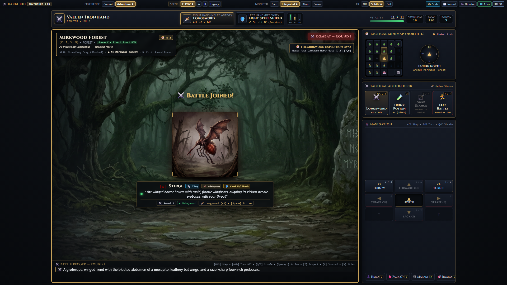
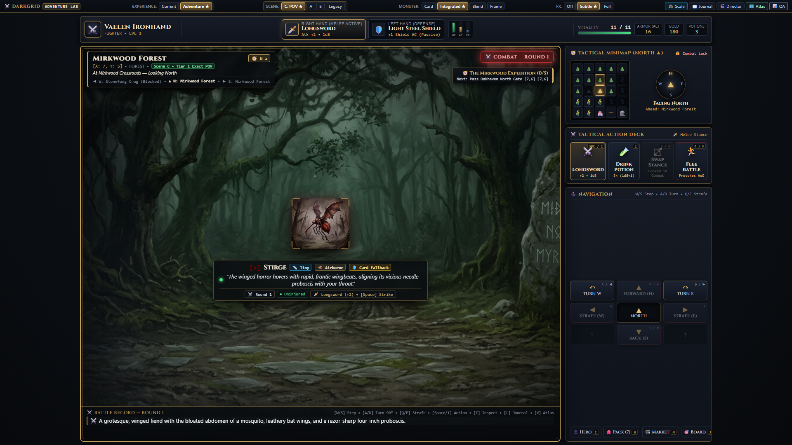

#### Goblin (Small) — Fyrir (`248×248 px`) vs. Eftir (`164×195 px`)

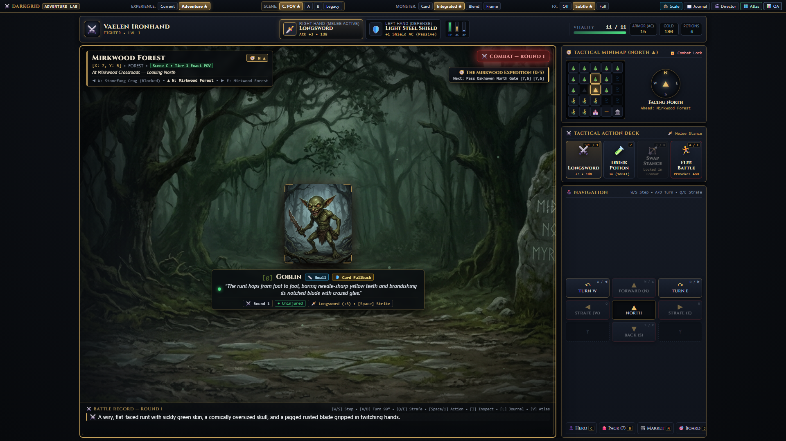

#### Giant Spider (Medium Wide Arachnid) — Fyrir vs. Eftir (`268×181 px`)
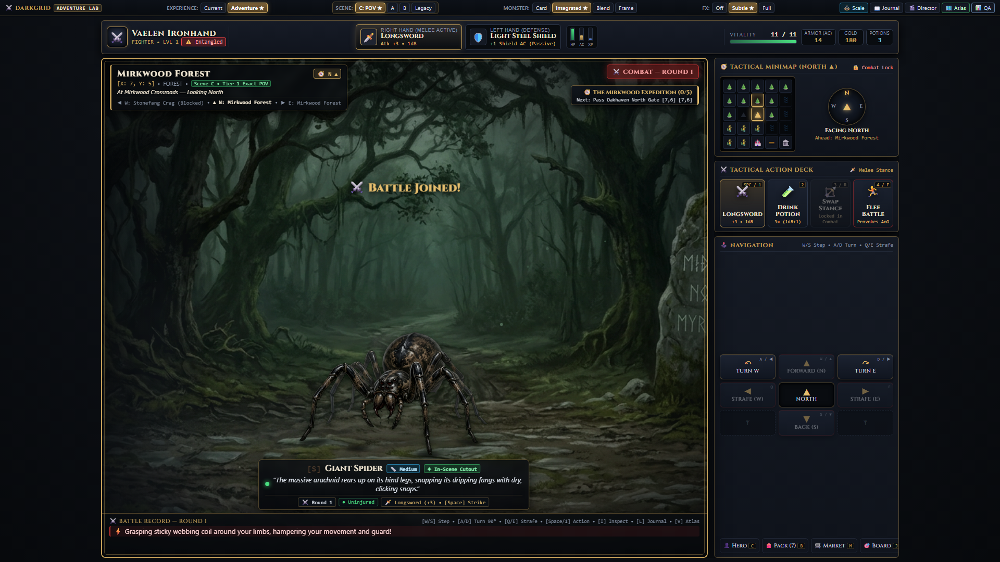
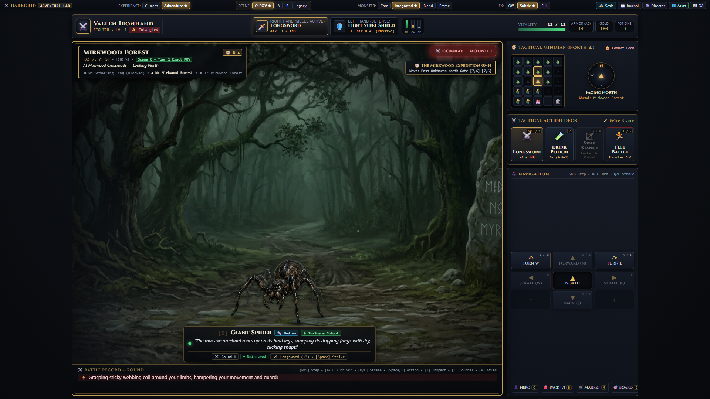

#### Troll (Large Brute) — Fyrir (`285×278 px`) vs. Eftir (`367×447 px`)
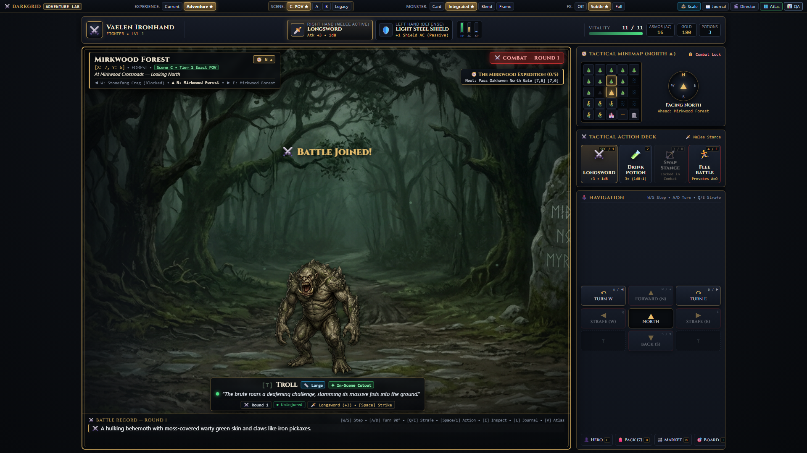
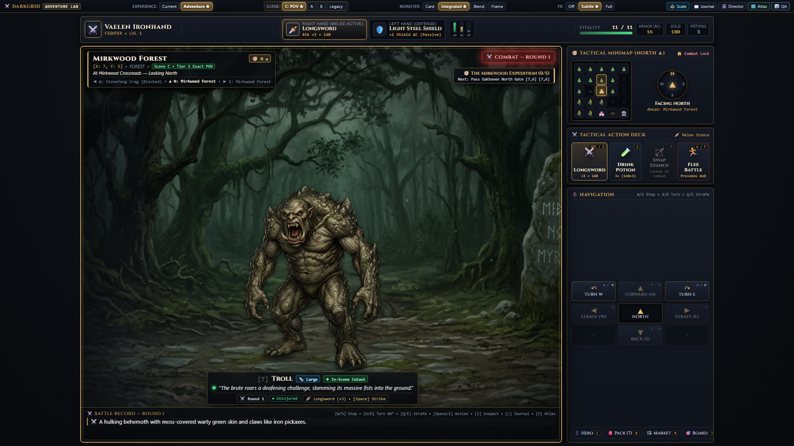

#### Beinn hlið-við-hlið samanburður í Arena: Troll (Before vs. After) og Stirge (Before vs. After)
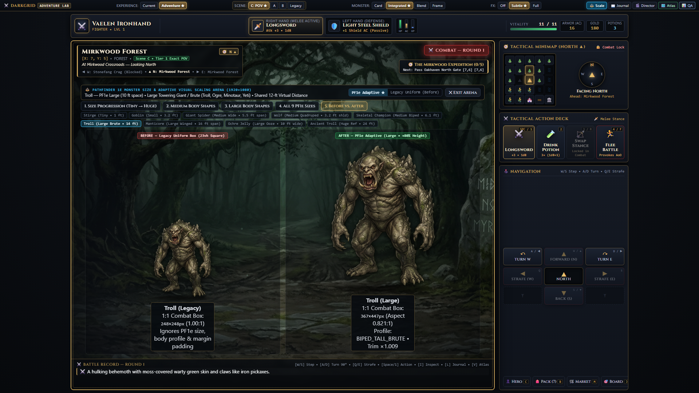
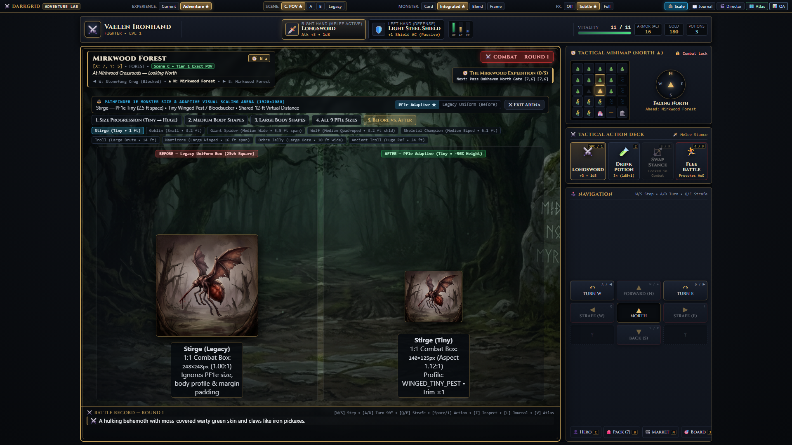

---

### 3.2 Stærðarþrep (Tiny → Small → Medium → Large → Huge) við 3 upplausnir

Prófað í **⚖️ Scale Arena** við `1920×1080`, `1440×900` og `1280×800` án nokkurs yfirflæðis (`scrollWidth <= clientWidth` og `scrollHeight <= clientHeight` staðfest í öllum þremur upplausnum):

#### `1920×1080` (Full HD)
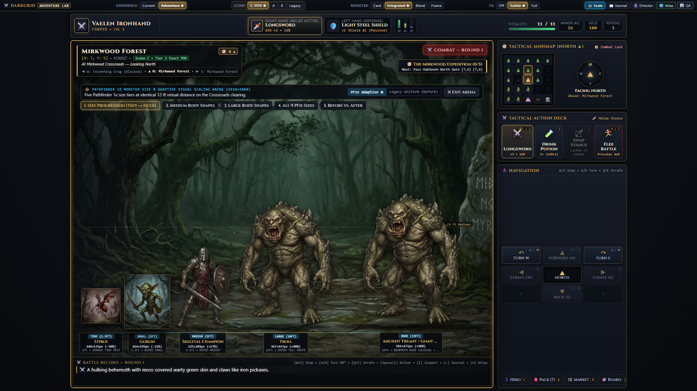

#### `1440×900` (WXGA+ Widescreen)
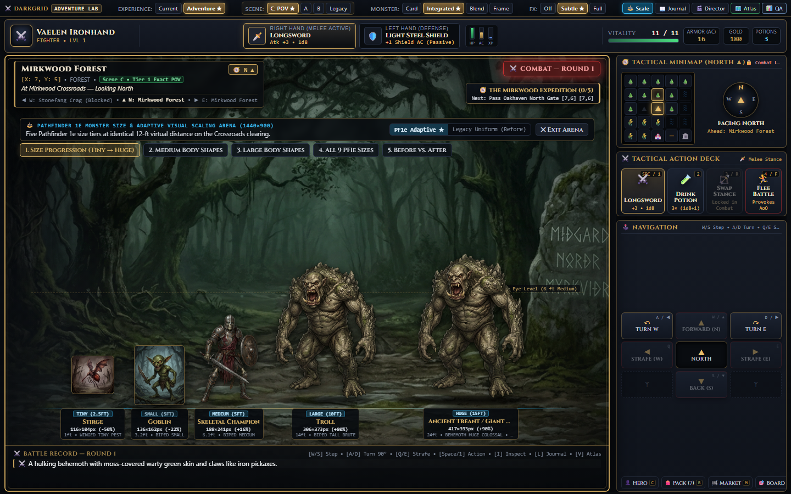

#### `1280×800` (Compact Laptop)
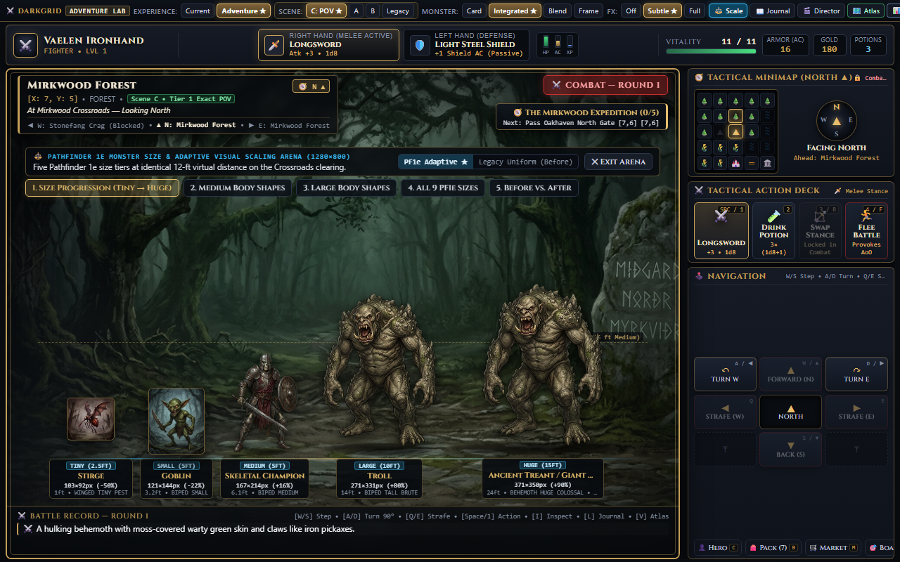

---

### 3.3 Mismunandi líkamslögun innan sama stærðarflokks

#### 5 ólík líkamslög innan `MEDIUM` (5-feta reitur):
- **Skeletal Champion** (`BIPED_MEDIUM`, `225×289 px`, hlutfall `0.78:1`) — nær upp í 6 feta augnhæðarviðmið.
- **Ghoul** (`BIPED_CROUCHED`, `253×239 px`, hlutfall `1.06:1`) — boginn í árásarstöðu.
- **Wolf** (`QUADRUPED_LOW`, `243×211 px`, hlutfall `1.15:1`) — láréttur ferfætlingur.
- **Giant Spider** (`ARACHNID_WIDE`, `268×181 px`, hlutfall `1.48:1`) — lágur búkur, breiðir fætur.
- **Harpy** (`WINGED_HOVER_MEDIUM`, `316×272 px`, hlutfall `1.16:1`) — svífandi í lofti með breiðu vænghafi.

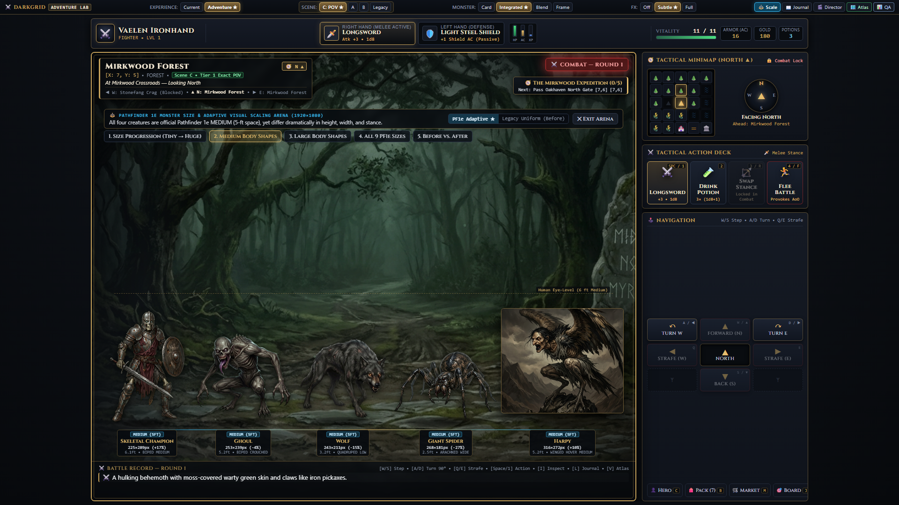

#### 5 ólík líkamslög innan `LARGE` (10-feta reitur):
- **Troll** (`BIPED_TALL_BRUTE`, `367×447 px`, hlutfall `0.82:1`) — 14 feta hátt tröll.
- **Manticore** (`WINGED_LARGE_PREDATOR`, `458×375 px`, hlutfall `1.22:1`) — 16 feta vænghaf á sveimi.
- **Winter Wolf** (`QUADRUPED_MASSIVE`, `368×317 px`, hlutfall `1.16:1`) — 9 feta langur risavargur.
- **Assassin Vine** (`PLANT_MASS_LARGE`, `361×376 px`, hlutfall `0.96:1`) — rótfast klifurflækjubákn.
- **Ochre Jelly** (`AMORPHOUS_LARGE_OOZE`, `338×245 px`, hlutfall `1.38:1`) — lág en víðáttumikil slímvera.

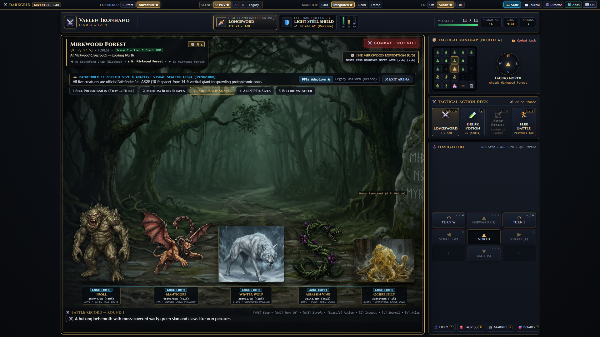

#### Allir 9 Pathfinder 1e stærðarflokkarnir (`Fine` → `Colossal`)
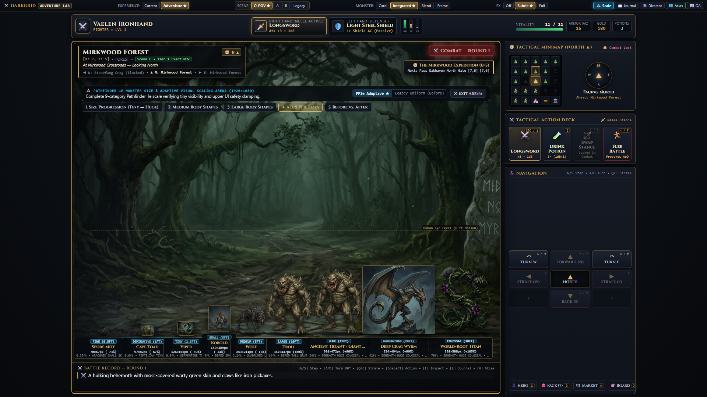

---

## 4. Tilvik þar sem sjálfvirk stærðarstilling virkar illa

Þótt sjálfvirka reikniritið skili eðlilegri stærðarupplifun fyrir mikinn meirihluta skrímslasafnsins, komu í ljós **fjórir flokkar myndrænna jaðartilvika** þar sem einföld stærðarvörpun ein og sér dugar ekki án sérreglna:

1. **Nærmyndir (Macro Close-ups) af örsmáum verum (`TINY`):**  
   Málverkin fyrir *Stirge*, *Viper*, *Blood Hawk*, *Grimslake* og *Cave Fisher Larva* voru upphaflega máluð sem nærmyndir þar sem veran fyllir ~95% af `1024×1024` rammanum ásamt stórum trjágreinum eða steinum í forgrunni. Ef `imageTrimScale` væri notað á þær eða ef þær eru birtar í spjaldaramma (Card mode), virðist umhverfið inni á spjaldinu (t.d. trjágreinin undir *Stirge*) vera í öðrum mælikvarða en skógurinn í bakgrunni.
2. **Ógegnsæ spjaldamálverk (Card Mode) á móti RGBA Cutout:**  
   Í núverandi safni eiga **7 skrímsli** hreint RGBA cutout (`assassin_vine`, `ghoul`, `giant_spider`, `manticore`, `skeletal_champion`, `troll`, `wolf`), en hin **91 skrímslin** nota `1024×1024` málverk með innmáluðum bakgrunni (og 60 þeirra eru í raun JPEG skrár með `.png` skráarendingu). Þegar spjaldamálverk af *Winter Wolf* eða *Ochre Jelly* er stækkað upp í `LARGE` stærð stækkar einnig ferhyrndi ramminn utan um bakgrunn málverksins, sem rýrir dýptartilfinninguna samanborið við RGBA cutout eins og *Troll* eða *Manticore*.
3. **Ósamhverfir dökkir Vignette-jaðrar í spjaldamálverkum:**  
   Nokkur spjaldamálverk eru með óvenju mikið dökkt tómrými efst í myndinni (t.d. `wolf.png` í Card-ham með 22,3% dökkan efri jaðar, `dire_rat.png` með 16,8%, `giant_scorpion.png` með 11,3%, `hyena.png` með 9,8% og `Shadow` með 7,4%). Án `imageTrimScale` og `imageShiftYPct` virðast þessi skrímsli allt of lítil og lágt sett í spjaldarammanum.
4. **Láréttar eða fljótandi verur í ferköntuðum upprunamyndum:**  
   Verur eins og *Giant Spider*, *Giant Crab*, *Giant Scorpion*, *Ankheg* og *Ochre Jelly* eru mun breiðari en þær eru háar, en upprunalegu myndirnar eru allar `1024×1024` (1:1). Þegar ramma þeirra er breytt í t.d. `1.48:1` í Card-ham með `object-fit: cover` þarf að passa að efsti eða neðsti hluti myndarinnar klippist ekki af; þess vegna notar kerfið `object-fit: contain` fyrir RGBA cutouts en mjúkt `imageTrimScale` og `imageShiftYPct` fyrir Card-myndir.

---

## 5. Skrímsli sem þurfa sérstaka handvirka myndstillingu (Manual Visual Overrides)

Alls eru **18 skrímsli** í `MONSTER_SIZE_CATALOG` merkt með `manualOverrideFlag` þar sem sjálfvirk stærðarvörpun þarf annaðhvort sérstaka jaðaleiðréttingu í reikniritinu (sem er þegar virk í Lab) eða handvirka RGBA-úrklippu (cutout) í næsta áfanga:

| Flokkur sérstillingar (`manualOverrideFlag`) | Skrímsli | Ástæða & Virk / Ráðlögð meðhöndlun |
| :--- | :--- | :--- |
| `CLOSEUP_PORTRAIT_CROP` | **Stirge**, **Viper**, **Blood Hawk**, **Grimslake**, **Cave Fisher Larva** | Örsmá (`TINY`) skrímsli máluð í nærmynd. Reikniritið sleppir `imageTrimScale` stækkun og heldur rammanum í `125–135 px` hæð. **Ráðlagt:** Búa til RGBA cutout án trjágreina/steina svo þau virðist raunverulega 1–2 fet í senunni. |
| `HIGH_VIGNETTE_MARGIN` | **Wolf** (Card), **Dire Rat**, **Giant Scorpion**, **Hyena**, **Shadow** | Spjaldamálverk með 10%–25% dökkum vignette-jöðrum. Reikniritið beitir `imageTrimScale` (`1.10×–1.24×`) og `imageShiftYPct` til að stækka og miðjusetja skrímslið innan rammans. |
| `WIDE_LOW_ARACHNID` | **Giant Spider**, **Giant Crab**, **Ankheg**, **Rust Monster**, **Giant Stag Beetle** | Mjög breið en lág skordýr/krabbadýr (`aspectRatio 1.26–1.48`). *Giant Spider* er þegar með RGBA cutout og 4 snertiskugga; **ráðlagt** að bæta við RGBA cutouts fyrir *Giant Crab*, *Ankheg* og *Giant Scorpion*. |
| `WIDE_OOZE_SPRAWL` | **Ochre Jelly** | `LARGE` slímvera sem á að breiða úr sér lárétt á jörðinni (`338×245 px`) í stað þess að gnæfa upp í loftið. **Ráðlagt:** RGBA cutout með mjúku gegnsæi við jarðveg. |
| `LUMINOUS_ORB_AURA` | **Will-o'-Wisp** | `SMALL` fljótandi ljóskúla þar sem ytri ljósbjarmi fyllir myndina en kjarninn er aðeins ~1 fet. Reikniritið notar `FLOATING_ORB` (`155×155 px`, `airborneLiftPx: 44`, daufan skugga). |
| `SPRIGGAN_SIZE_ALTERATION` | **Spriggan** | Hefur tvö form í Pathfinder 1e (*Small* 3 ft / *Large* 12 ft). Styður `overridePfSize: 'LARGE'` í `computeAdaptiveMonsterVisualScale`. |
| `DUAL_SOURCE_WATER_STRIDER` | **Giant Water Strider** | Tryggir að CR 0.5 útgáfan haldist í *Small* (`ARACHNID_SMALL_SKIMMER`) í samræmi við d20pfsrd Nymph tölfræði. |

---

## 6. Tillögur að næstu skrefum (Recommendations for Next Steps)

1. **Stækka RGBA Cutout safnið úr 7 í ~25 lykilskrímsli (Forgangur 1):**  
   Stærsti sjónræni munurinn í fyrstu persónu sjónarhorninu sést á þeim 7 skrímslum sem eru með hreint RGBA cutout (*Troll*, *Manticore*, *Skeletal Champion*, *Giant Spider*, *Assassin Vine*, *Ghoul*, *Wolf*). Við mælum með að útbúa RGBA cutouts (í `action-ui-lab/public/images/monsters-cutout/`) næst fyrir:
   - **Tiny verur í nærmynd:** *Stirge*, *Viper*, *Blood Hawk* (til að fjarlægja stóra forgrunnssteina/trjágreinar sem trufla stærðarskynjun).
   - **Algeng Small & Large skrímsli:** *Goblin*, *Kobold*, *Dire Rat*, *Ogre*, *Minotaur*, *Owlbear*, *Winter Wolf*, *Wyvern*, *Ochre Jelly* og *Giant Scorpion*.
2. **Bæta `size_category` og `visual_body_profile` við aðalgagnagrunn þegar tilbúið (Forgangur 2):**  
   Þegar hönnunin í `action-ui-lab/` hefur verið samþykkt er hægt að nota `MONSTER_SIZE_CATALOG` í `action-ui-lab/monster-size-catalog.js` beint til að búa til idempotent SQL migration/seed sem bætir `size_category` og `visual_profile` við `monsters` töfluna í aðalleiknum án þess að hrófla við bardagatölfræði.
3. **Tengja sýndarfjarlægð (`virtualDistanceFt`) við Stage 1 → Stage 2 bardagaskipti (Forgangur 3):**  
   Þar sem `computeAdaptiveMonsterVisualScale` styður þegar `virtualDistanceFt` breytuna er hægt að láta skrímsli birtast í **18–20 feta fjarlægð** þegar leikmaður áttar sig fyrst á þeim (t.d. í Ranger *Opening Shot* fjarlægð) og færast svo nær í **10–12 feta návígi** þegar melee-bardagi hefst.
