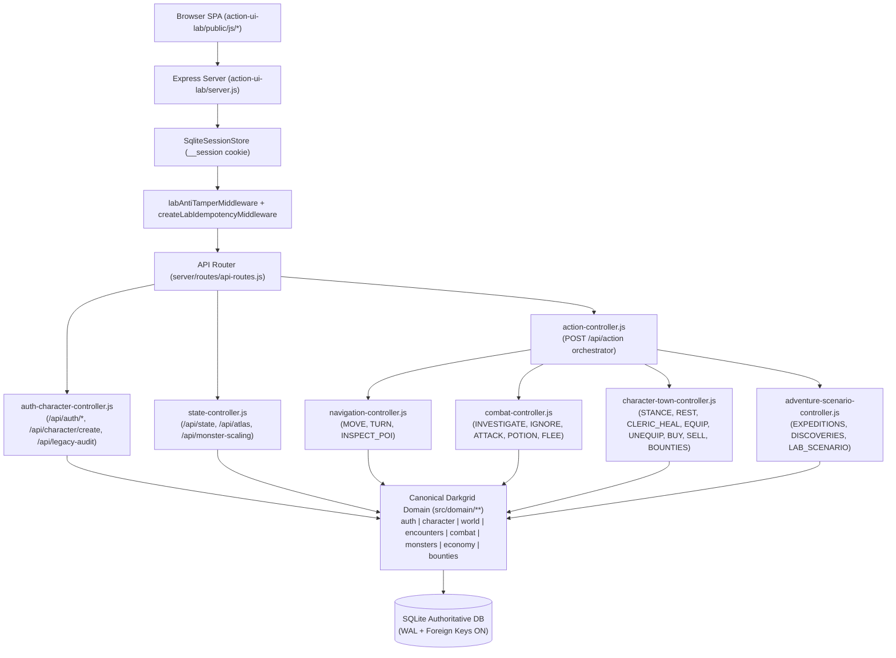

# DARKGRID — PHASE 6: MODULAR ARCHITECTURE & STATE AUTHORITY

**Date:** 2026-10-22  
**Scope:** Architecture of the integrated `action-ui-lab/` application, module responsibilities, and single-source-of-truth boundaries.

---

## 1. Architectural Principles

1. **Zero Duplication of Domain Rules:** `action-ui-lab/` does **not** re-implement d20 combat math, character creation validation, XP/level thresholds, shop pricing, loot generation, bounty generation, or permadeath persistence. It imports the canonical domain modules from `src/domain/**` directly.
2. **Strict Isolation from Legacy SSR Routes:** All Phase 6 code lives strictly inside `action-ui-lab/`. Zero files in `src/`, `db/`, or root configuration were modified.
3. **Modular Server & Frontend Responsibilities:** Both backend (`action-ui-lab/server/**`) and frontend (`action-ui-lab/public/js/**`) are split into focused, single-responsibility modules rather than monolithic files.

---

## 2. Backend Architecture (`action-ui-lab/server/`)

### Server Module Breakdown
- `action-ui-lab/server.js` — Express app factory (`createLabApp`), wiring security headers, `express-session` with `SqliteSessionStore`, `labAntiTamperMiddleware`, `createLabIdempotencyMiddleware`, static asset serving, and API routes.
- `action-ui-lab/server/services/legacy-compatibility-service.js` — Non-destructive SQLite schema adapter (`ensureNonDestructiveLabAdapter`), multi-user session resolution (`resolveRequestUserId`), anti-tamper & idempotency middlewares, database compatibility auditor (`verifyLegacyDatabaseCompatibility`), and class ability tier builder (`buildClassAbilitySummary`).
- `action-ui-lab/server/services/sandbox-db-service.js` — Database connection initialization, migration/seed runner, and default sandbox hero provisioning (`ensureLivingHero`).
- `action-ui-lab/server/services/client-state-service.js` — Authoritative state serializer (`buildClientState`) combining user session state, living or fallen character state, saving throws, class abilities, 9-slot equipment, inventory, Oakhaven market stock (standard + global resale), Watcher's Board contracts + wilderness threats, 640-viewpoint POV scene data, and active encounter/combat state.
- `action-ui-lab/server/controllers/auth-character-controller.js` — Dedicated REST handlers and action handlers for `REGISTER`, `LOGIN`, `LOGOUT`, `CREATE_CHARACTER`, and `GET /api/legacy-audit`.
- `action-ui-lab/server/controllers/action-controller.js` — Unified `POST /api/action` dispatcher delegating to `navigation-controller.js`, `combat-controller.js`, `character-town-controller.js`, and `adventure-scenario-controller.js`.

---

## 3. Frontend Architecture (`action-ui-lab/public/js/`)

- `state/store.js` — Reactive UI state store including `creatorState` (71-point allocator, class selection, Ranger Favored Enemy + subtype, weapon stance) and `authFormState`.
- `api/client.js` — Fetch wrapper (`dispatchAction`, `fetchInitialState`) with `expectedRound` combat idempotency and sequence synchronization.
- `character/character-ui.js` — Top champion bar, `renderCharacterModal` (Saving Throws, XP threshold, `+2 STR` Belt indicator, Class Pillars & Progression Tiers, 9-slot panoply), and `renderAccountAndCreatorModal` (Sign In, Register, Sign Out, and 71-Point Hero Forge).
- `inventory/inventory-ui.js` — `renderBackpackModal` (equip/unequip/quaff/sell with starter gear lock), `renderMarketModal` (3 tabs: Standard Stock + category filter, Shared Global Magical Resale Market, Sell Backpack Gear), and `renderBountiesModal` (Active Warrant + Abandon, Section A Contracts, Section B Wilderness Threats).
- `combat/combat-ui.js` & `combat/sequence.js` — Stage 1/2 combat actor rendering, 37 RGBA monster cutouts, PF1e size scaling, multi-beat combat choreography, and `renderFallenScreen` (killer metadata, tile, final battle chronicle, and Custom Hero Forge button).
- `world/scene-renderer.js`, `world/navigation.js`, `world/minimap.js`, `world/atmosphere.js` — 640-viewpoint first-person scene rendering, crossfades, atmospheric particles, Victory banner (Level-Up, Bounty Slain, Avenged Heroes), and 5×5 expandable minimap.
