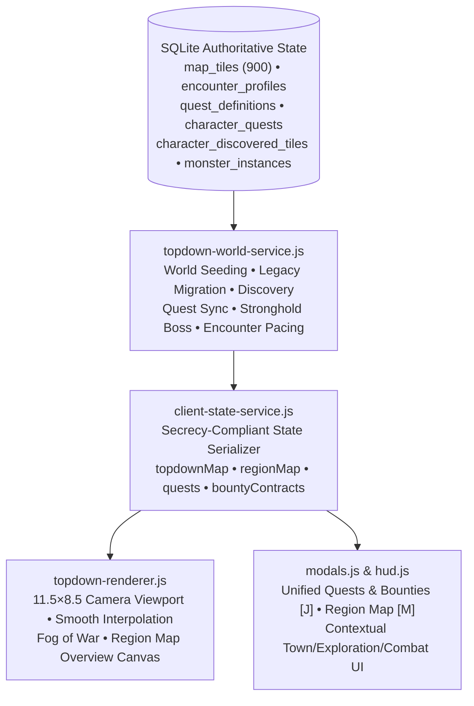

# DARKGRID — PHASE 8: TECHNICAL IMPLEMENTATION REPORT (`PHASE-8-IMPLEMENTATION.md`)

## 1. Architecture Overview

Phase 8 builds directly on the Phase 7C Action UI Lab (`action-ui-lab/`) and Top-Down Exploration Experiment 1, preserving the authoritative Darkgrid domain layer (`src/domain/`) while upgrading the world architecture, camera renderer, discovery state, quest persistence, and player UI.

---

## 2. Database Schema & Non-Destructive Adapter (`016_phase8_topdown_world_and_quests.sql`)

Created [`db/migrations/016_phase8_topdown_world_and_quests.sql`](file:///C:/Users/hih/Documents/antiDark/db/migrations/016_phase8_topdown_world_and_quests.sql) and synchronized [`action-ui-lab/server/services/legacy-compatibility-service.js`](file:///C:/Users/hih/Documents/antiDark/action-ui-lab/server/services/legacy-compatibility-service.js):

1. **Authoritative `map_tiles` Columns:**
   - `region_key TEXT NOT NULL DEFAULT 'BLACKWOOD_FOREST'`
   - `biome TEXT NOT NULL DEFAULT 'FOREST'`
   - `visual_type TEXT NOT NULL DEFAULT 'FOREST'`
   - `visual_kind TEXT NOT NULL DEFAULT 'DENSE_WOODS'`
   - `path_connections TEXT NOT NULL DEFAULT '[]'`
   - `is_landmark INTEGER NOT NULL DEFAULT 0`
   - `landmark_key TEXT NULL`
   - `encounter_profile_key TEXT NOT NULL DEFAULT 'GOBLIN_FOREST'`
   - `boss_key TEXT NULL`
2. **Data-Driven `encounter_profiles` Table:**
   - Stores `GOBLIN_FOREST` (`step_encounter_chance = 0.14`, `post_combat_grace_steps = 2`, and the 80% / 15% / 5% monster category weights JSON) and `SAFE_NONE` (`step_encounter_chance = 0.0`).
3. **Persistent Discovery Table (`character_discovered_tiles`):**
   - `PRIMARY KEY (character_id, x, y)` storing `discovered_at` timestamps per hero.
4. **General Quest Framework Tables (`quest_definitions` & `character_quests`):**
   - `quest_definitions`: Stores `THE_GOBLIN_CHIEFTAIN` (`region_key`, `giver_name`, `target_landmark_key`, `target_boss_key`, `reward_gold = 100`, `reward_xp_base = 250`).
   - `character_quests`: Tracks per-hero quest status (`NOT_ACCEPTED`, `ACTIVE`, `COMPLETED`, `REWARD_CLAIMED`), `objective_completed`, `accepted_at`, `completed_at`, and `reward_claimed_at`, kept in bidirectional sync with legacy `characters.quest_goblin_chieftain_status` and `characters.goblin_chieftain_slain`.

---

## 3. 30×30 Goblin Forest Geography & Three Routes (`topdown-world-service.js`)

Implemented in [`action-ui-lab/server/services/topdown-world-service.js`](file:///C:/Users/hih/Documents/antiDark/action-ui-lab/server/services/topdown-world-service.js):

- **Dimensions:** `30×30` (`900` tiles, `x = 0..29`, `y = 0..29`), with `681` connected passable tiles and `219` impassable barrier tiles (outer cliffs/brambles, Blackwater River channel, Stonefang Crag, Whispering Crags, Thornbriar Thickets, and Stronghold Palisades).
- **Key Locations & 13 Landmarks:**
  1. `Oakhaven` (`[15, 27]`, `CITY`, `is_safe = 1`)
  2. `Oakhaven North Gate` (`[15, 26]`)
  3. `Blackwood Crossroads` (`[15, 23]`)
  4. `The Old Stone Bridge` (`[19, 25]`)
  5. `Abandoned Watchpost` (`[21, 25]`)
  6. `The Broken Shrine` (`[7, 17]`)
  7. `Old Charcoal Camp` (`[6, 12]`)
  8. `Ancient Black Oak` (`[15, 15]`)
  9. `Ravine East Overlook` (`[22, 15]`)
  10. `Old Log Crossing` (`[20, 9]`)
  11. `Goblin Hunting Grounds` (`[15, 9]`)
  12. `Stronghold Approach` (`[15, 3]`)
  13. `Goblin Stronghold` (`[15, 2]`, boss key `WARCHIEF_GRAK`)
- **Three Distinct Routes from Oakhaven to Goblin Stronghold:**
  - **Route A — Main Forest Trail (`ROUTE_A_MAIN_TRAIL`, 32 tiles / 31 steps):** Winding central road north through `Blackwood Crossroads [15,23]`, `Ancient Black Oak [15,15]`, and `Goblin Hunting Grounds [15,9]` to `Goblin Stronghold [15,2]`.
  - **Route B — Western Wilderness Route (`ROUTE_B_WESTERN_WILDERNESS`, 44 tiles / 43 steps):** Branches west at `[15,23]` around `Stonefang Crag`, north through `The Broken Shrine [7,17]` and `Old Charcoal Camp [6,12]`, and northeast along the pine ridge to `[15,3] -> [15,2]`.
  - **Route C — Eastern River Route (`ROUTE_C_EASTERN_RIVER`, 46 tiles / 45 steps):** Crosses `The Old Stone Bridge [19,25]` to `Abandoned Watchpost [21,25]`, follows the eastern rim of Blackwater Ravine past `Ravine East Overlook [22,15]`, and crosses back over `Old Log Crossing [20,9]` (or `Upper Ford Stones [20,4]`) to `[15,2]`.

---

## 4. Camera Viewport, Smooth Movement & Discovery (`topdown-renderer.js`)

Implemented in [`action-ui-lab/public/js/world/topdown-renderer.js`](file:///C:/Users/hih/Documents/antiDark/action-ui-lab/public/js/world/topdown-renderer.js):

- **Viewport Sizing (`computeCameraViewportMetrics`):** Displays `~11.5 × 8.5` tiles on desktop regardless of total map size (`tileSize` clamped to `46..96px`).
- **Camera Centering & Clamping:** Keeps the hero centered in the interior of the map while clamping `camPxX` and `camPxY` to `[0, worldPixelSize - viewportSize]` near outer borders so no void space is shown outside the 30×30 world.
- **Smooth Movement Interpolation:** Interpolates `(heroVisualX, heroVisualY)` over `145ms` (`easeOutCubic`) on single-tile steps while snapping immediately on scenario/teleport jumps (`dist > 2.2`).
- **Camera-Offset Hit Testing (`clientPointToGridCoord`):** Translates mouse coordinates using `mx + camPxX` and `my + camPxY` so clicking adjacent passable tiles steps accurately at any camera offset.
- **Discovery & Light Fog of War:**
  - `getVisionRadiusForClass(heroClass)` in [`topdown-world-service.js`](file:///C:/Users/hih/Documents/antiDark/action-ui-lab/server/services/topdown-world-service.js) grants `RANGER` a `4`-tile scouting radius (`dx² + dy² <= 18`) vs `3` tiles (`dx² + dy² <= 10`) for `FIGHTER` and `CLERIC`.
  - Unexplored tiles render under a dark shroud (`rgba(5, 8, 7, 0.84)`); explored tiles outside current vision render in dimmed memory (`rgba(6, 10, 9, 0.36)`); tiles within active vision render at full clarity.
  - Region Map (`renderRegionMapCanvas`) renders a 30×30 overview inside the `Map [M]` modal showing discovered trails, discovered landmarks, Oakhaven, hero position, and Goblin Stronghold (only once discovered).
