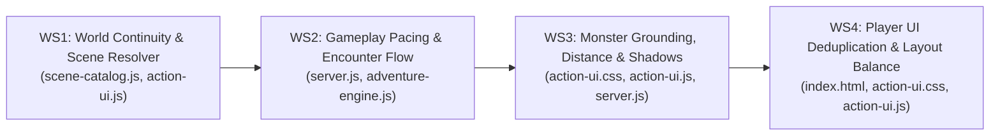

# Darkgrid Adventure Lab — Next Implementation Plan

**Dagsetning:** 2026-10-21  
**Worktree:** `C:\Users\hih\.gemini\antigravity\worktrees\antiDark\darkgrid_overnight_development` (`darkgrid_overnight_development`)  
**Umfang:** Eingöngu innan `action-ui-lab/` (engum kóða hefur verið breytt; þessi áætlun bíður samþykkis).

---

## Yfirlit og Forgangsröðun

Næsta framkvæmdalota ætti að beinast að því að **tengja saman og laga bilið á milli bakendavélanna (Tracks 1, 3, 4) og framendaviðmótsins (Track 2)** í 4 afmörkuðum verkþáttum (Workstreams), þar sem hver verkþáttur hefur skýrt eignarhald á skrám og mælanleg vafra-prófunarskilyrði.

---

## Workstream 1 — World Continuity & Scene Resolver (`P0 — Hæsta forgangur`)

### Vandamál sem verið er að leysa
1. `public/action-ui.js` les aldrei `state.adventure.continuityNote`, `horizonHint`, `revisitBanner`, `compassContext` eða `combatReturnContext`.
2. `[7,4] NORTH` (Mirkwood Trail í átt að Eikinni miklu `[7,3]`) vantar í `DEFAULT_PERSPECTIVE_VIEWS`, á meðan myndin `/lab-assets/images/perspective/forest_7_4_north_oak_approach.jpg` er ranglega sett á `[7,3] EAST` og `[7,3] WEST`.
3. `computeDeterministicVariantIndex` í `scene-catalog.js` veldur því að `NORTH` (`+0`) og `WEST` (`+3`) fá **alltaf nákvæmlega sömu mynd** þegar `povPool.length === 3` (`(x+0)%3 === (x+3)%3`).
4. `FOREST` myndbrigðið `forest_tangled_canopy` notar hitabeltismyndina `/images/terrain/terrain_jungle.webp` (24 af 148 skógarsjónarhornum).
5. `pov_forest_track_east` sýnir `crossroads_7_5_east.jpg` á öllum skógarreitum þegar horft er í austur, og `pov_transition_swamp_to_plains` notar sömu mynd og `pov_transition_plains_to_swamp`.
6. `Deadman's Mire [4,11]` sýnir nákvæmlega sömu myndina í allar 4 höfuðáttir (`N, E, S, W`).

### Nákvæmar breytingar (Skrár og línur)
- **[`action-ui-lab/scene-catalog.js`](../../scene-catalog.js):**
  1. **Línur 1358–1403 (`DEFAULT_PERSPECTIVE_VIEWS`):**
     - Bæta við Tier 1 færslu `fp_mirkwood_trail_7_4_north` (`tile_x: 7, tile_y: 4, facing: 'NORTH'`) sem bendir á `/lab-assets/images/perspective/forest_7_4_north_oak_approach.jpg`.
     - Bæta við `fp_mirkwood_trail_7_4_south` (`tile_x: 7, tile_y: 4, facing: 'SOUTH'`) sem vísar til baka á vegamótin (`crossroads_7_5_north.jpg` eða sérhæfða vegamótasýn).
     - Uppfæra `fp_ancient_oak_7_3_east` og `fp_ancient_oak_7_3_west` þannig að þær sýni skógarhlíðar út frá eikinni í stað nálgunarmyndarinnar að eikinni.
  2. **Línur 78–90 & 3331–3339 (`computeDeterministicVariantIndex` og Tier 4 val):**
     - tryggja að 4 höfuðáttir á sama reit (`N, E, S, W`) lendi aldrei á sama myndbrigði við 90° eða 180° snúning (t.d. með því að stækka Tier 4 POV-laug hvers landsvæðis í `>= 4` gildar POV-myndir og nota permutaðan áttarvísi `[0, 1, 2, 3]` per `(x, y)`).
  3. **Línur 206–260 (`DEFAULT_SCENE_VARIANTS` fyrir `FOREST`):**
     - Skipta `/images/terrain/terrain_jungle.webp` út úr `FOREST` fyrir kaldari norræna skógarmynd (`/lab-assets/images/terrain/forest_pine_ravine.jpg` eða `/lab-assets/images/perspective/crossroads_7_5_lateral.jpg`).
  4. **Línur 1405–1435 (`Deadman's Mire [4,11]`) & `DEFAULT_POV_CONTEXT_RULES`:**
     - Aðgreina `N, E, S, W` á `[4,11]` (t.d. `deadmans_mire_4_11_ruins.jpg` í `NORTH`, `swamp_approach_mire_ruins.jpg` í `SOUTH`, `swamp_willow_boardwalk_pov.jpg` í `EAST` og `terrain_swamp.webp` í `WEST`).
     - Takmarka `pov_forest_track_east` við vegamótin eða fjarlægja hana úr almennum Tier 3 reglum svo skref í austur um skóginn festist ekki á sömu myndinni.
- **[`action-ui-lab/public/action-ui.js`](../../public/action-ui.js):**
  1. **Línur 2736–2770 (`renderViewportCenterStage` — `.fp-vista-bar`):**
     - Birta `state.adventure.horizonHint` og `state.adventure.revisitBanner` (ef til staðar) í `.fp-vista-bar` í stað þess að endurtaka eingöngu hrátt heiti reitsins.
  2. **Línur 2832–2848 (`renderBottomChronicle`):**
     - Birta `state.adventure.continuityNote` (eða `combatReturnContext.groundedReturnNote` strax eftir bardaga) sem fyrstu línu í Chronicle á undan staðarlýsingu reitsins, þannig að hvert skref og snúningur segi samfellda sögu.

### Prófunarskilyrði (Acceptance Criteria)
- Á `[7,4] NORTH` birtist `forest_7_4_north_oak_approach.jpg` (Tier 1) og textinn í `.fp-vista-bar` nefnir Primeval Black Oak framundan.
- `0` skógarreitir (`FOREST`) birta `terrain_jungle.webp`.
- Enginn 90° eða 180° snúningur á staðnum heldur óbreyttri mynd á neinum af 12 helstu kennileitareitunum.
- Í raunverulegum vafra birtist `continuityNote` í `#fp-chronicle-lines` við hvert skref og snúning.

---

## Workstream 2 — Gameplay Pacing & Encounter Flow (`P1`)

### Vandamál sem verið er að leysa
1. `server.js` kallar á `checkTileEncounter` á hverju skrefi án tillits til `postCombatBreathingSteps` eða `stepsSinceLastEncounter`.
2. `server.js` sendir aðeins 5 viðföng í `onPlayerStep` og sleppir `persistentAlert`, `adjacentPersistentCount` og `{ facing, moveAction }`.
3. Handskrifaðir `exactTiles` discovery-atburðir á `[7,5]`, `[7,4]` og `[7,3]` kveikja á 3 discovery-spjöldum á 3 skrefum í röð.
4. Bæjarhliðin `[7,6]` og `[7,8]` kveikja á bardögum strax á fyrsta skrefi út úr Oakhaven.

### Nákvæmar breytingar (Skrár og línur)
- **[`action-ui-lab/server.js`](../../server.js):**
  1. **Línur 1892–1921 (`action === 'MOVE'`):**
     - Lesa `advState = getOrCreateAdventureState(character.id, currentTile)` áður en kastað er upp á bardaga.
     - Ef `advState.enabled` er virkt:
       - Sleppa tilviljunarkenndum bardaga (`checkTileEncounter`) ef `advState.postCombatBreathingSteps > 0` (nema lifandi persistent skrímsli/bounty sé á reitnum).
       - Veita 1–2 skrefa grið við bæjarhliðin (`[7,6]` og `[7,8]`) þegar gengið er beint út úr Oakhaven (`[7,7]`).
     - Reikna `persistentAlert` og `adjacentPersistentCount` fyrir `targetTile` og senda þau ásamt `{ facing: currentFacing, moveAction: moveKind, db }` inn í `onPlayerStep`.
- **[`action-ui-lab/adventure-engine.js`](../../adventure-engine.js):**
  1. **Línur 949–973 (`selectDiscoveryForTile`):**
     - Ef bardagi var á síðasta skrefi (`stepsSinceLastEncounter === 0`), fresta `AMBIENT` og `NOTICEABLE` discovery-borðum svo leikmaðurinn fái öndunarrými.
     - Breyta `[7,4]` (*Abandoned Scout Camp*) úr risa-spjaldi (`IMPORTANT`) í þjált `NOTICEABLE` borðaspjald sem leikmaður getur valið að skoða (`Examine Closer`), svo það hylji ekki Eikina miklu þegar gengið er eftir Norðurleiðinni.

### Prófunarskilyrði (Acceptance Criteria)
- Í 40 skrefa ferðalagi um óbyggðir eru að minnsta kosti **45–55% skrefa róleg (`QUIET_TRAVEL`)**, og aldrei koma tveir tilviljunarkenndir bardagar á tveimur skrefum í röð (`backToBackEncounters === 0`).
- Þegar gengið er á reit við hliðina á lifandi skrímsli (`adjacentPersistentCount > 0`) birtist `GENUINE_EVIDENCE • NEARBY SURVIVOR` borðinn strax á því skrefi.

---

## Workstream 3 — Monster Grounding, Distance & Shadows (`P1`)

### Vandamál sem verið er að leysa
1. `61 af 98` skrímslum (`CARD` fallback) svífa í miðju lofti (`footYInViewportPct = 56–60%`) með skugga í lausu lofti vegna þess að `.fp-monster-actor.is-card-monster` vantar gólfestingu.
2. `--stage-floor-y` og `--monster-offset-y` eru sett á `#fp-monster-actor` í JS en aldrei notuð í `action-ui.css`; `.fp-monster-hud-plate` (`97 px` hátt) ýtir öllum skrímslum ~100 px upp.
3. `computeClientMonsterVisualScale` í `action-ui.js` harðkóðar `virtualDistanceFt: 12` óháð vopnastöðu (`isRangedActive`) og lotu.
4. Öll 30 nýju cutout-skrímslin nota sniðmátsskugga (`sc.shadow.contactPatches`) í stað skugga sem passa við raunverulega fætur/klær í myndinni.

### Nákvæmar breytingar (Skrár og línur)
- **[`action-ui-lab/public/action-ui.css`](../../public/action-ui.css):**
  1. **Línur 1153–1254 & 1405–1411 (`.fp-monster-actor`, `.is-card-monster`, `.fp-monster-hud-plate`):**
     - Festa bæði `.is-integrated-monster` og `.is-card-monster` við gólflínu senunnar (`--stage-floor-y`) og virkja `translateY(var(--monster-offset-y, 0px))` á `.fp-monster-stage-figure`.
     - Stilla `.fp-monster-hud-plate` sem þétta, hálfgagnsæja nafn- og ástandsplötu við neðri brún senunnar þannig að hún ýti ekki `.fp-monster-portrait-box` upp í loftið/trjákrónurnar.
- **[`action-ui-lab/public/action-ui.js`](../../public/action-ui.js):**
  1. **Línur 277–300 (`computeClientMonsterVisualScale`):**
     - Ef leikmaður er í `Ranged Stance` (`state.combatStats.isRangedActive && enc.combat_round === 1`), nota `virtualDistanceFt: 16` (`RANGED_ENGAGEMENT`), annars `12` (`MELEE_ENGAGEMENT`).
- **[`action-ui-lab/scripts/produce-monster-cutouts.js`](../../scripts/produce-monster-cutouts.js) & [`action-ui-lab/server.js`](../../server.js):**
  - Mæla sjálfkrafa raunverulega snertipunkta í neðstu 10% hvers cutout-skrímslis (`alpha > 80` klasa á X-ás) og vista nákvæma `contactPatches` fyrir öll 37 cutout-skrímslin.

### Prófunarskilyrði (Acceptance Criteria)
- Í Chromium vaframælingu við `1920×1080` eru fætur jarðbundinna skrímsla (bæði `INTEGRATED` og `CARD`) innan `±3%` frá `stageFloorY` (`80,5%–83,5%` af hæð viewportsins), aldrei uppi í `56–60%`.
- Í `Ranged Stance` á Round 1 birtist skrímsli í `16 ft` fjarlægð (`~0.75×` stærð miðað við `12 ft` návígi) og færist í `12 ft` þegar návígi hefst.

---

## Workstream 4 — Player UI Deduplication & Layout Balance (`P2`)

### Vandamál sem verið er að leysa
1. `#dm-movement-deck` í hægri dálki er `596 px` hátt við `1920×1080` en inniheldur aðeins `210 px` af efni (`~386 px` tómt dökkt bil).
2. `.dm-shell` (`max-width: 1540px`) skilur eftir `388 px` af auðum svörtum jaðri við `1920×1080`.
3. Sama upplýsingin er endurtekin allt að 6 sinnum á skjánum (Átt 6×, Ahead 3×, Stance 3×, HP/AC 2× hlið við hlið, Pack 2×, Hero 2×, Potions 2×).

### Nákvæmar breytingar (Skrár og línur)
- **[`action-ui-lab/public/index.html`](../../public/index.html) & [`action-ui-lab/public/action-ui.css`](../../public/action-ui.css):**
  1. **Stækka `.dm-shell` hámarksbreidd** úr `1540px` í `1760px` (eða `96vw`) svo 1. persónu glugginn njóti sín á `1920×1080` skjám.
  2. **Sameina tvíteknar upplýsingar í `#dm-top-deck`:**
     - Fjarlægja `.dm-vertical-pillars` (eða gera þær valkvæðar í Lab Tools) þar sem `.dm-vitals-readout` sýnir þegar HP-stiku, AC, Gold og Potions 10 px hægra megin.
     - Fjarlægja `#btn-quick-stance` og `#btn-quick-pack` úr `#dm-top-deck` þar sem vopnareitirnir 2 (`#slot-main-hand` / `#slot-off-hand`) og `Slot 3 [3/R]` + `🎒 Pack [B]` eru þegar á skjánum.
  3. **Endurhanna hægri dálkinn (`.dm-right-deck`) svo `386 px` tóma bilið hverfi:**
     - Breyta `.dm-right-deck` úr `grid-template-rows: auto auto minmax(0, 1fr)` í þéttari röðun (`auto auto auto 1fr`) þar sem:
       - **Kort 1:** `🧭 Minimap & Compass` (sameina áttavita- og minimap-upplýsingar án tvítekningar).
       - **Kort 2:** `⚔️ Tactical Actions [1–4]`.
       - **Kort 3:** `🕹️ First-Person Navigation Pad` (þétt `210 px` spjald án `386 px` tómrar eyðu).
       - **Kort 4 (`1fr`):** **`🧭 Wayfinder & Field Bearings` spjald** sem birtir nýju `travelContinuity` gögnin úr Track 1: virkt markmið (`activeObjectiveHint`), vegferðarslóð (`breadcrumbSummary`), áttavita-kennileiti (`compassContext.ahead / left / right / behind`) og stöðu reits (`revisitBanner`).
  4. **Einfalda `#fp-location-plaque` ofan á 1. persónu senunni:**
     - Minnka skiltið efst til vinstri í 2 hreinar línur (Staðarnafn + Hnit/Landslag) svo það skyggi síður á málverkið.

### Prófunarskilyrði (Acceptance Criteria)
- Tómt bil inni í `#dm-movement-deck` fer úr `386 px` niður í `< 24 px` við `1920×1080`.
- Áttarvísinum (`NORTH`), Stance-hnappnum og HP/AC-mælum er ekki lengur tví- eða sexfaldað á sama skjá.
- Nýja `Wayfinder & Field Bearings` spjaldið í hægri dálki birtir lifandi gögn úr `travel-continuity.js` á hverju skrefi.
