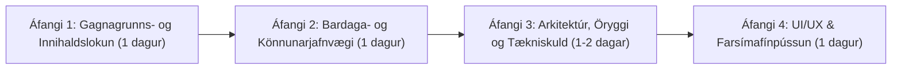

# Darkgrid — Óháð heildarúttekt á verkefninu (Independent Full Project Review)

**Dagsetning úttektar:** 14. október 2026  
**Úttektaraðili:** Óháður yfirúttektaraðili (Independent Project Auditor)  
**Umfang:** Allur frumkóði (`src/`), gagnagrunns-migrations (`db/migrations/001`–`012`), gagnagrunns-seeds (`db/seeds/001`–`009`), framendaviðmót (`src/views/`, `public/`), Firebase-dreifingarlag (`src/firebase/`, `scripts/build_firebase.js`, `firestore.rules`, `apphosting.yaml`), prófasvíta (`tests/`, 214 próf í 16 skráarsöfnum), og öll hönnunar- og stöðuskjöl í `.agents/` og `docs/`.  
**Aðferðafræði:** Bein kóðarýni á allar skrár verkefnisins, keyrsla á sjálfvirkum prófum (`npm test`), bein SQL-greining á bæði lifandi diskagagnagrunni (`db/darkgrid.sqlite`) og hreinum minnisgagnagrunni, og Monte Carlo bardagahermun (`10.080` hermdir bardagar yfir stig 1–5 fyrir allar þrjár hetjustéttir og öll aðgengileg skrímsli). Engu var breytt í forritskóða eða gagnagrunni verkefnisins.

> **Merkingar um vissu í skýrslunni:**
> - **[STAÐFEST]** — Sannað með beinni kóðalínu, SQL-fyrirspurn á gagnagrunn, sjálfvirku prófi eða keyrslu í hermi.
> - **[LÍKLEGT]** — Sterkar líkur út frá kóðauppbyggingu, stærðfræðilegu líkani eða hegðun undir álagi.
> - **[ÞARFNAST PRÓFUNAR]** — Atriði sem krefst lifandi vafra-/tækjaprófunar eða álagsprófunar í raunumhverfi (ekki framkvæmt í þessari read-only úttekt).

---

## 1. Executive Summary

**Darkgrid** er metnaðarfullt, vel afmarkað og andrúmslofts-ríkt dark-fantasy single-player RPG með „shared-world" áhrifum (varanlegum skrímslum sem erfa herfang fallinna hetja og sameiginlegum endursölumarkaði í Oakhaven), byggt að hluta á Pathfinder 1e d20 reglum.

Það sem er **vel gert** í verkefninu:
1. **Kjarnalénsrökfræði (Domain Architecture) í Node.js/Express hlutanum** er hrein, vel einangruð (`src/domain/*`) og notar samstilltar SQLite-færslur (`withTransaction` í [`src/db/connection.js`](file:///c:/Users/hih/Documents/antiDark/src/db/connection.js#L71-L97)) af öryggi.
2. **Andrúmsloft og sjónræn stefna** eru sterk: 68 skrímsli með tvöföldum myndum (lifandi og sigruð í `public/images/monsters/` og `public/images/monsters-defeated/`), 80 landslagsbakgrunnar, dularfullar skynjunarlýsingar áður en skrímsli er afhjúpað (Encounter Secrecy) og 9 stigvaxandi ástandslýsingar í stað hráa HP-mælis á skrímslum.
3. **Nýlegar viðbætur (Lotu 3–4)** — sérhæfni skrímsla (`src/domain/combat/abilities.js`), stéttarhæfileikar hetja, The Watcher's Board (Hunting Contracts og Nemesis Bounties í `src/domain/bounties/board.js`) og verslun í Oakhaven (`src/domain/economy/shop.js`) — hafa gefið leiknum mun dýpri grunnlykkju en hann hafði í upphafi.

**Hins vegar leiddi óháð rannsókn á raunverulegum kóða og gagnagrunni í ljós alvarleg misræmi við fyrri stöðuskýrslur verkefnisins (`docs/darkgrid-complete-review.md`, `docs/post-rebalance-combat-report.md`):**

1. **[STAÐFEST — P0 Critical] Alvarlegt arkitektúr- og öryggisrof í Firebase Spark-útgáfunni:**  
   Þótt allar reglur verkefnisins ([`.agents/rules/darkgrid_rules.md`](file:///c:/Users/hih/Documents/antiDark/.agents/rules/darkgrid_rules.md#L5-L12)) kveði ófrávíkjanlega á um **Server-Side Truth** (ekkert RNG, bardagareikningar eða gagnagrunnsval í vafra), þá gerir Firebase Spark-útfærslan ([`src/firebase/spark-client.js`](file:///c:/Users/hih/Documents/antiDark/src/firebase/spark-client.js#L1-L1321) og [`scripts/build_firebase.js`](file:///c:/Users/hih/Documents/antiDark/scripts/build_firebase.js#L1-L148)) nákvæmlega hið gagnstæða: hún sendir allan SQLite-gagnagrunninn (`dist/seed.sqlite` með öllum földum tölum skrímsla) í vafrann, keyrir alla bardaga- og teningavélina í vafra spilarans, og leyfir í [`firestore.rules`](file:///c:/Users/hih/Documents/antiDark/firestore.rules#L278-L324) hvaða innskráðum notanda sem er að skrifa beint í Firestore hvaða `level` (allt að 20), `gold` (allt að 10 milljónir), `inventory_json` og `is_alive: 1` (lífga við dauðar permadeath-hetjur!) sem hann vill. Þar að auki yfirskrifar `pushStateToFirestore()` öll sameiginleg `persistent_monsters` og `market_listings` skjöl í Firestore án samstillingar, og `hunting_contracts` (bounties) glatast við hvert refresh í Firebase-ham.
2. **[STAÐFEST — P0 Critical] Gagnatap og leki á lykli í `apphosting.yaml`:**  
   Í [`apphosting.yaml`](file:///c:/Users/hih/Documents/antiDark/apphosting.yaml#L5-L19) er `minInstances: 0` og `DB_PATH: /tmp/darkgrid.sqlite`, sem þýðir að í hvert sinn sem Cloud Run / App Hosting gámurinn skalar niður í 0 eða endurræsist, þurrkast allur SQLite-gagnagrunnurinn út. Í sömu skrá er framleiðslu-`SESSION_SECRET` harðkóðað í hreinum texta í git.
3. **[STAÐFEST — P0/P1] 36 af 113 hlutum í gagnagrunninum (31,9%) — þ.m.t. 26 virkir galdrahlutir og allir 3 Legendary hlutirnir — eru 100% ófáanlegir í leiknum:**  
   17 virkir `+1`/`+2` vopna-, brynju- og skjaldahlutir eru í **engri** loot-töflu (`0` línur í `loot_table_entries`) og ekki seldir í búðinni (þótt `009_rebalance_and_special_abilities.sql` hafi uppfært lýsingar þeirra!). 9 hlutir til viðbótar (þ.m.t. *Holy Avenger +3*, *Oathbow +3*, *Crown of the Sunken King*, *Full Plate +2*) eru eingöngu í `DRAGON_HOARD` loot-töflunni, sem krefst `creature_type = 'DRAGON'`, en það eru **0 drekar (`DRAGON`)** í `monsters` töflunni!
4. **[STAÐFEST — P0/P1] 12 af 68 skrímslum (17,6%) geta aldrei birst í leiknum og 3 af 14 Ranger Favored Enemy valmöguleikum gefa 0% bónus:**  
   Á 15×15 heimskortinu (`map_tiles`) eru öll `MOUNTAINS`, `OCEAN` og `RIVER_LAKE` ógeng (`is_passable = 0`), `CITY` er öruggur reitur (`is_safe = 1`), og landslagsgerðirnar `UNDERGROUND_RUINS`, `DESERT`, `COAST`, `AQUATIC` og `EXTRAPLANAR` eru **ekki til á kortinu**. Því geta 12 skrímsli (t.d. *Drow, Duergar, Skeletal Champion, Mummy, Doppelganger, Phase Spider*) aldrei birst — jafnvel þótt fyrri skýrsla (`docs/post-rebalance-combat-report.md`) hafi sérstaklega „endurstillt" *Phase Spider*! Ennfremur veldur þetta því að nýr Ranger sem velur `Dragon`, `Humanoid (Drow)` eða `Humanoid (Duergar)` í hetjusköpun ([`src/views/create-character.ejs`](file:///c:/Users/hih/Documents/antiDark/src/views/create-character.ejs#L91-L106)) fær **aldrei** Favored Enemy bónusinn sinn í öllum leiknum.
5. **[STAÐFEST — P1] Ólokið/ósamkvæmt ástand í vinnutré (`git status`) og villur í lénsrökfræði:**  
   29 breyttar skrár og 18 óskráðar skrár liggja ócommittaðar í vinnutrénu. Í kóðanum eru einnig:
   - **CamelCase vs. Snake_Case villa** milli [`src/domain/combat/engine.js`](file:///c:/Users/hih/Documents/antiDark/src/domain/combat/engine.js#L447) og [`src/domain/combat/victory.js`](file:///c:/Users/hih/Documents/antiDark/src/domain/combat/victory.js#L80-L87) þegar annar spilari drepur persistent skrímsli á undan.
   - **„Mule-feeding" svindl á byrjunarbúnaði** þar sem hægt er að láta ókeypis Level 1 hetjur deyja viljandi á reit við hlið Oakhaven og safna hundruðum gullpeninga á aðalhetju.
   - **Ambush rökfræðigalli** þar sem spilarinn getur alltaf smellt á `"Bypass & Ignore"` með 100% árangri jafnvel þegar skrímsli situr fyrir honum (`is_ambush = 1`).
   - **Stig 6–10 innihaldstóm:** Hámarksstig hetju er 10, en hæsta skrímsli í leiknum er stig 5 (`solo_level = 5`).

---

## 2. Current Project Status

Eftirfarandi tafla flokkar öll undirkerfi Darkgrid út frá **raunverulegri virkni í kóða og gagnagrunni** (ekki út frá óskhyggju í hönnunarskjölum):

| Kerfi / Eiginleiki | Staða | Rökstuðningur og sannanir í kóða |
| :--- | :--- | :--- |
| **Auðkenning (Auth & Sessions)** | **Fully implemented** | [`src/domain/auth/service.js`](file:///c:/Users/hih/Documents/antiDark/src/domain/auth/service.js), `scrypt` lykilorðasöltun, CSRF-vörn ([`src/middleware/csrf.js`](file:///c:/Users/hih/Documents/antiDark/src/middleware/csrf.js)). Hefur þó minnisleka í `MemoryStore` og `authAttempts` (sjá kafla 10–11). **[STAÐFEST]** |
| **Hetjusköpun og 3 stéttir (Fighter, Ranger, Cleric)** | **Fully implemented** | [`src/domain/character/rules.js`](file:///c:/Users/hih/Documents/antiDark/src/domain/character/rules.js), 68+3 punkta úthlutun, upphafsbúnaður, Favored Enemy og Primary Weapon. Hins vegar eru 3 Favored Enemy valmöguleikar dauðir (0 skrímsli) og villuendurhleðsla í [`public/js/character-builder.js`](file:///c:/Users/hih/Documents/antiDark/public/js/character-builder.js#L160-L162) þurrkar út val spilarans. **[STAÐFEST]** |
| **15×15 Heimskort og 5×5 Minimap** | **Partially implemented** | [`src/domain/world/map.js`](file:///c:/Users/hih/Documents/antiDark/src/domain/world/map.js) og [`db/seeds/001_seed_world.sql`](file:///c:/Users/hih/Documents/antiDark/db/seeds/001_seed_world.sql) virka fyrir 6 landslagsgerðir, en 5 landslagsgerðir sem skrímsli og listaverk vísa í vantar alveg á kortið og 3 til viðbótar eru 100% ógengar. **[STAÐFEST]** |
| **Slóðvísir (Pathfinder / Waypoint Route Planner)** | **Fully implemented** | BFS-reiknirit (`findShortestPath`) í [`src/domain/world/map.js`](file:///c:/Users/hih/Documents/antiDark/src/domain/world/map.js#L298-L433) með sjálfvirkri stöðvun við fundið skrímsli. **[STAÐFEST]** |
| **Skynjun og Encounter Secrecy** | **Partially implemented** | [`src/domain/encounters/engine.js`](file:///c:/Users/hih/Documents/antiDark/src/domain/encounters/engine.js) velur skrímsli með Gaussian dreifingu og felur nafn/mynd í `DISCOVERED` stöðu. **Gallar:** 12 af 68 skrímslum eru óaðgengileg, og `is_ambush = 1` kemur hvorki í veg fyrir `"Bypass & Ignore"` né gefur skrímslinu frumkvæði í bardaga. **[STAÐFEST]** |
| **Bardagavél (Melee, Ranged, Potions, Flee, Class Abilities)** | **Fully implemented** | [`src/domain/combat/engine.js`](file:///c:/Users/hih/Documents/antiDark/src/domain/combat/engine.js) og [`src/domain/combat/abilities.js`](file:///c:/Users/hih/Documents/antiDark/src/domain/combat/abilities.js). Styður d20, critical confirmation, 9 ástandslýsingar, stéttarhæfileika og 19 sérhæfni skrímsla. Hefur þó jafnvægisvanda á stigi 1 og fyrir Cleric á stigum 4–5. **[STAÐFEST]** |
| **Permadeath & Persistent Monsters** | **Fully implemented** | [`src/domain/monsters/persistence.js`](file:///c:/Users/hih/Documents/antiDark/src/domain/monsters/persistence.js). Flytur 50% gulls og 50% hluta á skrímslið, gefur `+10% HP` við fyrsta víg og býr til sæmdarheiti (`custom_title`). Opnar þó fyrir „mule-feeding" exploit og hefur camelCase/snake_case villu við concurrent sigur. **[STAÐFEST]** |
| **Oakhaven Verslun & Shared Resale Market** | **Fully implemented** | [`src/domain/economy/shop.js`](file:///c:/Users/hih/Documents/antiDark/src/domain/economy/shop.js). Kaup/sala með Charisma-áhrifum og sameiginlegur endursölumarkaður (`market_listings`). **[STAÐFEST]** |
| **The Watcher's Board (Hunting Contracts & Nemesis Bounties)** | **Partially implemented** | [`src/domain/bounties/board.js`](file:///c:/Users/hih/Documents/antiDark/src/domain/bounties/board.js) virkar vel í Express/SQLite-ham, en **er ótengt Firestore í Firebase Spark-ham** (samningar hverfa við refresh). **[STAÐFEST]** |
| **Herfang (Loot Tables & Item Progression)** | **Broken or potentially unreliable** | Í [`db/seeds/007_seed_expanded_items_and_loot_tables.sql`](file:///c:/Users/hih/Documents/antiDark/db/seeds/007_seed_expanded_items_and_loot_tables.sql) og [`src/domain/combat/loot.js`](file:///c:/Users/hih/Documents/antiDark/src/domain/combat/loot.js) eru **26 virkir hlutir (þ.m.t. 17 `+1`/`+2` vopn/brynjur og allir 9 `DRAGON_HOARD` hlutir) 100% ófáanlegir** í leiknum. **[STAÐFEST]** |
| **10-hluta „Deeper Progression" (Buff Potions, Wondrous Items, Traps, Wandering Monsters, Cursed Items)** | **Partially implemented / Planned only** | 10 hlutir eru í gagnagrunninum en harðkóðaðir í `INACTIVE_ITEM_NAMES` í [`src/domain/combat/loot.js`](file:///c:/Users/hih/Documents/antiDark/src/domain/combat/loot.js#L13-L24) og fjarlægðir úr verslun. Engin rökfræði er til fyrir gildrur (traps), bölvaða hluti (cursed items) eða reika-skrímsli (wandering monsters). **[STAÐFEST]** |
| **Stig 6–10 Leikinnihald (Endgame Content)** | **Planned only** | `FAST_XP_TABLE` í [`src/domain/character/rules.js`](file:///c:/Users/hih/Documents/antiDark/src/domain/character/rules.js#L45-L56) nær upp í stig 10, en hæsta `solo_level` skrímsla í gagnagrunninum er **5**. **[STAÐFEST]** |
| **Firebase Spark Mode (`spark-client.js`) & App Hosting (`apphosting.yaml`)** | **Broken or potentially unreliable** | Rýfur Server-Side Truth, leyfir client-side svindl í `firestore.rules`, yfirskrifar sameiginlegt ástand annarra spilara, glatar bounties og notar forgengilegt `/tmp/darkgrid.sqlite` í App Hosting. **[STAÐFEST]** |
| **Sjónræn virkni í lifandi farsímavöfrum (iOS Safari / Android Chrome)** | **Unknown / not verified** | CSS og EJS sniðmát voru rýnd í kóða (og sýna nokkra responsive galla á `<768px` skjám), en lifandi snertiprófun á rauntækjum var ekki framkvæmd. **[ÞARFNAST PRÓFUNAR]** |

---

## 3. Gameplay Evaluation

### Hvað fær spilarann til að halda áfram að spila?
Kjarnalykkja Darkgrid er **Oakhaven (Safe Tile) → Undirbúningur (Shop / Bounty Board) → Könnun á 15×15 korti → Skynjun óþekktrar ógnar → Ákvörðun (Investigate vs. Bypass) → Bardagi (faldar tölur + ástandslýsingar) → Herfang/XP → Heimkoma til Oakhaven**.

Þessi lykkja hefur þrjá sterka drifkrafta:
1. **Upplýsingaójafnvægi (Information Asymmetry):** Vegna þess að spilarinn sér hvorki nafn skrímslis né tölulegt HP við fyrstu skynjun (heldur aðeins vísbendingar eins og *"Something heavy shifts among the ferns..."*), verður hver ákvörðun um að rannsaka (`Advance & Investigate`) spennuþrungin.
2. **Staðbundin hefnd og áhætta (Nemesis / Persistent Monsters):** Þegar hetja fellur verður banamaðurinn eftir á nákvæmlega þeim reit (`monster_instances`), heldur 50% af gulli og búnaði hetjunnar, fær nafnbót (t.d. *"Ogre, Bonecrusher of Aldric"*) og birtist á *The Watcher's Board* í Oakhaven sem **Nemesis Bounty**. Þetta gefur næstu hetju spilarans tafarlaust persónulegt markmið.
3. **Markmiðsstýrð könnun með Hunting Contracts:** Viðbótin í [`src/domain/bounties/board.js`](file:///c:/Users/hih/Documents/antiDark/src/domain/bounties/board.js) (allt að 2 virkir samningar í senn, sem benda á landslag og fjarlægðarsvæði) leysti stærsta vandamál fyrstu útgáfunnar, sem var markmiðsleysi í villtum óbyggðum.

### Eru exploration, combat, loot og progression nægilega samtengd?
Á stigum **1 til 3** eru kerfin vel samtengd: hvert nýtt vopn eða brynja úr búðinni í Oakhaven (+1 til +3 í AC eða hærri skaðateningur) finnst strax í bardaga.  
Á stigum **4 til 5+** slitnar þessi tenging hins vegar af tveimur ástæðum:
1. **Rof í Loot-keðjunni [STAÐFEST]:** Eins og sýnt er í kafla 7 vantar **17 virka `+1` og `+2` galdrahluti** í `loot_table_entries`, og allir **9 `DRAGON_HOARD` hlutirnir** eru læstir á bak við dreka sem eru ekki til. Spilari sem berst við stigs 3–5 skrímsli fær því í sífellu sömu fáu hlutina (*Longsword +1*, *Mace, Heavy +1*, *Chain Shirt +1*, *Full Plate +1*) á meðan *Shortsword +1*, *Battleaxe +1*, *Warhammer +1*, *Longbow +1*, *Longbow +2*, *Breastplate +1/+2* o.fl. geta **aldrei** fallið í leiknum!
2. **Skortur á dýpt í könnun (Exploration Resource Management):** Það kostar ekkert (hvorki mat, kyndla né þreytu) að ganga um kortið, og spilari getur hunsað (`Bypass & Ignore`) 100% af öllum skrímslum sem hann rekst á — **jafnvel þegar `is_ambush = 1`**! Þetta gerir það að verkum að ferðin aftur til Oakhaven með lítið HP er ekki spennandi flótti, heldur bara vélrænn smellur á Oakhaven `(7,7)` í slóðvísinum og `"Bypass & Ignore"` ef eitthvað verður á vegi manns.

### Eru einhver kerfi of flókin eða vantar eitthvað í grunnleikinn?
- **Of flókið án ávinnings:** Að hafa **tvær ósamhæfðar keyrsluvélar** (annars vegar Express + `node:sqlite` á bakenda, og hins vegar 1.321 lína af `spark-client.js` sem endurskrifar Express-routing og SQLite í vafra með `sql.js` og Firestore-sync) hefur tvöfaldað viðhaldsþyngd verkefnisins og skapað alvarlegustu villurnar.
- **Það sem vantar til að gera grunnleikinn skemmtilegri:**
  1. Að `is_ambush = 1` virki í raun (komi í veg fyrir ókeypis `"Bypass & Ignore"` eða krefjist flóttakasts).
  2. Að opna (eða tengja) þau 12 skrímsli og 26 virku hluti sem nú þegar eru tilbúin í gagnagrunninum en eru óaðgengileg.
  3. Létt auðlindakerfi eða hvíldarkostnað (t.d. *Camp Supplies* eða kostnað við *Rest at the Rusty Anchor Inn* í Oakhaven) svo spilarinn geti ekki læknað sig ókeypis og endalaust með einum smelli á `(7,7)`.

---

## 4. Combat & Balance Analysis

### 4.1 Bardagaflæði og vélfræði (`src/domain/combat/`)
Bardagavélin ([`src/domain/combat/engine.js`](file:///c:/Users/hih/Documents/antiDark/src/domain/combat/engine.js), [`src/domain/combat/rules.js`](file:///c:/Users/hih/Documents/antiDark/src/domain/combat/rules.js), [`src/domain/combat/abilities.js`](file:///c:/Users/hih/Documents/antiDark/src/domain/combat/abilities.js)) byggir á lotubundnu d20 kerfi:
- **Initiative:** Við upphaf bardaga (`startCombat`, línur 212–288 í `engine.js`) kasta bæði hetja (`1d20 + DEX_mod + Improved_Initiative`) og skrímsli (`1d20 + initiative_bonus`). Ef skrímslið vinnur frumkvæði, gerir það **fyrstu árásina strax í `startCombat`** áður en spilarinn fær að velja sína fyrstu aðgerð!
- **Critical Hits (Pathfinder 1e):** Aðeins `natural 20` er critical threat (nema hjá Fighter á stigi 9+ með *Improved Critical*, þar sem 19–20 er threat), og krefst **confirmation roll** (`1d20 + attack_bonus >= target_AC`). Staðfest crit tvöfaldar heildarskaða (`totalDamage * 2`). `Natural 1` er alltaf miss.
- **Aðgerðir spilara:**
  1. `ATTACK` (Melee): `1d20 + BAB + STR_mod + weapon_bonus + class_bonuses` gegn `monster.armor_class`.
  2. `RANGED_ATTACK`: Notar `DEX_mod` í árásarkasti. Bætir við `STR_mod` í skaða ef vopnið er *Sling* eða *Compound Bow* (`rules.js` línur 932–938).
  3. `CLASS_ABILITY`: Stéttarhæfileiki (takmarkaður fjöldi skipta á bardaga, `class_ability_uses_left`):
     - **Fighter (*Power Strike*):** `-1` árás, `+3` (`+5` á stigi 5) í skaða, 2–3 skipti á bardaga.
     - **Ranger (*Aimed Shot*):** `+2` árás, `+1d4` (`+1d6` á stigi 5) í skaða, 2–3 skipti á bardaga.
     - **Cleric (*Channel Energy / Sacred Strike*):** Læknar `1d6 + WIS_mod` (`2d6 + WIS_mod` á stigi 4+) **og** gerir annaðhvort `1d6 + WIS_mod` geislaskaða á `UNDEAD` eða veitir vopnaárás með `+WIS_mod` í skaða gegn öðrum skrímslum (`abilities.js` línur 97–169).
  4. `POTION`: Drekkur lækningadrykk úr bakpoka (fer eftir styrkleika drykkjarins: *Minor* `1d8+1`, *Cure Light* `1d8+2`, *Cure Moderate* `2d8+3`, *Cure Serious* `3d8+5`, *Cure Critical* `4d8+7`), en skrímslið fær sína venjulegu árás í sömu lotu.
  5. `FLEE`: Skrímslið fær eina fríárás (*Attack of Opportunity*). Ef hetjan lifir þá árás af, tekst flóttinn **sjálfkrafa (100%)** (`engine.js` línur 495–534).

### 4.2 Monte Carlo bardagahermun (10.080 bardagar á stigum 1–5) [STAÐFEST]
Til að meta raunverulegt bardagajafnvægi (án þess að breyta kóða leiksins) var keyrður sjálfstæður hermir yfir öll **56 aðgengilegu skrímslin** á stigum 1–5 (`60` bardagar á hvert skrímsli fyrir hverja stétt = `10.080` bardagar alls, með eðlilegum búnaði hvers stigs og 25% ambush-hlutfalli á stigum 2–5, án drykkja eða flótta til að mæla hreina bardagagetu):

| Stig | Stétt | Aðgengileg skrímsli á stigi | Fjöldi bardaga | Sigurhlutfall (Win Rate) | Meðallengd (Lotur) | Meðal-HP eftir við sigur | 1-lotu dauðsföll (One-Shots) | 1–2 lotu dauðahlutfall |
| :---: | :--- | :---: | :---: | :---: | :---: | :---: | :---: | :---: |
| **1** | **Fighter** | 20 | 1.200 | **95,6%** | 1,47 | 88,0% | 27 (`2,25%`) | 4,00% |
| **1** | **Ranger** | 20 | 1.200 | **94,3%** | 1,33 | 90,3% | 48 (`4,00%`) | 4,92% |
| **1** | **Cleric** | 20 | 1.200 | **84,9%** | 2,00 | 82,4% | 72 (`6,00%`) | **10,33%** |
| **2** | **Fighter** | 10 | 600 | **98,8%** | 2,48 | 79,8% | 1 (`0,17%`) | 0,50% |
| **2** | **Ranger** | 10 | 600 | **85,8%** | 2,48 | 73,5% | 6 (`1,00%`) | 6,00% |
| **2** | **Cleric** | 10 | 600 | **77,0%** | 3,90 | 68,6% | 4 (`0,67%`) | 6,50% |
| **3** | **Fighter** | 11 | 660 | **94,5%** | 2,70 | 81,8% | 2 (`0,30%`) | 2,42% |
| **3** | **Ranger** | 11 | 660 | **90,9%** | 2,62 | 79,3% | 2 (`0,30%`) | 4,39% |
| **3** | **Cleric** | 11 | 660 | **77,4%** | 3,83 | 74,4% | 7 (`1,06%`) | 5,15% |
| **4** | **Fighter** | 8 | 480 | **97,5%** | 3,75 | 77,6% | 0 (`0,00%`) | 1,04% |
| **4** | **Ranger** | 8 | 480 | **83,3%** | 3,67 | 64,0% | 3 (`0,63%`) | 4,58% |
| **4** | **Cleric** | 8 | 480 | **67,9%** | 5,62 | 55,2% | 1 (`0,21%`) | 5,00% |
| **5** | **Fighter** | 7 | 420 | **99,0%** | 4,83 | 83,8% | 0 (`0,00%`) | 0,00% |
| **5** | **Ranger** | 7 | 420 | **92,6%** | 4,67 | 69,0% | 0 (`0,00%`) | 0,00% |
| **5** | **Cleric** | 7 | 420 | **62,6%** | 7,42 | 67,1% | 0 (`0,00%`) | 0,00% |

#### Helstu niðurstöður úr hermun og stærðfræðigreiningu:

1. **Ósanngjörn 1-lotu dauðsföll (One-Shot Permadeath) á Stigi 1 [STAÐFEST]:**  
   Þrátt fyrir að [`db/seeds/009_rebalance_and_special_abilities.sql`](file:///c:/Users/hih/Documents/antiDark/db/seeds/009_rebalance_and_special_abilities.sql) hafi lækkað skaða hjá *Orc* úr `2d4+3` í `1d8+2`, þá eiga sér enn stað **147 dauðsföll á 1. lotu** í herminum á stigi 1!  
   Af hverju? Skoðum þrjú skrímsli á stigi 1:
   - **Orc** (`HP 6, AC 13, AB +3, Dmg 1d8+2, Ferocity`): Hámarks venjulegt högg er `10` skaði (drepur 9 HP Cleric í einu höggi án crits!), og staðfest crit er `2×(1d8+2) = 6–20` skaði (meðaltal `13`, sem drepur 12 HP Fighter, 11 HP Ranger og 9 HP Cleric í einu höggi!). Þar að auki hefur Orc **Ferocity** (`abilities.js` línur 318–326): jafnvel þótt hetjan vinni initiative og geri 10 skaða á Orc í 1. lotu, neitar Orc að deyja, stendur eftir í `1 HP` og slær til baka í sömu lotu! Gegn Level 1 Cleric olli Orc **16 dauðsföllum í 1. lotu (26,7%)** og **26 dauðsföllum á 1.–2. lotu (43,3%)**!
   - **Gnoll** (`HP 6, AC 14, AB +3, Dmg 1d8+2`): Olli **14 dauðsföllum í 1. lotu (23,3%)** gegn Cleric, **9 (15,0%)** gegn Ranger og **6 (10,0%)** gegn Fighter.
   - **Hobgoblin** (`HP 6, AC 15, AB +3, Dmg 1d8+1`): Hátt AC (`15`) gerir það að verkum að Level 1 hetja hittir aðeins í ~45–50% tilfella, og crit úr `1d8+1` (`4–18` skaði) olli **14 dauðsföllum í 1. lotu (23,3%)** gegn Cleric og **9 (15,0%)** gegn Ranger.
   - **Rót vandans:** Í `startCombat` (`engine.js` línur 238–280), ef skrímsli vinnur initiative, gerir það sína fyrstu árás **áður en spilarinn fær nokkurn valmöguleika í UI**. Ef það högg er crit (eða hátt kast hjá Orc/Gnoll), deyr spilarinn samstundis áður en hann getur drukkið drykk eða flúið.

2. **Misræmi í BAB-formúlu á stigum 1–4 (`getBaseAttackBonus`) [STAÐFEST]:**  
   Í [`src/domain/character/rules.js`](file:///c:/Users/hih/Documents/antiDark/src/domain/character/rules.js#L74-L81) er Base Attack Bonus reiknað svona:
   ```js
   if (normalizedClass === 'FIGHTER' || normalizedClass === 'RANGER') {
     return lvl - 1; // Stig 1: 0, Stig 2: 1, Stig 3: 2, Stig 4: 3, Stig 5: 4
   }
   if (normalizedClass === 'CLERIC') {
     return Math.floor(lvl * 0.75); // Stig 1: 0, Stig 2: 1, Stig 3: 2, Stig 4: 3, Stig 5: 3
   }
   ```
   Taktu eftir stærðfræðinni: Á **stigum 1, 2, 3 og 4** gefur `lvl - 1` (`0, 1, 2, 3`) **nákvæmlega sömu tölu** og `Math.floor(lvl * 0.75)` (`0, 1, 2, 3`)!
   - Í Pathfinder 1e hefur Fighter/Ranger fullt BAB (`level`, þ.e. `+1, +2, +3, +4, +5`) en Cleric hefur 3/4 BAB (`+0, +1, +2, +3, +3`).
   - Vegna þess að Darkgrid breytti Fighter/Ranger í `lvl - 1` án þess að breyta Cleric úr `Math.floor(lvl * 0.75)`, hefur Cleric **jafn hátt BAB og Fighter/Ranger fyrstu 4 stigin í leiknum**, og stéttarlýsing Fighter á stigi 1 í [`src/domain/character/rules.js`](file:///c:/Users/hih/Documents/antiDark/src/domain/character/rules.js#L131) birtist bókstaflega sem `"Martial Weapon Training (+0 Attack)"`!

3. **Árásargeta Cleric hrynur á stigum 4–5 gegn skrímslum með Regeneration og hátt HP [STAÐFEST]:**  
   Á stigi 4–5 hækkar HP skrímsla í `30–45 HP` (t.d. *Giant Stag Beetle* `38 HP, AC 17, Trample +1d6`, *Minotaur* `36 HP, AC 16, Powerful Charge +1d6`, *Troll* `42 HP, AC 16, Regeneration 3 HP/lota`, *Manticore* `40 HP, AC 17`).  
   Fighter fær *Weapon Training (+1/+2)* og *Armor Training (+1)*, og Ranger fær *Combat Style (+1/+2)* og *Favored Enemy (+2/+4)*. Cleric fær hins vegar enga óvirka (passive) aukningu á vopnaárásum og nær aðeins `11,7%` sigurhlutfalli gegn *Troll* í venjulegum vopnabardaga vegna þess að `3 HP/lota` endurnýjun Tröllsins étur upp megnið af meðalskaða Cleric.

4. **Misræmi milli skýrslu og kóða varðandi Flee og Grab/Entangle [STAÐFEST]:**  
   Í [`docs/post-rebalance-combat-report.md`](file:///c:/Users/hih/Documents/antiDark/docs/post-rebalance-combat-report.md) er fullyrt að sérhæfileikarnir `Grab` og `Entangle` veiti `-2 AC og -2 Flee`. Í raunverulegum kóða ([`src/domain/combat/abilities.js`](file:///c:/Users/hih/Documents/antiDark/src/domain/combat/abilities.js#L261-L290) og [`src/domain/combat/engine.js`](file:///c:/Users/hih/Documents/antiDark/src/domain/combat/engine.js#L495-L534)) er **ekkert flóttakast (flee roll) til í leiknum** — flótti heppnast alltaf 100% ef hetjan lifir af eina fríárás skrímslisins (þótt `-2 AC` úr `GRABBED` geri þá fríárás líklegri til að hitta).

---

## 5. Monsters & Pathfinder Review

### 5.1 Yfirlit yfir skrímslasafnið (`monsters` taflan)
Í gagnagrunninum eru **68 skrímsli** (seeded í `002`, `003`, `004`, `006` og endurstillt í `009`), skipt niður á `solo_level` 1 til 5:
- **Level 1 (`solo_level = 1`):** 23 skrímsli (CR 0.25 til CR 1) — **20 aðgengileg**, 3 óaðgengileg (*Duergar, Drow, Darkmantle*).
- **Level 2 (`solo_level = 2`):** 13 skrímsli (CR 0.5 til CR 2) — **10 aðgengileg**, 3 óaðgengileg (*Giant Crab, Iron Cobra, Skeletal Champion*).
- **Level 3 (`solo_level = 3`):** 13 skrímsli (CR 2 til CR 3) — **11 aðgengileg**, 2 óaðgengileg (*Morlock, Sahuagin*).
- **Level 4 (`solo_level = 4`):** 11 skrímsli (CR 3 til CR 5) — **8 aðgengileg**, 3 óaðgengileg (*Doppelganger, Mummy, Cloaker*).
- **Level 5 (`solo_level = 5`):** 8 skrímsli (CR 4 til CR 5) — **7 aðgengileg**, 1 óaðgengilegt (*Phase Spider*).

### 5.2 Samanburður við Pathfinder 1e og aðlögun að Darkgrid
Darkgrid er **solo-RPG** (ein hetja gegn einu skrímsli), en Pathfinder 1e CR-kerfið er hannað fyrir **4 manna hóp**.
- Í upphaflegu seed-skránum (`004` og `006`) voru Pathfinder 1e tölur fluttar nánast óbreyttar inn, sem olli því að CR 3–5 skrímsli (eins og *Ogre*, *Minotaur*, *Phase Spider*, *Troll*) voru með allt of háan skaða og HP fyrir eina hetju.
- Í [`db/seeds/009_rebalance_and_special_abilities.sql`](file:///c:/Users/hih/Documents/antiDark/db/seeds/009_rebalance_and_special_abilities.sql) var þetta leiðrétt með góðum árangri fyrir flest skrímsli á stigum 2–5, og bætt við **19 virkum sérhæfileikum** í [`src/domain/combat/abilities.js`](file:///c:/Users/hih/Documents/antiDark/src/domain/combat/abilities.js) sem fanga Pathfinder-einkenni skrímslanna á einfaldan og skýran hátt:
  - `POISON` (*Giant Spider, Giant Scorpion, Ettercap, Wyvern, Phase Spider, Giant Centipede, Giant Wasp*)
  - `PARALYSIS` (*Ghoul,Ghast, Carrion Crawler, Lich/Mummy*)
  - `BLEED` (*Dire Rat, Stirge, Dire Bat, Manticore, Cockatrice, Harpy*)
  - `ACID_CORROSION` (*Ankheg, Black Pudding, Gelatinous Cube, Giant Ant, Babau*)
  - `GRAB` / `ENTANGLE` / `WEB` (*Constrictor Snake, Assassin Vine, Shambling Mound, Choker, Giant Frog*)
  - `PACK_TACTICS` (*Wolf, Dire Wolf, Hyena, Goblin, Kobold, Jackalwere*)
  - `FEROCITY` (*Orc, Boar, Dire Boar*)
  - `REGENERATION` (*Troll*)
  - `COLD_AURA` / `FIRE_AURA` / `STENCH` / `TRAMPLE` / `CHARGE` / `Pounce` / `ROAR` / `LIFE_DRAIN` / `DISEASE` / `BLIND`.

### 5.3 Kóðasannanir um óaðgengileg skrímsli og dauða Ranger Favored Enemy valmöguleika [STAÐFEST]
Bein SQL-keyrsla á `monsters`, `monster_terrains` og `map_tiles` sýnir að **12 af 68 skrímslum (17,6%) geta aldrei birst í leiknum** vegna þess að öll skráð heimkynni þeirra í `monster_terrains` eru annaðhvort ekki til á 15×15 kortinu (`UNDERGROUND_RUINS`, `DESERT`, `COAST`, `AQUATIC`), eru ógeng (`MOUNTAINS`, `OCEAN`, `RIVER_LAKE`), eða eru örugg (`CITY`):

| ID | Skrímsli | Stig (`solo_level`) | Tegund (`creature_type`) | Skráð landslag í `monster_terrains` | Af hverju 100% óaðgengilegt? |
| :---: | :--- | :---: | :--- | :--- | :--- |
| 10 | **Duergar** | 1 | `HUMANOID (duergar)` | `MOUNTAINS`, `UNDERGROUND_RUINS` | `MOUNTAINS` er `is_passable = 0`; `UNDERGROUND_RUINS` er 0 reitir á korti |
| 12 | **Drow** | 1 | `HUMANOID (drow)` | `UNDERGROUND_RUINS` | 0 reitir á korti |
| 36 | **Darkmantle** | 1 | `MAGICAL_BEAST` | `UNDERGROUND_RUINS` | 0 reitir á korti |
| 22 | **Giant Crab** | 2 | `VERMIN` | `AQUATIC`, `COAST`, `OCEAN`, `RIVER_LAKE` | 0 gengir reitir á korti |
| 46 | **Iron Cobra** | 2 | `CONSTRUCT` | `UNDERGROUND_RUINS` | 0 reitir á korti |
| 48 | **Skeletal Champion** | 2 | `UNDEAD` | `UNDERGROUND_RUINS` | 0 reitir á korti |
| 49 | **Morlock** | 3 | `MONSTROUS_HUMANOID` | `UNDERGROUND_RUINS` | 0 reitir á korti |
| 52 | **Sahuagin** | 3 | `MONSTROUS_HUMANOID` | `AQUATIC`, `COAST`, `OCEAN` | 0 gengir reitir á korti |
| 54 | **Doppelganger** | 4 | `MONSTROUS_HUMANOID` | `CITY`, `UNDERGROUND_RUINS` | `CITY` (7,7) er `is_safe = 1`; `UNDERGROUND_RUINS` er 0 reitir |
| 64 | **Mummy** | 4 | `UNDEAD` | `DESERT`, `UNDERGROUND_RUINS` | 0 reitir á korti |
| 65 | **Cloaker** | 4 | `ABERRATION` | `UNDERGROUND_RUINS` | 0 reitir á korti |
| 68 | **Phase Spider** | 5 | `MAGICAL_BEAST` | `UNDERGROUND_RUINS` | 0 reitir á korti (þrátt fyrir rebalance í `009`!) |

Ennfremur sýnir greining á **14 valmöguleikum fyrir Ranger Favored Enemy** í [`src/views/create-character.ejs`](file:///c:/Users/hih/Documents/antiDark/src/views/create-character.ejs#L91-L106):
- **`DRAGON`:** **0 skrímsli (0,0%)** — Það er ekkert skrímsli í gagnagrunninum með `creature_type = 'DRAGON'`!
- **`HUMANOID:drow`:** **0 aðgengileg skrímsli (0,0%)** — *Drow* er læst í `UNDERGROUND_RUINS`.
- **`HUMANOID:duergar`:** **0 aðgengileg skrímsli (0,0%)** — *Duergar* er læst í `MOUNTAINS`/`UNDERGROUND_RUINS`.
- **`HUMANOID:orc` og `HUMANOID:gnoll`:** Aðeins **1 skrímsli (1,8%)** hvort á stigi 1, og ekkert á stigum 2–5!
- Á sama tíma eru **7 aðgengileg `UNDEAD` skrímsli (12,5%)** og **5 `PLANT` skrímsli (8,9%)**, en `UNDEAD` er **ekki** í Favored Enemy valmyndinni í `create-character.ejs` (og heldur ekki í `ALLOWED_FAVORED_ENEMIES` í [`src/domain/character/rules.js`](file:///c:/Users/hih/Documents/antiDark/src/domain/character/rules.js#L439-L443))!

### 5.4 Myndir og lýsingar skrímsla [STAÐFEST]
- Öll 68 skrímsli eru með gildar, tilvistarstaðfestar myndaskrár á diski bæði fyrir `image_path` (`public/images/monsters/*.png`) og `defeated_image_path` (`public/images/monsters-defeated/*-defeated.png`).
- Öll 68 skrímsli eru með `description_hidden` (dularfulla skynjunarlýsingu) og `description_revealed`. Engin `description_hidden` lekur beinu nafni skrímslisins (nema almennum orðum eins og *bat* í *Dire Bat* og *snake* í *Venomous Snake*).

---

## 6. Exploration & World Design

### 6.1 Uppbygging 15×15 heimskortsins (`db/seeds/001_seed_world.sql`) [STAÐFEST]
Heimskortið samanstendur af 225 reitum (`x: 0..14, y: 0..14`) með Oakhaven í miðjunni á `(7,7)`:

| Landslagsgerð (`terrain`) | Fjöldi reita | Gengir (`is_passable = 1`) | Óöruggir (`is_safe = 0`) | Hlutfall af spilanlegu svæði |
| :--- | :---: | :---: | :---: | :---: |
| `FOREST` | 38 | 38 | 38 | 23,9% |
| `SWAMP` | 35 | 35 | 35 | 22,0% |
| `PLAINS` | 30 | 30 | 30 | 18,9% |
| `JUNGLE` | 28 | 28 | 28 | 17,6% |
| `HILLS` | 27 | 27 | 27 | 17,0% |
| `BRIDGE` | 1 | 1 | 1 | 0,6% |
| `CITY` (Oakhaven) | 1 | 1 | 0 (`is_safe = 1`) | — |
| `MOUNTAINS` | 29 | 0 (`is_passable = 0`) | 29 | 0% (Ógengt) |
| `OCEAN` | 13 | 0 (`is_passable = 0`) | 13 | 0% (Ógengt) |
| `RIVER_LAKE` | 7 | 0 (`is_passable = 0`) | 7 | 0% (Ógengt) |
| `ROAD` | 16 | 16 | 0 (`is_safe = 1`) | — (Öruggir vegir) |
| **Samtals** | **225** | **176** | **159 gengir & óöruggir** | **100%** |

- **Vegalengdarstigull (Danger Scaling):** Í [`src/domain/encounters/engine.js`](file:///c:/Users/hih/Documents/antiDark/src/domain/encounters/engine.js#L131-L162) ræðst grunn-áskorunarstig (`baseTargetLevel`) af:
  $$\text{targetLevel} = \text{round}\left(0.6 \times \text{character.level} + 0.4 \times \text{tileDangerLevel}\right)$$
  þar sem Chebyshev-fjarlægð frá Oakhaven `(7,7)` hækkar `tileDangerLevel` úr 1 (fjarlægð 1–2) upp í 5 (fjarlægð 7). Þetta er vel útfærð blanda sem leyfir spilara að stjórna áhættu sinni með því hversu langt frá Oakhaven hann hættir sér.
- **Ónýtt landslagslistaverk:** Í `terrain_art_variants` (`db/migrations/008_terrain_artwork_system.sql`) eru 80 myndbrigði fyrir 16 landslagsgerðir (5 á hverja gerð), en vegna þess að 8 landslagsgerðir eru annaðhvort ógengar eða ekki á kortinu, sjást **40 af þessum 80 bakgrunnsmyndum aldrei í leiknum**.

### 6.2 Ambush-galli í könnun (`src/domain/encounters/engine.js`) [STAÐFEST]
Í [`src/domain/encounters/engine.js`](file:///c:/Users/hih/Documents/antiDark/src/domain/encounters/engine.js#L353-L375) er kastað hvort skrímsli sitji fyrir hetjunni (`is_ambush = 1` ef hetjan er á stigi `> 1` og tapar skynjunarkasti). Í viðmótinu (`game.ejs` línur 508–512) birtist þá rauð viðvörun:
> *"⚠️ Ambush! The creature lunged from hiding before you could spot its tracks."*

**Hins vegar:**
1. Í [`ignoreEncounter`](file:///c:/Users/hih/Documents/antiDark/src/domain/encounters/engine.js#L455-L492) er **engin athugun á `encounter.is_ambush`**! Spilarinn getur einfaldlega smellt á hnappinn `"Bypass & Ignore"` og gengið burt úr fyrirsátinni án nokkurra afleiðinga.
2. Ef spilarinn smellir á `"Advance & Investigate"` í fyrirsát (`is_ambush = 1`), þá kastar [`startCombat`](file:///c:/Users/hih/Documents/antiDark/src/domain/combat/engine.js#L225-L245) samt venjulegu initiative-kasti í stað þess að veita skrímslinu sjálfkrafa fyrstu árásina.

---

## 7. Progression & Economy

### 7.1 Reynslustig og stighækkun (`FAST_XP_TABLE`)
Í [`src/domain/character/rules.js`](file:///c:/Users/hih/Documents/antiDark/src/domain/character/rules.js#L45-L56) fylgir leikurinn Pathfinder Fast XP töflunni upp í stig 10:
- Stig 2: `1.300 XP` (~4–5 bardagar á stigi 1).
- Stig 3: `3.300 XP` (~4–5 bardagar til viðbótar).
- Stig 4: `6.000 XP`.
- Stig 5: `10.000 XP`.
- Stig 6–10: `15.000` upp í `71.000 XP`.

**Greining á stigum 1–5 vs. 6–10 [STAÐFEST]:**
- Hraðinn upp á stig 3–4 er mjög góður fyrir permadeath-leik: ef spilarinn missir hetju tekur um 15–25 mínútur að byggja nýja hetju upp á stig 3.
- Eftir stig 5 er hins vegar **ekkert nýtt innihald** (`solo_level` nær aðeins upp í 5, hámarks `xp_reward` er 1.600 XP). Stig 6–10 eru aðeins tölulegar uppfærslur í töflu án samsvarandi óvina.

### 7.2 Úttekt á öllum 113 hlutum og Loot-töflum (`item_definitions` & `loot_table_entries`) [STAÐFEST]
Gerð var tæmandi SQL-greining á öllum **113 hlutum** í `item_definitions`, verslunarlager í [`src/domain/economy/shop.js`](file:///c:/Users/hih/Documents/antiDark/src/domain/economy/shop.js#L35-L59) og öllum 7 loot-töflum í [`db/seeds/007_seed_expanded_items_and_loot_tables.sql`](file:///c:/Users/hih/Documents/antiDark/db/seeds/007_seed_expanded_items_and_loot_tables.sql):

1. **50 venjulegir hlutir (`is_magical = 0`, ekki í `INACTIVE_ITEM_NAMES`):** Fást í verslun Oakhaven (`getCityStoreStock`).
2. **27 galdra-/fjársjóðshlutir:** Fást sem herfang úr þeim 6 loot-töflum sem aðgengileg skrímsli nota (`HUMANOID_LOADOUT`, `BEAST_TROPHY`, `UNDEAD_RELIC`, `ABERRATION_PARASITE`, `SWAMP_PLANT_OOZE`, `OUTSIDER_CONSTRUCT_HOARD`).
3. **36 hlutir (31,9% allra hluta í gagnagrunninum!) eru 100% ÓFÁANLEGIR í leiknum:**
   - **Flokkur A — 17 virkir `+1`/`+2` galdrahlutir sem gleymdist að setja í `loot_table_entries` (`0` línur í `loot_table_entries` og `is_magical = 1` svo þeir fást ekki í búðinni):**
     - Vopn (9): `Shortsword +1` (#68), `Dagger +1` (#69), `Battleaxe +1` (#70), `Warhammer +1` (#71), `Shortbow +1` (#74), `Longbow +1` (#75), `Light Crossbow +1` (#76), `Longsword +2` (#77), `Longbow +2` (#78).
     - Brynjur og skildir (8): `Leather Armor +1` (#79), `Scale Mail +1` (#81), `Chainmail +1` (#82), `Breastplate +1` (#83), `Light Steel Shield +1` (#85), `Chain Shirt +2` (#87), `Breastplate +2` (#88), `Heavy Steel Shield +2` (#90).
     - *Sérstaklega kaldhæðnislegt:* Í [`db/seeds/009_rebalance_and_special_abilities.sql`](file:///c:/Users/hih/Documents/antiDark/db/seeds/009_rebalance_and_special_abilities.sql#L198-L250) voru skrifaðar `UPDATE item_definitions SET description = ...` skipanir fyrir alla þessa 17 hluti án þess að nokkur tæki eftir því að þeir eru ekki í neinni loot-töflu! Ennfremur þýðir þetta að **Rangers geta aldrei fengið galdraboga (`Shortbow +1`, `Longbow +1`, `Longbow +2`) í öllum leiknum!**
   - **Flokkur B — 9 virkir hlutir sem eru EINGÖNGU í `DRAGON_HOARD` (en það eru 0 `DRAGON` skrímsli í leiknum!):**
     - `Heavy Steel Shield +1` (#86), `Full Plate +2` (#89), `Potion of Cure Critical Wounds` (#65), `Draught of Troll's Blood` (#98), `Jeweled Ceremonial Dagger` (#107), `Silk Brocade Tapestry` (#111), `Crown of the Sunken King` (#112 — Legendary), `Holy Avenger +3` (#119 — Legendary), `Oathbow +3` (#120 — Legendary).
     - Í [`src/domain/combat/loot.js`](file:///c:/Users/hih/Documents/antiDark/src/domain/combat/loot.js#L169-L171) velur `selectLootTable(monster)` aðeins `DRAGON_HOARD` þegar `type.includes('DRAGON')`. Þar sem enginn dreki er í `monsters` töflunni er `DRAGON_HOARD` 100% dauður kóði.
   - **Flokkur C — 10 óvirkir hlutir (`INACTIVE_ITEM_NAMES` í `loot.js`):**
     - `Potion of Barkskin`, `Potion of Bull's Strength`, `Potion of Cat's Grace`, `Potion of Shield of Faith`, `Potion of Heroism`, `Elixir of Dragon's Breath`, `Antitoxin`, `Cloak of Resistance +1`, `Bracers of Armor +1`, `Boots of Elvenkind`.

---

## 8. Bounties & Permadeath

### 8.1 The Watcher's Board (`src/domain/bounties/board.js`)
The Watcher's Board í Oakhaven skiptist í tvennt:
1. **Nemesis Bounties:** Öll virk `monster_instances` (`status = 'ACTIVE'`) á kortinu birtast sjálfkrafa með nafni, sæmdarheiti (`custom_title`), fjölda víga (`kill_count`), síðasta þekkta landslagi og svæðisvísbendingu (t.d. *"Northern Reaches"*, *"Deep Wilderness"*), auk áætlaðrar gullverðlauna (`held_gold + kill_count * 50 gp`).
2. **Hunting Contracts:** Daglegir (seed-bundnir eftir dagsetningu og stigi hetju) veiðisamningar þar sem spilarinn getur haft allt að 2 virka samninga í senn og fær **2× gull og +50% XP** þegar hann finnur og sigrar skrímslið á réttu landslagi.

### 8.2 Tvær alvarlegar villur/gloppur í Permadeath og Persistent Monsters [STAÐFEST]

1. **CamelCase vs. Snake_Case villa við samkeppnissigur á Persistent Monster (`engine.js` vs `victory.js`):**  
   Í [`src/domain/combat/engine.js`](file:///c:/Users/hih/Documents/antiDark/src/domain/combat/engine.js#L441-L450), ef tveir spilarar berjast við sama persistent skrímslið og Spilari A drepur það fyrst, þá skráir `engine.js` línan 447 `VICTORY` atburð fyrir Spilara B með **camelCase** lyklum:
   ```js
   insertEvent(tx, encounterId, nextRound, 'SYSTEM', 'VICTORY',
     `As your blow lands, the ${encounter.monster_name} collapses...`,
     { goldAwarded: 0, itemsAwarded: [], xpAwarded: 0, resolvedByOther: true }
   );
   ```
   En þegar Spilari B er sendur á sigurskjáinn (`/game/victory`), les [`src/domain/combat/victory.js`](file:///c:/Users/hih/Documents/antiDark/src/domain/combat/victory.js#L80-L87) **snake_case** lykla:
   ```js
   xpAwarded = Number(details.xp_awarded ?? (encounter.xp_reward || 0));
   resolvedByOther = Boolean(details.resolved_by_other);
   ```
   Vegna þess að `details.xp_awarded` og `details.resolved_by_other` eru `undefined`, birtir sigurskjárinn ranglega fullt `encounter.xp_reward` og `resolvedByOther: false`!

2. **„Mule-Feeding" svindl á byrjunarbúnaði (Starter Gear Permadeath Exploit):**  
   Í [`src/domain/character/rules.js`](file:///c:/Users/hih/Documents/antiDark/src/domain/character/rules.js#L536-L576) fær hver ný Level 1 hetja ókeypis byrjunarbúnað og 2 lækningadrykki (söluverðmæti ~100 gp fyrir Fighter) + 10 gp í gulli.  
   Í [`src/domain/monsters/persistence.js`](file:///c:/Users/hih/Documents/antiDark/src/domain/monsters/persistence.js#L99-L156):
   - Þegar hetja deyr flytjast 50% af gulli hennar og 50% af **öllum búnaði hennar** (þ.m.t. ókeypis byrjunarbúnaði!) yfir á `monster_instance` á reitnum.
   - Skrímslið fær **aðeins `+10% HP` við sitt fyrsta víg** (`const hpBoost = currentKills === 0 ? Math.max(1, Math.round(currentMaxHp * 0.10)) : 0;` á línu 153) og hækkar aldrei aftur í HP eða tölfræði, sama hversu margar hetjur það drepur!
   - Spilari getur því búið til 5–10 Level 1 hetjur í röð, látið þær hlaupa á sama Level 1 skrímslið við hlið Oakhaven (sem er enn með ~6 HP en komið með `kill_count = 10`), og síðan gengið út með nýja hetju, drepið 6 HP skrímslið í 1–2 höggum, og fengið **10×50 gp = 500 gp í Nemesis Bounty bónus + 20–30 stykki af vopnum, brynjum og drykkjum**!

---

## 9. Technical Architecture Review

### 9.1 Uppbygging og aðskilnaður ábyrgðar (Separation of Concerns)
Í Express-bakendanum (`src/`) er arkitektúrinn í megindráttum skýr:
- `src/domain/*` inniheldur lénsrökfræði sem tekur `db` (eða `tx`) sem fyrsta viðfang.
- `src/routes/*` sér um HTTP-beiðnir, lotur (`req.session`), flash-skilaboð og EJS-endurteikningu.
- `src/views/*` inniheldur EJS-sniðmát.

**Þrír arkitektúrgallar rýra þennan aðskilnað [STAÐFEST]:**
1. **Tvöföld útfærsla í [`src/firebase/spark-client.js`](file:///c:/Users/hih/Documents/antiDark/src/firebase/spark-client.js):**  
   `spark-client.js` (1.321 lína) afritar og endurútfærir stóran hluta af `src/routes/game.js`, `src/routes/character.js` og `src/routes/auth.js` inni í vafra-interceptor (`interceptFormsAndLinks`). Í hvert sinn sem einhverju er breytt í `src/routes/game.js` eða gagnagrunnsskema þarf að uppfæra `spark-client.js` handvirkt — sem hefur þegar leitt til þess að `hunting_contracts`, `custom_title` og `bounty_contract_id` vantar eða eru brotin í `spark-client.js`.
2. **Falinn global minnis-cache í [`src/domain/character/rules.js`](file:///c:/Users/hih/Documents/antiDark/src/domain/character/rules.js#L582):**  
   Á línu 582 í `rules.js` er `const lastEquipmentByCharacterId = new Map();`. Þegar `getCharacterEquipment(db, characterId)` er kallað, vistar fallið búnaðinn í þessu global `Map` í vinnsluminni Node-þjónsins. Ástæðan er sú að `getEffectiveStats(character, equipment)` er kallað **án `equipment` viðfangs** á 4 stöðum í [`src/domain/combat/engine.js`](file:///c:/Users/hih/Documents/antiDark/src/domain/combat/engine.js#L219) (línur 219, 227, 457 og 721)! Ef `getCharacterEquipment` hefur ekki verið kallað á undan í sama ferli (eða ef vinnslan endurræsist), skilar `getEffectiveStats` röngum/tómum búnaðarbónusum! Þetta brýtur gegn hreinum föllum (pure domain functions).
3. **EJS-þýðing í vafra í `spark-client.js`:**  
   Í Firebase-ham sækir vafrinn hráar `.ejs` skrár yfir HTTP og keyrir `ejs.render` í vafranum með client-side mocks (`req`, `res`).

### 9.2 Staða Git-vinnutrésins [STAÐFEST]
Keyrsla á `git status` sýnir að verkefnið er með **29 breyttar skrár og 18 óskráðar skrár/möppur** ócommittaðar á `main` greininni (þar á meðal allar Lotu 3–4 breytingar, `011` og `012` migrations, `008` og `009` seeds, `abilities.js`, `board.js` og `defeated` skrímslamyndir). Þetta skapar mikla hættu á gagnatapi í þróun ef vinnutréð skemmist.

---

## 10. Database & Performance

### 10.1 SQLite-stillingar og samkeppnishæfni (`src/db/connection.js`)
Í [`src/db/connection.js`](file:///c:/Users/hih/Documents/antiDark/src/db/connection.js#L43-L46) er innbyggt `node:sqlite` (`DatabaseSync`) notað með:
```sql
PRAGMA journal_mode = WAL;
PRAGMA foreign_keys = ON;
PRAGMA busy_timeout = 5000;
```
- **Kostir:** `WAL` (Write-Ahead Logging) og `BEGIN IMMEDIATE` í `withTransaction` (lína 80) tryggja að samstilltar færslur í einu Node.js ferli lendi ekki í race conditions.
- **Takmörkun:** Vegna þess að `DatabaseSync` í `node:sqlite` er **100% samstillt (synchronous)** á aðalþræði Node.js (event loop), blokka allar SQL-færslur event loop-ið á meðan þær keyra. Fyrir 1–50 samtímis spilara á SSD-diski tekur hver færsla `< 1 ms`, en ef diskurinn er hægur eða læstur í 5 sekúndur (`busy_timeout = 5000`), frýs allur HTTP-þjónninn í allt að 5 sekúndur.

### 10.2 Gagnagrunnsskema og Foreign Key gallar (`db/migrations/001_initial_schema.sql`) [STAÐFEST]
1. **Hringtenging (Circular Foreign Key) án `ON DELETE SET NULL / CASCADE`:**  
   - `encounters.monster_instance_id` vísar í `monster_instances(id)` ([`001_initial_schema.sql`](file:///c:/Users/hih/Documents/antiDark/db/migrations/001_initial_schema.sql#L99)).
   - `monster_instances.source_encounter_id` vísar til baka í `encounters(id)` ([`005_combat_and_potions.sql`](file:///c:/Users/hih/Documents/antiDark/db/migrations/005_combat_and_potions.sql)).
   - Engin tafla í `001_initial_schema.sql` er með `ON DELETE CASCADE` eða `ON DELETE SET NULL` (hvorki `combat_events`, `encounters`, `item_instances` né `monster_instances`). Þetta var staðfest í reynd þegar hermirinn okkar reyndi að eyða línu úr `encounters` eða `monster_instances` og fékk `SQLITE_CONSTRAINT_FOREIGNKEY (errcode 787)` þar til hringtengingin var rofin handvirkt með `UPDATE encounters SET monster_instance_id = NULL`.
2. **Úrelt reconciler-rökfræði í [`src/db/migrate.js`](file:///c:/Users/hih/Documents/antiDark/src/db/migrate.js#L85-L128) [STAÐFEST]:**  
   Í `runSeeds(db)` (línur 93–101) athugar kóðinn:
   ```js
   const monsterCount = db.prepare('SELECT COUNT(*) AS count FROM monsters').get().count;
   ...
   const defeatedImgCount = db.prepare('SELECT COUNT(*) AS count FROM monsters WHERE defeated_image_path IS NOT NULL').get().count;
   if (tileCount >= 225 && monsterCount >= 98 && itemDefCount >= 110 && lootTableCount >= 7 && defeatedImgCount >= 90) {
   ```
   Í gagnagrunninum eru **68 skrímsli** (ekki 98 og ekki 90!), og `seedFilesToRecord` listinn á línum 102–111 **sleppir `009_rebalance_and_special_abilities.sql`**.

### 10.3 Minnislekar í Express-þjóni [STAÐFEST]
1. **Session MemoryStore leki á hverri GET-beiðni ([`src/middleware/csrf.js`](file:///c:/Users/hih/Documents/antiDark/src/middleware/csrf.js#L25-L27) & [`src/app.js`](file:///c:/Users/hih/Documents/antiDark/src/app.js#L43-L55)):**  
   `express-session` notar sjálfgefið `MemoryStore` í minni með `maxAge: 7 dagar`. Þótt `saveUninitialized: false` sé stillt í `app.js`, þá skrifar `csrfProtection` middleware-ið `req.session.csrfToken = generateToken()` á **hverja einustu óinnskráða GET-beiðni** (t.d. heimsókn á `/`, `/auth/login`, heilsuathuganir eða bot-umferð). Það breytir lotunni úr „uninitialized" í „modified" og neyðir `MemoryStore` til að geyma hana í vinnsluminni í 7 daga!
2. **Ótakmarkaður IP-listi í [`src/routes/auth.js`](file:///c:/Users/hih/Documents/antiDark/src/routes/auth.js#L6-L31):**  
   `const authAttempts = new Map()` geymir IP-tölur en hreinsar aldrei út útrunnar færslur nema sama IP-tala reyni aftur.

---

## 11. Security & Data Integrity

### 11.1 Flokkun öryggisveikleika eftir raunverulegri áhættu

| Áhættustig | Veikleiki | Skrá og línur | Staða |
| :---: | :--- | :--- | :---: |
| **CRITICAL (P0)** | **Client-Side Authority & Svindl í Firebase Spark-ham:** Allur SQLite-grunnurinn (með földum tölum skrímsla) er hlaðinn niður í vafra og `firestore.rules` leyfir sérhverjum innskráðum notanda að breyta sínu eigin gulli (allt að 10M), XP, stigi (allt að 20), lífga við dauðar hetjur (`is_alive: 1`) og yfirskrifa öll `persistent_monsters` og `market_listings` skjöl annarra spilara. | [`src/firebase/spark-client.js`](file:///c:/Users/hih/Documents/antiDark/src/firebase/spark-client.js#L401-L490), [`firestore.rules`](file:///c:/Users/hih/Documents/antiDark/firestore.rules#L278-L324), [`firestore.rules`](file:///c:/Users/hih/Documents/antiDark/firestore.rules#L456-L499) | **[STAÐFEST]** |
| **CRITICAL (P0)** | **Harðkóðað framleiðslu-`SESSION_SECRET` í git og forgengilegur `/tmp` gagnagrunnur:** Leyndarmálið `b89c7f62...` er í hreinum texta í `apphosting.yaml` (gerir hverjum sem hefur lesaðgang að repo kleift að falsa session-kökur) og `/tmp/darkgrid.sqlite` þurrkast út við scale-to-zero. | [`apphosting.yaml`](file:///c:/Users/hih/Documents/antiDark/apphosting.yaml#L5-L19) | **[STAÐFEST]** |
| **HIGH (P1)** | **Race-condition og yfirskrift á sameiginlegu ástandi í `spark-client.js`:** `pullStateFromFirestore()` keyrir aðeins **einu sinni** við innskráningu (lína 1262), en `pushStateToFirestore()` (línur 447–489) keyrir eftir hverja aðgerð og yfirskrifar **allar** línur í `persistent_monsters` og `market_listings` í Firestore með gömlum gögnum úr minni vafrans. | [`src/firebase/spark-client.js`](file:///c:/Users/hih/Documents/antiDark/src/firebase/spark-client.js#L447-L489) | **[STAÐFEST]** |
| **MEDIUM (P1)** | **Sjálfgefið `SESSION_SECRET` í `src/config/index.js`:** Ef `SESSION_SECRET` vantar í umhverfisbreytum notar þjónninn `'darkgrid-dev-secret-do-not-use-in-prod'` án þess að kasta villu í `NODE_ENV=production`. | [`src/config/index.js`](file:///c:/Users/hih/Documents/antiDark/src/config/index.js#L16) | **[STAÐFEST]** |
| **MEDIUM (P1)** | **DoS-áhætta vegna `MemoryStore` + `csrf.js`:** Óinnskráð flóð af GET-beiðnum fyllir vinnsluminni Node-þjónsins. | [`src/middleware/csrf.js`](file:///c:/Users/hih/Documents/antiDark/src/middleware/csrf.js#L26) | **[STAÐFEST]** |
| **LOW (P2)** | **Vantar HTTP öryggishausa (`helmet` / CSP) og `trust proxy` í `src/app.js`:** Á bak við Cloud Run / reverse proxy sér `req.ip` í `auth.js` aðeins proxy-IP nema `app.set('trust proxy', 1)` sé virkt, sem þýðir að 10 misheppnaðar innskráningar frá einum aðila læsa **öllum** notendum í 15 mínútur. | [`src/app.js`](file:///c:/Users/hih/Documents/antiDark/src/app.js#L18), [`src/routes/auth.js`](file:///c:/Users/hih/Documents/antiDark/src/routes/auth.js#L35) | **[STAÐFEST]** |

---

## 12. UI/UX Evaluation

*(Athugasemd um aðferðafræði: Þetta mat byggir á beinni greiningu á öllum 1.721 línum í [`src/views/game.ejs`](file:///c:/Users/hih/Documents/antiDark/src/views/game.ejs), öllum 3.584 línum í [`public/css/style.css`](file:///c:/Users/hih/Documents/antiDark/public/css/style.css), [`src/views/create-character.ejs`](file:///c:/Users/hih/Documents/antiDark/src/views/create-character.ejs), [`public/js/character-builder.js`](file:///c:/Users/hih/Documents/antiDark/public/js/character-builder.js) og DOM-prófum í `tests/`. Ég hef ekki keyrt lifandi sjónræna vafraprófun í þessari lotu.)*

### 12.1 Styrkleikar í viðmóti
1. **Samræmdur sjónrænn stíll:** Litapallettan (`#0d0f12` bakgrunnur, `#c9a227` gull-áherslur, `#8b1e1e` blóðrauður, *Cinzel* + *Inter* + *JetBrains Mono* leturgerðir) fylgir [`docs/game-ui-style.md`](file:///c:/Users/hih/Documents/antiDark/docs/game-ui-style.md) af mikilli nákvæmni.
2. **Útskýring á atburðum (Feedback til spilarans):**
   - Í bardaga sýnir `Combat Chronicle` ([`src/views/game.ejs`](file:///c:/Users/hih/Documents/antiDark/src/views/game.ejs#L774-L824)) bæði frásagnartexta og (fyrir eigin árásir hetjunnar) sundurliðun á d20-kastinu (`Roll: X + Bonus: Y = Total Z`) í gegnum `formatHeroCombatRollSummary` (`game.ejs` línur 72–82), án þess að ljóstra upp AC eða HP skrímslisins.
   - Búnaðarsamanburður í bakpoka (`game.ejs` línur 1070–1115) sýnir grænar/rauðar örvar (`▲ +2 AC`, `▼ -1 Dmg`) miðað við núverandi búnað í sama hólfi.

### 12.2 UI/UX gallar og tækifæri til úrbóta [STAÐFEST í kóða]
1. **Hetjusmiðurinn (`character-builder.js`) þurrkar út val spilarans ef villa kemur upp [STAÐFEST]:**  
   Í [`public/js/character-builder.js`](file:///c:/Users/hih/Documents/antiDark/public/js/character-builder.js#L159-L162) endar skráin á:
   ```js
   const initialClass = classInput.value || 'FIGHTER';
   selectClassCard(initialClass);
   initStatsForClass(initialClass);
   ```
   `initStatsForClass(initialClass)` yfirskrifar **alltaf** öll `input.value` gildin með grunnstöðlum stéttarinnar (`baseStats`)! Ef spilarinn úthlutar punktunum sínum vandlega en gerir villu í nafni (t.d. nafn þegar í notkun eða of stutt), þá sendir netþjónninn til baka innslegnu tölurnar í `formData.stats` í [`src/views/create-character.ejs`](file:///c:/Users/hih/Documents/antiDark/src/views/create-character.ejs#L168), en um leið og síðan hleðst keyrir `character-builder.js` og **þurrkar út allar tölurnar sem spilarinn valdi**!
2. **Heilbrigði (Monster Condition) er falið inni í `<details>` fellilista í bardaga [STAÐFEST]:**  
   Í [`src/views/game.ejs`](file:///c:/Users/hih/Documents/antiDark/src/views/game.ejs#L574-L607) er 9-þrepa ástandslýsing skrímslisins (`condition.label` og `condition.description`, t.d. *"Uninjured"*, *"Near Death"*) falin inni í lokuðum `<details class="combat-CollapsiblePanel">` reit (`"Condition & Threat Intel"`), á meðan stutta merkið á myndinni sýnir aðeins `condition.shortLabel`. Þetta er mikilvægasta upplýsingin sem spilarinn hefur í bardaga og ætti að vera sýnileg án aukasmells.
3. **Fullkomnar síðuendurhleðslur (Full-Page POST Redirects) við hvert einasta skref á kortinu [STAÐFEST]:**  
   Í Express-útgáfunni er hver hreyfing á 5×5 kortinu og hver bardagalota hefðbundið HTML `<form method="POST">` sem gerir `302 Redirect` á `/game` og endurhleður öllum 1.721 línunum af HTML og öllum myndum. Þótt scroll-staða sé vistuð í `sessionStorage` (`game.ejs` línur 1630–1675), veldur þetta sjónrænu flökti við hvert skref. Létt `fetch()` / AJAX uppfærsla á miðju- og hægri dálki myndi gera upplifunina margfalt mýkri.
4. **Farsímanotkun og aðgengi (Mobile & Accessibility) [STAÐFEST í CSS]:**
   - Á skjám `< 900px` ([`public/css/style.css`](file:///c:/Users/hih/Documents/antiDark/public/css/style.css#L3380-L3584)) staflast 3ja dálka grindin (`Left Character Sheet` → `Center Viewport` → `Right Minimap & Inventory`) lóðrétt í þeirri röð. Það þýðir að á síma birtist **heill dálkur af tölfræði hetjunnar efst á skjánum**, og spilarinn þarf að skrolla fram hjá honum eftir **hvert einasta POST-skref** til að sjá bardagann eða 5×5 kortið!
   - Hnappar á 5×5 minimapinu og í compact-flipum eru með litla snertifleti (`< 44×44px`), og engir lyklaborðsflýtilyklar (t.d. `WASD` / örvalyklar fyrir hreyfingu eða `1–4` fyrir bardagaaðgerðir) eru til staðar.

---

## 13. Critical Findings (Forgangsraðaðar tillögur: P0 / P1 / P2)

Hér eru allar meginniðurstöður flokkaðar í **P0 (Critical)**, **P1 (Important)** og **P2 (Later)**, þar sem svarað er öllum 6 kröfuspurningum fyrir hverja tillögu:

---

### 🔴 P0 – Critical (Villur, gagnatap, öryggisrof og alvarlegt misræmi sem þarf að laga strax)

#### P0-1: Firebase Spark-hamurinn rýfur Server-Side Truth, lekur öllum gagnagrunninum og leyfir fullkomið svindl og yfirskrift á gögnum annarra spilara
1. **Hvað er vandamálið?**  
   Firebase Spark-útfærslan keyrir allan leikinn í vafra spilarans (`sql.js` á móti `dist/seed.sqlite`), leyfir spilaranum í `firestore.rules` að skrifa hvaða gildi sem er í eigin hetju (`gold`, `xp`, `level`, `is_alive: 1`) og yfirskrifa öll `persistent_monsters` og `market_listings` skjöl í Firestore, auk þess sem `hunting_contracts` (bounties) glatast við hvert refresh.
2. **Hvaða sannanir fundust í kóðanum?**  
   - [`scripts/build_firebase.js`](file:///c:/Users/hih/Documents/antiDark/scripts/build_firebase.js#L43-L61) býr til `dist/seed.sqlite` með öllum földum tölum skrímsla og sendir í `dist/` möppuna.
   - [`firestore.rules`](file:///c:/Users/hih/Documents/antiDark/firestore.rules#L278-L324) (`isValidCharacterPayload`) leyfir hvaða innskráðum notanda sem er að uppfæra `/characters/{uid}` með `level <= 20`, `gold <= 10000000`, `is_alive in [0, 1]` (lífga við dauða hetju!) og hvaða `inventory_json` sem er.
   - [`firestore.rules`](file:///c:/Users/hih/Documents/antiDark/firestore.rules#L456-L499) leyfir hvaða innskráðum notanda sem er (`isSignedIn()`) að yfirskrifa hvaða skjal sem er í `/persistent_monsters/{pmId}` og `/market_listings/{listingId}`.
   - [`src/firebase/spark-client.js`](file:///c:/Users/hih/Documents/antiDark/src/firebase/spark-client.js#L447-L489) (`pushStateToFirestore`) lykkjar yfir allar línur í staðbundnum `monster_instances` og `market_listings` og kallar á `setDoc`, án þess að `pullStateFromFirestore()` sé kallað fyrir aðgerðina. Auk þess er `hunting_contracts` hvergi lesið né vistað í `spark-client.js`.
3. **Hvaða áhrif hefur það á spilarann?**  
   Í sameiginlegum heimi (shared-world) getur einn spilari með DevTools eyðilagt efnahaginn og öll Nemesis-skrímsli fyrir alla aðra spilara, eða óvart yfirskrifað sigur annars spilara vegna úreltra gagna í minni vafrans. Þar að auki virka Hunting Contracts ekki í Firebase-ham.
4. **Hvernig myndir þú leysa það?**  
   Velja **eina** sannleiksuppsprettu:
   - **Leið A (Mælt með fyrir Server-Side Truth):** Keyra Node.js/Express bakendann á hýsingu sem styður varanlegan SQLite-disk (t.d. Fly.io með Volume, Railway, Render eða litlum VPS) og fjarlægja `spark-client.js` vafra-gagnagrunninn.
   - **Leið B (Ef halda á í ókeypis Firebase Spark):** Ef leikurinn *verður* að keyra án bakenda á Spark-áætlun, verður að viðurkenna í hönnunarskjölum að client-side hamur geti ekki framfylgt Server-Side Truth, en laga þá **strax** state-clobbering villuna í `spark-client.js` (nota Firestore transactions/`runTransaction` á einstök skjöl í stað þess að yfirskrifa allar töflur í lykkju) og bæta `hunting_contracts`, `custom_title` og `bounty_contract_id` við samstillinguna.
5. **Hversu flókin er breytingin?**  
   Lítil (1–2 klst.) ef farið er í Leið A (vél með varanlegum diski); Miðlungs (1–2 dagar) ef laga á Firestore-samstillingu í `spark-client.js`.
6. **Hver er ávinningurinn?**  
   Kemur í veg fyrir gagnatap, samkeppnisyfirskriftir (state clobbering) og svindl í sameiginlega heiminum og fjarlægir tvöfalt viðhald á kóða.

---

#### P0-2: Forgengilegur gagnagrunnur (`/tmp/darkgrid.sqlite`) og harðkóðað `SESSION_SECRET` í `apphosting.yaml`
1. **Hvað er vandamálið?**  
   Í `apphosting.yaml` er SQLite-gagnagrunnurinn settur í `/tmp/darkgrid.sqlite` með `minInstances: 0`, sem þurrkar út öll gögn þegar þjónninn skalar niður í 0. Í sömu skrá er framleiðslu-`SESSION_SECRET` birt í hreinum texta í git.
2. **Hvaða sannanir fundust í kóðanum?**  
   - [`apphosting.yaml`](file:///c:/Users/hih/Documents/antiDark/apphosting.yaml#L5-L19): Lína 5 (`minInstances: 0`), lína 15 (`value: /tmp/darkgrid.sqlite`) og lína 19 (`value: b89c7f6241e305a89d142763c5e08f1249a3b7d65e1f809234a6c1d8e7b5029f`).
   - [`src/config/index.js`](file:///c:/Users/hih/Documents/antiDark/src/config/index.js#L16) leyfir einnig fallback á `'darkgrid-dev-secret-do-not-use-in-prod'` í production.
3. **Hvaða áhrif hefur það á spilarann?**  
   Allir notendaaðgangar, lifandi hetjur, markaðslýsingar og Nemesis-skrímsli hverfa sporlaust í hvert sinn sem gámurinn endurræsist, og hver sem les git-söguna getur falsað lotukökur hvaða notanda sem er.
4. **Hvernig myndir þú leysa það?**  
   1. Fjarlægja harðkóðaða `SESSION_SECRET` úr `apphosting.yaml` og nota Cloud Secret Manager (`secret: SESSION_SECRET`) og láta `src/config/index.js` kasta villu við ræsingu ef `NODE_ENV === 'production'` og `SESSION_SECRET` vantar.
   2. Hýsa SQLite-þjóninn á umhverfi með varanlegu diskaplássi (persistent volume) eða tengja Litestream fyrir samfellda afritun.
5. **Hversu flókin er breytingin?**  
   Mjög lítil (30 mínútur).
6. **Hver er ávinningurinn?**  
   Tryggir að spilarar tapi ekki hetjum sínum og aðgangi vegna endurræsingar á hýsingu og lokar alvarlegu öryggisgati.

---

#### P0-3: 26 virkir hlutir (þ.m.t. 17 `+1`/`+2` vopn/brynjur og allir 9 `DRAGON_HOARD` hlutir) eru 100% ófáanlegir í leiknum
1. **Hvað er vandamálið?**  
   17 virkir `+1`/`+2` galdrahlutir eru í engri loot-töflu (`0` færslur í `loot_table_entries`), og 9 hlutir (þ.m.t. allir 3 Legendary hlutirnir og *Full Plate +2*) eru eingöngu í `DRAGON_HOARD` loot-töflunni, sem krefst `creature_type = 'DRAGON'`, en það eru 0 drekar í `monsters` töflunni.
2. **Hvaða sannanir fundust í kóðanum?**  
   - [`db/seeds/007_seed_expanded_items_and_loot_tables.sql`](file:///c:/Users/hih/Documents/antiDark/db/seeds/007_seed_expanded_items_and_loot_tables.sql#L195-L345): Vantar `INSERT INTO loot_table_entries` fyrir 17 virka hluti (t.d. `Shortsword +1`, `Battleaxe +1`, `Warhammer +1`, `Shortbow +1`, `Longbow +1`, `Longbow +2`, `Leather Armor +1`, `Breastplate +1/+2` o.fl.).
   - [`src/domain/combat/loot.js`](file:///c:/Users/hih/Documents/antiDark/src/domain/combat/loot.js#L169-L171): `if (type.includes('DRAGON')) return 'DRAGON_HOARD';` — en `SELECT COUNT(*) FROM monsters WHERE creature_type LIKE '%DRAGON%'` skilar `0`.
3. **Hvaða áhrif hefur það á spilarann?**  
   Rangers geta **aldrei** fengið galdraboga í leiknum, hetjur sem nota öxi, hamar eða brynju á borð við *Breastplate* fá aldrei uppfærslu í herfangi, og enginn spilari getur nokkurn tímann fundið hámarkshlutina sem leikurinn auglýsir.
4. **Hvernig myndir þú leysa það?**  
   1. Bæta nýrri seed-skrá við sem tengir þessa 17 virku `+1`/`+2` hluti inn í viðeigandi loot-töflur (`HUMANOID_LOADOUT`, `UNDEAD_RELIC`, `OUTSIDER_CONSTRUCT_HOARD`, `ABERRATION_PARASITE`).
   2. Annaðhvort bæta við 1–2 `DRAGON` skrímslum á stigi 4–5 (t.d. *Young Black Dragon* í `SWAMP` og *Wyvern* / *Drake* í `HILLS`) **eða** leyfa `selectLootTable` í `loot.js` að nota `DRAGON_HOARD` fyrir Level 5 boss/Nemesis skrímsli (`monster.solo_level >= 5 && isPersistentKill`).
5. **Hversu flókin er breytingin?**  
   Lítil (1–2 klst.).
6. **Hver er ávinningurinn?**  
   Opnar strax 26 fullgerða hluti sem þegar eru í gagnagrunninum og lagar vopnaframvindu fyrir allar þrjár stéttirnar (sérstaklega Ranger).

---

#### P0-4: 12 af 68 skrímslum (17,6%) geta aldrei birst á kortinu og 3 af 14 Ranger Favored Enemy valkostum gefa 0% bónus
1. **Hvað er vandamálið?**  
   12 skrímsli í `monsters` eru eingöngu tengd við landslagsgerðir sem eru annaðhvort ekki til á 15×15 kortinu (`UNDERGROUND_RUINS`, `DESERT`, `COAST`, `AQUATIC`), eru ógengar (`MOUNTAINS`, `OCEAN`, `RIVER_LAKE`) eða eru öruggar (`CITY`). Vegna þessa gefa 3 valmöguleikar í Favored Enemy valmynd Ranger (`Dragon`, `Humanoid (Drow)`, `Humanoid (Duergar)`) **0% virkni**.
2. **Hvaða sannanir fundust í kóðanum?**  
   - [`db/seeds/001_seed_world.sql`](file:///c:/Users/hih/Documents/antiDark/db/seeds/001_seed_world.sql): Aðeins 6 óöruggar landslagsgerðir eru með `is_passable = 1` (`FOREST`, `SWAMP`, `PLAINS`, `JUNGLE`, `HILLS`, `BRIDGE`).
   - [`src/views/create-character.ejs`](file:///c:/Users/hih/Documents/antiDark/src/views/create-character.ejs#L91-L106) býður upp á `DRAGON`, `HUMANOID:drow` og `HUMANOID:duergar`, en sleppir `UNDEAD` (sem hefur 7 aðgengileg skrímsli).
   - [`src/domain/character/rules.js`](file:///c:/Users/hih/Documents/antiDark/src/domain/character/rules.js#L439-L443): `ALLOWED_FAVORED_ENEMIES` vantar einnig `'UNDEAD'`.
3. **Hvaða áhrif hefur það á spilarann?**  
   Spilari sem velur Ranger með *Favored Enemy: Dragon*, *Drow* eða *Duergar* spilar allan leikinn án stéttareiginleika síns (gildruval í hetjusköpun), og næstum fimmtungur allra skrímsla og listaverka í leiknum sést aldrei.
4. **Hvernig myndir þú leysa það?**  
   1. Breyta 10–15 jöðrum á 15×15 kortinu (eða gera valda fjallaskörð/rústir og strandreiti genga) í `UNDERGROUND_RUINS`, `COAST` og geng `MOUNTAINS`, **eða** bæta `HILLS`/`FOREST`/`SWAMP` við `monster_terrains` fyrir þessi 12 skrímsli.
   2. Uppfæra `create-character.ejs` og `ALLOWED_FAVORED_ENEMIES` í `rules.js`: bæta `UNDEAD` við, sameina alla `HUMANOID` undirflokka í einn valkost (`HUMANOID` — 9 skrímsli alls) eða sýna fjölda skrímsla við hvern valkost, og fjarlægja `DRAGON` þar til drekar eru komnir í leikinn.
5. **Hversu flókin er breytingin?**  
   Lítil (1–2 klst.).
6. **Hver er ávinningurinn?**  
   21% aukning í fjölbreytni skrímsla strax og enginn nýr Ranger lendir í ónýtum stéttarvalkosti.

---

### 🟠 P1 – Important (Mikilvægar lagfæringar fyrir gameplay, jafnvægi, stöðugleika og UX)

#### P1-1: Ósanngjörn 1-lotu dauðsföll á Stigi 1 (Surprise Crits + Orc Ferocity)
1. **Hvað er vandamálið?**  
   Monte Carlo hermun sýnir að Level 1 hetjur deyja í **1. lotu** í 2,25% (Fighter), 4,00% (Ranger) og 6,00% (Cleric) tilfella (og allt að **26,7%** í 1. lotu fyrir Cleric gegn *Orc*!) áður en spilarinn fær að gera sína fyrstu aðgerð, vegna þess að skrímsli sem vinnur initiative getur crittað í `startCombat` og *Orc* með `Ferocity` slær alltaf til baka með `1d8+2`.
2. **Hvaða sannanir fundust í kóðanum?**  
   - [`src/domain/combat/engine.js`](file:///c:/Users/hih/Documents/antiDark/src/domain/combat/engine.js#L238-L280) (`startCombat`): Skrímsli ræðst strax á hetjuna við upphaf bardaga ef það vinnur initiative.
   - [`db/seeds/009_rebalance_and_special_abilities.sql`](file:///c:/Users/hih/Documents/antiDark/db/seeds/009_rebalance_and_special_abilities.sql#L14-L16): *Orc*, *Gnoll* og *Hobgoblin* á stigi 1 eru með `1d8+2` / `1d8+1` sem getur one-shottað Level 1 Cleric (`9 HP`) án crits og Level 1 Fighter (`12 HP`) með crit.
3. **Hvaða áhrif hefur það á spilarann?**  
   Spilari á stigi 1 getur smellt á `"Advance & Investigate"` með fullt HP og lent beint á `/game/fallen` (dauðaskjánum) án þess að hafa fengið að velja eina einustu bardagaaðgerð. Í permadeath-leik upplifist þetta sem ósanngjörn villuvirkni frekar en spennandi áhætta.
4. **Hvernig myndir þú leysa það?**  
   1. Lækka skaða á Level 1 *Orc* og *Gnoll* í `1d6+2` (og *Hobgoblin* í `1d6+1`).
   2. Setja **Level 1 Death's Door / Crit-vörn í 1. lotu** (ef `character.level === 1` og hetjan er með fullt HP í lotu 0/1, getur eitt högg í mesta lagi skilið hana eftir í `1 HP` í stað þess að drepa hana áður en spilarinn fær fyrstu lotu sína).
5. **Hversu flókin er breytingin?**  
   Lítil (1 klst.).
6. **Hver er ávinningurinn?**  
   Útrýmir ósanngjörnum 0-ákvarðana permadeath-dauðsföllum á stigi 1 án þess að gera leikinn auðveldan (hetjan stendur í 1 HP og verður að drekka drykk eða flýja í 1. lotu).

---

#### P1-2: BAB-formúla gefur Cleric sama BAB og Fighter/Ranger á stigum 1–4, og Cleric vantar sóknarskalun á stigum 4–5
1. **Hvað er vandamálið?**  
   `getBaseAttackBonus` gefur Fighter/Ranger `level - 1` (`0, 1, 2, 3` á stigum 1–4) og Cleric `Math.floor(level * 0.75)` (`0, 1, 2, 3` á stigum 1–4), þannig að Fighter hefur engan BAB-forskot á Cleric fyrstu 4 stigin. Á stigum 4–5 hrynur sigurhlutfall Cleric niður í 62,6% (og 11,7% gegn *Troll*) vegna skorts á vopnaskalun.
2. **Hvaða sannanir fundust í kóðanum?**  
   - [`src/domain/character/rules.js`](file:///c:/Users/hih/Documents/antiDark/src/domain/character/rules.js#L74-L81) og lína 131 (`"Martial Weapon Training (+0 Attack)"`).
3. **Hvaða áhrif hefur það á spilarann?**  
   Fighter og Ranger upplifa enga BAB-yfirburði á stigum 1–4, og Cleric verður mjög vanmáttugur í einvígjum á stigum 4–5.
4. **Hvernig myndir þú leysa það?**  
   1. Gefa Fighter og Ranger rétt Pathfinder fullt BAB (`return lvl;` þ.e. `+1` á stigi 1 upp í `+5` á stigi 5) eða láta Cleric fylgja `Math.floor((lvl - 1) * 0.75)`.
   2. Gefa Cleric *Divine Favor / Blessing of War* á stigi 3 (`+1` árás og `+1` geislaskaða á vopnahöggum, sem telur sem eldur/geisli gegn *Troll* regeneration!).
5. **Hversu flókin er breytingin?**  
   Lítil (1 klst.).
6. **Hver er ávinningurinn?**  
   Skýr stéttarsérstaða frá stigi 1 og jafnari upplifun fyrir Cleric á stigum 4–5.

---

#### P1-3: Ambush (`is_ambush = 1`) leyfir samt 100% ókeypis `"Bypass & Ignore"` og gefur ekki frumkvæði
1. **Hvað er vandamálið?**  
   Þegar skrímsli situr fyrir hetju (`is_ambush = 1`), sýnir viðmótið `"⚠️ Ambush!"`, en leyfir spilaranum samt að smella á `"Bypass & Ignore"` með 100% árangri, og ef hann berst kastar `startCombat` samt venjulegu initiative.
2. **Hvaða sannanir fundust í kóðanum?**  
   - [`src/domain/encounters/engine.js`](file:///c:/Users/hih/Documents/antiDark/src/domain/encounters/engine.js#L455-L492) (`ignoreEncounter` athugar aldrei `encounter.is_ambush`).
   - [`src/views/game.ejs`](file:///c:/Users/hih/Documents/antiDark/src/views/game.ejs#L540-L547) birtir alltaf `"Bypass & Ignore"` hnappinn.
   - [`src/domain/combat/engine.js`](file:///c:/Users/hih/Documents/antiDark/src/domain/combat/engine.js#L225-L245) (`startCombat` athugar ekki `encounter.is_ambush` við initiative).
3. **Hvaða áhrif hefur það á spilarann?**  
   Fyrirsát (Ambush) hefur enga raunverulega virkni í leiknum og spilarinn getur gengið óáreittur um allt kortið með því að smella alltaf á `"Bypass & Ignore"`.
4. **Hvernig myndir þú leysa það?**  
   Þegar `encounter.is_ambush === 1`:
   1. Fela/afvirkja `"Bypass & Ignore"` í `game.ejs` og kasta villu í `ignoreEncounter` (spilarinn verður að berjast eða nota `FLEE` í 1. lotu).
   2. Veita skrímslinu `+4` í initiative í `startCombat` (í stað sjálfvirkrar árásar, til að forðast 1-lotu dauða).
5. **Hversu flókin er breytingin?**  
   Lítil (45 mínútur).
6. **Hver er ávinningurinn?**  
   Gerir könnun á hættulegum svæðum raunverulega spennandi og gefur Perception/Stealth (DEX/WIS) raunverulegt gildi.

---

#### P1-4: CamelCase vs. Snake_Case villa í `victory.js` og „Mule-Feeding" svindl í `persistence.js`
1. **Hvað er vandamálið?**  
   1. `engine.js` skrifar `{ xpAwarded: 0, resolvedByOther: true }` (camelCase) en `victory.js` les `details.xp_awarded` og `details.resolved_by_other` (snake_case).
   2. Ókeypis byrjunarbúnaður Level 1 hetja erfist yfir á `monster_instances` við dauða og gefur `+50 gp` Nemesis-bónus fyrir hvert víg án þess að skrímslið styrkist eftir fyrsta vígið.
2. **Hvaða sannanir fundust í kóðanum?**  
   - [`src/domain/combat/engine.js`](file:///c:/Users/hih/Documents/antiDark/src/domain/combat/engine.js#L447) vs. [`src/domain/combat/victory.js`](file:///c:/Users/hih/Documents/antiDark/src/domain/combat/victory.js#L80-L87).
   - [`src/domain/character/rules.js`](file:///c:/Users/hih/Documents/antiDark/src/domain/character/rules.js#L536-L576) og [`src/domain/monsters/persistence.js`](file:///c:/Users/hih/Documents/antiDark/src/domain/monsters/persistence.js#L114-L155).
3. **Hvaða áhrif hefur það á spilarann?**  
   Annars vegar rangar upplýsingar á sigurskjá, og hins vegar auðveld leið til að búa til ótakmarkað gull og drykki á 2 mínútum með fórnarhetjum.
4. **Hvernig myndir þú leysa það?**  
   1. Lesa bæði `details.xpAwarded ?? details.xp_awarded` og `details.resolvedByOther ?? details.resolved_by_other` í `victory.js`.
   2. Merkja byrjunarbúnað (eða hluti á Level 1 hetju með `xp === 0`) þannig að hetja sem hefur **0 XP** (`character.xp === 0`) skili hvorki byrjunarbúnaði né hækki `kill_count` á persistent skrímsli þegar hún deyr.
5. **Hversu flókin er breytingin?**  
   Mjög lítil (30 mínútur).
6. **Hver er ávinningurinn?**  
   Lokar stærstu efnahagsgloppunni í permadeath-kerfinu og lagar sigurskjáinn.

---

#### P1-5: Falinn global minnis-cache (`lastEquipmentByCharacterId`), villu-reset í `character-builder.js`, og minnisleki í `csrf.js`
1. **Hvað er vandamálið?**  
   1. `rules.js` geymir búnað í `lastEquipmentByCharacterId` í vinnsluminni vegna þess að `engine.js` kallar 4 sinnum á `getEffectiveStats(character)` án `equipment`.
   2. `character-builder.js` kallar alltaf á `initStatsForClass(initialClass)` við hleðslu og þurrkar út gildi sem spilarinn hafði valið ef form-villa kemur upp.
   3. `csrf.js` skrifar í `req.session.csrfToken` á hverri GET-beiðni og fyllir `MemoryStore`.
2. **Hvaða sannanir fundust í kóðanum?**  
   - [`src/domain/character/rules.js`](file:///c:/Users/hih/Documents/antiDark/src/domain/character/rules.js#L582) og [`src/domain/combat/engine.js`](file:///c:/Users/hih/Documents/antiDark/src/domain/combat/engine.js#L219) (línur 219, 227, 457, 721).
   - [`public/js/character-builder.js`](file:///c:/Users/hih/Documents/antiDark/public/js/character-builder.js#L160-L162).
   - [`src/middleware/csrf.js`](file:///c:/Users/hih/Documents/antiDark/src/middleware/csrf.js#L26).
3. **Hvaða áhrif hefur það á spilarann?**  
   Hætta á röngum tölfræðigildum í bardaga, pirrandi gagnatap í hetjusmiðnum við innsláttarvillu, og minnisþurrð á netþjóni.
4. **Hvernig myndir þú leysa það?**  
   1. Senda alltaf `equipment` inn í `getEffectiveStats(character, equipment)` í `engine.js` og fjarlægja `lastEquipmentByCharacterId`.
   2. Í `character-builder.js`: athuga hvort `input` reitirnir hafi þegar gildi sem summa í `!= baseStats` áður en `initStatsForClass` yfirskrifar þá.
   3. Notast við SQLite-byggt session store (eða búa aðeins til CSRF token á síðum sem innihalda form / innskráða lotu) og hreinsa `authAttempts` í `auth.js`.
5. **Hversu flókin er breytingin?**  
   Lítil (1–2 klst.).
6. **Hver er ávinningurinn?**  
   Hreinni, fyrirsjáanlegri bakendi og betri notendaupplifun við hetjusköpun.

---

### 🟡 P2 – Later (Góðar umbætur sem mega bíða næsta áfanga)

#### P2-1: Færa hreyfingu og bardagalotur yfir í létt AJAX/Fetch (eða HTMX) og bæta við lyklaborðsstýringu
1. **Hvað er vandamálið?** Hvert skref á 5×5 kortinu og hver bardagalota endurhleður allri síðunni (`POST` → `302` → `GET /game`), og engir lyklaborðsflýtilyklar (`WASD`, örvar, `1–4`) eru studdir. Á farsímum þarf að skrolla fram hjá vinstri dálki (Character Sheet) við hvert skref.
2. **Hvaða sannanir fundust í kóðanum?** [`src/views/game.ejs`](file:///c:/Users/hih/Documents/antiDark/src/views/game.ejs#L880-L940) og [`public/css/style.css`](file:///c:/Users/hih/Documents/antiDark/public/css/style.css#L3380-L3430).
3. **Hvaða áhrif hefur það á spilarann?** Hægari og þyngri spilunarupplifun, sérstaklega við könnun og á farsímum.
4. **Hvernig myndir þú leysa það?** Raða miðjudálki (`Center Viewport`) efst á farsímaskjám (`order: -1` í CSS undir `900px`), birta `Monster Condition` opið í bardaga (ekki falið í `<details>`), bæta við `keydown` hlustara fyrir `WASD`/örvar og `1–4`, og nota `fetch()` til að skipta út DOM-hlutum án heillar síðuendurhleðslu.
5. **Hversu flókin er breytingin?** Miðlungs (1 dagur).
6. **Hver er ávinningurinn?** Miklu hraðari, nútímalegri og þægilegri spilun bæði á borðtölvu og síma.

---

#### P2-2: Stig 6–10 innihald EÐA formleg afmörkun hámarksstigs við Stig 5–6
1. **Hvað er vandamálið?** `FAST_XP_TABLE` og stéttarhæfileikar ná upp í stig 10, en skrímsli ná aðeins upp í `solo_level = 5`.
2. **Hvaða sannanir fundust í kóðanum?** [`src/domain/character/rules.js`](file:///c:/Users/hih/Documents/antiDark/src/domain/character/rules.js#L45-L56) vs. `SELECT MAX(solo_level) FROM monsters` (`= 5`).
3. **Hvaða áhrif hefur það á spilarann?** Eftir stig 5 er engin ný áskorun í leiknum.
4. **Hvernig myndir þú leysa það?** Annaðhvort afmarka „Act I" formlega við hámarksstig 6 (með lokabardaga/markmiði á stigi 5–6) **eða** virkja hin 10 óvirku items (`INACTIVE_ITEM_NAMES`) og bæta við 10–12 skrímslum á `solo_level` 6–8 (þ.m.t. drekum).
5. **Hversu flókin er breytingin?** Lítil (ef hámarksstig er sett á 6) eða Stór (2–3 dagar ef bætt er við Act II skrímslum og myndum).
6. **Hver er ávinningurinn?** Skýr endapunktur eða fullklárað endgame.

---

## 14. Top 10 Recommended Improvements (Í forgangsröð)

1. **[P0] Commit-a núverandi vinnutré í Git** (`29` breyttar og `18` óskráðar skrár) áður en nokkru öðru er breytt svo ekkert tapist.
2. **[P0] Tengja alla 26 ófáanlegu virku hlutina inn í `loot_table_entries` og `selectLootTable`** svo `+1`/`+2` vopn/brynjur (þ.m.t. allir galdrabogar fyrir Ranger!) og Legendary hlutir geti fallið í leiknum.
3. **[P0] Opna aðgang að 12 óaðgengilegu skrímslunum á kortinu og laga Ranger Favored Enemy valmyndina** (bæta `UNDEAD` við, fjarlægja/laga 0% valkostina `DRAGON`, `Drow`, `Duergar`).
4. **[P0] Gera upp á milli Express-bakenda og Firebase Spark-hamsins** og laga `apphosting.yaml` (`/tmp` gagnatapið og harðkóðaða `SESSION_SECRET`).
5. **[P1] Laga Ambush (`is_ambush = 1`)** þannig að ekki sé hægt að smella á `"Bypass & Ignore"` ókeypis þegar skrímsli situr fyrir hetju.
6. **[P1] Setja Level 1 one-shot vörn (Death's Door á 1. lotu) og lækka Level 1 Orc/Gnoll skaða í `1d6+2`** til að útrýma 0-ákvarðana permadeath-dauðsföllum.
7. **[P1] Laga BAB-formúluna í `rules.js`** (svo Fighter/Ranger hafi `+1` BAB forskot á Cleric frá stigi 1) og gefa Cleric *Blessing of War* á stigi 3+ svo hann ráði við *Troll* og stigs 4–5 skrímsli.
8. **[P1] Laga camelCase/snake_case villuna í `victory.js` og loka á `xp === 0` „Mule-Feeding" svindlið í `persistence.js`**.
9. **[P1] Hreinsa tækniskuld í bakenda:** Fjarlægja `lastEquipmentByCharacterId` úr `rules.js`, laga `character-builder.js` form-reset villuna, laga `migrate.js` reconciler tölurnar (`68` í stað `98`), og koma í veg fyrir `MemoryStore` lekann í `csrf.js`.
10. **[P2] Bæta UI/UX í bardaga og á farsímum:** Taka `Monster Condition` út úr lokuðu `<details>` í `game.ejs`, setja miðjudálkinn efst á farsímum (`<900px`) og bæta við `WASD` / `1–4` lyklaborðsstýringu.

---

## 15. Suggested Development Priorities (Næstu skref í þróun)



1. **Áfangi 1 — Gagnagrunns- og innihaldslokun (1 dagur):**
   - Skrá hreint Git commit fyrir núverandi stöðu.
   - Bæta við seed/migration sem virkjar alla 26 ófáanlegu virku hlutina í `loot_table_entries` og opnar öll 12 óaðgengilegu skrímslin á kortinu.
   - Laga Ranger Favored Enemy valkostina í `create-character.ejs` og `rules.js`.
2. **Áfangi 2 — Bardaga- og könnunarjafnvægi (1 dagur):**
   - Virkja `is_ambush = 1` (banna `"Bypass & Ignore"` í fyrirsát).
   - Setja Level 1 one-shot vörn og stilla *Orc*/*Gnoll* á stigi 1.
   - Laga BAB-formúlu Fighter/Ranger vs. Cleric og bæta sóknarskalun Cleric á stigi 3–5.
   - Loka á `xp === 0` starter-gear mule svindlið í `persistence.js` og laga `victory.js`.
3. **Áfangi 3 — Arkitektúr, öryggi og tækniskuld (1–2 dagar):**
   - Fjarlægja harðkóðað `SESSION_SECRET` úr `apphosting.yaml` og ákveða endanlega hýsingarleið (Server-Side Node/SQLite með persistent volume vs. viðgerð á `spark-client.js`).
   - Fjarlægja `lastEquipmentByCharacterId`, laga `csrf.js` session-lekann, laga `migrate.js` og `character-builder.js`.
4. **Áfangi 4 — UI/UX og farsímafínpússun (1 dagur):**
   - Sýna `Monster Condition` beint í bardagaviðmótinu, laga farsimaröðun dálka og bæta við lyklaborðsflýtilyklum.

---

## 16. Overall Assessment

**Darkgrid** er komið mun lengra en dæmigert indie-frumgerðarverkefni: það er með sterka sjónræna sál, 68 myndskreytt skrímsli, 113 skilgreinda hluti, 214 sjálfvirk próf sem öll standast, og skemmtilega hugmynd um varanleg skrímsli (Nemesis) í permadeath-heimi.

Stærsti veikleiki verkefnisins í dag er **ekki** skortur á fleiri kerfum eða flóknari reglum, heldur **misræmi á milli þess sem hefur verið búið til í gagnagrunninum og þess sem er í raun tengt við leikinn**, ásamt **klofningi í arkitektúr** milli Express-bakendans og Firebase Spark-framendans. Um leið og hinir 26 faldu hlutir og 12 faldu skrímsli eru tengd inn, Level 1 one-shot dauðsföllin og Ambush-gloppan eru löguð, og hýsingar-/öryggismálin eru gerð upp, verður Darkgrid afar heilsteyptur, sanngjarn og grípandi leikur.

---

## Viðauki: Ef þetta væri mitt verkefni — Hvaða 5 breytingar myndi ég gera næst og hvers vegna?

Ef ég tæki við Darkgrid í dag sem aðalhönnuður og forritari myndi ég **ekki** bæta við neinum nýjum stórum kerfum. Ég myndi gera þessar **fimm hnitmiðuðu breytingar** í þessari röð:

1. **Tengja strax alla 26 ófáanlegu hlutina og 12 óaðgengilegu skrímslin (og laga Ranger Favored Enemy):**  
   *Hvers vegna?* Þetta er mesta „auka-innihald" sem hægt er að fá með minnstu fyrirhöfn. Öll listaverkin, tölfræðin og lýsingarnar eru þegar til í verkefninu, en 18% skrímslanna og 32% hlutanna (þ.m.t. allir galdrabogar fyrir Ranger og allir Legendary hlutir) komast aldrei í hendur spilarans vegna vöntunar á línum í `loot_table_entries` og landslagstengingum á kortinu.
2. **Gera Ambush (`is_ambush = 1`) að raunverulegri ógn með því að loka á `"Bypass & Ignore"` í fyrirsát:**  
   *Hvers vegna?* Eins og leikurinn er núna getur spilari gengið um allt kortið með 1 HP og smellt á `"Bypass & Ignore"` í 100% tilfella — jafnvel þegar viðmótið öskrar `"⚠️ Ambush!"`. Um leið og fyrirsát neyðir spilarann inn í bardaga (þar sem hann verður a.m.k. að lifa af eitt fríhögg til að flýja með `FLEE`), fær könnun, vegalengd frá Oakhaven og varkárni með HP loksins raunverulega vigt.
3. **Setja „Death's Door" vörn á 1. lotu fyrir Level 1 hetjur og lækka Level 1 Orc/Gnoll skaða í `1d6+2`:**  
   *Hvers vegna?* Í permadeath-leik verður dauði alltaf að vera afleiðing af ákvörðun spilarans. Monte Carlo hermirinn sýndi 147 dauðsföll í 1. lotu á stigi 1 — þar sem spilarinn smellir á `"Advance & Investigate"` með fullt HP og deyr samstundis úr crit eða Orc *Ferocity* áður en hann fær að velja eina einustu aðgerð. Að láta fyrsta högg á Level 1 hetju með fullt HP skilja hana eftir í 1 HP (svo hún fái eina lotu til að drekka drykk eða flýja) gerir leikinn spennandi í stað þess að vera ósanngjarn.
4. **Laga BAB-formúluna (`rules.js`), styrkja Cleric á stigi 3–5, og loka á `xp === 0` „Mule-Feeding" svindlið (`persistence.js`):**  
   *Hvers vegna?* Það er bæði stærðfræðilega og leikjahönnunarlega rangt að Fighter sé með `+0 Attack` á stigi 1 og nákvæmlega sama BAB og Cleric upp á stig 4, á meðan Cleric dettur niður í 11,7% sigurhlutfall gegn *Troll* á stigi 5. Og í shared-world permadeath-leik má ekki vera hægt að búa til óendanlegt gull með því að láta ókeypis Level 1 hetjur með 0 XP deyja viljandi við hlið Oakhaven.
5. **Kasta `spark-client.js` vafra-gagnagrunninum og keyra hinn raunverulega Node.js/SQLite bakenda á hýsingu með varanlegum diski (og hreinsa `apphosting.yaml`):**  
   *Hvers vegna?* `spark-client.js` brýtur grundvallarreglu leiksins um Server-Side Truth, leyfir hverjum sem er að breyta gulli og lífga við dauðar hetjur í Firestore, yfirskrifar gögn annarra spilara og týnir Hunting Contracts við refresh. Hinn raunverulegi Express + `node:sqlite` bakendi er miklu hreinni, öruggari og auðveldari í viðhaldi — hann þarf bara varanlegan disk í stað `/tmp/darkgrid.sqlite`.
