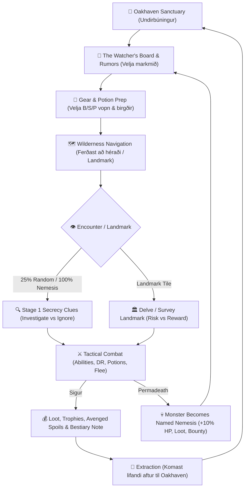

# DARKGRID — Gameplay Loops & Feature Design Review

**Dagsetning:** 14. október 2026  
**Hlutverk:** Senior Game Designer & Systems Designer  
**Staða:** Rannsóknar-, greiningar- og hönnunarskýrsla (Read-Only Review)

---

## 1. Stöðugreining: Darkgrid eins og hann er Í DAG

Áður en ný leikjakerfi eru lögð til er nauðsynlegt að greina raunverulegt ástand kóðans, gagnagrunnsins og spilunarflæðisins og halda **staðreyndum úr kóða** stranglega aðgreindum frá **hönnunarályktunum**.

### 1.1 Staðreyndir úr kóðanum (Codebase Facts)

* **Kort og heimur (`db/seeds/001_seed_world.sql`, `src/domain/world/map.js`, `src/domain/world/artwork.js`):**
  * Heimurinn er 15×15 hnitanet (225 reitir, `(0,0)` til `(14,14)`).
  * Eina örugga borgin er **Oakhaven** á `(7,7)` (`terrain = 'CITY'`, `feature = 'MARKETPLACE'`, `is_safe = 1`), varin af tveimur öruggum hliðum: *Oakhaven North Gate* `(7,6)` og *Oakhaven South Gate* `(7,8)` (`feature = 'TOWN_GATES'`, `is_safe = 1`).
  * Færir óbyggðareitir skiptast í `PLAINS` (*Verdant Plains*, *Windblown Heath*), `FOREST` (*Mirkwood Forest*), `HILLS` (*Raven Crags*), `SWAMP` (*Rotting Fen*, *Deadman's Mire*), `JUNGLE` (*Venomous Jungle*) og `BRIDGE` (*The Old Stone Bridge* á `(8,7)`).
  * Ófærir reitir (`is_passable = 0`) mynda náttúruleg landamæri og flöskuhálsa: *Darkmount Peaks* (`MOUNTAINS`), *The Murksea* (`OCEAN`), *The Bottomless Mire* (`SWAMP` á `y=14`) og *Blackwater River* (`RIVER_LAKE` eftir endilöngu `x=9`, sem þvingar spilara til að fara yfir brúna á `(8,7)` eða suður í frumskóginn á `(9,11)`).
  * Fjarlægðarhámark á hættustigi (`getDistanceToNearestSafeCity` í `src/domain/encounters/engine.js`) verndar byrjendur: 0 skref = CR 0; 1 skref = CR $\le 0.334$; 2 skref = CR $\le 0.5$; 3 skref = CR $\le 1.0$; 4+ skref = óheft Gaussian dreifing ($\sigma = 1.5$ miðað við `character.level` vs `monster.solo_level`).
  * **Minimap (`getMinimapData`):** Sýnir 5×5 svæði (`radius = 2`) í kringum spilarann. Ef varanlegt skrímsli (`monster_instances` með `status = 'ACTIVE'`) er innan 2 reita birtist `💀` tákn á minimap með hover-textanum `Persistent Threat (X fallen heroes)`. Utan 2 reita radíuss eru varanleg skrímsli **algjörlega ósýnileg** spilaranum.
  * **Landamerki (`map_tiles.feature`):** Aðeins 5 reitir í grunninum eru með `feature` gildi: `(7,7) MARKETPLACE`, `(7,6)/(7,8) TOWN_GATES`, `(8,7) ANCIENT_BRIDGE`, `(7,3) ANCIENT_OAK` (*Heart of the Mirkwood*) og `(4,11) SUNK_RUIN` (*Deadman's Mire*). Í dag velur `feature` aðeins sérmynd úr `terrain_artworks` og sýnir merki í viðmótinu (`game.ejs`), en hefur **enga leikjavirkni (0 interactions)**.

* **Fundir og leynd (`src/domain/encounters/engine.js`):**
  * Hvert gilt skref (`POST /game/move`) á óöruggum reit hefur `25%` líkur á tilviljunarfundi, nema varanlegt skrímsli (`monster_instances`) sé á reitnum — þá er fundurinn **100% öruggur** og gengur alltaf fyrir.
  * Tveggja þrepa leynd: Á **Stigi 1 (`DISCOVERED`)** sér spilarinn aðeins óljósa vísbendingu (`1_distant`, plús `2_ranger_distant` fyrir Ranger) án nafns, myndar eða tölfræði, og velur `Investigate` eða `Ignore`.
  * Perception-próf (`1d20 + WIS_mod + [3 ef Ranger]` gegn `10 + monster.initiative_bonus`) ræður hvort spilarinn kemur auga á óvininn (`spotted_by_hero = 1`) eða lendir í fyrirsát (`is_ambush = 1`, óvirkt á Level 1).

* **Bardagakerfi, stéttir og sérhæfileikar (`src/domain/combat/engine.js`, `abilities.js`, `src/domain/character/rules.js`):**
  * 68 skrímsli úr Pathfinder 1e eru í gagnagrunninum (`solo_level` 1–5), öll með virk sérhæfileikakerfi (12 erkitýpur: *DR by weapon type B/S/P/Magic, Incorporeal/Evasion, Regeneration, Ferocity, Blood Frenzy, Combat-Start Auras, Opening Strike, Rend, Cooldown Breath/Volley, Elemental Rider, Poison/Disease/Bleed, Trip/Grab/Constrict, Paralysis/Drain/Calcify, Rust*) og 9 Permadeath-öryggisreglur.
  * 3 bardagaaðgerðir: `Attack`, `Drink Potion`, `Flee` (gefur skrímsli 1 frítt *Attack of Opportunity*).
  * Faldar tölur: Engar tölulegar upplýsingar um HP/AC/árásir skrímsla eða vopna/brynja sjást í UI; heilsa skrímsla birtist í 5 textaþrepum (`5_health_100` niður í `9_dead`).
  * 3 stéttir (**Fighter**, **Ranger**, **Cleric**) með skýra sérstöðu: Fighter fær *Armor/Weapon Training* og fulla vopna/brynjufærni; Ranger fær *Favored Enemy*, *Ranged Opening Shot* (frítt bogaskot fyrir bardaga ef `spotted_by_hero = 1` og `is_ambush = 0`), `+3 Perception` og auka vísbendingar; Cleric fær *Holy Radiance* gegn Undead og *Channel Divine Healing* utan bardaga (endurhlaðið með `POST /game/rest` í Oakhaven).

* **Búnaður, Loot og Hagkerfi (`src/domain/combat/loot.js`, `src/domain/economy/shop.js`):**
  * 113 hlutir í `item_definitions` (vopn, brynjur, skildir, drykkir, fylgihlutir og 14 `TREASURE` verðmæti). 10 hlutir eru enn óvirkir (`INACTIVE_ITEM_NAMES`, t.d. *Antitoxin*, *Potion of Barkskin*, *Cloak of Resistance +1*).
  * `loot_tables` og `loot_table_entries` stýra verðlaunum eftir `creature_type` og CR. **Venjuleg dýr (`ANIMAL`) gefa 0 gull og 0 hluti** (`loot.js` lína 169).
  * Í Oakhaven er verslun sem selur ógöldruð grunnvopn/brynjur og *Minor Healing Potion*, kaupir venjulega hluti á 50% verði og setur selda galdrahluti á **Global Magical Resale Market** (`market_listings`) á 125% verði þar sem aðrir spilarar (eða næstu hetjur sama spilara) geta keypt þá.

* **Permadeath og Persistent Monsters (`src/domain/monsters/persistence.js`, `src/domain/combat/victory.js`):**
  * Þegar hetja deyr fer `is_alive = 0` og `killed_by_monster_instance_id` er skráð. Skrímslið verður `ACTIVE` í `monster_instances` á reitnum, fær `+10%` hámarkslíf (einu sinni), `kill_count + 1`, tekur **50% af gulli** hetjunnar (`held_gold`) og **50% líkur á hvern hlut** í eigu hetjunnar (allt að 20 hlutir, forgangsraðað eftir `is_magical > buy_price > id`).
  * Taflan `monster_instances` er nú þegar með dálkinn `custom_title TEXT` (`001_initial_schema.sql` lína 85) og `victory.js` (lína 120) les `customTitle: instance.custom_title || null`, en **ekkert kerfi skrifar í `custom_title` í dag**.
  * `victory.ejs` er nú þegar með tilbúinn **"A Fallen Hero Avenged"** borða (`isAvenged`) sem sýnir hvaða föllnu hetjur voru hefndar og hvaða herfang (`spoils`) endurheimtist!

---

### 1.2 Svar við spurningum 1–5 (Staðreyndir vs. Ályktanir)

#### 1. Hver er núverandi gameplay loop?
* **Staðreynd úr kóða:** Spilari býr til hetju $\rightarrow$ byrjar í Oakhaven `(7,7)` $\rightarrow$ gengur út í óbyggðir (1 reit í einu) $\rightarrow$ fær 25% tilviljunarfundi $\rightarrow$ metur vísbendingu (`Investigate` / `Ignore`) $\rightarrow$ berst með `Attack` / `Drink Potion` / `Flee` $\rightarrow$ fær XP, gull og loot $\rightarrow$ snýr aftur til Oakhaven til að hvílast (`Rest`) og versla (`Shop`) $\rightarrow$ endurtekur þar til hetjan deyr (Permadeath).
* **Ályktun:** Þetta er hreinræktuð **„Step-Grind & Extract"** lykkja. Grunnstoðirnar (taktískur bardagi, leynd yfir tölum og útgönguleið í borg) eru traustar, en lykkjuna vantar **miðjan hlekkinn**: *Af hverju valdi ég að fara í þessa átt í þessari ferð?*

#### 2. Hvað gerir spilarinn yfirleitt frá því hann byrjar þar til hann hættir?
* **Staðreynd úr kóða:** Spilarinn byrjar með 0 gull og ryðgaðan byrjendabúnað, gengur í 1–2 reita fjarlægð frá Oakhaven (þar sem CR-þakið heldur honum öruggum), safnar XP og gulli fyrir fyrstu brynju/vopni og *Minor Healing Potions*, og hættir sér svo 3–4+ reiti frá borginni.
* **Ályktun:** Þar sem allir reitir af sömu landslagstegund (`terrain`) í sömu fjarlægð frá Oakhaven hegða sér nákvæmlega eins (25% tilviljunarfundur), breytist ferðalagið fljótt í „reitavafr" (tile-pacing) þar sem spilarinn gengur fram og til baka á tveimur reitum rétt utan við hlið Oakhaven í stað þess að leggja í raunverulega leiðangra.

#### 3. Hvað er nú þegar skemmtilegt eða áhugavert?
* **Staðreynd úr kóða:**
  1. **Tveggja þrepa leyndin (`DISCOVERED` $\rightarrow$ `IN_COMBAT`) og faldar tölur:** Spilarinn þarf að lesa lýsingar (*„The scent of carrion hangs heavy..."*, *„Thick, rubbery hide turns the edge of your blade..."*) til að greina óvininn og veikleika hans (t.d. B/S/P vopnategundir).
  2. **Permadeath + Persistent Monsters + Global Market:** Ddauði eyðir ekki bara hetjunni heldur skilur eftir raunverulegt skrímsli á kortinu með vopnin þín og gullið þitt, og seldir galdrahlutir lifa áfram í verslun Oakhaven.
  3. **Skýr stéttasérstaða:** Ranger upplifir heiminn allt öðruvísi en Fighter eða Cleric vegna *Ranged Opening Shot* og auka skynjunarvísbendinga.
* **Ályktun:** Darkgrid er **ekki** venjulegur talna-RPG; styrkur hans felst í **upplýsingaójafnvægi (information asymmetry), undirbúningi og áhættustýringu**.

#### 4. Hvar vantar skýrari markmið?
* **Staðreynd úr kóða:** Engin verkefni (quests), engin veiðisamnigar (bounties), engin kortavirkni á landamerkjum (`feature`), enginn listi í Oakhaven yfir virk varanleg skrímsli (`monster_instances`) eða fallnar hetjur, og engin langtímaskráning á afrekum í `Journal` (sem sýnir aðeins síðustu 10 fundi núverandi hetju).
* **Ályktun:** Spilarinn hefur aðeins **innri markmið** (*„Ég ætla að ná Level 3"*, *„Ég ætla að safna 50g fyrir Chainmail"*), en engin **ytri, heimstengd markmið** (*„Ég ætla að elta uppi Dire Wolf sem drap fyrri hetjuna mína í Raven Crags"*, *„Ég ætla að kanna Sunk Ruin í Deadman's Mire"*).

#### 5. Hvaða núverandi kerfi mætti nýta miklu betur?
1. **`monster_instances` og `custom_title`:** Varanleg skrímsli eru gimsteinn leiksins, en þau eru falin! Ef hetja deyr á `(3,11)` veit ný hetja í Oakhaven `(7,7)` ekkert af skrímslinu nema spilarinn muni hnitið utanbókar, og `custom_title` dálkurinn stendur ónotaður.
2. **`map_tiles.feature` og `terrain_artworks`:** `ANCIENT_OAK`, `SUNK_RUIN` og `ANCIENT_BRIDGE` eru þegar í grunninum með sérmyndum, en ekkert gerist þegar komið er á reitinn.
3. **Dýr (`ANIMAL` creature type):** 16 af 68 skrímslum í grunninum eru `ANIMAL` (t.d. *Wolf, Boar, Grizzly Bear, Leopard, Dire Bat, Wolverine*). Þar sem þau gefa 0 gull og 0 hluti í `loot.js` forðast reyndir spilarar þau. Ef þau tengdust veiðisamningum (Hunting Contracts) eða feldum/bráð (Trophies/Pelts) yrðu þau skyndilega eftirsóknarverð.
4. **Journal Modal (`#modal-journal` í `game.ejs`):** Er nú þegar til í UI sem 4. glugginn, en sýnir aðeins hrárra 10 lína lista yfir nýjustu bardaga.

---

## 2. Greining á því hvað Darkgrid vantar (eftir spilunartíma)

### 2.1 Fyrstu 10 mínúturnar (Onboarding & First Blood)
* **Hvað fær nýjan spilara til að vilja kanna næsta reit?**
  * *Staða í dag:* Forvitni um 5×5 minimap-ið og löngun til að prófa fyrsta bardagann.
  * *Hvað vantar:* Þegar spilarinn vaknar í Oakhaven `(7,7)` fær hann ekkert upphafskall (call to action). Hann gengur út um *North Gate* `(7,6)` eða *South Gate* `(7,8)` án þess að vita *hvert* hann á að stefna.
* **Hefur hann eitthvað markmið?**
  * Aðeins að lifa af fyrsta bardagann og safna 25 gullpeningum fyrir *Minor Healing Potion*.
* **Hvernig upplifir hann fyrstu bardagana?**
  * Mjög vel eftir Core Stabilization: Level 1 er varinn gegn Ambush, CR-þakið (CR $\le 0.334$ í 1 skrefs fjarlægð) tryggir sanngjarna fyrstu bardaga, og leyndin á Stigi 1 vekur spennu. Hins vegar, ef fyrsti bardaginn er gegn `ANIMAL` (t.d. *Rat*, *Raven*, *Dog*), fær spilarinn **0 gull og 0 loot**, sem getur valdið vonbrigðum í fyrstu upplifun.
* **Er nægilega skýrt hvað hann getur gert og finnur hann fyrir framförum?**
  * Viðmótið er hreint og skýrt, en framfarir á fyrstu 10 mínútunum mælast eingöngu í XP-stikunni ef ekkert gull fellur til.

### 2.2 Fyrstu 30–60 mínúturnar (The Mid-Session Loop)
* **Er kominn áhugaverður gameplay loop?**
  * Spilarinn er kominn á Level 2–3, hefur keypt betra vopn/brynju og skilur muninn á `Slashing`, `Piercing` og `Bludgeoning`. En hér byrjar **endurtekningin** að segja til sín.
* **Eru fleiri ástæður til að ferðast en að finna skrímsli?**
  * **Nei.** Í núverandi útgáfu er eina ástæðan til að stíga á nýjan reit að kasta 25% teningnum fyrir skrímslafund. Það er engin ástæða til að fara alla leið að *Heart of the Mirkwood* `(7,3)` frekar en að ganga í hringi á `(6,4)` og `(6,5)`.
* **Er spilarinn að vinna að einhverju ákveðnu? Getur hann valið mismunandi markmið?**
  * Nei. Spilarinn getur ekki valið á milli þess að fara í *öruggan könnunarleiðangur*, *áhættusama skrímslaveiði* eða *fjársjóðsleit*.

### 2.3 Eftir nokkrar klukkustundir (Mid-to-Late Game, Level 4–6+)
* **Hvað heldur spilaranum við efnið og er einhver langtímaframvinda?**
  * Á Level 4–5 opnast hættulegustu skrímslin (CR 3–5 eins og *Assassin Vine*, *Ogre*, *Wight*, *Basilisk*, *Manticore*) og galdrahlutir (`+1` vopn/brynjur, hringar, skikkjur).
  * En þegar hetjan er komin með góðan búnað vantar **prófstein (capstone challenges)**: Hvað geri ég við þennan styrk?
* **Er ástæða til að kanna mismunandi svæði?**
  * Skrímslin eru bundin við búsvæði (`terrain`), svo Cleric gæti leitað í *Rotting Fen* (`SWAMP`) eftir Undead, en ekkert kerfi beinir spilaranum markvisst í ný héruð (t.d. austur yfir *The Old Stone Bridge* `(8,7)` inn í *Venomous Jungle*).

### 2.4 Eftir dauða persónu (Post-Permadeath & Shared World)
* **Hvað fær spilarann til að byrja nýjan character?**
  * Í kóðanum í dag er **hefndarhvötin (The Vengeance Hook)** falin: Skrímslið sem drap þig heldur áfram að lifa á reitnum með 50% af gullinu þínu og hluta af búnaðinum þínum.
  * **Vandamálið í dag:**
    1. Þegar nýja hetjan vaknar í Oakhaven er hvergi hægt að sjá lista yfir fallnar hetjur eða hvaða skrímsli gengur laust og hvar.
    2. Ef hetja deyr á Level 1 með 0 gull og ómerkilegan byrjendabúnað, heldur skrímslið á **engu verðmæti** (`held_gold = 0`), svo það er enginn efnahagslegur hvati til að hætta lífi nýrrar hetju gegn skrímsli með `+10% HP`.
    3. Ef spilarinn velur sömu stétt aftur er byrjunin 100% eins.

---

## 3. Rannsókn á mögulegum Gameplay Systems (Flokkar A–G)

### A. Hunting & Bounty System (Veiðisamningar og skrímsli með fé til höfuðs)
* **Greining á núverandi kerfi (`src/domain/monsters/persistence.js`):**
  * Taflan `monster_instances` geymir nú þegar `monster_id`, `tile_x`, `tile_y`, `current_hp`, `max_hp`, `kill_count`, `is_boosted`, `held_gold`, `custom_title` og `status ('ACTIVE' | 'SLAIN')`.
  * Taflan `characters` geymir `killed_by_monster_instance_id`.
* **Hvernig Hunting & Bounty passar við Darkgrid:**
  * Þetta er **náttúrulegasta viðbótin við leikinn**. Hún skiptist í tvennt:
    1. **Nemesis Bounties (Varanleg skrímsli sem hafa drepið hetjur):** Þegar skrímsli drepur hetju fær það sjálfkrafa nafnbót í `custom_title` (t.d. *"Gorgoroth, Bane of Aldric"* eða *"The Blood-Stained Worg of Raven Crags"*) og borgarverðir Oakhaven leggja **opinbert verðlaunafé (Guild Bounty Gold)** ofan á `held_gold` (t.d. `50g × monster.solo_level × kill_count`). Þetta leysir vandann þegar Level 1 hetja deyr blank: skrímslið verður samt verðmætt skotmark!
    2. **Wilderness Hunting Contracts (Staðbundnir veiðisamningar):** 2–3 samningar í Oakhaven sem biðja um að fella **eitt tiltekið skrímsli eða safna einu veiðitákni (Trophy)** á tilteknu svæði (t.d. *"Cull a Dire Wolf in the Hills"* eða *"Clear a Giant Spider from Mirkwood Forest"*). Þetta gefur `ANIMAL` og `VERMIN` skrímslum (sem annars gefa 0 gull) mikilvægan tilgang.

### B. Quest System (Verkefnakerfi án MMO-endurtekningar)
* **Hvað á að forðast:** Hefðbundin MMO-verkefni (*„Dreptu 10 úlfa"*, *„Safnaðu 15 sveppum"*) passa illa við Darkgrid vegna þess að hver einasti bardagi í permadeath-leik er lífshættulegur og 25% fundartíðni myndi gera „10 dráp" að 40+ skrefa leiðindagöngu.
* **Hvað passar við Darkgrid — „Single-Target Expedition Objectives":**
  * Í stað fjöldamarkmiða eiga verkefni í Darkgrid að vera **einstakir leiðangrar (Expeditions)**:
    * **Purge / Hunt:** Finndu og felldu *eina* tiltekna ógn á tilteknu svæði (t.d. *„A Ghoul has been spotted near Deadman's Mire"*).
    * **Reconnaissance / Cartography:** Komdu þér lifandi á tiltekið landamerki (t.d. *The Old Stone Bridge* `(8,7)` eða *Heart of the Mirkwood* `(7,3)`), framkvæmdu könnun (`Survey`) og komdu skýrslunni **lifandi til baka** til Oakhaven.
    * **Relic Recovery:** Endurheimtu týndan grip úr rústum eða af tilteknu skrímsli.
* **Miðlun markmiða:** Engir langir NPC-samtalsgluggar. Stutt, drungaleg tilkynningatafla í Oakhaven (**The Watcher's Board**) ásamt **orðrómi (Rumors)** sem finnast á ferðalögum.

### C. Exploration & Discovery (Könnun og uppgötvanir á 15×15 kortinu)
* **Hvað er hægt að gera með núverandi kortakerfi án þess að endursmíða heiminn?**
  * Í `map_tiles` er dálkurinn `feature` nú þegar til! Við getum virkjað núverandi landamerki (`ANCIENT_OAK` á `(7,3)`, `SUNK_RUIN` á `(4,11)`, `ANCIENT_BRIDGE` á `(8,7)`) og bætt `feature` gildum á 6–10 lykilreiti til viðbótar (t.d. *Watchtower Ruin* í Raven Crags, *Bone Altar* í Rotting Fen, *Smuggler's Cove* við Murksea, *Overgrown Shrine* í Venomous Jungle).
  * **Virkni:** Þegar spilari stendur á reit með `feature` (utan borgar) birtist hnappurinn **`Explore [Landmark Name]`** í stað þess að reiturinn sé bara mynd.
  * **Fog of War / Cartography (`character_tiles_visited`):** Með því að skrá hvaða reiti hver hetja hefur heimsótt fær spilarinn tilfinningu fyrir því að kortleggja óbyggðirnar og fær lítinn **First Discovery XP bónus** (t.d. `+10 XP`) þegar nýr reitur eða nýtt landamerki finnst í fyrsta sinn á ferlinum.

### D. Dynamic World Events (Kvikt ástand heimsins án bakgrunnsþjónusta)
* **Tæknileg regla:** Engir cron-jobs, engir WebSockets, engir bakgrunnsþræðir. Allir atburðir verða til **lazy / on-demand** þegar spilari hreyfir sig, lýkur bardaga, deyr eða hvílist í Oakhaven.
* **Hvernig það virkar í SQLite:**
  * **Apex / Roaming Threat:** Þegar hetja nær ákveðnum áfanga eða eftir $N$ bardaga í heiminum getur kviknað á **World Condition** á tilteknu svæði (t.d. *„Undead Stirring in Rotting Fen"* eða *„A Manticore roosts in Raven Crags"*), geymt í einfaldri töflu með `expires_after_encounters` teljara.
  * **Death Echoes:** Dauði hetju er sjálfkrafa stærsti kviki heimsviðburðurinn — hann breytir reitnum í dauðagildru með varanlegu skrímsli og býr til hefndarverkefni.

### E. Character Goals & Progression (Markmið án power-creep)
* **Áskorun:** Við viljum ekki bæta við flóknum skill-trjám sem eyðileggja Pathfinder 1e jafnvægið.
* **Lausn:**
  * **Expedition Milestones & Bestiary Log í `#modal-journal`:** Dagbókin (`Journal`) breytist úr 10-lína textalista í alvöru **Field Journal**:
    1. *Active Objectives:* Virkir veiðisamningar / eiðar.
    2. *Bestiary / Field Notes:* Þegar þú hefur barist við skrímsli (t.d. *Skeleton*) skráist það í dagbókina þína ásamt vísbendingum sem þú hefur uppgötvað (t.d. *„Resistant to slashing and piercing blades"*). Þetta hjálpar spilaranum að muna veikleika án þess að rjúfa leyndarregluna!
    3. *Deeds & Records:* Lengsta ferðalag frá Oakhaven, hæsta CR sigrað, fjöldi hefndra hetja.

### F. Emergent Gameplay (Sjálfsprottnar sögur)
* Darkgrid hefur einstakt forskot hér vegna `monster_instances` og `market_listings`:
  1. **The Nemesis Escalation:** Ef skrímsli drepur hetju A (`kill_count = 1`), og hetja B fer að hefna hennar en deyr líka (`kill_count = 2`), safnar skrímslið **báðum herföngunum** og verður að alræmdum goðsagnakenndum óvini á kortinu (*„The Twice-Bloodied Cockatrice of Raven Crags"*).
  2. **Fallen Hero Relics:** Þegar þú drepur Nemesis-skrímsli og endurheimtir sverð sem tilheyrði annarri hetju, segir sagan sig sjálf í gegnum `victory.ejs` (*„A Fallen Hero Avenged"*).
  3. **Corpse / Cairn Discovery:** Ef hetja dó úr gildru eða óheppni, eða ef hluti af búnaði hennar varð eftir á reitnum, geta aðrir spilarar fundið **minnisvarða (Fallen Cairn)** á reitnum.

### G. Frumlegar hugmyndir sérhannaðar fyrir Darkgrid
Með hliðsjón af kóðarannsókninni komu þrjár sértækar hugmyndir í ljós sem leysa núverandi veikleika í Darkgrid:
1. **Wilderness Trophies & Pelts (Lausn á 0-loot `ANIMAL`/`VERMIN` vandanum):** Í stað þess að úlfar og birnir láti gullpeninga detta (sem brýtur Pathfinder-rökfræði), láta dýr og skordýr eftir sig **veiðibráð/feldi** (t.d. *Wolf Pelt*, *Boar Tusk*, *Venom Sac*) eða uppfylla veiðisamninga í Oakhaven.
2. **Sanctuary Rumors & Scout Intel (Lausn áEncounter Secrecy + undirbúningi):** Í Oakhaven getur spilarinn fengið 1–2 ókeypis **orðróma (Rumors)** þegar hann hvílist (`Rest`), t.d.: *„Travelers fleeing the Old Stone Bridge speak of rattling bones—bring a heavy mace if you cross east."* Þetta tengir saman vopnaval (B/S/P), landslag og undirbúning!
3. **Blood-Oaths (Persónuleg áhættuloforð):** Spilari getur svarið eið í Oakhaven áður en hann leggur af stað (t.d. *„Vow of the Far Strider: Reach distance 5 from Oakhaven and return alive without resting"*). Ef það tekst fær hann XP/gull bónus; ef hann hvílist áður en markmiðinu er náð rofnar eiðurinn.

---

## 4. Hvernig kerfin vinna saman (System Synergy)

Markmiðið er ekki að raða ótengdum tökkum í viðmótið heldur að láta hvert kerfi fæða annað í einni samfelldri **Leiðangurslykkju (The Expedition Loop)**:

### Hvernig þættirnir tengjast:
* **Exploration $\rightarrow$ Quests:** Könnun á landamerkjum (`feature`) getur afhjúpað vísbendingar um hvar sjaldgæft skrímsli eða týndur fjársjóður leynist.
* **Permadeath $\rightarrow$ Persistent Monsters $\rightarrow$ Hunting:** Hvert skipti sem hetja deyr skapast sjálfkrafa **Nemesis Bounty** á *The Watcher's Board* í Oakhaven með síðasta þekkta hniti, nafni skrímslisins, nafni föllnu hetjunnar og verðlaunafé.
* **Rumors/Contracts $\rightarrow$ Terrain $\rightarrow$ Gear Prep:** Ef samningur eða orðrómur vísar í *Rotting Fen* (`SWAMP`) gegn beinagrindum (`UNDEAD`), veit Fighter/Cleric að hann þarf að kaupa *Heavy Mace* (`Bludgeoning`) áður en hann leggur af stað.
* **Combat $\rightarrow$ Bestiary Journal:** Hver bardagi bætir þekkingu í dagbók spilarans, svo falda talnakerfið verður að **lærdómsferli** í stað blindrar ágiskunar.

---

## 5. 10–15 Gameplay Feature Hugmyndir (Gagnrýnin úttekt)

Hér eru **12 gameplay eiginleikar** metnir af fullri hreinskilni. Sumir eru frábærir fyrir Darkgrid, á meðan aðrir eru of þungir eða raska jafnvægi leiksins.

---

### Hugmynd 1: The Watcher's Board — Nemesis Bounties & Hunting Contracts
1. **Name:** The Watcher's Board (Nemesis Bounties & Hunting Contracts)
2. **Concept:** Tilkynningatafla í Oakhaven sem birtir annars vegar **öll virk Persistent Monsters (`monster_instances`)** sem hafa fellt hetjur (með sjálfvirkri nafnbót í `custom_title`, hniti/svæði, fjölda fórnarlamba og Guild Bounty gullverðlaunum ofan á `held_gold`), og hins vegar **3 staðbundna veiðisamninga (Hunting Contracts)** sem endurnýjast þegar hetja hvílist eða klárar samning.
3. **Player experience:** Í Oakhaven opnar spilarinn *Watcher's Board*, sér t.d. *"💀 Blood-Maw the Dire Wolf — Last seen at Raven Crags (4,3) — Slain: 1 Hero — Bounty: 75g + Reclaimed Spoils"* eða samning við hæfi síns levels (*"Hunt: Clear a Giant Spider in Mirkwood Forest — Reward: 35g & 75 XP"*). Hann merkir sér skotmarkið, undirbýr vopn og heldur af stað.
4. **Fun factor:** Hámarkar spennu! Breytir tilviljanakenndu ráfi í markvissa veiðiferð (The Hunt) og gerir permadeath-kerfið sýnilegt öllum í Oakhaven.
5. **Existing systems:** Nýtir `monster_instances` (`custom_title`, `tile_x`, `tile_y`, `kill_count`, `held_gold`), `characters.killed_by_monster_instance_id`, `victory.ejs` (*A Fallen Hero Avenged*), og Oakhaven borgarviðmótið.
6. **Technical requirements:** Virkja `custom_title` við dauða hetju í `persistence.js`; bæta við einfaldri `bounty_contracts` töflu (eða seed/generator) og UI-flipa í Oakhaven + merki á minimap/kompás.
7. **Complexity:** **Low–Medium**
8. **Replayability:** Mjög hátt. Hvert dauðsfall í heiminum býr til nýtt, einstakt boss-skotmark; veiðisamningar tryggja að það sé alltaf tilgangur með ferðinni jafnvel þegar enginn Nemesis er á lífi.
9. **Risks:** Ef Level 1 hetja eltir Level 4 Nemesis-skrímsli deyr hún samstundis. **Mótvægi:** Sýna skýra hættumerkingu (1–5 hauskúpur miðað við `solo_level` vs `character.level`) á töflunni.

---

### Hugmynd 2: Landmark Mysteries & Delving Sites (Points of Interest)
1. **Name:** Landmark Mysteries & Delving Sites
2. **Concept:** Virkjar `map_tiles.feature` dálkinn (t.d. `ANCIENT_OAK`, `SUNK_RUIN`, `ANCIENT_BRIDGE` og 6–8 ný landamerki á 15×15 kortinu). Þegar spilari stendur á landamerki getur hann valið aðgerðina **`Explore Landmark`**, sem býður upp á staðbundna ákvörðun (t.d. rannsaka altari, leita í rústum gegn vörðum, eða drekka úr lind).
3. **Player experience:** Spilarinn sér á kortinu að í *Deadman's Mire* `(4,11)` eru *Sunk Ruins*. Hann brýst í gegnum mýrina, kemur á reitinn og velur *Explore the Sunken Ruin*. Hann fær val: *Search the flooded crypt (High risk of Undead encounter, guaranteed Treasure roll)* eða *Copy the ancient inscriptions (+XP, safe)*.
4. **Fun factor:** Gefur kortinu raunverulega landafræði. Reitir hætta að vera bara „25% rúllur" og verða að áfangastöðum sem spilarinn leggur á minnið.
5. **Existing systems:** Nýtir `map_tiles.feature`, `terrain_artworks`, `encounters/engine.js` og `combat/loot.js`.
6. **Technical requirements:** Tafla `landmark_interactions` (eða `character_landmark_state` með cooldown svo ekki sé hægt að spamma sama reitinn endalaust), `POST /game/landmark/interact` route og UI-hnappur í `game.ejs` þegar `tile.feature` er virkt.
7. **Complexity:** **Medium**
8. **Replayability:** Miðlungs–Hátt. Með 8–10 landamerkjum og 2–3 mögulegum útkomum á hverju landamerki (endurstillt eftir ákveðinn fjölda bardaga eða fyrir nýja hetju) helst könnunin fersk.
9. **Risks:** Hætta á að spilarar standi á landamerki og ýti endalaust á hnappinn (farming). **Mótvægi:** Hvert landamerki er *Exhausted* fyrir hetjuna þar til hún hefur lokið t.d. 5 bardögum eða hækkað um level.

---

### Hugmynd 3: Field Journal, Bestiary Notes & Blood-Oaths
1. **Name:** Field Journal, Bestiary Notes & Blood-Oaths
2. **Concept:** Uppfærir núverandi `#modal-journal` úr einföldum 10-lína lista í þrískiptan **Field Journal**: (1) *Active Contracts & Blood-Oaths*, (2) *Bestiary Field Notes* (sjálfvirk skráning á skrímslum sem hetjan hefur mætt og hvaða eiginleikar/DR komu í ljós í bardaganum), og (3) *Hall of the Fallen / Personal Milestones*.
3. **Player experience:** Eftir harðan bardaga við *Gargoyle* þar sem venjulegt sverð beit illa á steinhúðina, opnar spilarinn dagbókina og sér skráð undir *Gargoyle*: *"Observed: Ordinary blades struggle to pierce its stony hide (Requires Magic weapon)."* Einnig getur hann svarið *Blood-Oath* í Oakhaven fyrir næsta leiðangur.
4. **Fun factor:** Gefur spilaranum tilfinningu fyrir vaxandi meistaratökum (mastery) og leysir vandann við að muna 68 skrímsli og 12 sérhæfileika án þess að opna wiki-síðu.
5. **Existing systems:** Nýtir `#modal-journal` í `game.ejs`, `encounters` töfluna, og `abilities.js` lýsingar.
6. **Technical requirements:** Viðbótarfyrirspurnir fyrir Journal-gögn (samantekt úr `encounters` eftir `monster_id`) og uppfært EJS-sniðmát fyrir `#modal-journal`.
7. **Complexity:** **Low**
8. **Replayability:** Hátt, sérstaklega ef *Bestiary* getur valkvætt geymt „Lore Passages" frá fyrri hetjum sama notanda (`user_id`), svo þekking leikmannsins safnist saman þótt hetjan deyi!
9. **Risks:** Má ekki birta tölulegar upplýsingar (t.d. „AC 16, HP 42, DR 5/bludgeoning") því það brýtur `.agents/rules/encounter-design.md`. Verður eingöngu að nota frásagnarsetningar.

---

### Hugmynd 4: Wilderness Trophies & Pelts (Animal/Vermin Loot Fix)
1. **Name:** Wilderness Trophies & Alchemical Harvest
2. **Concept:** Lagar þá staðreynd að 16 `ANIMAL` skrímsli (og mörg `VERMIN`) gefa 0 gull og 0 hluti í `loot.js`. Þegar spilari fellir dýr eða skordýr eru líkur á að hann fái náttúrulegt hráefni/veiðitákn (`TREASURE` flokkur, t.d. *Wolf Pelt*, *Grizzly Hide*, *Spider Silk Gland*, *Boar Tusk*) sem hægt er að selja kaupmanninum í Oakhaven fyrir gull.
3. **Player experience:** Í stað þess að pirra sig á að mæta *Wolf* eða *Grizzly Bear* og fá ekkert nema XP (og tapa 2 Healing Potions), fær spilarinn *Pristine Wolf Pelt* sem hann selur í Oakhaven fyrir 12 gullpeninga.
4. **Fun factor:** Fjarlægir „dauða bardaga" (feel-bad moments) án þess að láta úlfa ganga um með gullbuddur.
5. **Existing systems:** Nýtir `item_definitions` (`category = 'TREASURE'`), `loot_tables` og `loot_table_entries` — **engin kóðabreyting** í `shop.js` þörf því verslunin kaupir nú þegar alla `TREASURE` hluti!
6. **Technical requirements:** Bæta 8–10 Trophy/Pelt hlutum í `item_definitions` og tengja við `ANIMAL` og `VERMIN` í `loot_tables` (og uppfæra reglu í `loot.js` línu 169 svo `ANIMAL` geti rúllað á Trophy-töflu).
7. **Complexity:** **Low**
8. **Replayability:** Miðlungs (styður grunn-hagkerfið á Level 1–3).
9. **Risks:** Gæti aukið gullflæði á Level 1–2 ef sölugildið er of hátt. **Mótvægi:** Halda sölugildi lágu (3g–15g eftir CR) og 40–60% drop-líkum.

---

### Hugmynd 5: Sanctuary Rumors & Tavern Tidings
1. **Name:** Sanctuary Rumors & Scout Intel
2. **Concept:** Í hvert sinn sem spilari hvílist (`Rest`) í Oakhaven (eða skoðar borgarskjáinn) fær hann 1–2 stuttar frásagnir frá ferðalöngum/njósnurum sem gefa vísbendingu um hvað býr í tilteknu héraði, hvar varanlegt skrímsli sást síðast, eða hvaða vopnategund/búnaður hentar ákveðnu svæði.
3. **Player experience:** Spilarinn hvílist í Oakhaven og sér: *"A wounded woodcutter whispers: 'Do not enter the Rotting Fen with a rapier alone—the walking bones feel no point, only the weight of iron.'"*
4. **Fun factor:** Kennslukerfi (onboarding) sem er falið inni í drungalegum söguheimi leiksins. Hjálpar nýjum spilurum að læra Pathfinder-reglurnar án handbókar.
5. **Existing systems:** Nýtir `POST /game/rest` í `src/routes/game.js`, `monster_instances` og `game.ejs` flash/log kerfið.
6. **Technical requirements:** Lítið safn af samhengisbundnum orðrómum (dynamic + static templates) í `src/domain/world/rumors.js`.
7. **Complexity:** **Low**
8. **Replayability:** Miðlungs.
9. **Risks:** Ef orðrómarnir eru of fáir verða þeir endurteknir. Þarf a.m.k. 30–40 fjölbreyttar línur plús kvikar línur úr `monster_instances` og `market_listings`.

---

### Hugmynd 6: Fallen Cairns & Corpse Echoes
1. **Name:** Fallen Cairns & Corpse Echoes
2. **Concept:** Þegar hetja deyr verður ekki bara skrímslið eftir, heldur myndast **Fallen Cairn** (minnisvarði/beinagrind) á reitnum. Ef önnur hetja kemur á reitinn (og annaðhvort sigrar skrímslið eða skrímslið hefur þegar verið fellt) getur hún skoðað minnisvarðann, lesið grafskrift föllnu hetjunnar og annaðhvort rænt síðustu smámyntinni eða veitt henni hinstu hvíld fyrir tímabundna blessun (*Blessing of the Fallen*).
3. **Player experience:** Spilarinn gengur inn í *Mirkwood Forest* `(5,4)` og finnur *Weather-Worn Cairn of Sir Kaelen (Level 3 Fighter, slain by Giant Spider)*. Hann velur *Bury the bones with honor* og fær `+1 morale bonus to Saving Throws` í næstu 3 bardaga.
4. **Fun factor:** Sterk tilfinningaleg tenging við permadeath og fyrri hetjur.
5. **Existing systems:** Nýtir `characters` (`is_alive = 0`, `tile_x`, `tile_y`, `killed_by_monster_instance_id`).
6. **Technical requirements:** Dálkur `is_buried` á föllnum hetjum og tímabundinn buff-stakkur eða teljari á núverandi hetju.
7. **Complexity:** **Medium**
8. **Replayability:** Miðlungs.
9. **Risks:** Krefst tímabundinna buff-kerfa (buff duration tracking) utan bardaga sem er ekki til í `characters` töflunni í dag (nema bætt sé við dálkum).

---

### Hugmynd 7: Activate Dormant Tactical Consumables & Resist Gear
1. **Name:** Tactical Consumables & Alchemical Prep (`Antitoxin`, `Barkskin`, `Elixir`)
2. **Concept:** Í `item_definitions` eru nú þegar 10 hlutir sem eru faldir í `INACTIVE_ITEM_NAMES` (`src/domain/combat/loot.js` lína 9): *Antitoxin*, *Potion of Barkskin*, *Potion of Bull's Strength*, *Potion of Cat's Grace*, *Potion of Shield of Faith*, *Potion of Heroism*, *Elixir of Dragon's Breath*, *Boots of Elvenkind*, *Cloak of Resistance +1*, *Bracers of Armor +1*. Að virkja þessa hluti gefur spilaranum raunveruleg taktísk verkfæri til að búa sig undir sérstök skrímsli (t.d. drekka *Antitoxin* áður en haldið er í *Venomous Jungle*).
3. **Player experience:** Spilarinn tekur að sér veiðisamning í *Venomous Jungle* gegn *Giant Wasp* eða *Cockatrice*. Hann kaupir *Antitoxin* eða *Cloak of Resistance +1* í Oakhaven til að standast eitur- og lömunarpróf (`Fortitude saves`).
4. **Fun factor:** Dýpkar undirbúningsstigið í Oakhaven og nýtir Pathfinder 1e hluti sem eru nú þegar í gagnagrunninum!
5. **Existing systems:** `item_definitions`, `loot_table_entries`, `combat/engine.js`, `character/rules.js`.
6. **Technical requirements:** Virkja `+1` saving throw bónus fyrir `Cloak of Resistance +1` og AC bónus fyrir `Bracers of Armor +1` í `character/rules.js` (mjög einfalt!), og bæta við stuðningi við 1 virkan drykkjar-buff í `combat_state_json` fyrir bardagadrykki.
7. **Complexity:** **Low–Medium** (Low fyrir passíva hluti eins og *Cloak/Bracers/Boots*, Medium fyrir tímabundna drykki).
8. **Replayability:** Hátt í samspili við Hunting Contracts.
9. **Risks:** Ef buff-drykkir staflast (potion stacking) getur AC/Attack farið úr böndunum. **Mótvægi:** Aðeins 1 virkur alchemical buff í einu í `combat_state_json`.

---

### Hugmynd 8: Cartographer's Fog of War & Region Mastery
1. **Name:** Cartographer's Guild & Fog of War
2. **Concept:** Ný hetja sér aðeins Oakhaven og nærliggjandi reiti á kortinu í byrjun; aðrir reitir eru huldir þoku (`?`) þar til stigið er á þá (eða komið innan sjónmáls). Þegar hetja hefur kortlagt alla færa reiti í tilteknu héraði (t.d. alla reiti í *Mirkwood Forest*) getur hún selt kortið til *Cartographer's Guild* í Oakhaven fyrir gull og XP.
3. **Player experience:** Spilarinn sér 5×5 minimap-ið fyllast smám saman út þegar hann kannar heiminn og fær verðlaun fyrir að klára að kortleggja *Raven Crags*.
4. **Fun factor:** Gefur hverju einasta skrefi á ókönnuðum reit gildi, jafnvel þegar enginn bardagi verður.
5. **Existing systems:** `map_tiles`, `getMinimapData` í `src/domain/world/map.js`.
6. **Technical requirements:** Tafla `character_explored_tiles (character_id, tile_x, tile_y)` og breyting á `getMinimapData` til að athuga hvort reitur hafi verið skoðaður.
7. **Complexity:** **Medium**
8. **Replayability:** Miðlungs. Á 15×15 korti getur reyndur spilari lært kortið utanbókar eftir nokkur skipti, en það virkar mjög vel þegar kortið stækkar síðar.
9. **Risks:** Ef 5×5 minimap-ið sýnir bara `?` í 2 reita radíus getur spilarinn ekki séð ófæra reiti (fjöll/ár) fyrr en hann er alveg upp við þá. **Mótvægi:** Sýna alltaf 1 reits radíus (3×3) skýrt og vista alla reiti sem komið hefur verið innan 1 reits við.

---

### Hugmynd 9: Regional Threat Surges (Lazy Dynamic World Events)
1. **Name:** Regional Threat Surges (Omen Events)
2. **Concept:** Án nokkurra bakgrunnsþjónusta er ein virk „ógnarbylgja" (Omen) í heiminum í einu sem varir í t.d. 15 bardaga (t.d. *„Blood Moon over Raven Crags"*: skrímslafundir í `HILLS` eru 35% í stað 25%, en öll skrímsli þar gefa +20% XP og auka líkur á galdrahlutum).
3. **Player experience:** Þegar spilarinn kemur í Oakhaven sér hann viðvörun: *"Dark Omen: Restless Dead in Rotting Fen (8 encounters remaining)."* Sem Cleric sér hann þetta sem gullið tækifæri til að nýta *Holy Radiance*!
4. **Fun factor:** Breytir því hvaða svæði á kortinu er „heitt" í hverri lotu og hvetur spilarann til að færa sig á milli landslagstegunda.
5. **Existing systems:** `encounters/engine.js`, `combat/loot.js`, `map_tiles.terrain`.
6. **Technical requirements:** Einföld 1-lína stöðutafla `world_state` í SQLite sem geymir `active_omen_terrain`, `active_omen_type` og `remaining_encounters`.
7. **Complexity:** **Low–Medium**
8. **Replayability:** Hátt.
9. **Risks:** Getur gert tiltekið byrjendasvæði of hættulegt ef Omen lendir á `PLAINS` við hlið Oakhaven. **Mótvægi:** Omen virkjast aðeins á reitum í $\ge 3$ skrefa fjarlægð frá Oakhaven.

---

### Hugmynd 10: Mini-Dungeons / Multi-Stage Lairs (Tفر-þrepa bæli)
1. **Name:** Monster Lairs (Multi-Encounter Delving)
2. **Concept:** Á tilteknum reitum getur spilarinn fundið bæli (Lair) sem krefst 2–3 samfelldra bardaga í röð án þess að hægt sé að ganga í burtu á milli (aðeins drekka drykki eða flýja úr bælinu), með kistu í lokin.
3. **Player experience:** Spilarinn finnur *Goblin Warrens* í *Raven Crags*. Hann berst við *Goblin* vörð í Lotu 1, fær tækifæri til að drekka drykk, og mætir svo *Bugbear* höfðingja í Lotu 2 fyrir fjársjóðskistu.
4. **Fun factor:** Býr til háspennu „gauntlet" upplifun.
5. **Existing systems:** `encounters`, `combat/engine.js`.
6. **Technical requirements:** Nýtt ástandakerfi fyrir keðjubardaga (`lair_stage`, `lair_id`), breytingar á `victory.js` svo bardagalok vísi í næsta bardaga í stað korts.
7. **Complexity:** **High**
8. **Replayability:** Hátt.
9. **Risks:** **Há hætta fyrir Darkgrid á þessu stigi.** Í permadeath-leik þar sem einn óheppinn critt getur drepið hetju eru 2–3 bardagar í röð án hvíldar gríðarlega refsandi á Level 1–4, og krefjast mikilla breytinga á bardagaflæðinu (`game.js` og `victory.js`). *Ekki mælt með í fyrstu lotu.*

---

### Hugmynd 11: Crafting & Blacksmith Forging System
1. **Name:** Oakhaven Blacksmith & Crafting
2. **Concept:** Safna málmgrýti, leðri og skrímslahlutum til að smíða eigin vopn og brynjur í Oakhaven.
3. **Player experience:** Spilarinn safnar 5 *Iron Ore* og 3 *Wolf Pelts* til að smíða *Masterwork Longsword*.
4. **Fun factor:** Gefur hráefnum tilgang.
5. **Existing systems:** `item_definitions`, `character_items`.
6. **Technical requirements:** Uppskriftatafla (`crafting_recipes`), hráefnisstjórnun, nýtt smiðjuviðmót.
7. **Complexity:** **High**
8. **Replayability:** Miðlungs.
9. **Risks:** **Passar ILLA við Darkgrid.** Crafting-kerfi hvetja til endalausrar söfnunar (grinding) á lág-CR svæðum, fylla 50-hluta bakpokann af rusli og gera *Global Magical Resale Market* og *Loot Tables* óþörf. **Við mælum gegn þessari hugmynd.**

---

### Hugmynd 12: Ancestral Legacy / Meta-Progression Unlocks
1. **Name:** Ancestral Vault / Meta-Progression Boons
2. **Concept:** Þegar hetja deyr safnar spilarinn „Legacy Points" sem gefa öllum framtíðarhetjum varanlega tölfræðibónusa (t.d. +5% gull, +2 HP á Level 1, eða arfgenga kistu í Oakhaven).
3. **Player experience:** Eftir 5 dauðsföll byrjar nýja hetjan með extra gull og betra sverð.
4. **Fun factor:** Mýkir höggið við permadeath.
5. **Existing systems:** `users`, `characters`.
6. **Technical requirements:** `user_unlocks` tafla, breytingar á hetjustofnun.
7. **Complexity:** **Medium**
8. **Replayability:** Miðlungs.
9. **Risks:** **Brýtur grunnhugmynd Darkgrid.** Darkgrid er *Classical Roguelike / Hardcore RPG*, ekki *Rogue-lite* með varanlegu power-creep. Ef eldri spilarar byrja með ókeypis tölfræðibónusa riðlast Level 1–5 Pathfinder jafnvægið. Heims-framvindan í Darkgrid á að vera **í heiminum sjálfum** (`monster_instances` með stolnum hlutum og `market_listings` í búðinni), ekki í ókeypis stat-bónusum. **Við höfnum varanlegum stat-bónusum.**

---

## 6. Forgangsröðun og Samanburðartafla

Hér eru allar 12 hugmyndirnar metnar á kvarðanum **1–5** samkvæmt væginu:
* **Skemmtanagildi (Fun):** 30%
* **Auðvelt í útfærslu (Ease):** 20% *(5 = mjög einfalt / lítill kóði, 1 = flókið)*
* **Passar við Darkgrid (Fit):** 20%
* **Endurspilunargildi (Replay):** 15%
* **Nýting núverandi kerfa (Reuse):** 15%

| # | Hugmynd (Feature) | Skemmtun (30%) | Auðvelt (20%) | Passar (20%) | Endurspilun (15%) | Endurnýting (15%) | **Heildareinkunn** | Mat / Ráðlegging |
|---:|---|:---:|:---:|:---:|:---:|:---:|:---:|---|
| **1** | **The Watcher's Board (Nemesis Bounties & Hunting Contracts)** | 5.0 | 4.5 | 5.0 | 5.0 | 5.0 | **4.90** | 🏆 **Top 1 (MVP)** — Leysir markmiðsleysi & virkjar Persistent Monsters |
| **3** | **Field Journal, Bestiary Notes & Blood-Oaths** | 4.5 | 4.5 | 5.0 | 4.5 | 4.5 | **4.60** | 🥈 **Top 2** — Leysir falda-talna minnisvandann & bætir persónumarkmiðum við |
| **2** | **Landmark Mysteries & Delving Sites (`map_tiles.feature`)** | 5.0 | 3.5 | 5.0 | 4.0 | 4.5 | **4.48** | 🥉 **Top 3** — Gerir 15×15 kortið lifandi og gefur ferðalögum tilgang |
| **4** | **Wilderness Trophies & Pelts (`ANIMAL` Loot Fix)** | 3.5 | 5.0 | 4.5 | 3.5 | 5.0 | **4.23** | ⭐ **Quick Win** — Má taka inn sem hluta af Hunting Contracts |
| **5** | **Sanctuary Rumors & Scout Intel (in Oakhaven)** | 4.0 | 4.5 | 4.5 | 3.5 | 4.5 | **4.20** | ⭐ **Quick Win** — Frábær bragðbætir með Watcher's Board |
| **7** | **Activate Dormant Tactical Consumables & Resist Gear** | 4.0 | 4.0 | 4.5 | 4.0 | 4.5 | **4.18** | Góð viðbót í Phase 2 af þessari vegferð |
| **9** | **Regional Threat Surges (Lazy World Omens)** | 4.0 | 4.0 | 4.0 | 4.5 | 4.0 | **4.08** | Góð framtíðarviðbót þegar grunn-bounties eru komin |
| **6** | **Fallen Cairns & Corpse Echoes** | 4.0 | 3.5 | 4.5 | 3.5 | 4.0 | **3.93** | Skemmtilegt, en Nemesis Bounties dekka 80% af sömu upplifun |
| **8** | **Cartographer's Fog of War & Region Mastery** | 3.5 | 3.5 | 4.0 | 3.0 | 3.5 | **3.53** | Betra þegar kortið stækkar úr 15×15 í stærri heim |
| **10** | **Monster Lairs (Multi-Encounter Delving)** | 4.0 | 2.0 | 3.5 | 4.0 | 2.5 | **3.28** | Of áhættusamt fyrir permadeath og flókið í útfærslu núna |
| **12** | **Ancestral Legacy / Meta-Progression Boons** | 3.0 | 3.5 | 1.5 | 3.5 | 3.0 | **2.88** | ❌ **Hafnað** — Raskar Level 1–5 jafnvægi og grefur undan permadeath |
| **11** | **Oakhaven Blacksmith & Crafting System** | 2.5 | 1.5 | 1.5 | 2.5 | 2.0 | **2.03** | ❌ **Hafnað** — Hvetur til leiðinlegs grinding og ruslsöfnunar |

---

## 7. Þrjár bestu hugmyndirnar — Ítarleg hönnun

Við veljum þær þrjár hugmyndir sem vinna best saman sem **lítil, hnitmiðuð og snjöll kerfi**:
1. **The Watcher's Board: Nemesis Bounties & Hunting Contracts** (Markmið & Veiðar)
2. **Landmark Mysteries & Delving Sites** (Könnun & Landafræði)
3. **Field Journal: Bestiary Notes & Blood-Oaths** (Þekking, Framvinda & Áhættuval)

---

### 7.1 Eiginleiki 1: The Watcher's Board (Nemesis Bounties & Hunting Contracts)

#### A. Gameplay Design
* **Hvernig byrjar þetta?**
  * Í Oakhaven `(7,7)` bætist við nýr aðgerðahnappur í borgarvalmyndinni: **`📜 The Watcher's Board`**.
  * Taflan skiptist í tvo hluta:
    1. **🔥 Most Wanted — Active Nemeses (Global Shared World):** Öll virk skrímsli í `monster_instances` (`status = 'ACTIVE'`). Ef skrímsli hefur drepið hetju fær það sjálfkrafa nafnbót í `custom_title` (t.d. *"Grimfang, Slayer of Thorin"*), birtir síðasta þekkta svæði og hnit (t.d. *"Raven Crags — (4, 3)"*), hættumat (*Threat Rating: 💀💀💀*), fjölda fallinna hetja, og **Guild Bounty** gullverðlaun (t.d. `40g × solo_level`) **auk** alls stolins gulls og búnaðar sem skrímslið geymir!
    2. **🗡️ Warden's Hunting Contracts (Personal Expedition Targets):** 3 veiðisamningar sniðnir að stigi hetjunnar (`character.level` til `character.level + 1`). Hver samningur biður um að fella **eitt tiltekið skrímsli** í tilteknu héraði/landslagi (t.d. *"Slay a Wolf in Mirkwood Forest"* eða *"Purge a Skeleton from Rotting Fen"*).
* **Hvað gerir spilarinn og hvaða ákvarðanir tekur hann?**
  * Spilarinn getur haft **1 virkan Hunting Contract** í einu (Nemesis Bounties eru hins vegar alltaf opin öllum — hver sem drepur Nemesis-skrímslið fær verðlaunin).
  * Ákvörðunin: *Vel ég öruggan Level 1 samning nálægt Oakhaven fyrir 30g, eða tek ég áhættuna á hættulegum samningi í Rotting Fen sem gefur 75g og XP bónus, eða legg ég í hefndarför gegn Nemesis-skrímsli?*
* **Hvernig tekst honum að klára markmiðið?**
  * Þegar spilarinn er á réttu landslagi (`terrain`) með virkan Hunting Contract og fær tilviljunarfund, eru **40% líkur á að fundurinn sé einmitt samningsskrímslið** (svo spilarinn þurfi ekki að ganga 50 skref í leit að einum úlfi!).
  * Þegar skrímslið er fellt uppfærist samningurinn í `COMPLETED` (eða verðlaunin greiðast út þegar komið er lifandi aftur til Oakhaven — **Extraction mechanic!**).
* **Hvað gerist ef honum mistekst?**
  * Ef spilarinn flýr (`Flee`) helst samningurinn virkur. Ef spilarinn deyr (Permadeath) verður skrímslið sem drap hann að **nýjum Nemesis** á *The Watcher's Board*!
* **Hvað fær hann í verðlaun?**
  * *Nemesis Bounty:* Allt `held_gold` + öll `monster_instance_items` (stolið herfang) + **Guild Bounty Gold** (`40g × solo_level × kill_count`) + `+25% XP` bónus.
  * *Hunting Contract:* Fast gullverðlaun (t.d. `25g × target_solo_level`) og lítill XP bónus þegar skilað er inn í Oakhaven (þetta leysir líka 0-gull vandann á `ANIMAL` skrímslum!).

#### B. Practical Example (Spilunardæmi)
> **Hetja:** *Vaelen*, Level 2 Ranger.  
> **Í Oakhaven:** Vaelen opnar *The Watcher's Board*. Efst á listanum glóir rauður borði:  
> **`[NEMESIS] Red-Claw the Dire Badger`** — *Last seen in Mirkwood Forest (5, 5). Slain Heroes: 1 (Bram the Fighter). Threat: 💀💀. Guild Bounty: 40g + Fallen Hero's Spoils.*  
> Þar fyrir neðan eru 3 *Warden's Contracts*. Vaelen velur samninginn:  
> **`[CONTRACT] The Howling Crags`** — *"Track and slay a Wolf or Worg in the Hills of Raven Crags. Reward upon return to Oakhaven: 35 Gold, 60 XP."*  
> Vaelen kaupir einn *Minor Healing Potion*, gengur út um *North Gate* `(7,6)` og stefnir í vesturátt. Á leiðinni fer hann framhjá `(5,5)` þar sem `💀` táknið birtist á minimap-inu. Hann ákveður að hætta sér í *Red-Claw*!  
> **Stig 1 (`DISCOVERED`):** *"Freshly dug earth and bloodstained iron scraps litter the forest floor..."* Sem Ranger sér hann einnig: *"Heavy claw tracks circle a fallen warrior's pack."*  
> Hann velur `Investigate`, nær *Perception* prófinu, skýtur fríu *Ranged Opening Shot* örvaskoti, og klárar bardagann.  
> **Á `victory.ejs`:** Borðinn **A Fallen Hero Avenged!** birtist ásamt *Bram's Longsword*, `18 Held Gold` og `40 Guild Bounty Gold`! Síðan heldur Vaelen áfram í *Raven Crags* til að klára úlfasamninginn sinn áður en hann snýr sigri hrósandi aftur til Oakhaven.

#### C. Technical Design (Hátt stig)
* **Gagnagrunnsbreytingar:**
  * Nýta núverandi `monster_instances.custom_title` (engin breyting á `monster_instances` töflunni þörf!). Bæta við nafnasmið í `src/domain/monsters/persistence.js` þegar skrímsli drepur hetju (t.d. `<Epithet> <Monster Name>, Bane of <Hero Name>`).
  * Ný tafla `hunting_contracts`: `id`, `character_id`, `target_monster_id`, `target_terrain`, `reward_gold`, `reward_xp`, `status ('AVAILABLE' | 'ACTIVE' | 'READY_TO_CLAIM' | 'COMPLETED')`, `created_at`.
* **Backend Logic (`src/domain/bounties/`):**
  * `generateContractsForCharacter(characterId)`: Býr til 3 samninga sem passa við `character.level` og færa `terrain` reiti.
  * Í `src/domain/encounters/engine.js`: Ef hetja er með `ACTIVE` samning á núverandi `tile.terrain`, gefa `target_monster_id` hærra vægi (eða 40% beinar líkur) þegar tilviljunarfundur verður.
  * Í `src/domain/combat/victory.js`: Ef sigrað skrímsli er `monster_instance_id`, bæta `guildBountyGold` við verðlaunin; ef það passar við `ACTIVE` samning, setja samning í `READY_TO_CLAIM`.

---

### 7.2 Eiginleiki 2: Landmark Mysteries & Delving Sites (Points of Interest)

#### A. Gameplay Design
* **Hvernig byrjar þetta?**
  * Kortið hefur nú þegar `map_tiles.feature` á lykilreitum (`ANCIENT_OAK` á `(7,3)`, `SUNK_RUIN` á `(4,11)`, `ANCIENT_BRIDGE` á `(8,7)`), og við bætum 6–8 nýjum landamerkjum á 15×15 kortið (t.d. `WATCHTOWER_RUIN` í Raven Crags `(3,3)`, `BONE_ALTAR` í Rotting Fen `(3,12)`, `SMUGGLERS_CACHE` við ströndina `(1,8)`, `OVERGROWN_SHRINE` í Venomous Jungle `(11,9)`).
* **Hvað gerir spilarinn og hvaða ákvarðanir tekur hann?**
  * Þegar hetja stendur á reit með könnunarhæfu landamerki (og er ekki í bardaga) birtist sérstakur gluggi/hnappur í miðju-spjaldinu á `game.ejs`: **`🏛️ Explore [Landmark Name]`**.
  * Spilarinn fær stutta, drungalega lýsingu og **val á milli tveggja aðgerða**:
    * **Aðgerð A (Safe / Cautious):** T.d. *Observe from the perimeter / Offer a prayer / Search outer rubble* — Lítil áhætta, gefur smávægilegan XP bónus, orðróm/vísbendingu, eða 1 ókeypis *Channel/Minor Heal* við helgiskrín.
    * **Aðgerð B (Delve Deep / High Risk):** T.d. *Descend into the flooded vault / Disturb the Bone Altar* — Vekur **100% vörð (Guarded Encounter)** af viðeigandi CR fyrir svæðið, en ef spilarinn sigrar fær hann **guaranteed Treasure/Loot rúllu** (t.d. hærri líkur á galdrahlut eða fornum dýrgrip úr `TREASURE` flokknum).
* **Hvernig virkar kerfið aftur og aftur án þess að verða leiðinlegt?**
  * Eftir að hetja hefur kannað landamerki fer það í **Cooldown (Dormant)** fyrir þá hetju þar til hún hefur annaðhvort lokið **5 bardögum** eða **hvílst í Oakhaven á nýju leveli**. Þannig getur spilarinn ekki staðið á sama reitnum og ýtt endalaust á hnappinn, heldur hvetur kerfið til **hringferða (Expedition Circuits)** á milli landamerkja á kortinu!

#### B. Practical Example (Spilunardæmi)
> **Hetja:** *Sister Maren*, Level 3 Cleric.  
> Maren er stödd í *Deadman's Mire* á hniti `(4,11)` þar sem landamerkið **`SUNK_RUIN`** er. Á skjánum birtist sérmyndin af rústunum í mýrinni og hnappurinn **`Explore the Sunken Ruin`**.  
> Hún smellir á hnappinn og les:  
> *"Half-submerged stone arches jut from the black mire. Beneath the stagnant water, a rusted iron grate seals an ancient reliquary."*  
> Valmöguleikar:  
> 1. **`[Force the Iron Grate]`** *(Triggers a guardian encounter — High chance of Relic/Treasure on victory)*  
> 2. **`[Study the Sanctified Carvings]`** *(Gain 40 XP and record local lore; safe)*  
> Sem Cleric með *Holy Radiance* treystir Maren sér í Undead-vörð og velur *Force the Iron Grate*. Upp úr vatninu rís **Draugr** (`CR 2 Undead`). Maren sigrar hann með *Heavy Mace* og *Holy Radiance*, og auk venjulegs herfangs finnur hún í reliquary-hólfinu **Silver Chalice with Moss Agate** (`TREASURE`, virði 50g í Oakhaven)! Rústin verður nú *Dormant* í næstu 5 bardaga hennar.

#### C. Technical Design (Hátt stig)
* **Gagnagrunnsbreytingar:**
  * Uppfæra `map_tiles` með 6–8 nýjum `feature` gildum á völdum óbyggðareitum.
  * Ný tafla `character_landmarks`: `character_id`, `tile_x`, `tile_y`, `last_explored_at_encounter_count` (til að stýra 5-bardaga cooldown án tímaklukku!).
  * Í `encounters` töflunni má bæta við dálknum `is_landmark_delve INTEGER DEFAULT 0` svo `victory.js` viti að gefa bonus fjársjóðsrúllu þegar vörður landamerkis er sigraður.

---

### 7.3 Eiginleiki 3: Field Journal — Bestiary Notes & Blood-Oaths

#### A. Gameplay Design
* **Hvernig byrjar þetta?**
  * Núverandi `Journal` hnappur í fótstiku `game.ejs` (`#modal-journal`) er endurhannaður í þrjá skýra flipa:
    1. **📜 Contracts & Oaths:** Sýnir virkan veiðisamning af *Watcher's Board* og leyfir spilaranum (þegar hann er í Oakhaven) að sverja einn **Blood-Oath** fyrir komandi leiðangur (t.d. *"Oath of the Deep Wilds: Win 3 encounters at distance 4+ from Oakhaven before resting — Bonus: +100 XP & +40g"*).
    2. **📖 Bestiary (Field Notes):** Sýnir öll skrímsli sem spilarinn hefur mætt, flokkuð eftir `creature_type`. Fyrir hvert skrímsli birtist mynd þess, búsvæði, fjöldi sigra, og **frásagnarlegar athugasemdir um sérhæfileika** sem hafa komið fram (t.d. *„Regenerates wounds unless burned with fire or acid"*, *„Bludgeoning weapons crush its brittle bones"*).
    3. **⚰️ Chronicle of the Fallen:** Sýnir minningarskrá yfir fallnar hetjur (`is_alive = 0`), hvaða skrímsli felldi þær, á hvaða hniti, og hvort þeirra hafi verið hefnt (`AVENGED` vs `UNAVENGED`).

#### B. Practical Example (Spilunardæmi)
> Spilari missir Level 3 Fighter sinn (*Kael*) gegn *Assassin Vine* í *Venomous Jungle* `(10,11)`. Hann stofnar nýja hetju, *Lyra* (Ranger). Í Oakhaven opnar hann `Journal -> Chronicle of the Fallen` og sér:  
> *„Kael (Lvl 3 Fighter) — Slain at Venomous Jungle (10,11) by The Strangling Vine — Status: **UNAVENGED**."*  
> Í `Bestiary` flipanum sér hann einnig athugasemdina úr fyrri viðureignum sínum: *„Assassin Vine: Camouflaged ambush predator; immune to electricity; constricts prey in close quarters."*  
> Lyra hefur nú bæði **persónulegt langtímamarkmið** (hefna Kael þegar hún nær Level 3–4) og **upplýsingar** til að undirbúa sig!

#### C. Technical Design (Hátt stig)
* **Gagnagrunnsbreytingar:**
  * Nánast **engar nýjar töflur** fyrir Bestiary og Fallen Chronicle! Allt er hægt að lesa beint úr núverandi `encounters`, `monsters`, `characters` og `monster_instances` töflum með `SELECT ... GROUP BY`.
  * Ef við viljum að *Bestiary* og *Fallen Chronicle* haldist á milli hetja sama spilara tengjum við fyrirspurnina við `characters.user_id = ?`! Það gefur spilaranum **þekkingarlega meta-framvindu (Knowledge Persistence)** eftir permadeath án þess að gefa nokkurn ósanngjarnan stat-bónus.

---

## 8. Mikilvæg hönnunarsjónarmið og Jafnvægi (Balance & Safety)

Allar tillögurnar hér að ofan voru hannaðar með ströngum jafnvægisreglum:

1. **Permadeath skiptir enn öllu máli:**
   * Engin tillaga dregur úr dauðarefsingunni. Þvert á móti gera *The Watcher's Board* og *Chronicle of the Fallen* dauðann **miklu sýnilegri og dramatískari**.
2. **Level 1–5 Jafnvægi & Vörn gegn „Suicide Traps":**
   * Hunting Contracts eru síaðir eftir `monster.solo_level <= character.level + 1` og nota sömu fjarlægðarreglur og `encounters/engine.js`. Level 1 hetja fær aldrei samning um að fara í *Venomous Jungle* gegn CR 3 skrímsli.
   * Nemesis Bounties á *Watcher's Board* sýna skýrt hættumat (`💀💀💀💀 — Lethal for your current level`) svo Level 1 hetja vaði ekki blindandi í Level 4 Nemesis.
3. **Vörn gegn XP- og Loot-verðbólgu (Anti-Inflation & Anti-Grinding):**
   * *Hunting Contracts* krefjast þess að spilarinn **snúi aftur til Oakhaven** til að innleysa verðlaunin og endurnýja samninga (hámark 1 virkur samningur í einu).
   * *Landmarks* fara í 5-bardaga *Dormant* ástand eftir könnun, sem kemur í veg fyrir að spilarar standi kyrrir á einum reit og spammi verðlaun.

---

## 9. Mælt Gameplay Loop fyrir Darkgrid til lengri tíma

Til lengri tíma á Darkgrid ekki að vera „endalaust reitavafr", heldur **Tactical Expedition Roguelike** sem byggist á eftirfarandi 5-þrepa hringrás:

1. **Sanctuary & Intel (Oakhaven):** Spilarinn hvílist, les *Rumors*, skoðar *The Watcher's Board* (Nemesis-skrímsli og veiðisamninga) og skoðar *Bestiary* í dagbókinni sinni.
2. **Choice & Preparation:** Spilarinn velur sér **eitt skýrt markmið fyrir ferðina** (t.d. fella samningsskrímsli í *Mirkwood*, kanna *Sunk Ruin* í *Deadman's Mire*, eða hefna fallinnar hetju) og kaupir rétt vopn (`B/S/P`) og drykki.
3. **The Trek & Secrecy:** Spilarinn leggur í leiðangurinn. Á leiðinni metur hann *Stage 1 Secrecy* vísbendingar — á hann að berjast við tilviljunarfundi á leiðinni eða spara *Healing Potions* og *Channel* hleðslur fyrir aðalskotmarkið (`Ignore`)?
4. **The Climax (Target Hunt or Landmark Delve):** Spilarinn nær áfangastaðnum, tekst á við skotmarkið eða vörð landamerkisins í taktískum bardaga þar sem sérhæfileikar skrímsla og stéttarhæfileikar ráða úrslitum.
5. **Extraction or Legacy:**
   * *Ef hann lifir:* Hann þarf að komast lifandi aftur til Oakhaven með herfangið til að innleysa verðlaunin, uppfæra búnaðinn og skrá afrekið í *Field Journal*.
   * *Ef hann deyr:* Skrímslið verður að nafngreindum **Nemesis** á kortinu með búnaðinn hans, og næsta hetja erfir bæði **Bestiary-þekkinguna** og **hefndarverkefnið**!

---

## 10. Lokaspurning

> **„Ef þú værir sjálfur að hanna Darkgrid, hvaða þrjá gameplay eiginleika myndir þú velja og hvers vegna?"**

Ef ég væri sjálfur aðalhönnuður Darkgrid myndi ég án nokkurs vafa velja þessa þrjá eiginleika í þessari röð:

1. **The Watcher's Board (Nemesis Bounties & Hunting Contracts) + Animal Trophies:**
   * **Hvers vegna:** Vegna þess að Darkgrid er nú þegar með 90% af kóðanum fyrir eitt svalasta kerfi í RPG-leikjum (*Persistent Monsters* sem stela gulli og vopnum fallinna hetja og geyma `custom_title`), en í dag er þetta kerfi **ósýnilegt** spilaranum í Oakhaven! Með því að birta Nemesis-skrímsli á tilkynningatöflu í borginni með nafnbót, hniti og verðlaunafé — ásamt 3 einföldum veiðisamningum sem gefa `ANIMAL` skrímslum tilgang — fær spilarinn **tafarlaust markmið** í hvert einasta skipti sem hann gengur út um hlið Oakhaven.
2. **Landmark Mysteries & Delving Sites (Virkjun á `map_tiles.feature`):**
   * **Hvers vegna:** Vegna þess að 15×15 kortið er þegar með fallegar sérmyndir og `feature` dálk (`ANCIENT_OAK`, `SUNK_RUIN`, `ANCIENT_BRIDGE`), en ekkert gerist þegar þú kemur þangað. Með því að gera 8–10 landamerki á kortinu að virkum könnunarreitum (*Explore Landmark* með áhættu/verðlauna-vali og 5-bardaga cooldown) breytist heimurinn úr einsleitum reitum í spennandi landakort með eftirsóknarverðum áfangastöðum.
3. **Field Journal: Account-Wide Bestiary & Chronicle of the Fallen:**
   * **Hvers vegna:** Vegna þess að Darkgrid notar faldar tölur og 68 Pathfinder-skrímsli með 12 flóknum sérhæfileikum (DR, Regeneration, Incorporeal, Poison o.s.frv.). Með því að uppfæra núverandi `#modal-journal` þannig að hann skrái frásagnarlegar vísbendingar um skrímsli sem þú hefur mætt (*Bestiary*) og haldi minningarskrá yfir fallnar hetjur og ógoldnar hefndir (*Chronicle of the Fallen*), fær spilarinn varanlega tilfinningu fyrir framförum og þekkingu á milli hetja — án þess að rjúfa leyndarregluna eða spilla permadeath-jafnvæginu.
