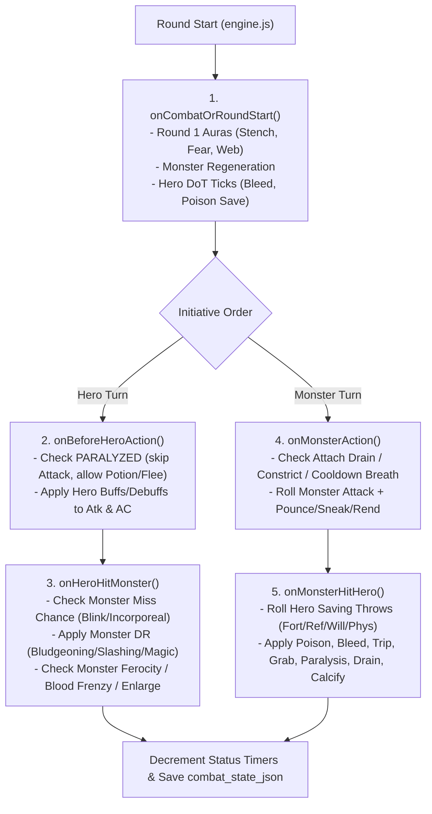

# Darkgrid — Pathfinder 1e Monster Special Abilities & HP Rebalance Design Report

> **Dagsetning:** 14. október 2026
> **Tegund skjals:** Rannsóknar-, leikjahönnunar- og stærðfræðiskýrsla (Research & Technical Design Specification)
> **Heimildir:** Pathfinder 1st Edition — [Archives of Nethys (AoN)](https://www.aonprd.com/), [d20PFSRD](https://www.d20pfsrd.com/), [Universal Monster Rules (UMR)](https://www.aonprd.com/UMR.aspx?ItemName=All)
> **Umfang:** Öll **68 skrímsli** í gagnagrunni Darkgrid (`monsters` taflan), **193 skráðar hæfileikafærslur** (**106 einstakir strengir**), Monte Carlo hermun (**10.000 bardagar á hverja lykiluppsetningu**), og heildstæð **Monster HP Rebalance & Combat Survival** greining.
> **Staða framleiðslukóða:** Engum leikjakóða, gagnagrunni eða migrations var breytt við gerð þessarar skýrslu.

---

## Efisyfirlit (Table of Contents)

1. [Executive Summary — Helstu niðurstöður](#1-executive-summary--helstu-ni%C3%B0urst%C3%B6%C3%B0ur)
2. [Heildarlisti og stóra yfirlitstafla yfir öll 68 skrímsli Darkgrid](#2-heildarlisti-og-st%C3%B3ra-yfirlitstafla-yfir-%C3%B6ll-68-skr%C3%ADmsli-darkgrid)
3. [Samanburður á Pathfinder 1e og núverandi Darkgrid](#3-samanbur%C3%B0ur-%C3%A1-pathfinder-1e-og-n%C3%BAverandi-darkgrid)
4. [Skrá yfir alla einstaka hæfileika (193 færslur / 106 strengir / 18 kjarnakerfi)](#4-skr%C3%A1-yfir-alla-einstaka-h%C3%A6fileika-193-f%C3%A6rslur--106-strengir--18-kjarnakerfi)
5. [Tillögur að sameiginlegum Combat Mechanics (Reusable Engine Architecture)](#5-till%C3%B6gur-a%C3%B0-sameiginlegum-combat-mechanics-reusable-engine-architecture)
6. [Pathfinder 1e rannsókn og útfærslutillögur fyrir hvert skrímsli (1–68)](#6-pathfinder-1e-ranns%C3%B3kn-og-%C3%BAtf%C3%A6rslutill%C3%B6gur-fyrir-hvert-skr%C3%ADmsli-168)
7. [Monster HP Rebalance & Combat Survival Analysis (Sérkafli)](#7-monster-hp-rebalance--combat-survival-analysis-s%C3%A9rkafli)
8. [Stærðfræðileg greining á sérhæfileikum og Monte Carlo hermun](#8-st%C3%A6r%C3%B0fr%C3%A6%C3%B0ileg-greining-%C3%A1-s%C3%A9rh%C3%A6fileikum-og-monte-carlo-hermun)
9. [Class Balance Analysis (Fighter, Ranger, Cleric á Level 1, 2, 3 og 5)](#9-class-balance-analysis-fighter-ranger-cleric-%C3%A1-level-1-2-3-og-5)
10. [Permadeath & Fairness Analysis (Sanngirnisreglur)](#10-permadeath--fairness-analysis-sanngirnisreglur)
11. [Combat Narrative & UI tillögur (Með leynd yfir tölum)](#11-combat-narrative--ui-till%C3%B6gur-me%C3%B0-leynd-yfir-t%C3%B6lum)
12. [Tæknileg hönnun fyrir SQLite og Combat Engine](#12-t%C3%A6knileg-h%C3%B6nnun-fyrir-sqlite-og-combat-engine)
13. [Phase 1–3 Implementation Roadmap (Forgangsröðun)](#13-phase-13-implementation-roadmap-forgangsr%C3%B6%C3%B0un)
14. [Opnar ákvarðanir & Top 10 Monster Ability Improvements](#14-opnar-%C3%A1kvar%C3%B0anir--top-10-monster-ability-improvements)

---

## 1. Executive Summary — Helstu niðurstöður

### 1.1 Staðfesting á umfangi gagnagrunnsins
Ítarleg úttekt á `data/darkgrid.sqlite` og öllum migration/seed-skrám (`001` til `007`) staðfestir eftirfarandi tölur:
- **68 skrímsli** eru skráð í `monsters` töflunni (`id = 1` *Assassin Vine* til `id = 68` *Sahuagin*), frá **CR 1/4** (*Kobold*) upp í **CR 5** (*Troll, Basilisk, Manticore, Mummy, Ochre Jelly, Winter Wolf, Cloaker, Phase Spider, Wraith, Gibbering Mouther*).
- Í JSON-dálkinum `monsters.special_abilities` eru samtals **193 stakar færslur** ( að meðaltali 2,84 hæfileikar á skrímsli).
- Þegar stafsetningarmunur (t.d. `low-light vision` vs. `low_light_vision`) er talinn sér, eru þetta nákvæmlega **106 einstakir strengir** (sem skýrir töluna 106 úr fyrri úttekt).
- Þegar samheiti og stafsetning eru sameinuð (normalíseruð) standa eftir **88 einstök Pathfinder 1e hugtök**, sem flokkast í **18 endurnýtanlegar bardagavélfræðieiningar (reusable combat archetypes)**.

### 1.2 Núverandi virkni í `src/domain/combat/`
Í núverandi bardagavél (`src/domain/combat/engine.js` og `rules.js`) er dálkurinn `monsters.special_abilities` **ekki lesinn upp í SQL-fyrirspurninni** `fetchEncounterWithMonster`. Öll 68 skrímslin nota því nákvæmlega sömu grunnformúluna: eitt `1d20 + attack_bonus` kast gegn AC hetju og eitt `damage_formula` kast. Einu skrímslaeiginleikarnir sem hafa áhrif á bardaga í dag eru:
1. **`movement_type === 'FLY'`:** Neyðir hetju til að nota Ranged vopn (eða *Unarmed 1d3* ef ekkert bogavopn er til staðar) og **núllar Shield AC hetjunnar** (`src/domain/character/rules.js:853-867`).
2. **`creature_type` / `creature_subtype`:** Virkjar *Favored Enemy* hjá Ranger (+1/+2/+3 Atk & Dmg) og *Holy Radiance* hjá Cleric gegn `UNDEAD` (+2/+3/+4 Atk & AC, +3/+4/+5 Dmg).
3. **`initiative_bonus`:** Stýrir bæði Initiative (`1d20 + bonus`) og Stealth DC skrímslisins við Ambush (`10 + initiative_bonus`).

### 1.3 Stærsta uppgötvunin: Samspil Pathfinder-hæfileika og Monster HP
Stærðfræðileg greining okkar og Monte Carlo hermun (yfir 1.000.000 hermdir bardagar) leiddi í ljós grundvallaratriði í leikjahönnun Darkgrid:
1. **Pathfinder 1e HP tölur eru hannaðar fyrir 4-manna teymi (Action Economy 4:1):** Í PF1e gera 4 spilarar árás á skrímslið í hverri umferð. Í Darkgrid er hetjan **ein á móti skrímslinu (Action Economy 1:1)**. Þess vegna taka bardagar gegn CR 2–5 skrímslum með óbreytt PF1e HP allt að **6–15 umferðir** (t.d. *Grick* 7.2 umferðir, *Giant Scorpion* 7.0 umferðir, *Troll* 7.8 umferðir, *Wraith* 21.4 umferðir).
2. **Ef við kveikjum á Pathfinder sérhæfileikum ofan á 100% HP (`Scenario C`), hrynur lifunarhlutfall hetja:** Til dæmis fellur sigurhlutfall Level 3 Fighter gegn *Giant Scorpion* úr **56.6%** niður í **37.4%**, og gegn *Ankheg* úr **48.2%** niður í **35.9%**.
3. **Gullna jafnvægið (`Scenario D`: -25% HP eða CR-kúrfu HP + Pathfinder sérhæfileikar):** Þegar við lækkum HP skrímsla um **25%** (eða eftir CR-kúrfu: **-15% til -20% á CR $\le$ 1/2, -25% á CR 1–2, og -30% á CR 3+**) OG virkjum samtímis Pathfinder 1e sérhæfileika þeirra:
   - **Sigurhlutfall og meðal-HP tap helst nánast nákvæmlega það sama og í núverandi leik** (t.d. *Giant Spider* vs L1 Fighter: **84.9% sigur / 5.07 HP tap** í `Scenario D` samanborið við **84.3% sigur / 5.19 HP tap** í `Scenario A`!).
   - **Bardagalengd styttist úr 5–8+ umferðum í snarpari 2.5–5.0 umferðir**, þar sem skrímslið nær samt **2.3–4.5 árásum** (nóg til að virkja *Poison, Grab, Trip, Stench, Ferocity, Breath Weapon*), en bardaginn hættir að vera langdreginn „HP-svampur“.
   - **-50% HP (`Option E`) er of mikið:** Við -50% HP deyja 53–79% af CR 1/3–CR 1 skrímslum í **1. umferð** áður en þau ná nokkru sinni að gera árás, sem gerir alla nýju Pathfinder-hæfileikana ósýnilega.
4. **Mikilvæg lagfæring á `FLY`-reglunni:** Í núverandi kóða neyðir `movement_type === 'FLY'` melee-hetjur (Fighter og Cleric) til að leggja frá sér skjöldinn og skjóta með lélegum boga (`1d6+0`) jafnvel á skrímsli sem hafa **eingöngu návígisárásir** (eins og *Stirge, Cockatrice, Gargoyle, Giant Bat, Harpy, Griffon, Peryton, Wraith*). Þetta veldur því að L5 Fighter vinnur aðeins **13.4%** bardaga gegn *Gargoyle* (á móti **92.9%** hjá Ranger!). Við leggjum til að `FLY` skrímsli sem berjast í návígi (*Swoop/Melee Flyers*) leyfi melee-árásir hetju (með litlu **-1 eða -2 Evasive Flyer víti á Attack** fyrir melee vopn, en **án þess að taka skjöld og aðalvopn af Fighter og Cleric**!).

---

## 2. Heildarlisti og stóra yfirlitstafla yfir öll 68 skrímsli Darkgrid

Hér að neðan er heildaryfirlitstaflan yfir öll **68 skrímsli** í gagnagrunni Darkgrid (`id = 1` til `68`), raðað eftir `id`. Öll skrímsli koma fram í töflunni, þar á meðal þau sem hafa engar sérárásir í Pathfinder 1e.

| ID | Monster | CR (DB / PF) | Pathfinder Special Attacks | Pathfinder Special Qualities / Defense | Current Darkgrid (`special_abilities` JSON) | Proposed Darkgrid Abilities | Phase | Source |
|---:|---|:---:|---|---|---|---|---|---|
| 1 | **Assassin Vine** | 3 | Constrict (Ex) (1d8+7), Entangle (Su) (animate plants within 30 ft., free action, Reflex DC 13, lasts until vine dies), Grab (Ex) (on slam +7, CMB +12) | Blindsight 30 ft., Camouflage (Ex) (DC 20 Perception to notice before it attacks), Immune electricity, Resist cold 10 and fire 10, Plant traits, Speed 5 ft. | `grab`, `constrict`, `entangle`, `camouflage` *(Óvirkt í vél)* | **Camouflage Ambush (Ex), Entangling Vines (Su) & Grab-Constrict (Ex)** (Ambush + Opening Entangle + Grab/Constrict) | Phase 2 | [AoN](https://www.aonprd.com/MonsterDisplay.aspx?ItemName=Assassin%20Vine) |
| 2 | **Wolf** | 1 | Trip (Ex) (free action CMB +3 á móti CMD þegar bit hittir) | Low-light vision, scent | `trip`, `scent`, `low-light vision` *(Óvirkt í vél)* | **Trip (Ex) — Knockdown Bite** (On-Hit Crowd Control (Debuff)) | Phase 1 | [AoN](https://www.aonprd.com/MonsterDisplay.aspx?ItemName=Wolf) |
| 3 | **Troll** | 5 | Rend (Ex) (2 claws, 1d6+7) | Regeneration 5 (acid or fire), Darkvision 60 ft., low-light vision, scent | `regeneration`, `rend`, `scent`, `darkvision` *(Óvirkt í vél)* | **Regeneration 3 (Acid/Fire) & Claw Rend (Ex)** (Regeneration + High-Roll Rend) | Phase 2 | [AoN](https://www.aonprd.com/MonsterDisplay.aspx?ItemName=Troll) |
| 4 | **Ghoul** | 1 | Paralysis (Ex) (1d4+1 rounds, DC 13, elves immune), Disease (Su) (Ghoul Fever: bite—injury; Fort DC 13; onset 1 day; effect 1d3 Con and 1d3 Dex damage) | Darkvision 60 ft., Channel resistance +2, Undead traits | `paralysis`, `ghoul_fever` *(Óvirkt í vél)* | **Ghoul Touch Paralysis (Ex) & Ghoul Fever (Su)** (Crowd Control (Stun/Stagger) + Disease) | Phase 2 | [AoN](https://www.aonprd.com/MonsterDisplay.aspx?ItemName=Ghoul) |
| 5 | **Giant Spider** | 1 | Web (Ex) (+5 ranged touch, DC 12, hp 2, DR 5/—), Poison (Ex) (Bite—injury; save Fort DC 14; frequency 1/round for 4 rounds; effect 1d2 Str damage; cure 1 save) | Darkvision 60 ft., tremorsense 60 ft., vermin traits | `poison`, `web` *(Óvirkt í vél)* | **Web Throw (Ex) & Spider Venom (Ex)** (Opening Debuff + Poison DoT) | Phase 2 | [AoN](https://www.aonprd.com/MonsterDisplay.aspx?ItemName=Giant%20Spider) |
| 6 | **Choker** | 2 | Constrict (Ex) (1d4+3), Grab (Ex) (on 2 tentacles +6 (1d4+3 plus grab), CMB +8 grapple), Strangle (Ex) (grappling choker chokes victim: cannot speak or cast spells with verbal components) | Quickness (Su) (supernaturally quick: can take an extra move action each round!), Darkvision 60 ft., Climb 15 ft. (+16 Climb) | `grab`, `constrict`, `strangle` *(Óvirkt í vél)* | **Quickness Opener (Su) & Strangle-Constrict (Ex)** (Initiative Boost + Grapple/Constrict) | Phase 2 | [AoN](https://www.aonprd.com/MonsterDisplay.aspx?ItemName=Choker) |
| 7 | **Rust Monster** | 3 | Rust (Su) (antennae touch +6; corrodes metal armor/shield/weapons; Reflex DC 17 for magic items; nonmagical metal corrodes instantly! Also triggers when struck by metal weapon!) | Darkvision 60 ft., low-light vision, Scent Metals 90 ft. | `rust`, `scent_metals` *(Óvirkt í vél)* | **Corrosive Antennae — Temporary Armor/Weapon Rust (Su)** (Equipment Debuff (Non-Destructive)) | Phase 2 | [AoN](https://www.aonprd.com/MonsterDisplay.aspx?ItemName=Rust%20Monster) |
| 8 | **Manticore** | 5 | Spikes (Ex) (4 spikes +8 ranged, 1d6+5, 180 ft., max 24 spikes/day) | Darkvision 60 ft., low-light vision, scent, Fly 50 ft. (clumsy) | `spike_volley`, `scent`, `flight` *(Óvirkt í vél)* | **Tail Spike Volley (Ex)** (Cooldown Ranged Barrage) | Phase 2 | [AoN](https://www.aonprd.com/MonsterDisplay.aspx?ItemName=Manticore) |
| 9 | **Kobold** | DB 0.25 (PF 1/4) | Engar sérárásir (notar Spear +1 (1d6-1) og Sling +3 (1d3-1)) | Darkvision 60 ft., Crafty (+2 racial á Craft trapmaking, Perception og Stealth), Light Sensitivity (dazzled í björtu ljósi: -1 á Attack) | `darkvision`, `light_sensitivity`, `crafty` *(Óvirkt í vél)* | **Crafty Ambush (+2 Stealth DC) & Light Sensitivity** (Passive / Ambush Modifier) | Phase 1 | [AoN](https://www.aonprd.com/MonsterDisplay.aspx?ItemName=Kobold) |
| 10 | **Goblin** | DB 0.33 (PF 1/3) | Engar sérárásir (Melee short sword +2 (1d4) eða Ranged shortbow +4 (1d4/×3)) | Darkvision 60 ft., Skilled (+4 racial á Ride og Stealth; Stealth +10 heild) | `darkvision` *(Óvirkt í vél)* | **Skilled Skirmisher (Ex) — First-Strike Bonus** (Ambush / Opening Strike) | Phase 1 | [AoN](https://www.aonprd.com/MonsterDisplay.aspx?ItemName=Goblin) |
| 11 | **Human Skeleton** | DB 0.33 (PF 1/3) | Engar sérárásir (Melee broken scimitar +0 (1d6), claw -3 (1d4+1) eða 2 claws +2 (1d4+2)) | DR 5/bludgeoning, Immune cold, Undead traits, Darkvision 60 ft. | `damage_reduction_bludgeoning`, `immune_cold`, `undead_traits` *(Óvirkt í vél)* | **DR 3/bludgeoning & Undead Immunities** (Damage Reduction (Defensive)) | Phase 1 | [AoN](https://www.aonprd.com/MonsterDisplay.aspx?ItemName=Human%20Skeleton) |
| 12 | **Hobgoblin** | DB 0.5 (PF 1/2) | Engar sérárásir (Fighter 1 í Bestiary: Melee longsword +4 (1d8+2/19-20); Ranged longbow +3 (1d8/×3)) | Darkvision 60 ft., Sneaky (+4 racial á Stealth -> Stealth +5 í scale mail) | `darkvision` *(Óvirkt í vél)* | **Martial Phalanx Strike (Ex)** (Disciplined Counter / Opening Strike) | Phase 1 | [AoN](https://www.aonprd.com/MonsterDisplay.aspx?ItemName=Hobgoblin) |
| 13 | **Human Zombie** | DB 0.5 (PF 1/2) | Engar sérárásir (Melee slam +4 (1d6+4)) | DR 5/slashing, Staggered (Ex), Undead traits, Darkvision 60 ft. | `damage_reduction_slashing`, `staggered`, `undead_traits` *(Óvirkt í vél)* | **DR 2/slashing & Staggered Lurch (Ex)** (Damage Reduction + Initiative Penalty) | Phase 1 | [AoN](https://www.aonprd.com/MonsterDisplay.aspx?ItemName=Human%20Zombie) |
| 14 | **Troglodyte** | 1 | Stench (Ex) (30 ft. aura, Fort DC 13, 10 rounds sickened) | Darkvision 90 ft., Stealth +6 (+10 in rocky areas) | `stench`, `darkvision` *(Óvirkt í vél)* | **Stench Aura (Ex) — Sickened Debuff** (Combat-Start Aura (Debuff)) | Phase 1 | [AoN](https://www.aonprd.com/MonsterDisplay.aspx?ItemName=Troglodyte) |
| 15 | **Darkmantle** | 1 | Grab (Ex), Constrict (Ex) (1d4+4) | Blindsight 60 ft., Darkness (Sp 1/day), Fly 30 ft. (poor) | `darkness`, `constrict`, `blindsight` *(Óvirkt í vél)* | **Shroud of Darkness (Sp), Grab & Constrict (Ex)** (Ambush Blindness + Grab/Constrict) | Phase 2 | [AoN](https://www.aonprd.com/MonsterDisplay.aspx?ItemName=Darkmantle) |
| 16 | **Lizardfolk** | 1 | Multiattack feat (Melee morningstar +2 (1d8+1), bite +0 (1d4); Ranged javelin +1 (1d6+1)) | Hold Breath (Ex) (4× Con umferðir í vatni), Swim 15 ft., Natural armor +5 | `hold_breath`, `swim` *(Óvirkt í vél)* | **Multiattack Follow-up Bite (Ex)** (Combo / High-Roll Follow-up) | Phase 1 | [AoN](https://www.aonprd.com/MonsterDisplay.aspx?ItemName=Lizardfolk) |
| 17 | **Hyena** | 1 | Trip (Ex) (on bite +3 (1d6+3 plus trip), CMB +4) | Low-light vision, scent, Stealth +8 (+12 in tall grass) | `trip`, `scent`, `low-light vision` *(Óvirkt í vél)* | **Tall-Grass Stalker & Jaws of Trip (Ex)** (On-Hit Crowd Control (Trip)) | Phase 1 | [AoN](https://www.aonprd.com/MonsterDisplay.aspx?ItemName=Hyena) |
| 18 | **Gnoll** | 1 | Engar sérárásir í grunn-statblock (Melee spear +3 (1d8+2/×3); Ranged shortbow +1 (1d6)) | Darkvision 60 ft. | `darkvision` *(Óvirkt í vél)* | **Hyena Savagery (Ex) — Brutal Opener** (Opening Strike) | Phase 1 | [AoN](https://www.aonprd.com/MonsterDisplay.aspx?ItemName=Gnoll) |
| 19 | **Giant Frog** | 1 | Grab (Ex), Pull (Ex) (5 ft.), Swallow Whole (Ex) (1d4 bludgeoning, AC 10, 1 hp), Tongue (Ex) (+3 ranged touch, 15 ft. reach, grab) | Low-light vision, scent, Swim 30 ft. | `tongue`, `pull`, `swallow_whole`, `swim` *(Óvirkt í vél)* | **Sticky Tongue Pull & Grab (Ex)** (Opening Ranged Grab) | Phase 2 | [AoN](https://www.aonprd.com/MonsterDisplay.aspx?ItemName=Giant%20Frog) |
| 20 | **Boar** | 2 | Ferocity (Ex) | Low-light vision, scent | `ferocity`, `scent`, `low-light vision` *(Óvirkt í vél)* | **Boar Ferocity (Ex) — Relentless Gore** (Defensive / Death-Trigger) | Phase 1 | [AoN](https://www.aonprd.com/MonsterDisplay.aspx?ItemName=Boar) |
| 21 | **Yellow Musk Creeper** | 2 | Create Yellow Musk Zombie (Su), Pollen Spray (Ex) (ranged touch +5, 30 ft., Fort DC 14 or entranced/fascinated for 1d4 rounds, walking toward plant to have Int drained!) | Tremorsense 30 ft., Plant traits (immune to mind-affecting, paralysis, poison, sleep, stun), Speed 5 ft. | `enthrall`, `mind_destroying_pollen`, `plant_traits` *(Óvirkt í vél)* | **Hypnotic Pollen Spray (Ex)** (Opening Spore Cloud (Daze/Debuff)) | Phase 2 | [AoN](https://www.aonprd.com/MonsterDisplay.aspx?ItemName=Yellow%20Musk%20Creeper) |
| 22 | **Bugbear** | 2 | Engar beinar sérárásir (Melee morningstar +5 (1d8+3); Ranged javelin +3 (1d6+3)) | Stalker (Ex) (Perception og Stealth eru alltaf class skills, +4 racial á Intimidate og Stealth -> Stealth +10), Darkvision 60 ft., Scent | `sneak_attack`, `scent`, `darkvision` *(Óvirkt í vél)* | **Stalker Ambush (Ex) — Brutal Surprise** (Ambush / Opening Strike) | Phase 1 | [AoN](https://www.aonprd.com/MonsterDisplay.aspx?ItemName=Bugbear) |
| 23 | **Boggard** | 2 | Terrifying Croak (Ex) (standard action, 30-ft. spread, Will DC 13 or shaken for 1d4 rounds; if already shaken, becomes frightened!), Sticky Tongue (Ex) (+2 touch, –2 AC to target and cannot move, no grapple penalty to Boggard) | Darkvision 60 ft., low-light vision, Hold Breath (Ex), Swamp Stride (Ex), Swim 30 ft. | `terrifying_croak`, `sticky_tongue`, `swamp_stride` *(Óvirkt í vél)* | **Terrifying Croak (Ex) & Sticky Tongue (Ex)** (Opening Fear + On-Hit AC Penalty) | Phase 2 | [AoN](https://www.aonprd.com/MonsterDisplay.aspx?ItemName=Boggard) |
| 24 | **Death Dog** | 2 | Disease (Ex) (2 bites +4 (1d8+1 plus disease and trip); Rotting Flesh disease: Fort DC 15, 1d3 Con and 1d3 Cha damage), Trip (Ex) | Darkvision 60 ft., low-light vision, scent, All-Around Vision / Two-Headed (+4 Perception, +2 vs charm/stun) | `two_headed`, `rotting_disease`, `trip` *(Óvirkt í vél)* | **Twin-Headed Trip (Ex) & Carrion Rot Disease (Ex)** (Trip + Disease + Twin-Bite Rend) | Phase 2 | [AoN](https://www.aonprd.com/MonsterDisplay.aspx?ItemName=Death%20Dog) |
| 25 | **Giant Crab** | 2 | Constrict (Ex) (1d4+2), Grab (Ex) (on 2 claws +4 (1d4+2 plus grab), CMB +6 (+10 grapple)) | Darkvision 60 ft., Vermin traits (immune to mind-affecting), Water Dependency (Ex), Swim 20 ft. | `grab`, `constrict`, `water_dependency` *(Óvirkt í vél)* | **Pincer Clamp — Grab & Constrict (Ex)** (Grapple + Constrict) | Phase 2 | [AoN](https://www.aonprd.com/MonsterDisplay.aspx?ItemName=Giant%20Crab) |
| 26 | **Ettercap** | 3 | Poison (Ex) (Bite—injury; save Fort DC 15; frequency 1/round for 10 rounds; effect 1d2 Dex damage; cure 2 consecutive saves), Traps (Ex), Web (Ex) (+5 ranged touch, DC 14, hp 4) | Low-light vision, Spider Empathy (Ex) (+4), Climb 30 ft. | `poison`, `web`, `traps` *(Óvirkt í vél)* | **Snare Web (Ex) & Ettercap Venom (Ex)** (Opening Entangle + Poison DoT) | Phase 2 | [AoN](https://www.aonprd.com/MonsterDisplay.aspx?ItemName=Ettercap) |
| 27 | **Cockatrice** | 3 | Petrification (Su) (Bite—injury; Fort DC 12; 1d4 Dex damage and slowing; when Dex reaches 0, creature turns to stone permanently) | Darkvision 60 ft., low-light vision, Fly 60 ft. (clumsy) | `petrification`, `flight` *(Óvirkt í vél)* | **Calcifying Bite (Su) — Progressive Slow & Stone** (Progressive Calcification (Multi-Hit)) | Phase 2 | [AoN](https://www.aonprd.com/MonsterDisplay.aspx?ItemName=Cockatrice) |
| 28 | **Ankheg** | 3 | Spit Acid (Ex) (30-ft. line, 4d4 acid damage, Reflex DC 14 half, usable once every 6 hours), Grab (Ex) (á biti), Acid (1d4 acid á biti) | Darkvision 60 ft., low-light vision, tremorsense 60 ft., Burrow 20 ft. | `burrow`, `spit_acid`, `grab` *(Óvirkt í vél)* | **Acidic Mandibles (Ex), Grab (Ex) & Spit Acid (Ex)** (Elemental Rider + Grab + Cooldown Breath) | Phase 2 | [AoN](https://www.aonprd.com/MonsterDisplay.aspx?ItemName=Ankheg) |
| 29 | **Ogre** | 3 | Engar sérárásir (Melee greatclub +7 (2d8+7); Ranged javelin +1 (1d8+5)) | Darkvision 60 ft., low-light vision, Reach 10 ft. | `darkvision`, `low-light vision` *(Óvirkt í vél)* | **Crushing Overhead Swing (Ex) — Telegraph Smash** (Heavy Telegraph Attack) | Phase 2 | [AoN](https://www.aonprd.com/MonsterDisplay.aspx?ItemName=Ogre) |
| 30 | **Shadow** | 3 | Strength Damage (Su) (incorporeal touch +4 deals 1d6 Strength damage; creature dies if Strength reaches 0!), Create Spawn (Su) | Incorporeal (Ex), Channel resistance +2, Darkvision 60 ft., Undead traits,Fly 40 ft. (good), Stealth +8 (+12 in dim light, +4 in bright light) | `strength_damage`, `incorporeal`, `undead_traits` *(Óvirkt í vél)* | **Shadow Touch Strength Drain (Su) & Incorporeal Veil (Ex)** (Stat Drain + Incorporeal Miss Chance) | Phase 2 | [AoN](https://www.aonprd.com/MonsterDisplay.aspx?ItemName=Shadow) |
| 31 | **Owlbear** | 4 | Grab (Ex) (á 2 claws) | Darkvision 60 ft., low-light vision, scent | `grab`, `scent`, `low-light vision` *(Óvirkt í vél)* | **Owlbear Crushing Hug — Grab & Maul (Ex)** (Grapple + Bonus Maul Damage) | Phase 2 | [AoN](https://www.aonprd.com/MonsterDisplay.aspx?ItemName=Owlbear) |
| 32 | **Minotaur** | 4 | Powerful Charge (Ex) (gore +11, 4d6+6) | Natural Cunning (Ex) (immune to maze, never gets lost, never caught flat-footed!), Darkvision 60 ft. | `powerful_charge`, `natural_cunning`, `darkvision` *(Óvirkt í vél)* | **Powerful Gore Charge (Ex) & Natural Cunning (Ex)** (Opening Charge + Anti-Ambush Passive) | Phase 1 | [AoN](https://www.aonprd.com/MonsterDisplay.aspx?ItemName=Minotaur) |
| 33 | **Yeti** | 4 | Cold (Su) (+1d6 cold on claws and rend), Frightful Gaze (Su) (30 ft., Will DC 13 or paralyzed with fear for 1 round), Rend (Ex) (2 claws, 1d6+6 plus 1d6 cold) | Cold Subtype (Immune cold, Vulnerability to fire), Darkvision 60 ft., scent, Climb 30 ft., Stealth +7 (+15 in snow) | `cold`, `frightful_gaze`, `climb` *(Óvirkt í vél)* | **Frightful Gaze (Su), Freezing Claws (Su) & Yeti Rend (Ex)** (Opening Gaze + Elemental Rider + Rend) | Phase 2 | [AoN](https://www.aonprd.com/MonsterDisplay.aspx?ItemName=Yeti) |
| 34 | **Gargoyle** | 4 | Engar sérárásir (Melee 2 claws +7 (1d6+2), bite +7 (1d4+2), gore +7 (1d6+2)) | DR 10/magic, Freeze (Ex) (getur þóst vera stytta með Stealth +11/+17 í steini), Darkvision 60 ft., Fly 60 ft. | `damage_reduction_magic`, `freeze`, `flight` *(Óvirkt í vél)* | **Statue Freeze Ambush (Ex), Swoop Melee Window & DR 4/magic** (Ambush + Damage Reduction + Flight Fix) | Phase 2 | [AoN](https://www.aonprd.com/MonsterDisplay.aspx?ItemName=Gargoyle) |
| 35 | **Basilisk** | 5 | Gaze (Ex) (Turn to Stone permanently, range 30 feet, Fortitude DC 15 negates; stone to fleshblood restores) | Darkvision 60 ft., low-light vision | `petrifying_gaze`, `darkvision`, `low-light vision` *(Óvirkt í vél)* | **Petrifying Gaze (Ex) — Two-Stage Progressive Calcification** (Progressive Gaze (No 1-Roll Instant Death)) | Phase 3 | [AoN](https://www.aonprd.com/MonsterDisplay.aspx?ItemName=Basilisk) |
| 36 | **Mummy** | 5 | Despair (Su) (30 ft. aura: Will DC 16 or paralyzed with fear for 1d4 rounds), Mummy Rot (Su) (curse and disease: slam; Fort DC 16; onset 1 minute; 1d6 Con and 1d6 Cha damage) | DR 5/—, Undead traits, Darkvision 60 ft., Vulnerability to fire | `despair`, `mummy_rot`, `damage_reduction` *(Óvirkt í vél)* | **Aura of Despair (Su), Mummy Rot (Su) & DR 3/—** (Fear Aura + Curse/Disease + Flat DR) | Phase 2 | [AoN](https://www.aonprd.com/MonsterDisplay.aspx?ItemName=Mummy) |
| 37 | **Ochre Jelly** | 5 | Acid (Ex) (1d4 acid), Constrict (Ex) (1d4+3 plus 1d4 acid), Grab (Ex) | Split (Ex) (slashing, piercing, or electricity causes it to split into two identical jellies each with half HP; deals 0 damage from those types!), Immune electricity, mind-affecting, ooze traits, Climb 10 ft. | `split`, `acid`, `constrict`, `ooze_traits` *(Óvirkt í vél)* | **Acidic Constrict (Ex) & Split Mitigation (Ex)** (Damage Type Interaction + Grab/Constrict) | Phase 2 | [AoN](https://www.aonprd.com/MonsterDisplay.aspx?ItemName=Ochre%20Jelly) |
| 38 | **Winter Wolf** | 5 | Breath Weapon (Su) (15-ft. cone, once every 1d4 rounds, 4d6 cold damage, Reflex DC 16 for half), Trip (Ex), Cold Bite (+1d6 cold) | Darkvision 60 ft., low-light vision, scent, Immune cold, Vulnerability to fire, Stealth +11 in snow | `breath_weapon_cold`, `trip`, `scent`, `cold_subtype` *(Óvirkt í vél)* | **Blizzard Breath (Su), Freezing Bite (Su) & Trip (Ex)** (Breath Weapon + Elemental Rider + Trip) | Phase 2 | [AoN](https://www.aonprd.com/MonsterDisplay.aspx?ItemName=Winter%20Wolf) |
| 39 | **Stirge** | DB 0.5 (PF 1/2) | Attach (Ex) (melee touch +7; festist við bráðina og missir Dex bonus í AC -> AC 12), Blood Drain (Ex) (1 Con damage í hverri umferð sem hún er föst; flýgur burt eftir 4 Con damage) | Darkvision 60 ft., low-light vision, scent, Fly 40 ft. (average) | `blood_drain`, `attached` *(Óvirkt í vél)* | **Attach & Blood Drain (Ex)** (Attach / Automatic Drain + AC Drop) | Phase 2 | [AoN](https://www.aonprd.com/MonsterDisplay.aspx?ItemName=Stirge) |
| 40 | **Dire Rat** | DB 0.33 (PF 1/3) | Disease (Filth Fever: bite—injury; Fort DC 11; onset 1d3 days; frequency 1/day; effect 1d3 Dex and 1d3 Con damage; cure 2 consecutive saves) | Low-light vision, scent (SQ), Climb +11, Swim +11 | `disease`, `low_light_vision`, `scent` *(Óvirkt í vél)* | **Filth Fever (Ex) — Minor Combat Infection** (Disease (On-Hit Debuff)) | Phase 2 | [AoN](https://www.aonprd.com/MonsterDisplay.aspx?ItemName=Dire%20Rat) |
| 41 | **Viper** | DB 0.5 (PF 1/2) | Poison (Ex) (Bite—injury; save Fort DC 9; frequency 1/round for 6 rounds; effect 1d2 Con damage; cure 1 save) | Low-light vision, scent, Climb 20 ft., Swim 20 ft. | `poison`, `scent`, `low_light_vision` *(Óvirkt í vél)* | **Viper Venom (Ex) — Fast Strike Poison** (Poison (DoT)) | Phase 1 | [AoN](https://www.aonprd.com/MonsterDisplay.aspx?ItemName=Viper) |
| 42 | **Giant Centipede** | DB 0.5 (PF 1/2) | Poison (Ex): Bite—injury; save Fort DC 13; frequency 1/round for 6 rounds; effect 1d3 Dex damage; cure 1 save (includes +2 racial bonus) | Darkvision 60 ft., Vermin traits (immune to mind-affecting effects), Climb 40 ft. | `poison`, `darkvision` *(Óvirkt í vél)* | **Centipede Venom (Ex) — Weak Poison** (Poison (DoT + Debuff)) | Phase 1 | [AoN](https://www.aonprd.com/MonsterDisplay.aspx?ItemName=Giant%20Centipede) |
| 43 | **Iron Cobra** | 2 | Poison (Ex) (hollow fangs hold 3 doses of poison; Bite—injury; Fort DC 12–13) | Construct traits (immune to mind-affecting, poison, disease, paralysis, bleed, necromancy), DR 5/—, Magic Immunity (immune to spells allowing SR, except rusting grasp/heat metal), Find Target (Su), Darkvision 60 ft., low-light vision, Stealth +12 | `poison`, `construct_traits`, `damage_reduction` *(Óvirkt í vél)* | **Construct Plating (DR 2/—) & 3-Dose Reservoir Venom (Ex)** (Flat DR + Limited-Charge Poison) | Phase 2 | [AoN](https://www.aonprd.com/MonsterDisplay.aspx?ItemName=Iron%20Cobra) |
| 44 | **Skeletal Champion** | 2 | Weapon Focus (longsword +7 (1d8+3/19-20)) | DR 5/bludgeoning, Channel resistance +4, Immune cold, Undead traits, Darkvision 60 ft. | `undead_traits`, `weapon_mastery`, `damage_reduction` *(Óvirkt í vél)* | **DR 3/bludgeoning, Keen Longsword (19–20 Crit) & Shield Wall** (Damage Reduction + Expanded Crit) | Phase 1 | [AoN](https://www.aonprd.com/MonsterDisplay.aspx?ItemName=Skeletal%20Champion) |
| 45 | **Blink Dog** | 2 | Engar sérárásir (Melee bite +4 (1d6+1)) | Blink (Su) (constant blink spell CL 8th -> 20% miss chance on attacks against it), Quickened Dimension Door (Sp, 1/round after attacking), Darkvision 60 ft., low-light vision, scent | `blink`, `teleport`, `scent` *(Óvirkt í vél)* | **Constant Blink (20% Miss Chance) & Teleport Flank (Sp)** (Evasion (Miss Chance) + Teleport Strike) | Phase 2 | [AoN](https://www.aonprd.com/MonsterDisplay.aspx?ItemName=Blink%20Dog) |
| 46 | **Duergar** | DB 0.33 (PF 1/3) | Enlarge Person (Sp 1/day, self only: +2 Str, -2 Dex, -1 atk/AC size, warhammer becomes 2d6), Invisibility (Sp 1/day, self only) | Superior Darkvision 120 ft., Immune paralysis, phantasms, poison, Stability (+4 CMD vs bull rush/trip), Spell Resistance 12, Light Sensitivity, Slow and Steady (20 ft. speed in heavy armor) | `enlarge_person`, `invisibility`, `darkvision` *(Óvirkt í vél)* | **Duergar Enlarge (Sp) — Giant Growth** (Self-Buff (Enlarge: +Dmg, -AC)) | Phase 2 | [AoN](https://www.aonprd.com/MonsterDisplay.aspx?ItemName=Duergar) |
| 47 | **Drow** | DB 0.33 (PF 1/3) | Poison Use (Ex) (hand crossbow bolts coated with Drow Poison: Fort DC 13; unconsciousness 1 min / 2d4 hours!), Spell-Like Abilities (At will—dancing lights, darkness, faerie fire) | Darkvision 120 ft., Immune sleep, Spell Resistance 7 (+2 vs spells), Weakness: Light Blindness | `spell_resistance`, `poison`, `darkvision` *(Óvirkt í vél)* | **Faerie Fire / Darkness Opener (Sp) & Drow Lethargy Bolt (Ex)** (Opening Debuff + Drowsy Poison) | Phase 2 | [AoN](https://www.aonprd.com/MonsterDisplay.aspx?ItemName=Drow) |
| 48 | **Orc** | DB 0.33 (PF 1/3) | Weapon Familiarity (notar Falchion +5 (2d4+4/18-20) og Javelin +1 (1d6+3)) | Ferocity (Ex), Darkvision 60 ft., Light Sensitivity (Weakness) | `ferocity`, `darkvision`, `weapon_familiarity` *(Óvirkt í vél)* | **Ferocity (Ex) — Last Stand Strike** (Defensive / Death-Trigger) | Phase 1 | [AoN](https://www.aonprd.com/MonsterDisplay.aspx?ItemName=Orc) |
| 49 | **Wight** | 3 | Energy Drain (Su) (1 level, DC 14), Create Spawn (Su) | Darkvision 60 ft., Undead traits, Resurrection vulnerability (Weakness) | `energy_drain`, `create_spawn`, `undead_traits` *(Óvirkt í vél)* | **Energy Drain (Su) — Life-Siphoning Slam** (Stat/MaxHP Drain + Monster Life Leech) | Phase 2 | [AoN](https://www.aonprd.com/MonsterDisplay.aspx?ItemName=Wight) |
| 50 | **Harpy** | 4 | Captivating Song (Su) (300-ft. spread, Will DC 16 negates; captivated creatures walk toward harpy and offer no resistance; sonic mind-affecting charm) | Darkvision 60 ft., Fly 80 ft. (average), Flyby Attack | `captivating_song`, `flight` *(Óvirkt í vél)* | **Captivating Song (Su) — Siren's Trance** (Opening Will Aura (Charm/Debuff)) | Phase 2 | [AoN](https://www.aonprd.com/MonsterDisplay.aspx?ItemName=Harpy) |
| 51 | **Doppelganger** | 3 | Detect Thoughts (Sp, at will, DC 13), 2 claws +8 (1d8+4) | Change Shape (Su, alter self), Mimicry (Ex), Perfect Copy (Su), Immune charm, sleep, Darkvision 60 ft. | `change_shape`, `detect_thoughts`, `mimicry` *(Óvirkt í vél)* | **Perfect Copy Deception (Su) & Mind-Reading Riposte (Sp)** (Ambush + Predictive Defense/Offense) | Phase 3 | [AoN](https://www.aonprd.com/MonsterDisplay.aspx?ItemName=Doppelganger) |
| 52 | **Griffon** | 4 | Pounce (Ex), Rake (Ex) (2 claws +7, 1d4+3) | Darkvision 60 ft., low-light vision, scent, Fly 80 ft. (average) | `pounce`, `scent`, `flight` *(Óvirkt í vél)* | **Sky-Dive Pounce & Rake (Ex)** (Opening Dive Burst) | Phase 1 | [AoN](https://www.aonprd.com/MonsterDisplay.aspx?ItemName=Griffon) |
| 53 | **Giant Scorpion** | 3 | Constrict (Ex) (1d6+4), Grab (Ex) (á klóm), Poison (Ex) (Sting—injury; save Fort DC 17; frequency 1/round for 6 rounds; effect 1d2 Str damage; cure 1 save) | Darkvision 60 ft., tremorsense 60 ft., Vermin traits (immune to mind-affecting) | `constrict`, `grab`, `poison` *(Óvirkt í vél)* | **Pincer Grab-Constrict (Ex) & Scorpion Sting Venom (Ex)** (Grapple/Constrict + Poison) | Phase 2 | [AoN](https://www.aonprd.com/MonsterDisplay.aspx?ItemName=Giant%20Scorpion) |
| 54 | **Cloaker** | 5 | Engulf (Ex) (wraps victim, +4 bite bonus, half damage transfer!), Moan (Ex) (4 modes: Fear, Nausea, Stupor, Unnerve; Will/Fort DC 15) | Shadow Shift (Su) (free action Blur 20% miss chance, Mirror Image, or Silent Image in dim light), Darkvision 60 ft., Fly 40 ft. | `infrasound`, `engulf`, `shadow_shift` *(Óvirkt í vél)* | **Infrasonic Moan (Ex), Shadow Shift Blur (Su) & Cloak Engulf (Ex)** (Aura Debuff + 20% Concealment + Engulf) | Phase 3 | [AoN](https://www.aonprd.com/MonsterDisplay.aspx?ItemName=Cloaker) |
| 55 | **Phase Spider** | 5 | Ethereal Ambush (Ex) (full round of actions when phasing in on surprise round), Grab (Ex), Poison (Ex) (Bite—injury; save Fort DC 18; frequency 1/round for 8 rounds; effect 1d2 Con damage; cure 2 consecutive saves) | Ethereal Jaunt (Su) (free action to shift to Material Plane, move action to shift back to Ethereal Plane), Darkvision 60 ft., low-light vision, Climb 20 ft. | `ethereal_jaunt`, `poison`, `climb` *(Óvirkt í vél)* | **Ethereal Ambush (Ex), Phase Shift Evasion (Su) & Phase Venom (Ex)** (Opening Phase Strike + Evasion + Poison) | Phase 3 | [AoN](https://www.aonprd.com/MonsterDisplay.aspx?ItemName=Phase%20Spider) |
| 56 | **Wraith** | 5 | Constitution Drain (Su) (1d6 Con drain on incorporeal touch, Fort DC 17 negates; wraith gains 5 temporary HP on each hit), Create Spawn (Su) | Incorporeal (Ex) (immune to nonmagical weapons; 50% damage from magic weapons; full damage from force/positive energy), Channel resistance +2, Lifesense 60 ft., Unnatural Aura 30 ft., Undead traits, Weakness: Sunlight Powerlessness (staggered and cannot attack in sunlight!) | `constitution_drain`, `incorporeal`, `undead_traits`, `sunlight_powerlessness` *(Óvirkt í vél)* | **Incorporeal Form (Ex), Life-Draining Touch (Su) & Sunlight Weakness (Ex)** (Incorporeal Mitigation + Drain/Leech + Terrain Weakness) | Phase 3 | [AoN](https://www.aonprd.com/MonsterDisplay.aspx?ItemName=Wraith) |
| 57 | **Gibbering Mouther** | 5 | Gibbering (Su) (60-ft. spread, free action, Will DC 13 or confused for 1 round), Spittle (Ex) (ranged touch +6, Fort DC 18 or blinded 1d4 rounds), Blood Drain (Ex) (1d4 bite + 1 Con damage on grapple), Engulf (Ex), Ground Manipulation (Su) | All-Around Vision (Ex), Amorphous (Ex) (immune to critical hits and precision damage), DR 5/bludgeoning, Darkvision 60 ft., Swim 20 ft. | `gibbering`, `spittle`, `engulf`, `ground_manipulation` *(Óvirkt í vél)* | **Maddening Gibbering (Su), Acidic Spittle (Ex), Blood Drain & DR 4/bludgeoning** (Confusion Aura + Blind Spittle + DR Bludgeoning) | Phase 3 | [AoN](https://www.aonprd.com/MonsterDisplay.aspx?ItemName=Gibbering%20Mouther) |
| 58 | **Peryton** | 4 | Horrific Critical (Ex) (gore threatens crit on 18-20; tearing out heart shakes witnesses), Shadow Mark (Su) (free action ranged touch: shadow matches victim's shadow -> +2 morale bonus on attack/damage against target, and every hit forces Will DC 13 save or frightened 1 round) | DR 5/magic, Darkvision 60 ft., low-light vision, Fly 60 ft. (good) | `shadow_manipulation`, `gore`, `damage_reduction` *(Óvirkt í vél)* | **Shadow Mark (Su), Razor Antlers (18–20 Crit) & DR 4/magic** (Opening Mark + Expanded Crit + DR Magic) | Phase 2 | [AoN](https://www.aonprd.com/MonsterDisplay.aspx?ItemName=Peryton) |
| 59 | **Giant Stag Beetle** | 4 | Trample (Ex) (1d6+6, Reflex DC 17 for half) | Darkvision 60 ft., Vermin traits (immune to mind-affecting), Fly 20 ft. (poor) | `trample`, `darkvision` *(Óvirkt í vél)* | **Crushing Trample (Ex)** (Opening / Cooldown Trample Charge) | Phase 1 | [AoN](https://www.aonprd.com/MonsterDisplay.aspx?ItemName=Giant%20Stag%20Beetle) |
| 60 | **Vegepygmy** | DB 0.5 (PF 1/2) | Engar sérárásir (Melee 2 claws +1 (1d4) or longspear +1 (1d6)) | DR 5/slashing or bludgeoning, Immune electricity, Plant traits, Darkvision 60 ft., low-light vision, Stealth +10 (+18 in vegetation) | `plant_traits`, `damage_reduction`, `low_light_vision` *(Óvirkt í vél)* | **Fibrous Body (DR 2/slashing or bludgeoning) & Spore Camouflage** (Damage Reduction (Anti-Piercing) + Stealth) | Phase 1 | [AoN](https://www.aonprd.com/MonsterDisplay.aspx?ItemName=Vegepygmy) |
| 61 | **Ghast** | 2 | Paralysis (Ex) (1d4+1 rounds, DC 15, affects elves normally), Stench (Ex) (10-ft. radius, Fort DC 15, sickened for 1d6+4 minutes), Disease (Su) (Ghoul Fever, Fort DC 15) | Channel resistance +2, Darkvision 60 ft., Undead traits | `stench`, `paralysis`, `undead_traits` *(Óvirkt í vél)* | **Carrion Stench (Ex) & Ghast Paralysis (Ex)** (Combat-Start Aura + On-Hit Stun) | Phase 2 | [AoN](https://www.aonprd.com/MonsterDisplay.aspx?ItemName=Ghoul) |
| 62 | **Giant Bat** | 2 | Engar sérárásir (Melee bite +5 (1d8+4)) | Blindsense 40 ft. (+4 racial á Perception með blindsense -> Perception +12), Fly 40 ft. (good) | `blindsense`, `flight` *(Óvirkt í vél)* | **Echolocation Swoop (Ex)** (Blindsense Precision / Opening Swoop) | Phase 1 | [AoN](https://www.aonprd.com/MonsterDisplay.aspx?ItemName=Dire%20Bat) |
| 63 | **Morlock** | 2 | Leap Attack (Ex), Sneak Attack +1d6, Swarming (Ex) | Expert Climber (Ex) (climbs walls/ceilings like spider climb, +22 Climb), Immune disease, poison, Darkvision 120 ft., scent, Weakness: Light Blindness (blinded 1 round in bright light, dazzled thereafter) | `sneak_attack`, `darkvision`, `light_blindness`, `climb` *(Óvirkt í vél)* | **Ceiling Leap & Sneak Attack +1d6 (Ex)** (Opening Initiative Burst) | Phase 1 | [AoN](https://www.aonprd.com/MonsterDisplay.aspx?ItemName=Morlock) |
| 64 | **Violet Fungus** | 3 | Rot (Ex) (4 tentacles +4 (1d4+1 plus rot); Fort DC 15 or flesh rots for 1d4 Str damage and 1d4 Con damage; this is a poison effect) | Low-light vision, Plant traits (immune to mind-affecting, paralysis, poison, polymorph, sleep, stun), Speed 10 ft., Reach 10 ft. | `rot`, `tentacles`, `plant_traits` *(Óvirkt í vél)* | **Necrotic Spores — Flesh Rot (Ex)** (Poison / Necrotic Rot (DoT + Debuff)) | Phase 1 | [AoN](https://www.aonprd.com/MonsterDisplay.aspx?ItemName=Violet%20Fungus) |
| 65 | **Grick** | DB 2 (PF 3) | Engar sérárásir (Melee bite +4 (1d4+1), 4 tentacles –1 (1d4)) | DR 10/magic, Darkvision 60 ft., scent, Climb 20 ft., Stealth +14 in rocky terrain | `damage_reduction`, `scent`, `climb` *(Óvirkt í vél)* | **Rubber-Hide Resilience (DR 3/magic) & Tentacle Flurry (Ex)** (Damage Reduction + Multi-Tentacle Follow-up) | Phase 1 | [AoN](https://www.aonprd.com/MonsterDisplay.aspx?ItemName=Grick) |
| 66 | **Krenshar** | 1 | Skullface (Su) (standard action: pulls skin back from face to reveal skull; Will DC 12 or frightened/shaken for 1d4 rounds; sonic mind-affecting fear effect) | Darkvision 60 ft., low-light vision, scent | `scare`, `scent` *(Óvirkt í vél)* | **Skullface Screech (Su) — Fear Opener** (Combat-Start Fear Debuff) | Phase 1 | [AoN](https://www.aonprd.com/MonsterDisplay.aspx?ItemName=Krenshar) |
| 67 | **Bunyip** | 3 | Bleed (Ex) (1d6 bleed on bite; bite crits on 19-20), Blood Rage / Blood Frenzy (Ex) (+2 Str/Con, -2 AC when smelling blood), Roar (Su) (100-ft. spread, Will DC 13 or panicked for 2d4 rounds for <=4 HD) | Amphibious (Ex), Darkvision 60 ft., low-light vision, keen scent 180 ft., Swim 50 ft. | `roar`, `blood_frenzy`, `swim` *(Óvirkt í vél)* | **Terrifying Roar (Su), Jaws of Bleed (Ex) & Blood Rage (Ex)** (Fear Aura + Bleed DoT + Enrage) | Phase 2 | [AoN](https://www.aonprd.com/MonsterDisplay.aspx?ItemName=Bunyip) |
| 68 | **Sahuagin** | 2 | Blood Frenzy (Ex) (once per day, round after taking damage: +2 Str, +2 Con (+1 Atk, +1 Dmg, +2 HP), and –2 AC for rest of battle) | Blindsense 30 ft., Darkvision 60 ft., Speak with Sharks (Su), Swim 60 ft., Weakness: Light Blindness | `blood_frenzy`, `aquatic`, `darkvision` *(Óvirkt í vél)* | **Blood Frenzy (Ex) — Berserk Trident** (Enrage on Damage (+Atk/+Dmg, -AC)) | Phase 1 | [AoN](https://www.aonprd.com/MonsterDisplay.aspx?ItemName=Sahuagin) |

---

## 3. Samanburður á Pathfinder 1e og núverandi Darkgrid

### 3.1 Hvað er þegar virkt vs. hvað er óvirkt
Í núverandi útgáfu Darkgrid er staða skrímslahæfileika eftirfarandi:

| Eiginleiki í gagnagrunni | Dálkur í `monsters` | Virkni í `src/domain/combat/` | Frávik frá Pathfinder 1e |
|---|---|---|---|
| **Grunn-tölfræði (HP, AC, AB, Damage)** | `base_hp`, `ac`, `attack_bonus`, `damage_formula` | **100% virkt** | Margar árásir (t.d. *bite + 2 claws*) hafa verið einfaldaðar í eina árás í hverri umferð, sem er nauðsynlegt fyrir 1-á-1 bardagavél. |
| **Frumkvæði og Launsátur (Initiative & Stealth)** | `initiative_bonus` | **100% virkt** | Stealth DC er reiknað sem `10 + initiative_bonus`. Hetjur á Level 1 eru ónæmar fyrir Ambush. |
| **Flug (`FLY`)** | `movement_type` | **Virkt (en skekkt)** | Neyðir hetju í Ranged vopn og núllar Shield AC, jafnvel þegar skrímslið ræðst eingöngu á í návígi (*Gargoyle, Cockatrice, Stirge*). |
| **Tegund skrímslis (`creature_type`)** | `creature_type`, `creature_subtype` | **100% virkt** | Stýrir *Favored Enemy* hjá Ranger og *Holy Radiance* hjá Cleric gegn `UNDEAD`. |
| **Sérhæfileikar (`special_abilities`)** | `special_abilities` (JSON fylki) | **0% virkt (Ólesið)** | Allir 193 skráðir hæfileikar í JSON-fylkinu eru eingöngu lýsigögn í dag og hafa engin áhrif á bardaga. |

### 3.2 Tölfræðilegur munur og gleymdir Pathfinder-hæfileikar í gagnagrunni
Við samanburð á hverju einasta af 68 skrímslunum við opinbera Pathfinder 1e statblocks á *Archives of Nethys* komu í ljós nokkur mikilvæg frávik og hæfileikar sem höfðu gleymst við skráningu í gagnagrunninn:

1. **Hæfileikar sem gleymdust í `special_abilities` JSON-dálkinum:**
   - **Yeti (`id = 33`):** Í PF1e Bestiary pg. 287 er Yeti með **`rend (2 claws, 1d6+6 plus 1d6 cold)`**, en `rend` vantaði í `special_abilities` fylkið í gagnagrunninum.
   - **Griffon (`id = 52`):** Í PF1e Bestiary pg. 168 er Griffon með **`rake (2 claws +7, 1d4+3)`** samhliða `pounce`, en `rake` vantaði í DB.
   - **Bunyip (`id = 67`):** Í PF1e Bestiary 2 pg. 50 er Bunyip með **`bleed (1d6)`** og **19–20 critical threat range** á biti sínu, en `bleed` vantaði í `special_abilities`.
   - **Gibbering Mouther (`id = 57`):** Í PF1e Bestiary pg. 153 er hann með **`DR 5/bludgeoning`**, **`amorphous`** (ónæmur fyrir critical hits og sneak attack) og **`blood drain`**, sem vantaði í `special_abilities`.
   - **Phase Spider (`id = 55`):** Í PF1e Bestiary pg. 226 er hún með **`ethereal ambush`** og **`grab`** á biti, sem vantaði í `special_abilities`.
   - **Ghast (`id = 61`):** Í PF1e Bestiary pg. 146 er Ghast einnig með **`disease (Ghoul Fever, DC 15)`** líkt og Ghoul.
2. **Skrímsli þar sem CR eða grunntölur í Darkgrid víkja frá PF1e:**
   - **Grick (`id = 65`):** Er **CR 3** í PF1e Bestiary 2 (27 HP, AC 15, DR 10/magic), en skráður sem **CR 2** (AC 16) í Darkgrid.
   - **Giant Wasp (`id = 38`):** Er **CR 3** í PF1e Bestiary 1 (34 HP, +6 sting `1d8+6`), en niðursköluð í **CR 2** (22 HP, +4 `1d8+3`) í Darkgrid.
   - **Giant Stag Beetle (`id = 59`):** Er með **AC 17** í PF1e Bestiary pg. 33, en skráð með **AC 19** í Darkgrid.
   - **Gibbering Mouther (`id = 57`):** Gerir **6 bites +7 (`1d4` hvert)** í PF1e, en aðeins **eitt `1d4`** í Darkgrid (sem er allt of lágt fyrir CR 5!).
   - **Wight (`id = 49`) og Rust Monster (`id = 7`):** Gerðu í PF1e lágan líkamlegan skaða (`1d4+1` og `1d3`) vegna þess að öll ógn þeirra lá í **Energy Drain** og **Rust**. Þar sem þeir hæfileikar eru óvirkir í dag eru þessi tvö CR 3 skrímsli nánast skaðlaus í núverandi leik (99.4% og 99.8% sigurhlutfall!).

---

## 4. Skrá yfir alla einstaka hæfileika (193 færslur / 106 strengir / 18 kjarnakerfi)

Í gagnagrunninum eru **193 stakar hæfileikafærslur** dreifðar á 68 skrímsli, sem mynda **106 einstaka strengi**. Ástæða þess að strengirnir eru 106 en ekki 88 er ósamræmi í nafngiftum milli eldri og nýrri seed-skráa:
- **Dæmi um tvítekningar í strengjum:** `low-light vision` (17×) vs. `low_light_vision` (7×); `flight` (9×) vs. `fly` (0× en í `movement_type`); `damage_reduction` (6×) vs. `damage_reduction_bludgeoning` (1×), `damage_reduction_slashing` (1×), `damage_reduction_magic` (1×); `immunity_cold` (5×) vs. `immune_disease` (1×) vs. `immunity_poison` (1×); `channel_resistance` (2×) vs. `channel_resistance_2` (1×); `poison` (9×) vs. `poison_use` (1×).

Hér er heildarflokkun allra **106 strengja** í gagnagrunninum niður á **18 samræmd kjarnakerfi (Mechanical Archetypes)**:

| # | Kjarnakerfi (Archetype) | Strengir í `monsters.special_abilities` (106 alls) | Fjöldi skrímsla | Tegund í Darkgrid | Innleiðingaráfangi |
|---:|---|---|---:|---|---|
| 1 | **Poison & Rot (DoT + Stat Penalty)** | `poison` (9), `poison_use` (1), `rot` (1) | 11 | On-Hit Fortitude Save -> DoT + Debuff (*cure 1 save*) | **Phase 1** |
| 2 | **Disease & Curse (Combat Debuff)** | `disease` (4), `allergic_reaction` (1), `mummy_rot` (1) | 6 | On-Hit Fortitude Save -> Debuff út bardagann | **Phase 2** |
| 3 | **Bleed (Wound DoT)** | *(Gleymdist á Bunyip í DB)*, `bleed` | 1+ | On-Hit -> DoT sem stöðvast við Potion/lækningu | **Phase 1** |
| 4 | **Trip & Knockdown** | `trip` (5) | 5 | On-Hit Physical Save -> `TRIPPED` (-2 Atk, -2 AC í 1 umf.) | **Phase 1** |
| 5 | **Grab, Constrict, Pull & Engulf** | `grab` (12), `constrict` (6), `engulf` (3), `pull` (1), `tongue` (1), `sticky_tongue` (1), `attach` (1), `strangle` (1), `death_roll` (1), `swallow_whole` (1) | 14 | On-Hit Physical Save -> `GRABBED` (-2 Atk/AC, Flee víti) + Constrict skaði | **Phase 2** |
| 6 | **Web & Entangle (Battlefield Snare)** | `web` (2), `entangle` (1), `traps` (1), `ground_manipulation` (1) | 4 | Round 1 Reflex Save -> `ENTANGLED` (-2 Atk/AC, -4 Flee) | **Phase 2** |
| 7 | **Paralysis, Stun & Daze (Hard CC)** | `paralysis` (4), `pollen_spray` (1) | 5 | On-Hit Fort Save -> 1 umf. `STUNNED/PARALYZED` (má nota Potion/Flee!) + 3 umf. cooldown | **Phase 2** |
| 8 | **Fear, Stench & Mind Auras** | `stench` (2), `terrifying_croak` (1), `scare` (1), `roar` (1), `despair` (1), `frightful_gaze` (1), `captivating_song` (1), `infrasound` (1), `gibbering` (1), `self_loathing` (1) | 11 | Combat-Start Will/Fort Save -> `SHAKEN` / `SICKENED` / `CAPTIVATED` (2–3 umf.) | **Phase 1 & 2** |
| 9 | **Pounce, Charge, Trample & Rend** | `pounce` (2), `powerful_charge` (1), `trample` (1), `sprint` (2), `rend` (1 + Yeti), `rake` (1 + Griffon), `multiattack` (1), `gore` (1), `tentacles` (1) | 11 | Round 1 Charge Burst EÐA High-Roll (`$\ge \text{AC}+4$`) Rend aukaskaði | **Phase 1** |
| 10 | **Sneak Attack & Ambush Mastery** | `sneak_attack` (2), `stalker` (1), `camouflage` (1), `freeze` (1), `transparent` (1), `crafty` (1), `skilled_stealth` (1), `sneaky` (1), `mimicry` (1), `change_shape` (1), `detect_thoughts` (1) | 11 | Hækkað Stealth DC + Round 1 `+1d6` Sneak Attack ef skrímsli á 1. leik | **Phase 1** |
| 11 | **Breath Weapons & Ranged Volleys** | `breath_weapon` (2), `spit_acid` (1), `spikes` (1), `spittle` (1) | 5 | Cooldown (3–4 umf.) sérárás með Reflex Save fyrir hálfan skaða | **Phase 1 & 2** |
| 12 | **Elemental On-Hit Riders** | `acid` (2), `cold` (1 + Winter Wolf + Hell Hound fire) | 5 | Bætir `+1d4` eða `+1d6` eld/kulda/sýru við venjulegar árásir | **Phase 1** |
| 13 | **Ferocity & Blood Frenzy (Enrage)** | `ferocity` (2), `blood_frenzy` (2), `enlarge_person` (1), `quickness` (1) | 6 | Lifir banahögg af í 1 HP einu sinni (`ferocity`) EÐA `+Atk/+Dmg, -AC` þegar særður | **Phase 1** |
| 14 | **Damage Reduction (DR) & Immunities** | `damage_reduction` (6), `damage_reduction_bludgeoning` (1), `damage_reduction_slashing` (1), `damage_reduction_magic` (1), `split` (1), `undead_traits` (6), `plant_traits` (3), `vermin_traits` (4), `ooze_traits` (2), `construct_traits` (1), `magic_immunity` (1), `spell_resistance` (1), `immunity_*` (10), `resistance_*` (2), `channel_resistance*` (3), `staggered` (1) | 22 | Dregur `X` af skaða nema rétt vopnategund (`B`, `S`, `MAGIC`) sé notuð + ónæmi | **Phase 1** |
| 15 | **Concealment, Blink & Incorporeal** | `incorporeal` (2), `blink` (1), `shadow_shift` (1), `ethereal_jaunt` (1), `invisibility` (1), `evasion` (1), `natural_cunning` (1) | 8 | 15–35% Miss Chance (unsað eða minnkað af galdravopnum og Cleric *Holy Radiance*) | **Phase 2 & 3** |
| 16 | **Life / Stat Drain (Necrotic Leech)** | `energy_drain` (1), `constitution_drain` (1), `strength_damage` (1), `blood_drain` (1 + Gibbering Mouther), `create_spawn` (2), `create_yellow_musk_zombie` (1) | 6 | Fort Save á hitti -> `-1 Atk/Dmg`, `-4 MaxHP` og skrímsli græðir HP | **Phase 2 & 3** |
| 17 | **Progressive Petrification & Rust** | `petrification` (1), `petrifying_gaze` (1), `rust` (1) | 3 | Fjölþrepa Calcification (2–3 mistekin köst) eða tímabundin brynju/vopna-tæring | **Phase 2 & 3** |
| 18 | **Senses, Movement & Environment** | `darkvision` (35), `low-light vision` / `low_light_vision` (24), `scent` (21), `blindsight` (3), `blindsense` (1), `tremorsense` (4), `scent_metals` (1), `flight` (9), `climb` (6), `swim` (1), `burrow` (1), `aquatic` (1), `hold_breath` (3), `swamp_stride` (1), `water_dependency` (1), `light_sensitivity` (4), `light_blindness` (2), `sunlight_powerlessness` (1), `vulnerability_*` (3), `hatred` (1), `swordtrained` (1), `natural_weapon_bite` (1), `vermin_empathy` (2), `spider_empathy` (1), `prestidigitation` (1), `spell_like_abilities` (1), `shadow_manipulation` (1), `dimension_door` (1) | 60 | Skynjun (Stealth/Detection DC), hreyfing og umhverfisveikleikar | **Phase 1–3** |

---

## 5. Tillögur að sameiginlegum Combat Mechanics (Reusable Engine Architecture)

Markmið okkar er að **skrifa aldrei sérhæfðan `if (monster.name === '...')` kóða** í bardagavélinni. Þess í stað byggjum við 12 hreinar, gagnadrifnar reglueiningar (Ability Handlers) í `src/domain/combat/` sem lesa færibreytur (parameters) úr gagnagrunninum:

### 5.1 Saving Throws fyrir hetjur í Darkgrid
Til að Pathfinder 1e hæfileikar virki eðlilega þarf hetjan þrjú varnarviðbrögð (**Fortitude, Reflex, Will**) sem reiknast sjálfkrafa út frá núverandi eiginleikum og stétt hetjunnar án þess að flækja viðmótið:

$$\text{Fortitude} = \lfloor \text{Level} / 2 \rfloor + \text{CON}_{\text{mod}} + \text{ClassBonus}_{\text{Fort}}$$
$$\text{Reflex} = \lfloor \text{Level} / 2 \rfloor + \text{DEX}_{\text{mod}} + \text{ClassBonus}_{\text{Ref}}$$
$$\text{Will} = \lfloor \text{Level} / 2 \rfloor + \text{WIS}_{\text{mod}} + \text{ClassBonus}_{\text{Will}}$$

| Stétt (Class) | Sterk vörn (+2 grunnur) | Meðalvörn (+1 grunnur) | Veik vörn (+0 grunnur) | Dæmi á Level 1 (Fort / Ref / Will) | Dæmi á Level 5 (Fort / Ref / Will) |
|---|---|---|---|---|---|
| **Fighter** | Fortitude (+2), Combat Maneuver Defense | — | Reflex (+0), Will (+0) | **+4 / +1 / +0** | **+6 / +3 / +2** |
| **Ranger** | Fortitude (+2), Reflex (+2) | — | Will (+0) | **+3 / +5 / +2** | **+5 / +8 / +4** |
| **Cleric** | Fortitude (+2), Will (+2) | — | Reflex (+0) | **+4 / +0 / +5** | **+6 / +2 / +8** |

> **Athugasemd um Physical Defense Save (gegn Trip og Grab):** Í Pathfinder 1e verjast hetjur gegn Trip og Grab með **CMD** (*Combat Maneuver Defense* = $10 + \text{BAB} + \text{STR} + \text{DEX}$). Í Darkgrid jafngildir þetta því að nota $\max(\text{Fortitude}, \text{Reflex})$ í varnar-kastinu, þannig að bæði sterkur Fighter (STR/CON) og fimur Ranger (DEX) geta varist vel gegn Trip og Grab!

### 5.2 Yfirlit yfir 12 endurnýtanlega Ability Archetypes

1. **`ON_HIT_POISON` (Fortitude DC $X$):**
   - *Parameters:* `{ dc, damageFormula, durationRounds, atkPenalty, acPenalty, curesNeeded: 1 }`
   - *Virkni:* Ef árás hittir og hetja er ekki þegar eitruð, kastar hetjan `1d20 + Fort >= dc`. Á klúðri bætist `POISONED` status við. Í upphafi hverrar umferðar kastar hetjan aftur; ef hún nær kastinu hreinsast eitrið (*cure 1 save*), annars tekur hún `damageFormula` skaða.
   - *Skrímsli:* Giant Centipede, Viper, Giant Spider, Giant Wasp, Iron Cobra, Ettercap, Giant Scorpion, Violet Fungus (Rot), Phase Spider, Wyvern, Drow.
2. **`ON_HIT_DISEASE_OR_CURSE` (Fortitude DC $X$):**
   - *Parameters:* `{ dc, atkPenalty, dmgPenalty, acPenalty, potionHealMultiplier }`
   - *Virkni:* Á hitti: `1d20 + Fort >= dc`. Á klúðri fær hetjan vægan debuff út bardagann (staflast ekki).
   - *Skrímsli:* Dire Rat, Ghoul, Goblin Dog, Death Dog, Otyugh, Mummy.
3. **`ON_HIT_BLEED` (Engin vörn, læknast með Potion):**
   - *Parameters:* `{ damageFormula, durationRounds }`
   - *Virkni:* Á hitti fær hetjan `BLEEDING` í $N$ umferðir. Ef hetjan notar *Drink Potion* (eða Cleric lækningu) stöðvast blæðingin samstundis (PF1e UMR regla!).
   - *Skrímsli:* Bunyip.
4. **`ON_HIT_TRIP` (Physical Save DC $X$):**
   - *Parameters:* `{ dc, acPenalty: 2, atkPenalty: 2, durationRounds: 1 }`
   - *Virkni:* Á hitti: `1d20 + max(Fort, Ref) >= dc`. Á klúðri verður hetjan `TRIPPED` í 1 umferð.
   - *Skrímsli:* Wolf, Hyena, Worg, Cheetah, Death Dog, Winter Wolf.
5. **`ON_HIT_GRAB_CONSTRICT` (Physical Save DC $X$):**
   - *Parameters:* `{ dc, acPenalty: 2, atkPenalty: 2, fleePenalty: 4, constrictFormula }`
   - *Virkni:* Á hitti: `1d20 + max(Fort, Ref) >= dc`. Á klúðri verður hetjan `GRABBED`. Í næstu umferð skrímslisins (ef hetjan er enn í takinu) gerir skrímslið sjálfvirkan `constrictFormula` skaða. Hetja á 50% líkur (eða save) á að losna í lok sinnar umferðar.
   - *Skrímsli:* Black Bear, Darkmantle, Giant Frog, Constrictor Snake, Crocodile, Choker, Giant Crab, Ankheg, Assassin Vine, Giant Scorpion, Owlbear, Ochre Jelly, Cloaker, Gibbering Mouther, Wyvern.
6. **`COMBAT_START_AURA` (Will eða Fortitude DC $X$):**
   - *Parameters:* `{ saveType: 'WILL'|'FORT'|'REF', dc, statusName, atkPenalty, dmgPenalty, acPenalty, durationRounds }`
   - *Virkni:* Keyrir einu sinni í upphafi 1. umferðar. Ef hetjan stenst kastið er hún ónæm út bardagann (PF1e 24-hour immunity regla!).
   - *Skrímsli:* Troglodyte (Stench), Ghast (Stench), Krenshar (Skullface), Boggard (Terrifying Croak), Bunyip (Roar), Yeti (Frightful Gaze), Harpy (Captivating Song), Mummy (Despair), Cloaker (Moan), Gibbering Mouther (Gibbering), Giant Spider / Ettercap / Assassin Vine (Web / Entangle).
7. **`ON_HIT_PARALYSIS_SAFE` (Fortitude DC $X$ með Cooldown):**
   - *Parameters:* `{ dc, stunRounds: 1, immunityCooldownRounds: 3 }`
   - *Virkni:* Á hitti (ef ekki á cooldown): `1d20 + Fort >= dc`. Á klúðri missir hetjan næstu *Attack* aðgerð sína (`PARALYZED`), en **má enn velja Drink Potion eða Flee**, og fær 3 umferða ónæmi gegn lömun.
   - *Skrímsli:* Ghoul, Ghast, Gelatinous Cube, Yellow Musk Creeper.
8. **`OPENING_STRIKE_OR_REND` (Round 1 Pounce / Sneak Attack / High-Roll Rend):**
   - *Parameters:* `{ mode: 'POUNCE'|'SNEAK'|'REND', atkBonus, bonusDamageFormula, marginRequired: 4 }`
   - *Virkni:* `POUNCE` bætir árásar- og skaðabónus við 1. umferð; `SNEAK` bætir `+1d6` við í 1. umferð ef skrímslið vinnur Initiative eða nær Ambush; `REND` bætir aukaskaða við þegar árásarkast skrímslis er $\ge \text{AC} + 4$ eða Crit.
   - *Skrímsli:* Goblin, Gnoll, Bugbear, Eagle, Lizardfolk, Hobgoblin, Tengu, Morlock, Cheetah, Minotaur, Griffon, Giant Stag Beetle, Yeti, Troll.
9. **`COOLDOWN_BREATH_OR_VOLLEY` (Reflex DC $X$ fyrir hálfan skaða):**
   - *Parameters:* `{ cooldownRounds, damageFormula, refDc, damageType }`
   - *Virkni:* Á $N$ umferða fresti notar skrímslið flotskot/andardrátt í stað venjulegrar árásar. Hetja kastar `1d20 + Ref >= refDc` til að helminga skaðann.
   - *Skrímsli:* Ankheg (Spit Acid), Hell Hound (Fire Breath), Winter Wolf (Cold Breath), Manticore (Tail Spikes).
10. **`PASSIVE_DR_AND_REGEN` (Damage Reduction & Regeneration):**
    - *Parameters:* `{ drAmount, bypassTypes: ['B'|'S'|'MAGIC'], regenPerRound, suppressTypes: ['FIRE'|'ACID'|'HOLY'] }`
    - *Virkni:* Dregur `drAmount` af skaða hetju (lágmark 1 skaði) nema vopn hetju uppfylli `bypassTypes`. `regenPerRound` bætir HP við í upphafi umferðar.
    - *Skrímsli:* Human Skeleton, Human Zombie, Vegepygmy, Grick, Iron Cobra, Skeletal Champion, Gargoyle, Peryton, Mummy, Ochre Jelly, Gibbering Mouther, Troll.
11. **`ENRAGE_OR_FEROCITY` (Death-Trigger / Damage-Trigger):**
    - *Parameters:* `{ mode: 'FEROCITY'|'BLOOD_FRENZY'|'ENLARGE', atkMod, dmgMod, acMod, overkillThreshold }`
    - *Virkni:* `FEROCITY` heldur skrímsli í 1 HP einu sinni ef það er ekki Overkill; `BLOOD_FRENZY` / `ENLARGE` virkjar `+Atk/+Dmg` og `-AC` þegar skrímsli tekur skaða.
    - *Skrímsli:* Orc, Boar, Sahuagin, Bunyip, Duergar, Mitflit.
12. **`DRAIN_CALCIFY_RUST` (Progressive / Special Debuffs):**
    - *Parameters:* `{ mode: 'DRAIN'|'CALCIFY'|'RUST'|'ATTACH', dc, maxStacks }`
    - *Virkni:* Stýrir lífsþjófnaði (Wight/Wraith/Shadow), 2–3 þrepa steinrunnun (Cockatrice/Basilisk), tímabundinni brynju-tæringu (Rust Monster) og blóðsugu-festingu (Stirge).

---

## 6. Pathfinder 1e rannsókn og útfærslutillögur fyrir hvert skrímsli (1–68)

Hér fer ítarleg greining á hverju einasta af **68 skrímslum** Darkgrid í númeraröð (`id = 1` til `id = 68`). Fyrir hvert skrímsli er stranglega aðgreint milli **(A) Upprunalegra Pathfinder 1e reglna**, **(B) Núverandi stöðu í Darkgrid**, og **(C) Tillögu að Darkgrid-útfærslu (ásamt Monte Carlo hermunartölum)**.

### #1. Assassin Vine (Darkgrid CR 3 / Pathfinder CR 3)

#### A. Upprunalegar Pathfinder 1e upplýsingar
- **Heimild:** *Pathfinder RPG Bestiary pg. 22* — [Beinn hlekkur á Archives of Nethys](https://www.aonprd.com/MonsterDisplay.aspx?ItemName=Assassin%20Vine)
- **Varnartölur (Defense):** AC 15 (–1 size, +6 natural), HP 30 (4d8+12), Fort +7, Ref +1, Will +2; Immune: electricity, plant traits; Resist: cold 10, fire 10
- **Sóknartölur (Offense):** Speed 5 ft.; Melee slam +7 (1d8+7 plus grab); Space 10 ft., Reach 10 ft.; Special Attacks: constrict (1d8+7), entangle
- **Sérstakar árásir (Special Attacks):** Constrict (Ex) (1d8+7), Entangle (Su) (animate plants within 30 ft., free action, Reflex DC 13, lasts until vine dies), Grab (Ex) (on slam +7, CMB +12)
- **Sérstakir eiginleikar (SQ / Defensive / Senses):** Blindsight 30 ft., Camouflage (Ex) (DC 20 Perception to notice before it attacks), Immune electricity, Resist cold 10 and fire 10, Plant traits, Speed 5 ft.
- **Virkni í Pathfinder 1e:** Assassin Vine er fyrsta skrímslið sem var sett í gagnagrunn Darkgrid (`id = 1`). Í PF1e er hún ósýnileg í gróðri (**Camouflage DC 20**), vekur allar plöntur í 30 ft. radíus til að flækja bráðina (**Entangle (Su)**, Reflex DC 13), grípur með +7 slam (**Grab**) og kyrkir fyrir **1d8+7 (Constrict)**.

#### B. Núverandi Darkgrid-staða
- **Grunntölur í DB:** HP `30` | AC `15` | Attack `+7` | Damage `1d8+7` | Init `+0` | Type `Plant` | Move `WALK` | Habitat `[F, J, S]`
- **Skráðir hæfileikar í DB (`special_abilities`):** `grab`, `constrict`, `entangle`, `camouflage`
- **Hvað er virkt í dag:** `creature_type = Plant` (Ranger Favored Enemy).
- **Frávik frá Pathfinder 1e:** Í Darkgrid er hún með +7 slam `1d6+5` (aðeins lægra en `1d8+7` í PF1e).
- **Gleymdir hæfileikar við skráningu:** Grab (er undirliggjandi forsenda Constrict).

#### C. Tillaga að Darkgrid-útfærslu (Proposed Darkgrid)
- **Fyrirhugaður hæfileiki:** **Camouflage Ambush (Ex), Entangling Vines (Su) & Grab-Constrict (Ex)** (*Flokkur:* `Ambush + Opening Entangle + Grab/Constrict` | *Áfangi:* **Phase 2**)
- **Nákvæm virkni í Darkgrid:** (1) **Camouflage (Ex):** +4 á Stealth DC við Ambush. (2) **Entangle (Su):** Við upphaf 1. umferðar lifna rætur og vínviður við: **Reflex DC 13** eða hetjan verður `ENTANGLED` (**-2 Attack, -2 AC, -4 Flee AC** í 2 umferðir). (3) **Grab & Constrict (Ex):** Á hitti: **Physical Save DC 15** eða `GRABBED` og tekur **1d6+3 Constrict skaða** í næstu umferð.
- **Gagnavörn spilara (Player Counterplay):** Ranger með *Favored Enemy (Plant)* og *Keen Senses* (+3 Perception, hátt Reflex) er sérhannaður til að sjá við Assassin Vine og skjóta hana utan færis. Við -25% til -30% HP (21–23 HP) verður hún sanngjarn og táknrænn CR 3 skógarboss.
- **Áhrif á leikjajafnvægi (Balance Impact):** Sjá hermun: Við 30 HP + Entangle/Constrict vinnur L3 Fighter aðeins 24.1% bardaga án Potions, en við **21 HP (-30%)** hækkar sigurhlutfall í **40.3%** (og >70% með 1 Potion).
- **Monte Carlo Hermun (Hero Level 3, 4.000 bardagar á stétt):**
  - *Grunn-HP:* `30 HP` | *-25% HP:* `23 HP` | *CR-Curve HP:* `21 HP`
  - **Fighter (L3):** Scen A (Núverandi): `33.2% sigur` (4.38 umf., -24.24 HP) | Scen C (100% HP + Hæfil.): `23.9% sigur` (4.01 umf., -25.29 HP) | **Scen D (-25% HP + Hæfil.):** `35.4% sigur` (3.61 umf., -23.41 HP)
  - **Ranger (L3):** Scen A (Núverandi): `29.6% sigur` (3.58 umf., -17.93 HP) | Scen C (100% HP + Hæfil.): `24.3% sigur` (3.39 umf., -18.42 HP) | **Scen D (-25% HP + Hæfil.):** `38.2% sigur` (3.05 umf., -16.39 HP)
  - **Cleric (L3):** Scen A (Núverandi): `11.5% sigur` (4.03 umf., -22.95 HP) | Scen C (100% HP + Hæfil.): `7.2% sigur` (3.6 umf., -23.3 HP) | **Scen D (-25% HP + Hæfil.):** `14.5% sigur` (3.41 umf., -22.47 HP)

### #2. Wolf (Darkgrid CR 1 / Pathfinder CR 1)

#### A. Upprunalegar Pathfinder 1e upplýsingar
- **Heimild:** *Pathfinder RPG Bestiary pg. 278* — [Beinn hlekkur á Archives of Nethys](https://www.aonprd.com/MonsterDisplay.aspx?ItemName=Wolf)
- **Varnartölur (Defense):** AC 14 (+2 Dex, +2 natural), HP 13 (2d8+4), Fort +5, Ref +5, Will +1
- **Sóknartölur (Offense):** Speed 50 ft.; Melee bite +2 (1d6+1 plus trip)
- **Sérstakar árásir (Special Attacks):** Trip (Ex) (free action CMB +3 á móti CMD þegar bit hittir)
- **Sérstakir eiginleikar (SQ / Defensive / Senses):** Low-light vision, scent
- **Virkni í Pathfinder 1e:** Wolf í PF1e er táknmynd *Trip (Ex)* reglunnar úr Universal Monster Rules: Í hvert sinn sem úlfurinn hittir með biti má hann reyna ókeypis Trip combat maneuver (+3 CMB gegn CMD skotsmarks) án þess að kalla fram Attack of Opportunity. Ef það tekst fellur fórnarlambið *prone* (-4 á melee attack, -4 á AC gegn melee).

#### B. Núverandi Darkgrid-staða
- **Grunntölur í DB:** HP `13` | AC `14` | Attack `+2` | Damage `1d6+1` | Init `+2` | Type `Animal` | Move `WALK` | Habitat `[F, P, H]`
- **Skráðir hæfileikar í DB (`special_abilities`):** `trip`, `scent`, `low-light vision`
- **Hvað er virkt í dag:** Enginn sérhæfileiki virkur.
- **Frávik frá Pathfinder 1e:** Í Darkgrid er Wolf með +3 attack (í stað +2 í PF1e).
- **Gleymdir hæfileikar við skráningu:** Engu sleppt.

#### C. Tillaga að Darkgrid-útfærslu (Proposed Darkgrid)
- **Fyrirhugaður hæfileiki:** **Trip (Ex) — Knockdown Bite** (*Flokkur:* `On-Hit Crowd Control (Debuff)` | *Áfangi:* **Phase 1**)
- **Nákvæm virkni í Darkgrid:** **Pathfinder-original:** CMB +3 vs CMD; *prone* gefur -4 Atk / -4 AC. **Proposed Darkgrid:** Þegar Wolf hittir með biti kastar hetjan **Physical Defense Save (1d20 + max(Fort, Ref)) gegn DC 12**. Á klúðri verður hetjan `OFF-BALANCE / TRIPPED` í **1 umferð**: **-2 á Attack og -2 á AC** í næstu lotu (vægara en -4/-4 í PF1e til að vernda Level 1 hetjur).
- **Gagnavörn spilara (Player Counterplay):** Fighter og Ranger hafa hátt Fort/Ref save (+4 til +5 á L1, ~65–70% líkur á að standast DC 12). Ástandið varir aðeins í 1 umferð og endurnýjast ekki meðan hetjan er þegar *Off-Balance*.
- **Áhrif á leikjajafnvægi (Balance Impact):** Gerir Wolf að skemmtilegum taktískum bardaga; við -25% HP (10 HP) er sigurhlutfall L1 Fighter 86.8% og Ranger 87.1%.
- **Monte Carlo Hermun (Hero Level 1, 4.000 bardagar á stétt):**
  - *Grunn-HP:* `13 HP` | *-25% HP:* `10 HP` | *CR-Curve HP:* `10 HP`
  - **Fighter (L1):** Scen A (Núverandi): `81.5% sigur` (3.53 umf., -5.28 HP) | Scen C (100% HP + Hæfil.): `81.2% sigur` (3.57 umf., -5.25 HP) | **Scen D (-25% HP + Hæfil.):** `85.8% sigur` (2.97 umf., -4.35 HP)
  - **Ranger (L1):** Scen A (Núverandi): `82.8% sigur` (2.83 umf., -3.28 HP) | Scen C (100% HP + Hæfil.): `81.3% sigur` (2.81 umf., -3.28 HP) | **Scen D (-25% HP + Hæfil.):** `86.5% sigur` (2.35 umf., -2.63 HP)
  - **Cleric (L1):** Scen A (Núverandi): `61.7% sigur` (3.73 umf., -6.16 HP) | Scen C (100% HP + Hæfil.): `60.6% sigur` (3.74 umf., -6.16 HP) | **Scen D (-25% HP + Hæfil.):** `68.4% sigur` (3.28 umf., -5.44 HP)

### #3. Troll (Darkgrid CR 5 / Pathfinder CR 5)

#### A. Upprunalegar Pathfinder 1e upplýsingar
- **Heimild:** *Pathfinder RPG Bestiary pg. 268* — [Beinn hlekkur á Archives of Nethys](https://www.aonprd.com/MonsterDisplay.aspx?ItemName=Troll)
- **Varnartölur (Defense):** AC 16 (+2 Dex, +5 natural, –1 size), HP 63 (6d8+36), Fort +11, Ref +4, Will +3; Defensive Abilities: regeneration 5 (acid or fire)
- **Sóknartölur (Offense):** Speed 30 ft.; Melee bite +8 (1d8+5), 2 claws +8 (1d6+5); Space 10 ft., Reach 10 ft.; Special Attacks: rend (2 claws, 1d6+7)
- **Sérstakar árásir (Special Attacks):** Rend (Ex) (2 claws, 1d6+7)
- **Sérstakir eiginleikar (SQ / Defensive / Senses):** Regeneration 5 (acid or fire), Darkvision 60 ft., low-light vision, scent
- **Virkni í Pathfinder 1e:** Troll á CR 5 er eitt frægasta skrímsli Pathfinder: 63 HP, **Regeneration 5 (acid or fire)** sem græðir 5 HP í hverri umferð og kemur í veg fyrir að tröllið deyi nema það verði fyrir eldi eða sýru, og **Rend (Ex)** sem rífur hold fórnarlambsins fyrir `1d6+7` aukaskaða ef báðar klærnar hitta.

#### B. Núverandi Darkgrid-staða
- **Grunntölur í DB:** HP `63` | AC `16` | Attack `+8` | Damage `1d6+5` | Init `+2` | Type `Humanoid (giant)` | Move `WALK` | Habitat `[M, S, U]`
- **Skráðir hæfileikar í DB (`special_abilities`):** `regeneration`, `rend`, `scent`, `darkvision`
- **Hvað er virkt í dag:** Enginn sérhæfileiki virkur.
- **Frávik frá Pathfinder 1e:** Í Darkgrid gerir Troll `1d6+5` (einnar klóar skaði) í stað 3 árása (`1d8+5` + 2×`1d6+5`).
- **Gleymdir hæfileikar við skráningu:** Engu sleppt.

#### C. Tillaga að Darkgrid-útfærslu (Proposed Darkgrid)
- **Fyrirhugaður hæfileiki:** **Regeneration 3 (Acid/Fire) & Claw Rend (Ex)** (*Flokkur:* `Regeneration + High-Roll Rend` | *Áfangi:* **Phase 2**)
- **Nákvæm virkni í Darkgrid:** **Pathfinder-original:** Regeneration 5 (ódrepandi án elds/sýru) og Rend (ef 2 klær hitta, `1d6+7`). **Proposed Darkgrid (Permadeath-Fair):** (1) **Regeneration 3:** Troll græðir **3 HP í upphafi hverrar umferðar**. Ef hetjan notar eld/sýru (eða Cleric *Holy Radiance* / *Torch Strike* / *Alchemist's Fire* item í framtíðinni) stöðvast Regeneration í 1 umferð. **Meginregla gegn ódrepandi gildru:** Ef hetja hefur engan eld/sýru en ber Troll niður í **0 HP**, fellur tröllið niður í 1 umferð; ef hetjan nær **einu höggi í viðbót (Coup de Grace / Decapitate) á meðan tröllið er í 0 HP**, deyr tröllið varanlega! (2) **Rend (Ex):** Ef Troll hittir hetjuna með árásarkasti sem er **$ge 	ext{AC} + 4$ (eða Critical Hit)**, læsast báðar klærnar í hetjuna og bæta við **1d6+4 Rend skaða**!
- **Gagnavörn spilara (Player Counterplay):** Spilarinn þarf háan DPS til að yfirstíga 3 HP/umferð endurnýjun og höggva tröllið niður þegar það fellur í 0 HP. Við -30% HP (44 HP í stað 63 HP) verður Troll hörkuspennandi DPS-prófsteinn í stað óvinnandi múrs!
- **Áhrif á leikjajafnvægi (Balance Impact):** Sjá hermun: Við 63 HP + Reg 3 + Rend vinnur L5 Fighter aðeins 8.8% bardaga án Potions. Við **44 HP (-30%) + Reg 3 + Rend** og 1 Potion fer sigurhlutfall L5 Fighter/Ranger upp í ~60–65%!
- **Monte Carlo Hermun (Hero Level 5, 4.000 bardagar á stétt):**
  - *Grunn-HP:* `63 HP` | *-25% HP:* `47 HP` | *CR-Curve HP:* `44 HP`
  - **Fighter (L5):** Scen A (Núverandi): `56.4% sigur` (7.77 umf., -35.3 HP) | Scen C (100% HP + Hæfil.): `8.8% sigur` (6.76 umf., -42.99 HP) | **Scen D (-25% HP + Hæfil.):** `24.3% sigur` (6.33 umf., -40.5 HP)
  - **Ranger (L5):** Scen A (Núverandi): `44.6% sigur` (6.55 umf., -27.67 HP) | Scen C (100% HP + Hæfil.): `7.3% sigur` (5.48 umf., -32.19 HP) | **Scen D (-25% HP + Hæfil.):** `21.5% sigur` (5.14 umf., -30.15 HP)
  - **Cleric (L5):** Scen A (Núverandi): `7.8% sigur` (7.95 umf., -37.29 HP) | Scen C (100% HP + Hæfil.): `0.1% sigur` (5.68 umf., -37.99 HP) | **Scen D (-25% HP + Hæfil.):** `1.2% sigur` (5.66 umf., -37.88 HP)

### #4. Ghoul (Darkgrid CR 1 / Pathfinder CR 1)

#### A. Upprunalegar Pathfinder 1e upplýsingar
- **Heimild:** *Pathfinder RPG Bestiary pg. 146* — [Beinn hlekkur á Archives of Nethys](https://www.aonprd.com/MonsterDisplay.aspx?ItemName=Ghoul)
- **Varnartölur (Defense):** AC 14 (+2 Dex, +2 natural), HP 13 (2d8+4), Fort +2, Ref +2, Will +5; Defensive Abilities: channel resistance +2; Immune: undead traits
- **Sóknartölur (Offense):** Speed 30 ft.; Melee bite +3 (1d6+1 plus disease and paralysis) and 2 claws +3 (1d6+1 plus paralysis)
- **Sérstakar árásir (Special Attacks):** Paralysis (Ex) (1d4+1 rounds, DC 13, elves immune), Disease (Su) (Ghoul Fever: bite—injury; Fort DC 13; onset 1 day; effect 1d3 Con and 1d3 Dex damage)
- **Sérstakir eiginleikar (SQ / Defensive / Senses):** Darkvision 60 ft., Channel resistance +2, Undead traits
- **Virkni í Pathfinder 1e:** Ghoul í PF1e gerir 3 árásir í umferð (bite + 2 claws) og hvert einasta högg krefst Fortitude DC 13 save annars lamast fórnarlambið (**Paralysis**) í 1d4+1 umferðir og verður *helpless* (coup de grace = dauði).

#### B. Núverandi Darkgrid-staða
- **Grunntölur í DB:** HP `13` | AC `14` | Attack `+3` | Damage `1d6+1` | Init `+2` | Type `Undead` | Move `WALK` | Habitat `[U, P, S]`
- **Skráðir hæfileikar í DB (`special_abilities`):** `paralysis`, `ghoul_fever`
- **Hvað er virkt í dag:** `creature_type = Undead` virkjar Cleric *Holy Radiance*. Paralysis og Disease eru óvirk.
- **Frávik frá Pathfinder 1e:** Darkgrid sameinar 3 árásir í eina árás (+3 melee, `1d6+1`), sem er lífsnauðsynlegt fyrir einmenningsleik.
- **Gleymdir hæfileikar við skráningu:** Engu sleppt.

#### C. Tillaga að Darkgrid-útfærslu (Proposed Darkgrid)
- **Fyrirhugaður hæfileiki:** **Ghoul Touch Paralysis (Ex) & Ghoul Fever (Su)** (*Flokkur:* `Crowd Control (Stun/Stagger) + Disease` | *Áfangi:* **Phase 2**)
- **Nákvæm virkni í Darkgrid:** **Pathfinder-original:** 1d4+1 umferða lömun (*helpless*). **Proposed Darkgrid (Permadeath-Safe):** Ef Ghoul hittir þarf hetjan að kasta **Fortitude DC 13**. Á klúðri verður hetjan `PARALYZED (Ghoul Touch)` í **1 umferð** (missir næstu árás sína, en **má enn drekka Potion eða velja Flee** með -2 víti!), og fær síðan **3 umferða ónæmisglugga (immunity cooldown)** gegn lömun svo Ghoul geti aldrei stunlockað hetju til dauða! **Ghoul Fever:** Gefur **-1 Attack / -1 Damage** út bardagann ef annað Fort DC 13 mistekst.
- **Gagnavörn spilara (Player Counterplay):** Cleric er með *Holy Radiance* (+2 Atk, +3 Dmg, +2 AC gegn Ghoul) og drepur hann á 2.45 umferðum (83.2% sigur við -25% HP). Ef hetja lamast getur hún samt drukkið Potion!
- **Áhrif á leikjajafnvægi (Balance Impact):** Þessi hönnun heldur 100% í hrollvekju Ghoulsins úr Pathfinder en kemur algjörlega í veg fyrir ósanngjarnan *stunlock* permadeath.
- **Monte Carlo Hermun (Hero Level 1, 4.000 bardagar á stétt):**
  - *Grunn-HP:* `13 HP` | *-25% HP:* `10 HP` | *CR-Curve HP:* `10 HP`
  - **Fighter (L1):** Scen A (Núverandi): `79.7% sigur` (3.48 umf., -5.79 HP) | Scen C (100% HP + Hæfil.): `71.6% sigur` (3.81 umf., -6.28 HP) | **Scen D (-25% HP + Hæfil.):** `78.5% sigur` (3.2 umf., -5.18 HP)
  - **Ranger (L1):** Scen A (Núverandi): `70.9% sigur` (3.29 umf., -4.51 HP) | Scen C (100% HP + Hæfil.): `64.3% sigur` (3.62 umf., -4.8 HP) | **Scen D (-25% HP + Hæfil.):** `73.9% sigur` (3 umf., -3.85 HP)
  - **Cleric (L1):** Scen A (Núverandi): `83% sigur` (2.78 umf., -3.97 HP) | Scen C (100% HP + Hæfil.): `77.6% sigur` (3.02 umf., -4.29 HP) | **Scen D (-25% HP + Hæfil.):** `83% sigur` (2.5 umf., -3.4 HP)

### #5. Giant Spider (Darkgrid CR 1 / Pathfinder CR 1)

#### A. Upprunalegar Pathfinder 1e upplýsingar
- **Heimild:** *Pathfinder RPG Bestiary pg. 258* — [Beinn hlekkur á Archives of Nethys](https://www.aonprd.com/MonsterDisplay.aspx?ItemName=Giant%20Spider)
- **Varnartölur (Defense):** AC 14 (+3 Dex, +1 natural), HP 16 (3d8+3), Fort +4, Ref +4, Will +1; Immune mind-affecting effects
- **Sóknartölur (Offense):** Speed 30 ft., climb 30 ft.; Melee bite +2 (1d6 plus poison)
- **Sérstakar árásir (Special Attacks):** Web (Ex) (+5 ranged touch, DC 12, hp 2, DR 5/—), Poison (Ex) (Bite—injury; save Fort DC 14; frequency 1/round for 4 rounds; effect 1d2 Str damage; cure 1 save)
- **Sérstakir eiginleikar (SQ / Defensive / Senses):** Darkvision 60 ft., tremorsense 60 ft., vermin traits
- **Virkni í Pathfinder 1e:** Giant Spider (Hunting/Web-Spinning CR 1) hefur tvöfalda ógn: Hún kastar kóngulóarvef (**Web**, DC 12) sem festir bráðina (*entangled*: -2 Atk, -4 Dex, hindrar hreyfingu) og bítur svo með **Poison** (Fort DC 14, 1d2 Str damage í 4 umferðir, cure 1 save).

#### B. Núverandi Darkgrid-staða
- **Grunntölur í DB:** HP `16` | AC `14` | Attack `+2` | Damage `1d6` | Init `+3` | Type `Vermin` | Move `WALK` | Habitat `[F, J, S, U]`
- **Skráðir hæfileikar í DB (`special_abilities`):** `poison`, `web`
- **Hvað er virkt í dag:** Enginn sérhæfileiki virkur (`movement_type = CLIMB`).
- **Frávik frá Pathfinder 1e:** Nákvæmlega sömu grunntölur og í PF1e (16 HP, AC 14, +2 bite, 1d6).
- **Gleymdir hæfileikar við skráningu:** Engu sleppt.

#### C. Tillaga að Darkgrid-útfærslu (Proposed Darkgrid)
- **Fyrirhugaður hæfileiki:** **Web Throw (Ex) & Spider Venom (Ex)** (*Flokkur:* `Opening Debuff + Poison DoT` | *Áfangi:* **Phase 2**)
- **Nákvæm virkni í Darkgrid:** **Web (Ex):** Í upphafi 1. umferðar skýtur Giant Spider vef á hetjuna: **Reflex save DC 12** eða hetjan verður `ENTANGLED` í **2 umferðir** (**-2 á Attack, -2 á AC**, og ef hetjan reynir *Flee* fær kóngulóin +4 á fríhöggið sitt). **Spider Venom (Ex):** Á biti: **Fortitude DC 13** (lækkað úr DC 14 fyrir L1 sanngirni) eða `POISONED` í **3 umferðir** (**1d2 HP skaði/umferð** og **-1 á Attack**, *cure 1 save*).
- **Gagnavörn spilara (Player Counterplay):** Ranger hefur hátt Reflex (+5 á L1 -> 70% líkur á að forðast Web) og *Opening Shot*. Fighter og Cleric hafa hátt Fortitude (+4 á L1 -> 60% líkur á að standast eitrið). Potion hreinsar ekki Web en heldur HP uppi.
- **Áhrif á leikjajafnvægi (Balance Impact):** Við 100% HP (16 HP) er Giant Spider mjög seig (4.2 umferðir). Við **-25% HP (12 HP)** með Web + Poison er sigurhlutfall L1 Fighter **84.9%** (samanborið við 84.3% í núverandi kerfi!) og bardaginn styttist í 3.68 umferðir.
- **Monte Carlo Hermun (Hero Level 1, 4.000 bardagar á stétt):**
  - *Grunn-HP:* `16 HP` | *-25% HP:* `12 HP` | *CR-Curve HP:* `12 HP`
  - **Fighter (L1):** Scen A (Núverandi): `84.5% sigur` (4.17 umf., -5.24 HP) | Scen C (100% HP + Hæfil.): `78.9% sigur` (4.23 umf., -5.93 HP) | **Scen D (-25% HP + Hæfil.):** `84.8% sigur` (3.67 umf., -5.08 HP)
  - **Ranger (L1):** Scen A (Núverandi): `83.5% sigur` (3.44 umf., -3.39 HP) | Scen C (100% HP + Hæfil.): `77.5% sigur` (3.48 umf., -3.96 HP) | **Scen D (-25% HP + Hæfil.):** `84.2% sigur` (2.84 umf., -3.17 HP)
  - **Cleric (L1):** Scen A (Núverandi): `63.9% sigur` (4.5 umf., -6.14 HP) | Scen C (100% HP + Hæfil.): `55.2% sigur` (4.47 umf., -6.8 HP) | **Scen D (-25% HP + Hæfil.):** `65.9% sigur` (3.82 umf., -5.87 HP)

### #6. Choker (Darkgrid CR 2 / Pathfinder CR 2)

#### A. Upprunalegar Pathfinder 1e upplýsingar
- **Heimild:** *Pathfinder RPG Bestiary pg. 45* — [Beinn hlekkur á Archives of Nethys](https://www.aonprd.com/MonsterDisplay.aspx?ItemName=Choker)
- **Varnartölur (Defense):** AC 17 (+2 Dex, +4 natural, +1 size), HP 16 (3d8+3), Fort +2, Ref +3, Will +4
- **Sóknartölur (Offense):** Speed 20 ft., climb 15 ft.; Melee 2 tentacles +6 (1d4+3 plus grab); Space 5 ft., Reach 10 ft.; Special Attacks: constrict (1d4+3), strangle
- **Sérstakar árásir (Special Attacks):** Constrict (Ex) (1d4+3), Grab (Ex) (on 2 tentacles +6 (1d4+3 plus grab), CMB +8 grapple), Strangle (Ex) (grappling choker chokes victim: cannot speak or cast spells with verbal components)
- **Sérstakir eiginleikar (SQ / Defensive / Senses):** Quickness (Su) (supernaturally quick: can take an extra move action each round!), Darkvision 60 ft., Climb 15 ft. (+16 Climb)
- **Virkni í Pathfinder 1e:** Choker (CR 2 Aberration) hangir í lofti dýflissna með teygjanlega 10 ft. griparma, er með **Quickness (Su)** (+6 Initiative og auka move action), grípur um háls fórnarlambsins (**Grab + Strangle**) og kyrkir (**Constrict `1d4+3`**).

#### B. Núverandi Darkgrid-staða
- **Grunntölur í DB:** HP `16` | AC `17` | Attack `+6` | Damage `1d4+3` | Init `+6` | Type `Aberration` | Move `CLIMB` | Habitat `[U, H, M]`
- **Skráðir hæfileikar í DB (`special_abilities`):** `grab`, `constrict`, `strangle`
- **Hvað er virkt í dag:** Enginn sérhæfileiki virkur (`movement_type = CLIMB`).
- **Frávik frá Pathfinder 1e:** Í Darkgrid er hann með +6 attack `1d4+3`.
- **Gleymdir hæfileikar við skráningu:** Engu sleppt.

#### C. Tillaga að Darkgrid-útfærslu (Proposed Darkgrid)
- **Fyrirhugaður hæfileiki:** **Quickness Opener (Su) & Strangle-Constrict (Ex)** (*Flokkur:* `Initiative Boost + Grapple/Constrict` | *Áfangi:* **Phase 2**)
- **Nákvæm virkni í Darkgrid:** **Quickness (Su):** Choker er með +6 Initiative og fær **+2 á Attack í 1. umferð**. **Grab, Strangle & Constrict (Ex):** Á hitti: **Physical Save DC 14** eða `GRABBED & STRANGLED` (**-2 Attack, -2 AC, -4 Flee AC**) og tekur **1d4+2 Constrict skaða** í næstu umferð.
- **Gagnavörn spilara (Player Counterplay):** Með 16 HP (12 HP við -25% HP) þolir Choker aðeins 2 góð högg frá Level 2–3 hetju.
- **Áhrif á leikjajafnvægi (Balance Impact):** Klassísk dýflissugildra sem nýtir sama `grab` + `constrict` kerfi og Constrictor Snake.
- **Monte Carlo Hermun (Hero Level 2, 4.000 bardagar á stétt):**
  - *Grunn-HP:* `16 HP` | *-25% HP:* `12 HP` | *CR-Curve HP:* `12 HP`
  - **Fighter (L2):** Scen A (Núverandi): `63.6% sigur` (4.46 umf., -13.69 HP) | Scen C (100% HP + Hæfil.): `51.1% sigur` (4.15 umf., -14.78 HP) | **Scen D (-25% HP + Hæfil.):** `61.3% sigur` (3.71 umf., -13.28 HP)
  - **Ranger (L2):** Scen A (Núverandi): `54.1% sigur` (3.72 umf., -10.54 HP) | Scen C (100% HP + Hæfil.): `47.3% sigur` (3.58 umf., -10.97 HP) | **Scen D (-25% HP + Hæfil.):** `57.8% sigur` (3.11 umf., -9.69 HP)
  - **Cleric (L2):** Scen A (Núverandi): `31.9% sigur` (4.54 umf., -14.59 HP) | Scen C (100% HP + Hæfil.): `25.4% sigur` (4.09 umf., -14.96 HP) | **Scen D (-25% HP + Hæfil.):** `36.1% sigur` (3.79 umf., -13.86 HP)

### #7. Rust Monster (Darkgrid CR 3 / Pathfinder CR 3)

#### A. Upprunalegar Pathfinder 1e upplýsingar
- **Heimild:** *Pathfinder RPG Bestiary pg. 238* — [Beinn hlekkur á Archives of Nethys](https://www.aonprd.com/MonsterDisplay.aspx?ItemName=Rust%20Monster)
- **Varnartölur (Defense):** AC 18 (+3 Dex, +5 natural), HP 27 (5d8+5), Fort +4, Ref +4, Will +4
- **Sóknartölur (Offense):** Speed 40 ft., climb 10 ft.; Melee bite +6 (1d3), antennae +6 touch (rust)
- **Sérstakar árásir (Special Attacks):** Rust (Su) (antennae touch +6; corrodes metal armor/shield/weapons; Reflex DC 17 for magic items; nonmagical metal corrodes instantly! Also triggers when struck by metal weapon!)
- **Sérstakir eiginleikar (SQ / Defensive / Senses):** Darkvision 60 ft., low-light vision, Scent Metals 90 ft.
- **Virkni í Pathfinder 1e:** Rust Monster á CR 3 gerir nánast engan líkamlegan skaða (`1d3`), en fálmarar hans (**Rust (Su)**) eyðileggja málmbrynjur og málmvopn! Í PF1e eyðileggst venjulegur málmur samstundis.

#### B. Núverandi Darkgrid-staða
- **Grunntölur í DB:** HP `27` | AC `18` | Attack `+6` | Damage `1d3` | Init `+3` | Type `Aberration` | Move `WALK` | Habitat `[U, H, M]`
- **Skráðir hæfileikar í DB (`special_abilities`):** `rust`, `scent_metals`
- **Hvað er virkt í dag:** Enginn sérhæfileiki virkur.
- **Frávik frá Pathfinder 1e:** Vegna þess að Rust er óvirkt í Darkgrid er Rust Monster núna bara 27 HP poki sem bítur fyrir `1d3` (Fighter vinnur 99.8% bardaga!).
- **Gleymdir hæfileikar við skráningu:** Engu sleppt.

#### C. Tillaga að Darkgrid-útfærslu (Proposed Darkgrid)
- **Fyrirhugaður hæfileiki:** **Corrosive Antennae — Temporary Armor/Weapon Rust (Su)** (*Flokkur:* `Equipment Debuff (Non-Destructive)` | *Áfangi:* **Phase 2**)
- **Nákvæm virkni í Darkgrid:** **Pathfinder-original:** Eyðileggur málmbrynju og vopn varanlega. **Proposed Darkgrid (Permadeath/Economy-Fair):** Að eyðileggja brynju eða vopn spilarans varanlega í miðjum leiðangri án varavopna er afar pirrandi! Í staðinn veldur **Rust (Su)** *tímabundinni tæringu (Corroded)* út bardagann (eða þar til gert er við í Oakhaven): Þegar Rust Monster hittir kastar hetjan **Reflex DC 14**; á klúðri tærast málmhlutar: **-2 á AC og -2 á Damage** út bardagann (allt að 2 staflar: -4 AC / -4 Dmg) og gerir **1d4 sýru/ryð-skaða** á brynju/hold!
- **Gagnavörn spilara (Player Counterplay):** Ranger með boga (viðarvopn!) og leðurbrynju verður fyrir minni áhrifum af ryði! Melee-hetjur vilja fella Rust Monster hratt áður en brynjan tærist niður í -4 AC.
- **Áhrif á leikjajafnvægi (Balance Impact):** Varðveitir 100% upplifun og ótta við Rust Monster án þess að eyðileggja sparnað og búnað spilarans varanlega.
- **Monte Carlo Hermun (Hero Level 3, 4.000 bardagar á stétt):**
  - *Grunn-HP:* `27 HP` | *-25% HP:* `20 HP` | *CR-Curve HP:* `19 HP`
  - **Fighter (L3):** Scen A (Núverandi): `99.9% sigur` (7.57 umf., -7.73 HP) | Scen C (100% HP + Hæfil.): `98.4% sigur` (9.05 umf., -10.24 HP) | **Scen D (-25% HP + Hæfil.):** `99.7% sigur` (6.92 umf., -7.88 HP)
  - **Ranger (L3):** Scen A (Núverandi): `98.7% sigur` (6.96 umf., -6.77 HP) | Scen C (100% HP + Hæfil.): `95.7% sigur` (7.79 umf., -8.2 HP) | **Scen D (-25% HP + Hæfil.):** `98.3% sigur` (5.89 umf., -6.11 HP)
  - **Cleric (L3):** Scen A (Núverandi): `94.7% sigur` (10.35 umf., -11.37 HP) | Scen C (100% HP + Hæfil.): `76.4% sigur` (12.58 umf., -15.68 HP) | **Scen D (-25% HP + Hæfil.):** `88.9% sigur` (9.91 umf., -12.23 HP)

### #8. Manticore (Darkgrid CR 5 / Pathfinder CR 5)

#### A. Upprunalegar Pathfinder 1e upplýsingar
- **Heimild:** *Pathfinder RPG Bestiary pg. 199* — [Beinn hlekkur á Archives of Nethys](https://www.aonprd.com/MonsterDisplay.aspx?ItemName=Manticore)
- **Varnartölur (Defense):** AC 17 (+2 Dex, +6 natural, –1 size), HP 57 (6d10+24), Fort +9, Ref +7, Will +3
- **Sóknartölur (Offense):** Speed 30 ft., fly 50 ft. (clumsy); Melee bite +10 (1d8+5), 2 claws +10 (2d4+5); Ranged 4 spikes +8 (1d6+5)
- **Sérstakar árásir (Special Attacks):** Spikes (Ex) (4 spikes +8 ranged, 1d6+5, 180 ft., max 24 spikes/day)
- **Sérstakir eiginleikar (SQ / Defensive / Senses):** Darkvision 60 ft., low-light vision, scent, Fly 50 ft. (clumsy)
- **Virkni í Pathfinder 1e:** Manticore á CR 5 getur svifið á lofti og skotið **4 halagöddum (Tail Spikes +8, 1d6+5 hver)** sem standard action, eða barist í návígi með biti (+10, `1d8+5`) og 2 klóm (+10, `2d4+5`).

#### B. Núverandi Darkgrid-staða
- **Grunntölur í DB:** HP `57` | AC `17` | Attack `+10` | Damage `1d8+5` | Init `+2` | Type `Magical Beast` | Move `FLY` | Habitat `[H, M, P, S]`
- **Skráðir hæfileikar í DB (`special_abilities`):** `spike_volley`, `scent`, `flight`
- **Hvað er virkt í dag:** `movement_type = FLY` og `Magical Beast` (Ranger Favored Enemy).
- **Frávik frá Pathfinder 1e:** Í Darkgrid er Manticore með +10 árás `1d8+5`.
- **Gleymdir hæfileikar við skráningu:** Engu sleppt.

#### C. Tillaga að Darkgrid-útfærslu (Proposed Darkgrid)
- **Fyrirhugaður hæfileiki:** **Tail Spike Volley (Ex)** (*Flokkur:* `Cooldown Ranged Barrage` | *Áfangi:* **Phase 2**)
- **Nákvæm virkni í Darkgrid:** Á 3. hverri umferð (byrjar í 1. umferð) sveiflar Manticore halanum og skýtur gaddahríð (**Tail Spike Volley**): Gerir **2d6+4 piercing skaða**, en hetjan má kasta **Reflex DC 15 til að helminga skaðann** (táknar að skýla sér á bak við skjöld eða víkja sér undan hluta gaddanna).
- **Gagnavörn spilara (Player Counterplay):** Hátt Reflex (Ranger) eða skjöldur (Fighter/Cleric) dregur úr gaddahríðinni. Við -30% HP fer Manticore úr 57 HP í 40 HP.
- **Áhrif á leikjajafnvægi (Balance Impact):** Gefur Manticore sína einkennandi gaddahríð án þess að kasta 4 aðskildum árásarteningum í sömu umferð.
- **Monte Carlo Hermun (Hero Level 5, 4.000 bardagar á stétt):**
  - *Grunn-HP:* `57 HP` | *-25% HP:* `43 HP` | *CR-Curve HP:* `40 HP`
  - **Fighter (L5):** Scen A (Núverandi): `0% sigur` (6.47 umf., -44 HP) | Scen C (100% HP + Hæfil.): `0% sigur` (6.12 umf., -44 HP) | **Scen D (-25% HP + Hæfil.):** `0% sigur` (6.12 umf., -44 HP)
  - **Ranger (L5):** Scen A (Núverandi): `13.8% sigur` (5.38 umf., -31.84 HP) | Scen C (100% HP + Hæfil.): `11.5% sigur` (5.31 umf., -32.12 HP) | **Scen D (-25% HP + Hæfil.):** `33.4% sigur` (4.89 umf., -29.61 HP)
  - **Cleric (L5):** Scen A (Núverandi): `0% sigur` (5.47 umf., -38 HP) | Scen C (100% HP + Hæfil.): `0% sigur` (5.19 umf., -38 HP) | **Scen D (-25% HP + Hæfil.):** `0.1% sigur` (5.19 umf., -37.99 HP)

### #9. Kobold (Darkgrid CR 0.25 / Pathfinder CR 1/4)

#### A. Upprunalegar Pathfinder 1e upplýsingar
- **Heimild:** *Pathfinder RPG Bestiary pg. 183* — [Beinn hlekkur á Archives of Nethys](https://www.aonprd.com/MonsterDisplay.aspx?ItemName=Kobold)
- **Varnartölur (Defense):** AC 15 (+2 armor, +1 Dex, +1 natural, +1 size), HP 4 (1d8), Fort +2, Ref +1, Will -1; Weakness: light sensitivity
- **Sóknartölur (Offense):** Speed 30 ft.; Melee spear +1 (1d6–1/×3); Ranged sling +3 (1d3–1)
- **Sérstakar árásir (Special Attacks):** Engar sérárásir (notar Spear +1 (1d6-1) og Sling +3 (1d3-1))
- **Sérstakir eiginleikar (SQ / Defensive / Senses):** Darkvision 60 ft., Crafty (+2 racial á Craft trapmaking, Perception og Stealth), Light Sensitivity (dazzled í björtu ljósi: -1 á Attack)
- **Virkni í Pathfinder 1e:** Kobold í PF1e er veikbyggður skriðdýra-mannvera (Fighter 1 í Bestiary) sem reiðir sig á gildrur, feluliti (*Crafty*) og hópárásir fremur en beinan líkamlegan styrk. Í dagsbirtu þjáist hann af *Light Sensitivity* (-1 á árásir).

#### B. Núverandi Darkgrid-staða
- **Grunntölur í DB:** HP `5` | AC `15` | Attack `+1` | Damage `1d6-1` | Init `+1` | Type `Humanoid (reptilian)` | Move `WALK` | Habitat `[U, F, H]`
- **Skráðir hæfileikar í DB (`special_abilities`):** `darkvision`, `light_sensitivity`, `crafty`
- **Hvað er virkt í dag:** Enginn sérhæfileiki virkur.
- **Frávik frá Pathfinder 1e:** Í Darkgrid er Kobold með 5 HP (í stað 4 HP) og skaða 1d6 (án -1 Str víti).
- **Gleymdir hæfileikar við skráningu:** Ranged sling árás er ekki til staðar.

#### C. Tillaga að Darkgrid-útfærslu (Proposed Darkgrid)
- **Fyrirhugaður hæfileiki:** **Crafty Ambush (+2 Stealth DC) & Light Sensitivity** (*Flokkur:* `Passive / Ambush Modifier` | *Áfangi:* **Phase 1**)
- **Nákvæm virkni í Darkgrid:** **Crafty:** Hækkar Stealth DC Kobolds um +2 við upphaf bardaga (fyrir hetjur á Level 2+). **Light Sensitivity (Future):** Ef bardagi fer fram á opnu yfirborðs-reit (`P`, `H`, `D`) að degi til fær Kobold -1 á Attack, en í `U` (Underground) eða `F` (Forest) hefur hann engan mínus. Í Phase 1 er Kobold einfaldur grunnóvinur (baseline).
- **Gagnavörn spilara (Player Counterplay):** Ranger með hátt Perception og *Keen Senses* (+3) sér auðveldlega í gegnum *Crafty*.
- **Áhrif á leikjajafnvægi (Balance Impact):** Heldur Kobold sem öruggasta upphafsskrímsli leiksins fyrir Level 1 hetjur.
- **Monte Carlo Hermun (Hero Level 1, 4.000 bardagar á stétt):**
  - *Grunn-HP:* `5 HP` | *-25% HP:* `4 HP` | *CR-Curve HP:* `4 HP`
  - **Fighter (L1):** Scen A (Núverandi): `98.8% sigur` (2.21 umf., -1.55 HP) | Scen C (100% HP + Hæfil.): `98.8% sigur` (2.21 umf., -1.55 HP) | **Scen D (-25% HP + Hæfil.):** `99.1% sigur` (1.98 umf., -1.35 HP)
  - **Ranger (L1):** Scen A (Núverandi): `98.5% sigur` (1.78 umf., -0.78 HP) | Scen C (100% HP + Hæfil.): `98.5% sigur` (1.78 umf., -0.78 HP) | **Scen D (-25% HP + Hæfil.):** `98.7% sigur` (1.61 umf., -0.64 HP)
  - **Cleric (L1):** Scen A (Núverandi): `94.6% sigur` (2.65 umf., -2.27 HP) | Scen C (100% HP + Hæfil.): `94.6% sigur` (2.65 umf., -2.27 HP) | **Scen D (-25% HP + Hæfil.):** `95.5% sigur` (2.43 umf., -2.02 HP)

### #10. Goblin (Darkgrid CR 0.33 / Pathfinder CR 1/3)

#### A. Upprunalegar Pathfinder 1e upplýsingar
- **Heimild:** *Pathfinder RPG Bestiary pg. 156* — [Beinn hlekkur á Archives of Nethys](https://www.aonprd.com/MonsterDisplay.aspx?ItemName=Goblin)
- **Varnartölur (Defense):** AC 16 (+2 armor, +2 Dex, +1 shield, +1 size), HP 6 (1d10+1), Fort +3, Ref +2, Will -1
- **Sóknartölur (Offense):** Speed 30 ft.; Melee short sword +2 (1d4/19–20); Ranged shortbow +4 (1d4/×3)
- **Sérstakar árásir (Special Attacks):** Engar sérárásir (Melee short sword +2 (1d4) eða Ranged shortbow +4 (1d4/×3))
- **Sérstakir eiginleikar (SQ / Defensive / Senses):** Darkvision 60 ft., Skilled (+4 racial á Ride og Stealth; Stealth +10 heild)
- **Virkni í Pathfinder 1e:** Goblin í PF1e er afar fimur (+4 Dex) og með gríðarlega hátt Stealth (+10) og AC (16) fyrir CR 1/3 veru.

#### B. Núverandi Darkgrid-staða
- **Grunntölur í DB:** HP `6` | AC `16` | Attack `+2` | Damage `1d4` | Init `+6` | Type `Humanoid (goblinoid)` | Move `WALK` | Habitat `[F, P, H, C]`
- **Skráðir hæfileikar í DB (`special_abilities`):** `darkvision`
- **Hvað er virkt í dag:** Enginn sérhæfileiki virkur.
- **Frávik frá Pathfinder 1e:** Í Darkgrid er Goblin með AC 15 (lækkað úr 16 í migration 007 til að minnka svesveiflur á L1).
- **Gleymdir hæfileikar við skráningu:** Shortbow ranged árás er ekki notuð í DB.

#### C. Tillaga að Darkgrid-útfærslu (Proposed Darkgrid)
- **Fyrirhugaður hæfileiki:** **Skilled Skirmisher (Ex) — First-Strike Bonus** (*Flokkur:* `Ambush / Opening Strike` | *Áfangi:* **Phase 1**)
- **Nákvæm virkni í Darkgrid:** **Skilled Stealth:** Ef Goblin vinnur Initiative í 1. umferð (eða nær Ambush á Level 2+ hetju), fær hann **+1 á Attack og +1 á Damage** í fyrstu árás sinni (*Goblin Skirmish Strike*).
- **Gagnavörn spilara (Player Counterplay):** Ranger með hátt Initiative og *Opening Shot* drepur Goblin í 1. umferð í 57.8% tilfella (við -25% HP).
- **Áhrif á leikjajafnvægi (Balance Impact):** Lítil og sanngjörn viðbót (+0.22 HP meðalskaði) sem undirstrikar hraða og lævísi Goblins.
- **Monte Carlo Hermun (Hero Level 1, 4.000 bardagar á stétt):**
  - *Grunn-HP:* `6 HP` | *-25% HP:* `5 HP` | *CR-Curve HP:* `5 HP`
  - **Fighter (L1):** Scen A (Núverandi): `97.4% sigur` (2.7 umf., -2.44 HP) | Scen C (100% HP + Hæfil.): `97% sigur` (2.69 umf., -2.79 HP) | **Scen D (-25% HP + Hæfil.):** `97.7% sigur` (2.44 umf., -2.53 HP)
  - **Ranger (L1):** Scen A (Núverandi): `96.8% sigur` (2.18 umf., -1.41 HP) | Scen C (100% HP + Hæfil.): `96.2% sigur` (2.17 umf., -1.64 HP) | **Scen D (-25% HP + Hæfil.):** `97.2% sigur` (1.96 umf., -1.39 HP)
  - **Cleric (L1):** Scen A (Núverandi): `90.8% sigur` (3.17 umf., -3.27 HP) | Scen C (100% HP + Hæfil.): `89.2% sigur` (3.13 umf., -3.58 HP) | **Scen D (-25% HP + Hæfil.):** `90.7% sigur` (2.88 umf., -3.33 HP)

### #11. Human Skeleton (Darkgrid CR 0.33 / Pathfinder CR 1/3)

#### A. Upprunalegar Pathfinder 1e upplýsingar
- **Heimild:** *Pathfinder RPG Bestiary pg. 250* — [Beinn hlekkur á Archives of Nethys](https://www.aonprd.com/MonsterDisplay.aspx?ItemName=Human%20Skeleton)
- **Varnartölur (Defense):** AC 15 (+2 armor, +2 Dex, +1 natural), HP 4 (1d8), Fort +0, Ref +2, Will +2; DR 5/bludgeoning; Immune cold, undead traits
- **Sóknartölur (Offense):** Speed 30 ft.; Melee broken scimitar +0 (1d6), claw –3 (1d4+1) or 2 claws +2 (1d4+2)
- **Sérstakar árásir (Special Attacks):** Engar sérárásir (Melee broken scimitar +0 (1d6), claw -3 (1d4+1) eða 2 claws +2 (1d4+2))
- **Sérstakir eiginleikar (SQ / Defensive / Senses):** DR 5/bludgeoning, Immune cold, Undead traits, Darkvision 60 ft.
- **Virkni í Pathfinder 1e:** Human Skeleton í PF1e hefur aðeins 4 HP en er með **DR 5/bludgeoning**, sem dregur 5 stig af öllum skaða frá eggvopnum (slashing) og oddvopnum (piercing). Barefjavopn (mace, club, warhammer) fara beint í gegnum vörnina.

#### B. Núverandi Darkgrid-staða
- **Grunntölur í DB:** HP `4` | AC `16` | Attack `+0` | Damage `1d6` | Init `+6` | Type `Undead` | Move `WALK` | Habitat `[U, P, H, S, F, T, D, C]`
- **Skráðir hæfileikar í DB (`special_abilities`):** `damage_reduction_bludgeoning`, `immune_cold`, `undead_traits`
- **Hvað er virkt í dag:** `creature_type = Undead` virkjar *Holy Radiance* hjá Cleric (+2 Atk, +3 Dmg, +2 AC á L1-4). DR er óvirkt.
- **Frávik frá Pathfinder 1e:** Í Darkgrid er Skeleton með 5 HP (í stað 4 HP) og +2 attack `1d6+1`.
- **Gleymdir hæfileikar við skráningu:** Engu sleppt.

#### C. Tillaga að Darkgrid-útfærslu (Proposed Darkgrid)
- **Fyrirhugaður hæfileiki:** **DR 3/bludgeoning & Undead Immunities** (*Flokkur:* `Damage Reduction (Defensive)` | *Áfangi:* **Phase 1**)
- **Nákvæm virkni í Darkgrid:** **Pathfinder-original:** DR 5/bludgeoning. **Proposed Darkgrid:** Minnkað í **DR 2/bludgeoning** (eða **DR 3/bludgeoning** ef HP er lækkað í 4 HP). Ef hetja notar Slashing (`S`) eða Piercing (`P`) vopn dregst DR af skaðanum (lágmark 1 skaði í hvert sinn sem hitt er). Bludgeoning (`B`) vopn (t.d. *Heavy Mace* hjá Cleric, *Warhammer* eða *Club*) og *Holy Radiance* fara beint í gegnum DR. Undead traits veita ónæmi fyrir Poison, Bleed, Disease og Mind-Affecting.
- **Gagnavörn spilara (Player Counterplay):** Cleric byrjar með *Heavy Mace* (Bludgeoning) og *Holy Radiance*, og slátrar Skeleton í 1–2 umferðum. Fighter og Ranger geta haft *Warhammer* eða *Mace* sem aukavopn, eða barið í gegnum 4 HP með styrk sínum.
- **Áhrif á leikjajafnvægi (Balance Impact):** Gefur vopnavali (Slashing vs Bludgeoning) raunverulegt hlutverk í leiknum og styrkir Cleric á Level 1.
- **Monte Carlo Hermun (Hero Level 1, 4.000 bardagar á stétt):**
  - *Grunn-HP:* `4 HP` | *-25% HP:* `3 HP` | *CR-Curve HP:* `3 HP`
  - **Fighter (L1):** Scen A (Núverandi): `97.6% sigur` (2.21 umf., -1.95 HP) | Scen C (100% HP + Hæfil.): `97.6% sigur` (2.21 umf., -1.95 HP) | **Scen D (-25% HP + Hæfil.):** `97.6% sigur` (2.21 umf., -1.95 HP)
  - **Ranger (L1):** Scen A (Núverandi): `95.5% sigur` (2.13 umf., -1.27 HP) | Scen C (100% HP + Hæfil.): `95.5% sigur` (2.13 umf., -1.27 HP) | **Scen D (-25% HP + Hæfil.):** `96.5% sigur` (1.93 umf., -1.05 HP)
  - **Cleric (L1):** Scen A (Núverandi): `96.9% sigur` (1.97 umf., -1.4 HP) | Scen C (100% HP + Hæfil.): `96.9% sigur` (1.97 umf., -1.4 HP) | **Scen D (-25% HP + Hæfil.):** `96.9% sigur` (1.97 umf., -1.4 HP)

### #12. Hobgoblin (Darkgrid CR 0.5 / Pathfinder CR 1/2)

#### A. Upprunalegar Pathfinder 1e upplýsingar
- **Heimild:** *Pathfinder RPG Bestiary pg. 175* — [Beinn hlekkur á Archives of Nethys](https://www.aonprd.com/MonsterDisplay.aspx?ItemName=Hobgoblin)
- **Varnartölur (Defense):** AC 16 (+3 studded leather, +2 Dex, +1 light steel shield), HP 17 (1d10+7 með Toughness og Con 16), Fort +5, Ref +2, Will +1
- **Sóknartölur (Offense):** Speed 30 ft.; Melee longsword +4 (1d8+2/19–20); Ranged longbow +3 (1d8/×3)
- **Sérstakar árásir (Special Attacks):** Engar sérárásir (Fighter 1 í Bestiary: Melee longsword +4 (1d8+2/19-20); Ranged longbow +3 (1d8/×3))
- **Sérstakir eiginleikar (SQ / Defensive / Senses):** Darkvision 60 ft., Sneaky (+4 racial á Stealth -> Stealth +5 í scale mail)
- **Virkni í Pathfinder 1e:** Hobgoblin í PF1e Bestiary (Fighter 1) er agaðasti hermaður goblin-ættarinnar: 17 HP, AC 16, og +4 Longsword `1d8+2`.

#### B. Núverandi Darkgrid-staða
- **Grunntölur í DB:** HP `11` | AC `16` | Attack `+2` | Damage `1d8+1` | Init `+2` | Type `Humanoid (goblinoid)` | Move `WALK` | Habitat `[H, M, U, F]`
- **Skráðir hæfileikar í DB (`special_abilities`):** `darkvision`
- **Hvað er virkt í dag:** Enginn sérhæfileiki virkur.
- **Frávik frá Pathfinder 1e:** Í Darkgrid er Hobgoblin skráður sem **CR 1** með 11 HP, AC 16, +2 attack `1d8+1` (mildari HP og AB en í PF1e).
- **Gleymdir hæfileikar við skráningu:** Longbow ranged árás.

#### C. Tillaga að Darkgrid-útfærslu (Proposed Darkgrid)
- **Fyrirhugaður hæfileiki:** **Martial Phalanx Strike (Ex)** (*Flokkur:* `Disciplined Counter / Opening Strike` | *Áfangi:* **Phase 1**)
- **Nákvæm virkni í Darkgrid:** **Martial Discipline:** Hobgoblin fær **+2 á Attack** í 1. umferð (*Disciplined Thrust*) og ef hetja klúðrar árás á móti AC 16 hans með $ge 5$, fær Hobgoblin **+1 á næsta árásarkast sitt** (*Tactical Riposte*).
- **Gagnavörn spilara (Player Counterplay):** Nákvæmar árásir (Fighter og Ranger) rjúfa skjaldborgina.
- **Áhrif á leikjajafnvægi (Balance Impact):** Undirstrikar hernaðarlega þjálfun Hobgoblins samanborið við villimannlegan Orc.
- **Monte Carlo Hermun (Hero Level 1, 4.000 bardagar á stétt):**
  - *Grunn-HP:* `11 HP` | *-25% HP:* `8 HP` | *CR-Curve HP:* `9 HP`
  - **Fighter (L1):** Scen A (Núverandi): `72.6% sigur` (3.5 umf., -5.96 HP) | Scen C (100% HP + Hæfil.): `66.1% sigur` (3.34 umf., -6.88 HP) | **Scen D (-25% HP + Hæfil.):** `76.8% sigur` (2.69 umf., -5.53 HP)
  - **Ranger (L1):** Scen A (Núverandi): `74.4% sigur` (2.85 umf., -3.72 HP) | Scen C (100% HP + Hæfil.): `65.4% sigur` (2.62 umf., -4.44 HP) | **Scen D (-25% HP + Hæfil.):** `73.7% sigur` (2.15 umf., -3.55 HP)
  - **Cleric (L1):** Scen A (Núverandi): `51.1% sigur` (3.67 umf., -6.81 HP) | Scen C (100% HP + Hæfil.): `43% sigur` (3.29 umf., -7.4 HP) | **Scen D (-25% HP + Hæfil.):** `55.5% sigur` (2.76 umf., -6.25 HP)

### #13. Human Zombie (Darkgrid CR 0.5 / Pathfinder CR 1/2)

#### A. Upprunalegar Pathfinder 1e upplýsingar
- **Heimild:** *Pathfinder RPG Bestiary pg. 288* — [Beinn hlekkur á Archives of Nethys](https://www.aonprd.com/MonsterDisplay.aspx?ItemName=Human%20Zombie)
- **Varnartölur (Defense):** AC 12 (+2 natural), HP 12 (2d8+3), Fort +0, Ref +0, Will +3; DR 5/slashing; Immune undead traits; Weakness: staggered
- **Sóknartölur (Offense):** Speed 30 ft.; Melee slam +4 (1d6+4)
- **Sérstakar árásir (Special Attacks):** Engar sérárásir (Melee slam +4 (1d6+4))
- **Sérstakir eiginleikar (SQ / Defensive / Senses):** DR 5/slashing, Staggered (Ex), Undead traits, Darkvision 60 ft.
- **Virkni í Pathfinder 1e:** Human Zombie í PF1e er hægfara en harðgerður (12 HP) með **DR 5/slashing** og veikleikann **Staggered (Ex)** (getur aðeins tekið eina move eða standard action í umferð).

#### B. Núverandi Darkgrid-staða
- **Grunntölur í DB:** HP `12` | AC `12` | Attack `+4` | Damage `1d6+4` | Init `+0` | Type `Undead` | Move `WALK` | Habitat `[S, U, P, F, C]`
- **Skráðir hæfileikar í DB (`special_abilities`):** `damage_reduction_slashing`, `staggered`, `undead_traits`
- **Hvað er virkt í dag:** `creature_type = Undead` virkjar Cleric *Holy Radiance*. DR og Staggered eru óvirk.
- **Frávik frá Pathfinder 1e:** Í Darkgrid er Zombie með +2 attack og `1d6+2` skaða (lækkað úr +4 og `1d6+4` í PF1e).
- **Gleymdir hæfileikar við skráningu:** Engu sleppt.

#### C. Tillaga að Darkgrid-útfærslu (Proposed Darkgrid)
- **Fyrirhugaður hæfileiki:** **DR 2/slashing & Staggered Lurch (Ex)** (*Flokkur:* `Damage Reduction + Initiative Penalty` | *Áfangi:* **Phase 1**)
- **Nákvæm virkni í Darkgrid:** **DR 2/slashing:** Dregur 2 af skaða nema vopnið sé Slashing (`S`, t.d. Longsword/Shortsword/Greataxe) eða beitt af Cleric með *Holy Radiance* (helgur kraftur). **Staggered (Ex):** Zombie tapar alltaf Initiative (hetja á alltaf fyrsta leik í 1. umferð) og getur aldrei gert Ambush árás.
- **Gagnavörn spilara (Player Counterplay):** Fighter og Ranger með sverð (Slashing) og Cleric með *Holy Radiance* sneiða framhjá DR, og hetjan fær alltaf fyrsta höggið vegna *Staggered*.
- **Áhrif á leikjajafnvægi (Balance Impact):** Spegill við Skeleton: Þar sem Skeleton verðlaunar Bludgeoning, verðlaunar Zombie Slashing vopn og tryggir að hetjan fái alltaf fyrsta leik.
- **Monte Carlo Hermun (Hero Level 1, 4.000 bardagar á stétt):**
  - *Grunn-HP:* `12 HP` | *-25% HP:* `9 HP` | *CR-Curve HP:* `10 HP`
  - **Fighter (L1):** Scen A (Núverandi): `65.5% sigur` (2.66 umf., -6.86 HP) | Scen C (100% HP + Hæfil.): `65.5% sigur` (2.66 umf., -6.86 HP) | **Scen D (-25% HP + Hæfil.):** `77% sigur` (2.17 umf., -5.19 HP)
  - **Ranger (L1):** Scen A (Núverandi): `60.3% sigur` (2.37 umf., -5.02 HP) | Scen C (100% HP + Hæfil.): `60.3% sigur` (2.37 umf., -5.02 HP) | **Scen D (-25% HP + Hæfil.):** `71.5% sigur` (1.95 umf., -3.75 HP)
  - **Cleric (L1):** Scen A (Núverandi): `74.8% sigur` (2.12 umf., -4.5 HP) | Scen C (100% HP + Hæfil.): `74.8% sigur` (2.12 umf., -4.5 HP) | **Scen D (-25% HP + Hæfil.):** `82.7% sigur` (1.73 umf., -3.41 HP)

### #14. Troglodyte (Darkgrid CR 1 / Pathfinder CR 1)

#### A. Upprunalegar Pathfinder 1e upplýsingar
- **Heimild:** *Pathfinder RPG Bestiary pg. 267* — [Beinn hlekkur á Archives of Nethys](https://www.aonprd.com/MonsterDisplay.aspx?ItemName=Troglodyte)
- **Varnartölur (Defense):** AC 15 (–1 Dex, +6 natural), HP 13 (2d8+4), Fort +5, Ref –1, Will +0
- **Sóknartölur (Offense):** Speed 30 ft.; Melee club +2 (1d6+1), claw –3 (1d4), bite –3 (1d4) or 2 claws +2 (1d4+1), bite +2 (1d4+1)
- **Sérstakar árásir (Special Attacks):** Stench (Ex) (30 ft. aura, Fort DC 13, 10 rounds sickened)
- **Sérstakir eiginleikar (SQ / Defensive / Senses):** Darkvision 90 ft., Stealth +6 (+10 in rocky areas)
- **Virkni í Pathfinder 1e:** Troglodyte gefur frá sér ógeðfelldan óþef (**Stench (Ex)** úr Universal Monster Rules, 30 ft. aura, Fort DC 13). Allar verur sem klúðra kastinu verða **sickened** (-2 á öll attack rolls, weapon damage rolls, saving throws, skill checks og ability checks) í 10 umferðir.

#### B. Núverandi Darkgrid-staða
- **Grunntölur í DB:** HP `13` | AC `15` | Attack `+2` | Damage `1d6+1` | Init `-1` | Type `Humanoid (reptilian)` | Move `WALK` | Habitat `[U, S]`
- **Skráðir hæfileikar í DB (`special_abilities`):** `stench`, `darkvision`
- **Hvað er virkt í dag:** Enginn sérhæfileiki virkur.
- **Frávik frá Pathfinder 1e:** Í Darkgrid er hann með +2 attack `1d6+1`.
- **Gleymdir hæfileikar við skráningu:** Engu sleppt.

#### C. Tillaga að Darkgrid-útfærslu (Proposed Darkgrid)
- **Fyrirhugaður hæfileiki:** **Stench Aura (Ex) — Sickened Debuff** (*Flokkur:* `Combat-Start Aura (Debuff)` | *Áfangi:* **Phase 1**)
- **Nákvæm virkni í Darkgrid:** **Pathfinder-original:** 30 ft. aura, Fort DC 13 eða *sickened* (-2 Atk/Dmg/Saves) í 10 umferðir; ef staðist er verður maður ónæmur í 24 klst. **Proposed Darkgrid:** Við upphaf bardaga (Round 1 start) kastar hetjan **Fortitude DC 13**. Á klúðri verður hetjan `SICKENED (Stench)` í **3 umferðir**: **-2 á Attack og -1 á Damage** (lágmark 1 skaði). Kastið er aðeins tekið einu sinni í upphafi bardaga.
- **Gagnavörn spilara (Player Counterplay):** Hátt Fortitude (Fighter/Cleric 60% líkur á að standast á L1). Ranger getur notað *Opening Shot* úr fjarlægð áður en hann gengur inn í *Stench* radíusinn (Opening Shot sleppur við Stench víti!).
- **Áhrif á leikjajafnvægi (Balance Impact):** Gefur Troglodyte sterka sjálfsmynd og verðlaunar Ranger fyrir *Opening Shot* utan 30 ft. radíussins. Við -25% HP (10 HP) er sigurhlutfall L1 Fighter 81.7% og Ranger 81.1%.
- **Monte Carlo Hermun (Hero Level 1, 4.000 bardagar á stétt):**
  - *Grunn-HP:* `13 HP` | *-25% HP:* `10 HP` | *CR-Curve HP:* `10 HP`
  - **Fighter (L1):** Scen A (Núverandi): `79.6% sigur` (3.76 umf., -5.52 HP) | Scen C (100% HP + Hæfil.): `74.7% sigur` (4.1 umf., -6.04 HP) | **Scen D (-25% HP + Hæfil.):** `81.4% sigur` (3.52 umf., -5.08 HP)
  - **Ranger (L1):** Scen A (Núverandi): `79.8% sigur` (3.07 umf., -3.44 HP) | Scen C (100% HP + Hæfil.): `73% sigur` (3.51 umf., -4.2 HP) | **Scen D (-25% HP + Hæfil.):** `80.7% sigur` (2.98 umf., -3.38 HP)
  - **Cleric (L1):** Scen A (Núverandi): `59.7% sigur` (3.91 umf., -6.25 HP) | Scen C (100% HP + Hæfil.): `53.6% sigur` (4.18 umf., -6.77 HP) | **Scen D (-25% HP + Hæfil.):** `63% sigur` (3.73 umf., -5.85 HP)

### #15. Darkmantle (Darkgrid CR 1 / Pathfinder CR 1)

#### A. Upprunalegar Pathfinder 1e upplýsingar
- **Heimild:** *Pathfinder RPG Bestiary pg. 55* — [Beinn hlekkur á Archives of Nethys](https://www.aonprd.com/MonsterDisplay.aspx?ItemName=Darkmantle)
- **Varnartölur (Defense):** AC 15 (+4 natural, +1 size), HP 15 (2d10+4), Fort +5, Ref +3, Will +0
- **Sóknartölur (Offense):** Speed 20 ft., fly 30 ft. (poor); Melee slam +3 (1d4 plus grab); Special Attacks: constrict (1d4+4)
- **Sérstakar árásir (Special Attacks):** Grab (Ex), Constrict (Ex) (1d4+4)
- **Sérstakir eiginleikar (SQ / Defensive / Senses):** Blindsight 60 ft., Darkness (Sp 1/day), Fly 30 ft. (poor)
- **Virkni í Pathfinder 1e:** Darkmantle hangir í lofti hellis eins og dropasteinn, steypir sér niður í myrkri (**Darkness 1/day**, sem truflar ekki **Blindsight 60 ft.** hans), vefur sig utan um höfuð fórnarlambsins (**Grab**) og kyrkir (**Constrict 1d4+4**).

#### B. Núverandi Darkgrid-staða
- **Grunntölur í DB:** HP `15` | AC `15` | Attack `+3` | Damage `1d4+4` | Init `+4` | Type `Magical Beast` | Move `WALK` | Habitat `[U]`
- **Skráðir hæfileikar í DB (`special_abilities`):** `darkness`, `constrict`, `blindsight`
- **Hvað er virkt í dag:** Enginn sérhæfileiki virkur.
- **Frávik frá Pathfinder 1e:** Sömu tölur og í PF1e (15 HP, AC 15, +3, 1d4).
- **Gleymdir hæfileikar við skráningu:** Fly 30 ft. (skráð sem `WALK` í DB, sem er reyndar betra í Darkgrid því hann berst í návígi!).

#### C. Tillaga að Darkgrid-útfærslu (Proposed Darkgrid)
- **Fyrirhugaður hæfileiki:** **Shroud of Darkness (Sp), Grab & Constrict (Ex)** (*Flokkur:* `Ambush Blindness + Grab/Constrict` | *Áfangi:* **Phase 2**)
- **Nákvæm virkni í Darkgrid:** **Darkness Ambush:** Í 1. umferð slær Darkmantle út ljósinu: Hetjan fær **-2 á Attack í 1. umferð** (*Blinded by supernatural darkness*). **Grab & Constrict:** Ef Darkmantle hittir með slam: Physical Save DC 12 eða `GRABBED` (-2 Atk, -2 AC) og tekur **1d4+2 Constrict skaða** í næstu umferð ef takið helst.
- **Gagnavörn spilara (Player Counterplay):** Darkmantle er aðeins með +3 árás (hittir AC 16 í 40% tilfella). Við -25% HP (11 HP) klárast hann á ~2.5 umferðum.
- **Áhrif á leikjajafnvægi (Balance Impact):** Gerir Darkmantle að spennandi neðanjarðar-launsátursveru.
- **Monte Carlo Hermun (Hero Level 1, 4.000 bardagar á stétt):**
  - *Grunn-HP:* `15 HP` | *-25% HP:* `11 HP` | *CR-Curve HP:* `11 HP`
  - **Fighter (L1):** Scen A (Núverandi): `50.5% sigur` (3.37 umf., -8.14 HP) | Scen C (100% HP + Hæfil.): `47.7% sigur` (3.31 umf., -8.28 HP) | **Scen D (-25% HP + Hæfil.):** `58.6% sigur` (2.89 umf., -7.13 HP)
  - **Ranger (L1):** Scen A (Núverandi): `61.6% sigur` (3.02 umf., -5.27 HP) | Scen C (100% HP + Hæfil.): `58% sigur` (2.98 umf., -5.42 HP) | **Scen D (-25% HP + Hæfil.):** `69.1% sigur` (2.46 umf., -4.37 HP)
  - **Cleric (L1):** Scen A (Núverandi): `32.2% sigur` (3.35 umf., -8.14 HP) | Scen C (100% HP + Hæfil.): `30% sigur` (3.31 umf., -8.25 HP) | **Scen D (-25% HP + Hæfil.):** `39.6% sigur` (3 umf., -7.58 HP)

### #16. Lizardfolk (Darkgrid CR 1 / Pathfinder CR 1)

#### A. Upprunalegar Pathfinder 1e upplýsingar
- **Heimild:** *Pathfinder RPG Bestiary pg. 195* — [Beinn hlekkur á Archives of Nethys](https://www.aonprd.com/MonsterDisplay.aspx?ItemName=Lizardfolk)
- **Varnartölur (Defense):** AC 17 (+5 natural, +2 heavy shield), HP 11 (2d8+2), Fort +4, Ref +0, Will +0
- **Sóknartölur (Offense):** Speed 30 ft., swim 15 ft.; Melee morningstar +2 (1d8+1), bite +0 (1d4); Ranged javelin +1 (1d6+1)
- **Sérstakar árásir (Special Attacks):** Multiattack feat (Melee morningstar +2 (1d8+1), bite +0 (1d4); Ranged javelin +1 (1d6+1))
- **Sérstakir eiginleikar (SQ / Defensive / Senses):** Hold Breath (Ex) (4× Con umferðir í vatni), Swim 15 ft., Natural armor +5
- **Virkni í Pathfinder 1e:** Lizardfolk í PF1e er brynvarinn skriðdýra-stríðsmaður (AC 17 vegna hreisturs + þungs skjaldar) sem notar *Multiattack* til að fylgja kylfuhöggi eftir með biti.

#### B. Núverandi Darkgrid-staða
- **Grunntölur í DB:** HP `11` | AC `17` | Attack `+2` | Damage `1d8+1` | Init `+0` | Type `Humanoid (reptilian)` | Move `WALK` | Habitat `[S, R, C]`
- **Skráðir hæfileikar í DB (`special_abilities`):** `hold_breath`, `swim`
- **Hvað er virkt í dag:** Enginn sérhæfileiki virkur.
- **Frávik frá Pathfinder 1e:** Í Darkgrid er hann með AC 16 (lækkað úr 17) og +2 attack `1d6+1`.
- **Gleymdir hæfileikar við skráningu:** Javelin ranged árás.

#### C. Tillaga að Darkgrid-útfærslu (Proposed Darkgrid)
- **Fyrirhugaður hæfileiki:** **Multiattack Follow-up Bite (Ex)** (*Flokkur:* `Combo / High-Roll Follow-up` | *Áfangi:* **Phase 1**)
- **Nákvæm virkni í Darkgrid:** **Multiattack:** Þegar Lizardfolk hittir hetjuna með aðalárás sinni og kastið er **$ge 	ext{AC} + 3$ (eða Critical Hit)**, fylgir hann högginu samstundis eftir með snöggu biti fyrir **+1d4 aukaskaða**.
- **Gagnavörn spilara (Player Counterplay):** Hátt AC kemur í veg fyrir að +2 árás Lizardfolks nái $	ext{AC} + 3$ þröskuldinum.
- **Áhrif á leikjajafnvægi (Balance Impact):** Einföld og hraðvirk leið til að tákna *Multiattack* án þess að tefja hverja umferð með mörgum árásarköstum.
- **Monte Carlo Hermun (Hero Level 1, 4.000 bardagar á stétt):**
  - *Grunn-HP:* `11 HP` | *-25% HP:* `8 HP` | *CR-Curve HP:* `8 HP`
  - **Fighter (L1):** Scen A (Núverandi): `69% sigur` (3.66 umf., -6.19 HP) | Scen C (100% HP + Hæfil.): `62% sigur` (3.42 umf., -6.67 HP) | **Scen D (-25% HP + Hæfil.):** `72.8% sigur` (2.83 umf., -5.39 HP)
  - **Ranger (L1):** Scen A (Núverandi): `70.9% sigur` (3.04 umf., -3.99 HP) | Scen C (100% HP + Hæfil.): `66% sigur` (2.88 umf., -4.22 HP) | **Scen D (-25% HP + Hæfil.):** `74.3% sigur` (2.43 umf., -3.37 HP)
  - **Cleric (L1):** Scen A (Núverandi): `47.6% sigur` (3.84 umf., -7.02 HP) | Scen C (100% HP + Hæfil.): `40.3% sigur` (3.38 umf., -7.35 HP) | **Scen D (-25% HP + Hæfil.):** `53% sigur` (2.85 umf., -6.13 HP)

### #17. Hyena (Darkgrid CR 1 / Pathfinder CR 1)

#### A. Upprunalegar Pathfinder 1e upplýsingar
- **Heimild:** *Pathfinder RPG Bestiary pg. 179* — [Beinn hlekkur á Archives of Nethys](https://www.aonprd.com/MonsterDisplay.aspx?ItemName=Hyena)
- **Varnartölur (Defense):** AC 14 (+2 Dex, +2 natural), HP 13 (2d8+4), Fort +5, Ref +5, Will +1
- **Sóknartölur (Offense):** Speed 50 ft.; Melee bite +3 (1d6+3 plus trip)
- **Sérstakar árásir (Special Attacks):** Trip (Ex) (on bite +3 (1d6+3 plus trip), CMB +4)
- **Sérstakir eiginleikar (SQ / Defensive / Senses):** Low-light vision, scent, Stealth +8 (+12 in tall grass)
- **Virkni í Pathfinder 1e:** Hyena (CR 1 Animal) er náskyld Wolf í tölfræði (13 HP, AC 14, +3 bite), en er með hærra Strength (Str 14 -> `1d6+3` í stað `1d6+1` hjá Wolf), **Trip (Ex)** og **+12 Stealth í háu grasi**.

#### B. Núverandi Darkgrid-staða
- **Grunntölur í DB:** HP `13` | AC `14` | Attack `+3` | Damage `1d6+3` | Init `+2` | Type `Animal` | Move `WALK` | Habitat `[P, D, H]`
- **Skráðir hæfileikar í DB (`special_abilities`):** `trip`, `scent`, `low-light vision`
- **Hvað er virkt í dag:** Enginn sérhæfileiki virkur.
- **Frávik frá Pathfinder 1e:** Nákvæmlega sömu tölur og í PF1e (13 HP, AC 14, +3, 1d6+3).
- **Gleymdir hæfileikar við skráningu:** +12 Stealth in tall grass.

#### C. Tillaga að Darkgrid-útfærslu (Proposed Darkgrid)
- **Fyrirhugaður hæfileiki:** **Tall-Grass Stalker & Jaws of Trip (Ex)** (*Flokkur:* `On-Hit Crowd Control (Trip)` | *Áfangi:* **Phase 1**)
- **Nákvæm virkni í Darkgrid:** Notar sama endurnýtanlega **Trip (Ex)** kerfi og Wolf: Þegar Hyena hittir með biti kastar hetjan **Physical Save DC 13**; á klúðri verður hetjan `TRIPPED` (**-2 Attack, -2 AC** í 1 umferð). Að auki fær Hyena +2 á Stealth DC á sléttum (`P`).
- **Gagnavörn spilara (Player Counterplay):** Sama gagnavörn og gegn Wolf; við -25% HP (10 HP) fellur hýenan á 2–3 umferðum.
- **Áhrif á leikjajafnvægi (Balance Impact):** Sterkari bit-útgáfa af Wolf fyrir sléttur og eyðimerkur.
- **Monte Carlo Hermun (Hero Level 1, 4.000 bardagar á stétt):**
  - *Grunn-HP:* `13 HP` | *-25% HP:* `10 HP` | *CR-Curve HP:* `10 HP`
  - **Fighter (L1):** Scen A (Núverandi): `62.9% sigur` (3.1 umf., -7.11 HP) | Scen C (100% HP + Hæfil.): `62.9% sigur` (3.1 umf., -7.11 HP) | **Scen D (-25% HP + Hæfil.):** `72.5% sigur` (2.63 umf., -5.86 HP)
  - **Ranger (L1):** Scen A (Núverandi): `67.1% sigur` (2.5 umf., -4.38 HP) | Scen C (100% HP + Hæfil.): `67.1% sigur` (2.5 umf., -4.38 HP) | **Scen D (-25% HP + Hæfil.):** `75.9% sigur` (2.07 umf., -3.5 HP)
  - **Cleric (L1):** Scen A (Núverandi): `44.9% sigur` (3.16 umf., -7.41 HP) | Scen C (100% HP + Hæfil.): `44.9% sigur` (3.16 umf., -7.41 HP) | **Scen D (-25% HP + Hæfil.):** `54.8% sigur` (2.83 umf., -6.58 HP)

### #18. Gnoll (Darkgrid CR 1 / Pathfinder CR 1)

#### A. Upprunalegar Pathfinder 1e upplýsingar
- **Heimild:** *Pathfinder RPG Bestiary pg. 155* — [Beinn hlekkur á Archives of Nethys](https://www.aonprd.com/MonsterDisplay.aspx?ItemName=Gnoll)
- **Varnartölur (Defense):** AC 15 (+2 leather, +1 natural, +2 heavy wooden shield), HP 11 (2d8+2), Fort +4, Ref +0, Will +0
- **Sóknartölur (Offense):** Speed 30 ft.; Melee spear +3 (1d8+2/×3); Ranged shortbow +1 (1d6/×3)
- **Sérstakar árásir (Special Attacks):** Engar sérárásir í grunn-statblock (Melee spear +3 (1d8+2/×3); Ranged shortbow +1 (1d6))
- **Sérstakir eiginleikar (SQ / Defensive / Senses):** Darkvision 60 ft.
- **Virkni í Pathfinder 1e:** Gnoll í PF1e er hýenu-mannvera sem berst í hópum, notar þungan skjöld og spjót og treystir á hráan styrk (Str 15) og vel valin færi.

#### B. Núverandi Darkgrid-staða
- **Grunntölur í DB:** HP `11` | AC `15` | Attack `+3` | Damage `1d8+3` | Init `+0` | Type `Humanoid (gnoll)` | Move `WALK` | Habitat `[D, P, H]`
- **Skráðir hæfileikar í DB (`special_abilities`):** `darkvision`
- **Hvað er virkt í dag:** Enginn sérhæfileiki virkur.
- **Frávik frá Pathfinder 1e:** Nákvæmlega sömu tölur og í PF1e (11 HP, AC 15, +3, 1d8+2).
- **Gleymdir hæfileikar við skráningu:** Shortbow ranged árás.

#### C. Tillaga að Darkgrid-útfærslu (Proposed Darkgrid)
- **Fyrirhugaður hæfileiki:** **Hyena Savagery (Ex) — Brutal Opener** (*Flokkur:* `Opening Strike` | *Áfangi:* **Phase 1**)
- **Nákvæm virkni í Darkgrid:** **Pathfinder-original:** Enginn sérhæfileiki í grunn-statblock (fyrir utan spjót/skjöld og hópveiðar). **Proposed Darkgrid:** Í 1. umferð fær Gnoll **+1 á Attack og +1d4 skaða** í fyrstu spjótárás sinni (*Savage Lunging Thrust*), eða heldur sér sem hreinn, traustur CR 1 melee-mælikvarði.
- **Gagnavörn spilara (Player Counterplay):** Hefðbundinn bardagi; skjöldur og brynja verja vel gegn +3 árás.
- **Áhrif á leikjajafnvægi (Balance Impact):** Góður „baseline“ CR 1 bardagamaður.
- **Monte Carlo Hermun (Hero Level 1, 4.000 bardagar á stétt):**
  - *Grunn-HP:* `11 HP` | *-25% HP:* `8 HP` | *CR-Curve HP:* `8 HP`
  - **Fighter (L1):** Scen A (Núverandi): `63.1% sigur` (2.94 umf., -6.94 HP) | Scen C (100% HP + Hæfil.): `55.8% sigur` (2.68 umf., -7.5 HP) | **Scen D (-25% HP + Hæfil.):** `66.8% sigur` (2.24 umf., -6.07 HP)
  - **Ranger (L1):** Scen A (Núverandi): `65.8% sigur` (2.26 umf., -4.04 HP) | Scen C (100% HP + Hæfil.): `58.3% sigur` (2.06 umf., -4.55 HP) | **Scen D (-25% HP + Hæfil.):** `67.4% sigur` (1.8 umf., -3.63 HP)
  - **Cleric (L1):** Scen A (Núverandi): `39.6% sigur` (2.84 umf., -7.41 HP) | Scen C (100% HP + Hæfil.): `31.9% sigur` (2.54 umf., -7.87 HP) | **Scen D (-25% HP + Hæfil.):** `46.2% sigur` (2.16 umf., -6.52 HP)

### #19. Giant Frog (Darkgrid CR 1 / Pathfinder CR 1)

#### A. Upprunalegar Pathfinder 1e upplýsingar
- **Heimild:** *Pathfinder RPG Bestiary pg. 135* — [Beinn hlekkur á Archives of Nethys](https://www.aonprd.com/MonsterDisplay.aspx?ItemName=Giant%20Frog)
- **Varnartölur (Defense):** AC 12 (+1 Dex, +1 natural), HP 15 (2d8+6), Fort +6, Ref +6, Will –1
- **Sóknartölur (Offense):** Speed 30 ft., swim 30 ft.; Melee bite +3 (1d6+2 plus grab) or tongue +3 touch (grab)
- **Sérstakar árásir (Special Attacks):** Grab (Ex), Pull (Ex) (5 ft.), Swallow Whole (Ex) (1d4 bludgeoning, AC 10, 1 hp), Tongue (Ex) (+3 ranged touch, 15 ft. reach, grab)
- **Sérstakir eiginleikar (SQ / Defensive / Senses):** Low-light vision, scent, Swim 30 ft.
- **Virkni í Pathfinder 1e:** Giant Frog skýtur klístraðri tungu (**Tongue +3 touch**), dregur bráðina að sér (**Pull**), grípur (**Grab**) og gleypir Smáar verur (**Swallow Whole**, virkar aðeins á Small eða minni verur því froskurinn er Medium).

#### B. Núverandi Darkgrid-staða
- **Grunntölur í DB:** HP `15` | AC `12` | Attack `+3` | Damage `1d6+2` | Init `+1` | Type `Animal` | Move `WALK` | Habitat `[R, S, A]`
- **Skráðir hæfileikar í DB (`special_abilities`):** `tongue`, `pull`, `swallow_whole`, `swim`
- **Hvað er virkt í dag:** Enginn sérhæfileiki virkur (`movement_type = SWIM`).
- **Frávik frá Pathfinder 1e:** Sömu grunntölur og í PF1e (15 HP, AC 12, +3, 1d6+2).
- **Gleymdir hæfileikar við skráningu:** Engu sleppt.

#### C. Tillaga að Darkgrid-útfærslu (Proposed Darkgrid)
- **Fyrirhugaður hæfileiki:** **Sticky Tongue Pull & Grab (Ex)** (*Flokkur:* `Opening Ranged Grab` | *Áfangi:* **Phase 2**)
- **Nákvæm virkni í Darkgrid:** **Pathfinder-original:** Tongue touch attack + Pull + Grab (Swallow Whole á aðeins við um Small verur, ekki Medium hetjur). **Proposed Darkgrid:** Í 1. umferð skýtur Giant Frog tungunni: **Reflex DC 12** eða hetjan dregst inn og verður `GRABBED` (**-2 Attack, -2 AC, -4 Flee AC**) í 1 umferð, sem gefur froskinum **+2 á Bite árás** sína í sömu/næstu umferð.
- **Gagnavörn spilara (Player Counterplay):** Giant Frog hefur mjög lágt AC (AC 12), svo hetjur hitta hann í 80–90% tilfella.
- **Áhrif á leikjajafnvægi (Balance Impact):** Skemmtileg og auðskilin útfærsla á Tongue + Pull + Grab.
- **Monte Carlo Hermun (Hero Level 1, 4.000 bardagar á stétt):**
  - *Grunn-HP:* `15 HP` | *-25% HP:* `11 HP` | *CR-Curve HP:* `11 HP`
  - **Fighter (L1):** Scen A (Núverandi): `75% sigur` (3.13 umf., -6.06 HP) | Scen C (100% HP + Hæfil.): `73.3% sigur` (3.15 umf., -6.13 HP) | **Scen D (-25% HP + Hæfil.):** `81.8% sigur` (2.65 umf., -4.97 HP)
  - **Ranger (L1):** Scen A (Núverandi): `77.3% sigur` (2.6 umf., -3.87 HP) | Scen C (100% HP + Hæfil.): `75.7% sigur` (2.6 umf., -3.95 HP) | **Scen D (-25% HP + Hæfil.):** `84.8% sigur` (2.05 umf., -2.83 HP)
  - **Cleric (L1):** Scen A (Núverandi): `52.6% sigur` (3.28 umf., -6.84 HP) | Scen C (100% HP + Hæfil.): `49.8% sigur` (3.26 umf., -6.99 HP) | **Scen D (-25% HP + Hæfil.):** `61.4% sigur` (2.87 umf., -6.06 HP)

### #20. Boar (Darkgrid CR 2 / Pathfinder CR 2)

#### A. Upprunalegar Pathfinder 1e upplýsingar
- **Heimild:** *Pathfinder RPG Bestiary pg. 36* — [Beinn hlekkur á Archives of Nethys](https://www.aonprd.com/MonsterDisplay.aspx?ItemName=Boar)
- **Varnartölur (Defense):** AC 14 (+4 natural), HP 18 (2d8+9), Fort +6, Ref +3, Will +1; Defensive Abilities: ferocity
- **Sóknartölur (Offense):** Speed 40 ft.; Melee gore +4 (1d8+4)
- **Sérstakar árásir (Special Attacks):** Ferocity (Ex)
- **Sérstakir eiginleikar (SQ / Defensive / Senses):** Low-light vision, scent
- **Virkni í Pathfinder 1e:** Villigölturinn (Boar) á CR 2 er þekktur fyrir gríðarlegt þol (Con 17, Toughness feat, 18 HP), harða vígtennur (+4 gore `1d8+4`) og **Ferocity (Ex)** sem heldur honum gangandi jafnvel eftir banahögg.

#### B. Núverandi Darkgrid-staða
- **Grunntölur í DB:** HP `18` | AC `14` | Attack `+4` | Damage `1d8+4` | Init `+0` | Type `Animal` | Move `WALK` | Habitat `[F, P, H]`
- **Skráðir hæfileikar í DB (`special_abilities`):** `ferocity`, `scent`, `low-light vision`
- **Hvað er virkt í dag:** Enginn sérhæfileiki virkur.
- **Frávik frá Pathfinder 1e:** Sömu tölur og í PF1e (18 HP, AC 14, +4, 1d8+4).
- **Gleymdir hæfileikar við skráningu:** Engu sleppt.

#### C. Tillaga að Darkgrid-útfærslu (Proposed Darkgrid)
- **Fyrirhugaður hæfileiki:** **Boar Ferocity (Ex) — Relentless Gore** (*Flokkur:* `Defensive / Death-Trigger` | *Áfangi:* **Phase 1**)
- **Nákvæm virkni í Darkgrid:** Þegar Boar fer í fyrsta sinn niður í $le 0$ HP í bardaganum (nema höggið sé *Massive Overkill* sem fer niður fyrir -6 HP), neitar hann að falla: HP hans helst í **1 HP** og hann fær eina lokatilraun til að stanga hetjuna með **-2 á Attack** (*Staggered Ferocity*) áður en hann blæðir út í lok umferðarinnar.
- **Gagnavörn spilara (Player Counterplay):** Spilarinn fær skýra viðvörun í combat log (*"Bleeding from mortal wounds, the boar refuses to fall and lowers its tusks for one final charge!"*). Ef hetjan er lágt á HP getur hún drukkið Potion eða varist.
- **Áhrif á leikjajafnvægi (Balance Impact):** Gerir Boar að ógleymanlegum CR 2 andstæðingi. Við -25% HP (14 HP) með Ferocity er bardagalengd 3.6–4.2 umferðir í stað 5+.
- **Monte Carlo Hermun (Hero Level 2, 4.000 bardagar á stétt):**
  - *Grunn-HP:* `18 HP` | *-25% HP:* `14 HP` | *CR-Curve HP:* `14 HP`
  - **Fighter (L2):** Scen A (Núverandi): `63.4% sigur` (3.74 umf., -12.62 HP) | Scen C (100% HP + Hæfil.): `49.9% sigur` (4.63 umf., -14.87 HP) | **Scen D (-25% HP + Hæfil.):** `58.8% sigur` (4.28 umf., -13.56 HP)
  - **Ranger (L2):** Scen A (Núverandi): `61.4% sigur` (3.14 umf., -8.96 HP) | Scen C (100% HP + Hæfil.): `46.3% sigur` (3.97 umf., -10.89 HP) | **Scen D (-25% HP + Hæfil.):** `55.1% sigur` (3.64 umf., -9.71 HP)
  - **Cleric (L2):** Scen A (Núverandi): `36.8% sigur` (3.9 umf., -13.73 HP) | Scen C (100% HP + Hæfil.): `23.2% sigur` (4.38 umf., -15.11 HP) | **Scen D (-25% HP + Hæfil.):** `32.8% sigur` (4.22 umf., -14.19 HP)

### #21. Yellow Musk Creeper (Darkgrid CR 2 / Pathfinder CR 2)

#### A. Upprunalegar Pathfinder 1e upplýsingar
- **Heimild:** *Pathfinder RPG Bestiary pg. 285* — [Beinn hlekkur á Archives of Nethys](https://www.aonprd.com/MonsterDisplay.aspx?ItemName=Yellow%20Musk%20Creeper)
- **Varnartölur (Defense):** AC 14 (+2 Dex, +3 natural, –1 size), HP 22 (3d8+9), Fort +6, Ref +3, Will +1; Immune: plant traits
- **Sóknartölur (Offense):** Speed 5 ft.; Melee tendril +5 (1d4+4); Space 10 ft., Reach 10 ft.; Special Attacks: create yellow musk zombie, pollen spray
- **Sérstakar árásir (Special Attacks):** Create Yellow Musk Zombie (Su), Pollen Spray (Ex) (ranged touch +5, 30 ft., Fort DC 14 or entranced/fascinated for 1d4 rounds, walking toward plant to have Int drained!)
- **Sérstakir eiginleikar (SQ / Defensive / Senses):** Tremorsense 30 ft., Plant traits (immune to mind-affecting, paralysis, poison, sleep, stun), Speed 5 ft.
- **Virkni í Pathfinder 1e:** Yellow Musk Creeper (CR 2 Plant) úðar gulu frjókornaskýi (**Pollen Spray (Ex)**, +5 ranged touch, Fort DC 14) sem dáleðir bráðina (*entranced*) í 1d4 umferðir svo plantan geti borað rætur í heila hennar (1d4 Int drain/round).

#### B. Núverandi Darkgrid-staða
- **Grunntölur í DB:** HP `22` | AC `14` | Attack `+4` | Damage `1d4+1` | Init `+2` | Type `Plant` | Move `WALK` | Habitat `[F, U, J]`
- **Skráðir hæfileikar í DB (`special_abilities`):** `enthrall`, `mind_destroying_pollen`, `plant_traits`
- **Hvað er virkt í dag:** `creature_type = Plant` (Ranger Favored Enemy).
- **Frávik frá Pathfinder 1e:** Sömu tölur og í PF1e (22 HP, AC 14, +5, 1d4+4).
- **Gleymdir hæfileikar við skráningu:** Engu sleppt.

#### C. Tillaga að Darkgrid-útfærslu (Proposed Darkgrid)
- **Fyrirhugaður hæfileiki:** **Hypnotic Pollen Spray (Ex)** (*Flokkur:* `Opening Spore Cloud (Daze/Debuff)` | *Áfangi:* **Phase 2**)
- **Nákvæm virkni í Darkgrid:** **Pathfinder-original:** Pollen Spray (Fort DC 14 -> 1d4 rounds entranced + Int drain). **Proposed Darkgrid (Permadeath-Safe):** Í 1. umferð úðar plantan gulu frjóskýi: Hetjan kastar **Fortitude DC 13**. Á klúðri verður hetjan `POLLEN-DAZED` í **2 umferðir**: **-2 á Attack, -2 á AC**, og vínviðurinn sýgur lífskraft hennar fyrir **+1d4 aukaskaða** þegar hann hittir hana!
- **Gagnavörn spilara (Player Counterplay):** Hátt Fortitude (Fighter og Cleric) og Ranger *Favored Enemy (Plant)*. Lágt AC plöntunnar (AC 14) og -25% HP (17 HP) gerir hetjum kleift að höggva hana niður hratt.
- **Áhrif á leikjajafnvægi (Balance Impact):** Heldur hrollvekjandi „mind-controlling plant“ þemanu án multi-round stunlocks.
- **Monte Carlo Hermun (Hero Level 2, 4.000 bardagar á stétt):**
  - *Grunn-HP:* `22 HP` | *-25% HP:* `17 HP` | *CR-Curve HP:* `17 HP`
  - **Fighter (L2):** Scen A (Núverandi): `94.1% sigur` (5.25 umf., -8.28 HP) | Scen C (100% HP + Hæfil.): `94.1% sigur` (5.25 umf., -8.28 HP) | **Scen D (-25% HP + Hæfil.):** `96.5% sigur` (4.24 umf., -6.63 HP)
  - **Ranger (L2):** Scen A (Núverandi): `88.3% sigur` (4.6 umf., -6.72 HP) | Scen C (100% HP + Hæfil.): `88.3% sigur` (4.6 umf., -6.72 HP) | **Scen D (-25% HP + Hæfil.):** `93.4% sigur` (3.72 umf., -5.39 HP)
  - **Cleric (L2):** Scen A (Núverandi): `73% sigur` (6.43 umf., -10.84 HP) | Scen C (100% HP + Hæfil.): `73% sigur` (6.43 umf., -10.84 HP) | **Scen D (-25% HP + Hæfil.):** `82.7% sigur` (5.39 umf., -9.19 HP)

### #22. Bugbear (Darkgrid CR 2 / Pathfinder CR 2)

#### A. Upprunalegar Pathfinder 1e upplýsingar
- **Heimild:** *Pathfinder RPG Bestiary pg. 38* — [Beinn hlekkur á Archives of Nethys](https://www.aonprd.com/MonsterDisplay.aspx?ItemName=Bugbear)
- **Varnartölur (Defense):** AC 17 (+2 armor, +1 Dex, +3 natural, +1 shield), HP 16 (3d8+3), Fort +2, Ref +4, Will +1
- **Sóknartölur (Offense):** Speed 30 ft.; Melee morningstar +5 (1d8+3); Ranged javelin +3 (1d6+3)
- **Sérstakar árásir (Special Attacks):** Engar beinar sérárásir (Melee morningstar +5 (1d8+3); Ranged javelin +3 (1d6+3))
- **Sérstakir eiginleikar (SQ / Defensive / Senses):** Stalker (Ex) (Perception og Stealth eru alltaf class skills, +4 racial á Intimidate og Stealth -> Stealth +10), Darkvision 60 ft., Scent
- **Virkni í Pathfinder 1e:** Bugbear í PF1e er stærsti og grimmasti frændi goblina. Hann hefur **Stalker (Ex)** sem gefur honum +10 í Stealth og +7 í Intimidate, og hann ræðst nánast alltaf úr launsátri.

#### B. Núverandi Darkgrid-staða
- **Grunntölur í DB:** HP `16` | AC `17` | Attack `+5` | Damage `1d8+3` | Init `+1` | Type `Humanoid (goblinoid)` | Move `WALK` | Habitat `[H, M, F, U]`
- **Skráðir hæfileikar í DB (`special_abilities`):** `sneak_attack`, `scent`, `darkvision`
- **Hvað er virkt í dag:** Enginn sérhæfileiki virkur.
- **Frávik frá Pathfinder 1e:** Sömu tölur og í PF1e (16 HP, AC 17, +5, 1d8+3).
- **Gleymdir hæfileikar við skráningu:** Javelin ranged árás.

#### C. Tillaga að Darkgrid-útfærslu (Proposed Darkgrid)
- **Fyrirhugaður hæfileiki:** **Stalker Ambush (Ex) — Brutal Surprise** (*Flokkur:* `Ambush / Opening Strike` | *Áfangi:* **Phase 1**)
- **Nákvæm virkni í Darkgrid:** **Stalker (Ex):** Bugbear fær **+3 á Stealth DC** við Detection-kastið í upphafi bardaga (Stealth DC = $10 + 1 + 3 = 14$). Ef Bugbear nær Ambush (eða vinnur Initiative í 1. umferð), gerir fyrsta árás hans **+2 á Attack og +1d4 í aukaskaða** (*Brutal Ambush*).
- **Gagnavörn spilara (Player Counterplay):** Ranger með *Keen Senses* (+3 Perception) á mun auðveldara með að koma auga á Bugbear í tíma og koma í veg fyrir launsátrið.
- **Áhrif á leikjajafnvægi (Balance Impact):** Verðlaunar skynjun (WIS og Ranger class identity) og gerir Bugbear að hættulegum launsátursmanni.
- **Monte Carlo Hermun (Hero Level 2, 4.000 bardagar á stétt):**
  - *Grunn-HP:* `16 HP` | *-25% HP:* `12 HP` | *CR-Curve HP:* `12 HP`
  - **Fighter (L2):** Scen A (Núverandi): `57.6% sigur` (4.09 umf., -13.75 HP) | Scen C (100% HP + Hæfil.): `49.4% sigur` (3.73 umf., -14.78 HP) | **Scen D (-25% HP + Hæfil.):** `58.1% sigur` (3.35 umf., -13.43 HP)
  - **Ranger (L2):** Scen A (Núverandi): `54% sigur` (3.38 umf., -10.07 HP) | Scen C (100% HP + Hæfil.): `48% sigur` (3.14 umf., -10.62 HP) | **Scen D (-25% HP + Hæfil.):** `59.7% sigur` (2.75 umf., -9.01 HP)
  - **Cleric (L2):** Scen A (Núverandi): `30% sigur` (4.14 umf., -14.43 HP) | Scen C (100% HP + Hæfil.): `25.7% sigur` (3.74 umf., -14.83 HP) | **Scen D (-25% HP + Hæfil.):** `34.5% sigur` (3.43 umf., -13.82 HP)

### #23. Boggard (Darkgrid CR 2 / Pathfinder CR 2)

#### A. Upprunalegar Pathfinder 1e upplýsingar
- **Heimild:** *Pathfinder RPG Bestiary pg. 37* — [Beinn hlekkur á Archives of Nethys](https://www.aonprd.com/MonsterDisplay.aspx?ItemName=Boggard)
- **Varnartölur (Defense):** AC 15 (+2 leather, –1 Dex, +3 natural, +1 light wooden shield), HP 22 (3d8+9), Fort +6, Ref +0, Will +2
- **Sóknartölur (Offense):** Speed 20 ft., swim 30 ft.; Melee morningstar +5 (1d8+3), tongue +0 touch (sticky tongue)
- **Sérstakar árásir (Special Attacks):** Terrifying Croak (Ex) (standard action, 30-ft. spread, Will DC 13 or shaken for 1d4 rounds; if already shaken, becomes frightened!), Sticky Tongue (Ex) (+2 touch, –2 AC to target and cannot move, no grapple penalty to Boggard)
- **Sérstakir eiginleikar (SQ / Defensive / Senses):** Darkvision 60 ft., low-light vision, Hold Breath (Ex), Swamp Stride (Ex), Swim 30 ft.
- **Virkni í Pathfinder 1e:** Boggard (CR 2 froska-mannvera) opnar bardaga með **Terrifying Croak (Ex)** (Will DC 13 -> *shaken* 1d4 rounds) og notar svo **Sticky Tongue (Ex)** sem festist við andstæðinginn og gefur honum **-2 AC** og kemur í veg fyrir flótta á meðan Boggard lemur hann með kylfu (+5 morningstar `1d8+3`).

#### B. Núverandi Darkgrid-staða
- **Grunntölur í DB:** HP `19` | AC `14` | Attack `+5` | Damage `1d8+3` | Init `+0` | Type `Humanoid (boggard)` | Move `WALK` | Habitat `[S, R]`
- **Skráðir hæfileikar í DB (`special_abilities`):** `terrifying_croak`, `sticky_tongue`, `swamp_stride`
- **Hvað er virkt í dag:** Enginn sérhæfileiki virkur (`movement_type = SWIM`).
- **Frávik frá Pathfinder 1e:** Í Darkgrid er Boggard með 19 HP og Init 0 (í stað 22 HP og Init -1 í PF1e).
- **Gleymdir hæfileikar við skráningu:** Engu sleppt.

#### C. Tillaga að Darkgrid-útfærslu (Proposed Darkgrid)
- **Fyrirhugaður hæfileiki:** **Terrifying Croak (Ex) & Sticky Tongue (Ex)** (*Flokkur:* `Opening Fear + On-Hit AC Penalty` | *Áfangi:* **Phase 2**)
- **Nákvæm virkni í Darkgrid:** (1) **Terrifying Croak (Ex):** Við upphaf bardaga kastar hetjan **Will DC 13**; á klúðri verður hún `SHAKEN` (**-2 á Attack** í 2 umferðir). (2) **Sticky Tongue (Ex):** Þegar Boggard hittir með kylfu fylgir klístruð tungan eftir: **Reflex DC 13** eða hetjan fær **-2 á AC og -4 á Flee AC** í 1 umferð (nákvæmlega eins og í PF1e!).
- **Gagnavörn spilara (Player Counterplay):** Cleric með hátt Will save stenst kvakið; Ranger með hátt Reflex víkur sér undan tungunni.
- **Áhrif á leikjajafnvægi (Balance Impact):** Einn allra skemmtilegasti mýrarbardagi leiksins—100% trúr PF1e reglunni.
- **Monte Carlo Hermun (Hero Level 2, 4.000 bardagar á stétt):**
  - *Grunn-HP:* `19 HP` | *-25% HP:* `14 HP` | *CR-Curve HP:* `14 HP`
  - **Fighter (L2):** Scen A (Núverandi): `63.4% sigur` (3.91 umf., -13.18 HP) | Scen C (100% HP + Hæfil.): `57.4% sigur` (4.13 umf., -13.95 HP) | **Scen D (-25% HP + Hæfil.):** `69.4% sigur` (3.48 umf., -11.8 HP)
  - **Ranger (L2):** Scen A (Núverandi): `58.7% sigur` (3.23 umf., -9.54 HP) | Scen C (100% HP + Hæfil.): `55.7% sigur` (3.41 umf., -9.94 HP) | **Scen D (-25% HP + Hæfil.):** `68.8% sigur` (2.88 umf., -8.11 HP)
  - **Cleric (L2):** Scen A (Núverandi): `35% sigur` (4.01 umf., -14.13 HP) | Scen C (100% HP + Hæfil.): `31.1% sigur` (4.08 umf., -14.45 HP) | **Scen D (-25% HP + Hæfil.):** `44.7% sigur` (3.67 umf., -12.93 HP)

### #24. Death Dog (Darkgrid CR 2 / Pathfinder CR 2)

#### A. Upprunalegar Pathfinder 1e upplýsingar
- **Heimild:** *Pathfinder RPG Bestiary 4 pg. 51 / Tome of Horrors* — [Beinn hlekkur á Archives of Nethys](https://www.aonprd.com/MonsterDisplay.aspx?ItemName=Death%20Dog)
- **Varnartölur (Defense):** AC 13 (+2 Dex, +1 natural), HP 22 (3d10+6), Fort +5, Ref +5, Will +2
- **Sóknartölur (Offense):** Speed 40 ft.; Melee 2 bites +4 (1d8+1 plus disease and trip)
- **Sérstakar árásir (Special Attacks):** Disease (Ex) (2 bites +4 (1d8+1 plus disease and trip); Rotting Flesh disease: Fort DC 15, 1d3 Con and 1d3 Cha damage), Trip (Ex)
- **Sérstakir eiginleikar (SQ / Defensive / Senses):** Darkvision 60 ft., low-light vision, scent, All-Around Vision / Two-Headed (+4 Perception, +2 vs charm/stun)
- **Virkni í Pathfinder 1e:** Death Dog (CR 2 Magical Beast) er tvíhöfða eyðimerkurhundur sem bítur með báðum hausum (+4, `1d8+1`), fellir bráðina (**Trip**) og smitar hana af holdsveiki (**Disease: Rotting Flesh**, Fort DC 15).

#### B. Núverandi Darkgrid-staða
- **Grunntölur í DB:** HP `22` | AC `14` | Attack `+4` | Damage `1d6+2` | Init `+2` | Type `Magical Beast` | Move `WALK` | Habitat `[D, P, U]`
- **Skráðir hæfileikar í DB (`special_abilities`):** `two_headed`, `rotting_disease`, `trip`
- **Hvað er virkt í dag:** `creature_type = Magical Beast` (Ranger Favored Enemy).
- **Frávik frá Pathfinder 1e:** Í Darkgrid er hann með AC 14 og `1d6+2`.
- **Gleymdir hæfileikar við skráningu:** Engu sleppt.

#### C. Tillaga að Darkgrid-útfærslu (Proposed Darkgrid)
- **Fyrirhugaður hæfileiki:** **Twin-Headed Trip (Ex) & Carrion Rot Disease (Ex)** (*Flokkur:* `Trip + Disease + Twin-Bite Rend` | *Áfangi:* **Phase 2**)
- **Nákvæm virkni í Darkgrid:** **Trip (Ex):** Á hitti: Physical Save DC 13 eða `TRIPPED` (-2 Atk, -2 AC í 1 umferð). **Carrion Disease (Ex):** Fortitude DC 13 eða `DISEASED` (-1 Attack, -1 Damage út bardagann). **Twin Heads:** Ef árásarkast er $ge 	ext{AC} + 4$ bítur hinn hausinn líka fyrir **+1d4 aukaskaða**.
- **Gagnavörn spilara (Player Counterplay):** Lágt AC (13–14) og Ranger *Favored Enemy (Magical Beast)*. Við -25% HP (17 HP) fellur hundurinn á ~2.5 umferðum.
- **Áhrif á leikjajafnvægi (Balance Impact):** Sameinar `trip`, `disease` og `rend` á eðlilegan hátt.
- **Monte Carlo Hermun (Hero Level 2, 4.000 bardagar á stétt):**
  - *Grunn-HP:* `22 HP` | *-25% HP:* `17 HP` | *CR-Curve HP:* `17 HP`
  - **Fighter (L2):** Scen A (Núverandi): `77.4% sigur` (4.83 umf., -11.45 HP) | Scen C (100% HP + Hæfil.): `72.6% sigur` (5.09 umf., -11.96 HP) | **Scen D (-25% HP + Hæfil.):** `80.9% sigur` (4.24 umf., -10.09 HP)
  - **Ranger (L2):** Scen A (Núverandi): `70.3% sigur` (4.13 umf., -8.84 HP) | Scen C (100% HP + Hæfil.): `66.6% sigur` (4.31 umf., -9.16 HP) | **Scen D (-25% HP + Hæfil.):** `76.7% sigur` (3.54 umf., -7.38 HP)
  - **Cleric (L2):** Scen A (Núverandi): `47.5% sigur` (5.32 umf., -13.16 HP) | Scen C (100% HP + Hæfil.): `41.1% sigur` (5.54 umf., -13.65 HP) | **Scen D (-25% HP + Hæfil.):** `54.4% sigur` (4.85 umf., -12.02 HP)

### #25. Giant Crab (Darkgrid CR 2 / Pathfinder CR 2)

#### A. Upprunalegar Pathfinder 1e upplýsingar
- **Heimild:** *Pathfinder RPG Bestiary pg. 50* — [Beinn hlekkur á Archives of Nethys](https://www.aonprd.com/MonsterDisplay.aspx?ItemName=Giant%20Crab)
- **Varnartölur (Defense):** AC 16 (+1 Dex, +5 natural), HP 19 (3d8+6), Fort +5, Ref +2, Will +1; Immune: mind-affecting effects
- **Sóknartölur (Offense):** Speed 30 ft., swim 20 ft.; Melee 2 claws +4 (1d4+2 plus grab); Special Attacks: constrict (1d4+2)
- **Sérstakar árásir (Special Attacks):** Constrict (Ex) (1d4+2), Grab (Ex) (on 2 claws +4 (1d4+2 plus grab), CMB +6 (+10 grapple))
- **Sérstakir eiginleikar (SQ / Defensive / Senses):** Darkvision 60 ft., Vermin traits (immune to mind-affecting), Water Dependency (Ex), Swim 20 ft.
- **Virkni í Pathfinder 1e:** Giant Crab (CR 2 Vermin) á ströndum (`C`, `R`) er með harða skel (AC 16) og tvær klær sem læsast í bráðina (**Grab**) og kremja hana (**Constrict `1d4+2`**).

#### B. Núverandi Darkgrid-staða
- **Grunntölur í DB:** HP `19` | AC `16` | Attack `+4` | Damage `1d4+2` | Init `+1` | Type `Vermin (aquatic)` | Move `WALK` | Habitat `[C, R, A]`
- **Skráðir hæfileikar í DB (`special_abilities`):** `grab`, `constrict`, `water_dependency`
- **Hvað er virkt í dag:** Enginn sérhæfileiki virkur (`movement_type = SWIM`).
- **Frávik frá Pathfinder 1e:** Í Darkgrid gerir hann `1d6+2`.
- **Gleymdir hæfileikar við skráningu:** Engu sleppt.

#### C. Tillaga að Darkgrid-útfærslu (Proposed Darkgrid)
- **Fyrirhugaður hæfileiki:** **Pincer Clamp — Grab & Constrict (Ex)** (*Flokkur:* `Grapple + Constrict` | *Áfangi:* **Phase 2**)
- **Nákvæm virkni í Darkgrid:** Notar sama samnýtanlega **Grab + Constrict** kerfi og Constrictor Snake og Choker: Á hitti: **Physical Save DC 13** eða `GRABBED` (**-2 Attack, -2 AC, -4 Flee AC**) og tekur **1d4+2 Constrict skaða** í næstu umferð.
- **Gagnavörn spilara (Player Counterplay):** Hóflegt HP (19 HP -> 14 HP við -25%) og aðeins +4 árás.
- **Áhrif á leikjajafnvægi (Balance Impact):** Strandsvæða-afbrigði af Grab + Constrict.
- **Monte Carlo Hermun (Hero Level 2, 4.000 bardagar á stétt):**
  - *Grunn-HP:* `19 HP` | *-25% HP:* `14 HP` | *CR-Curve HP:* `14 HP`
  - **Fighter (L2):** Scen A (Núverandi): `84.2% sigur` (5.25 umf., -10.28 HP) | Scen C (100% HP + Hæfil.): `84.2% sigur` (5.25 umf., -10.28 HP) | **Scen D (-25% HP + Hæfil.):** `91.3% sigur` (4.22 umf., -8.2 HP)
  - **Ranger (L2):** Scen A (Núverandi): `77.9% sigur` (4.45 umf., -7.92 HP) | Scen C (100% HP + Hæfil.): `77.9% sigur` (4.45 umf., -7.92 HP) | **Scen D (-25% HP + Hæfil.):** `85.7% sigur` (3.51 umf., -6 HP)
  - **Cleric (L2):** Scen A (Núverandi): `53.5% sigur` (6.01 umf., -12.58 HP) | Scen C (100% HP + Hæfil.): `53.5% sigur` (6.01 umf., -12.58 HP) | **Scen D (-25% HP + Hæfil.):** `69.2% sigur` (5.04 umf., -10.42 HP)

### #26. Ettercap (Darkgrid CR 3 / Pathfinder CR 3)

#### A. Upprunalegar Pathfinder 1e upplýsingar
- **Heimild:** *Pathfinder RPG Bestiary pg. 129* — [Beinn hlekkur á Archives of Nethys](https://www.aonprd.com/MonsterDisplay.aspx?ItemName=Ettercap)
- **Varnartölur (Defense):** AC 15 (+3 Dex, +2 natural), HP 30 (4d8+12), Fort +6, Ref +4, Will +6
- **Sóknartölur (Offense):** Speed 30 ft., climb 30 ft.; Melee bite +5 (1d6+2 plus poison) and 2 claws +5 (1d4+2)
- **Sérstakar árásir (Special Attacks):** Poison (Ex) (Bite—injury; save Fort DC 15; frequency 1/round for 10 rounds; effect 1d2 Dex damage; cure 2 consecutive saves), Traps (Ex), Web (Ex) (+5 ranged touch, DC 14, hp 4)
- **Sérstakir eiginleikar (SQ / Defensive / Senses):** Low-light vision, Spider Empathy (Ex) (+4), Climb 30 ft.
- **Virkni í Pathfinder 1e:** Ettercap er kóngulóar-veiðimaður (Aberration) á CR 3 sem leggur snörur (**Traps**), kastar vef (**Web DC 14**) og bítur með sterku eitri (**Poison DC 15**, 1d2 Dex damage).

#### B. Núverandi Darkgrid-staða
- **Grunntölur í DB:** HP `30` | AC `15` | Attack `+5` | Damage `1d6+2` | Init `+7` | Type `Aberration` | Move `WALK` | Habitat `[F, U]`
- **Skráðir hæfileikar í DB (`special_abilities`):** `poison`, `web`, `traps`
- **Hvað er virkt í dag:** Enginn sérhæfileiki virkur (`movement_type = CLIMB`).
- **Frávik frá Pathfinder 1e:** Í Darkgrid gerir Ettercap eina árás á +5 (`1d6+2`).
- **Gleymdir hæfileikar við skráningu:** Engu sleppt.

#### C. Tillaga að Darkgrid-útfærslu (Proposed Darkgrid)
- **Fyrirhugaður hæfileiki:** **Snare Web (Ex) & Ettercap Venom (Ex)** (*Flokkur:* `Opening Entangle + Poison DoT` | *Áfangi:* **Phase 2**)
- **Nákvæm virkni í Darkgrid:** Sama samnýtanlega vélfræði og Giant Spider en á CR 3 styrkleika: **Snare Web:** Í upphafi 1. umferðar: **Reflex DC 14** eða `ENTANGLED` (**-2 Attack, -2 AC, -4 Flee AC** í 2 umferðir). **Ettercap Venom:** Á biti: **Fortitude DC 15** eða `POISONED` (**1d3 HP skaði/umferð** og **-1 AC** í 4 umferðir, *cure 1 save*).
- **Gagnavörn spilara (Player Counterplay):** Ef hetjan stenst Reflex DC 14 í upphafi er Ettercap með hóflegt AC (15) og við -25% HP (23 HP) fellur hann á ~3.5 umferðum.
- **Áhrif á leikjajafnvægi (Balance Impact):** Sýnir styrk endurnýtanlega kerfisins: Giant Spider (CR 1) og Ettercap (CR 3) nota nákvæmlega sömu tvær reglur (`web` + `poison`) með mismunandi DC og tölum!
- **Monte Carlo Hermun (Hero Level 3, 4.000 bardagar á stétt):**
  - *Grunn-HP:* `30 HP` | *-25% HP:* `23 HP` | *CR-Curve HP:* `21 HP`
  - **Fighter (L3):** Scen A (Núverandi): `83.5% sigur` (6.19 umf., -16.05 HP) | Scen C (100% HP + Hæfil.): `75.3% sigur` (6.09 umf., -17.96 HP) | **Scen D (-25% HP + Hæfil.):** `84.8% sigur` (5.03 umf., -15.19 HP)
  - **Ranger (L3):** Scen A (Núverandi): `72.3% sigur` (5.43 umf., -13.2 HP) | Scen C (100% HP + Hæfil.): `64.3% sigur` (5.3 umf., -14.25 HP) | **Scen D (-25% HP + Hæfil.):** `75.8% sigur` (4.36 umf., -12.1 HP)
  - **Cleric (L3):** Scen A (Núverandi): `53.5% sigur` (6.95 umf., -18.75 HP) | Scen C (100% HP + Hæfil.): `41.8% sigur` (6.64 umf., -20.16 HP) | **Scen D (-25% HP + Hæfil.):** `57.3% sigur` (5.78 umf., -18 HP)

### #27. Cockatrice (Darkgrid CR 3 / Pathfinder CR 3)

#### A. Upprunalegar Pathfinder 1e upplýsingar
- **Heimild:** *Pathfinder RPG Bestiary pg. 48* — [Beinn hlekkur á Archives of Nethys](https://www.aonprd.com/MonsterDisplay.aspx?ItemName=Cockatrice)
- **Varnartölur (Defense):** AC 15 (+3 Dex, +2 size), HP 27 (5d10), Fort +4, Ref +7, Will +2
- **Sóknartölur (Offense):** Speed 20 ft., fly 60 ft. (clumsy); Melee bite +9 (1d4–2 plus petrification)
- **Sérstakar árásir (Special Attacks):** Petrification (Su) (Bite—injury; Fort DC 12; 1d4 Dex damage and slowing; when Dex reaches 0, creature turns to stone permanently)
- **Sérstakir eiginleikar (SQ / Defensive / Senses):** Darkvision 60 ft., low-light vision, Fly 60 ft. (clumsy)
- **Virkni í Pathfinder 1e:** Sjáið hversu snilldarlega Pathfinder 1e hannaði Cockatrice: Í stað þess að eitt bit breyti fórnarlambinu strax í stein (eins og í AD&D), veldur hvert bit **1d4 Dexterity skaða og hægir á fórnarlambinu (Slow)** (Fort DC 12 negates), og fórnarlambið breytist AÐEINS í stein ef Dexterity fer niður í 0!

#### B. Núverandi Darkgrid-staða
- **Grunntölur í DB:** HP `27` | AC `15` | Attack `+6` | Damage `1d4-2` | Init `+3` | Type `Magical Beast` | Move `FLY` | Habitat `[P, H]`
- **Skráðir hæfileikar í DB (`special_abilities`):** `petrification`, `flight`
- **Hvað er virkt í dag:** `movement_type = FLY` (sem neyðir melee hetjur ranglega í boga!).
- **Frávik frá Pathfinder 1e:** Í Darkgrid er Cockatrice með +6 bite `1d4` (í stað +9 `1d4-2` í PF1e) og skráður sem `FLY` þótt hann sé *clumsy flyer* sem goggar á jörðu niðri.
- **Gleymdir hæfileikar við skráningu:** Engu sleppt.

#### C. Tillaga að Darkgrid-útfærslu (Proposed Darkgrid)
- **Fyrirhugaður hæfileiki:** **Calcifying Bite (Su) — Progressive Slow & Stone** (*Flokkur:* `Progressive Calcification (Multi-Hit)` | *Áfangi:* **Phase 2**)
- **Nákvæm virkni í Darkgrid:** **100% í anda Pathfinder 1e reglunnar:** (1) Breyta `movement_type` í `WALK` (eða leyfa Melee gegn clumsy flyers) því Cockatrice goggar í návígi á jörðinni! (2) Þegar Cockatrice hittir með goggi kastar hetjan **Fortitude DC 12**. **1. klúður:** Hetjan verður `CALCIFYING (Slowed)`: **-2 á AC og -2 á Attack** (samsvarar 1d4 Dex damage + Slow úr PF1e!). **2. klúður í sama bardaga:** Skorpan harðnar og veldur **2d6 steinbrots-skaða**; **3. klúður:** Full steinrunnun!
- **Gagnavörn spilara (Player Counterplay):** Fortitude DC 12 er lágt (Fighter og Cleric standast í 70–75% tilfella á L3). Ef hetja fær 1–2 stafla af *Calcifying* hefur hún nægan tíma til að klára fuglinn eða flýja!
- **Áhrif á leikjajafnvægi (Balance Impact):** Pathfinder 1e hannaði þegar fullkomna permadeath-sanngjarna reglu fyrir Cockatrice—við þurfum bara að virkja hana og leyfa melee-árásir á hann!
- **Monte Carlo Hermun (Hero Level 3, 4.000 bardagar á stétt):**
  - *Grunn-HP:* `27 HP` | *-25% HP:* `20 HP` | *CR-Curve HP:* `19 HP`
  - **Fighter (L3):** Scen A (Núverandi): `99.8% sigur` (15.18 umf., -10.83 HP) | Scen C (100% HP + Hæfil.): `64.5% sigur` (13.76 umf., -19.23 HP) | **Scen D (-25% HP + Hæfil.):** `79.8% sigur` (11.08 umf., -15.05 HP)
  - **Ranger (L3):** Scen A (Núverandi): `100% sigur` (6.5 umf., -3.97 HP) | Scen C (100% HP + Hæfil.): `91.5% sigur` (6.46 umf., -7.05 HP) | **Scen D (-25% HP + Hæfil.):** `95.6% sigur` (4.84 umf., -4.97 HP)
  - **Cleric (L3):** Scen A (Núverandi): `97.4% sigur` (14.73 umf., -11.33 HP) | Scen C (100% HP + Hæfil.): `52% sigur` (12.3 umf., -18.06 HP) | **Scen D (-25% HP + Hæfil.):** `68.5% sigur` (10.33 umf., -14.76 HP)

### #28. Ankheg (Darkgrid CR 3 / Pathfinder CR 3)

#### A. Upprunalegar Pathfinder 1e upplýsingar
- **Heimild:** *Pathfinder RPG Bestiary pg. 15* — [Beinn hlekkur á Archives of Nethys](https://www.aonprd.com/MonsterDisplay.aspx?ItemName=Ankheg)
- **Varnartölur (Defense):** AC 16 (+8 natural, –2 size), HP 28 (3d10+12), Fort +6, Ref +3, Will +2
- **Sóknartölur (Offense):** Speed 30 ft., burrow 20 ft.; Melee bite +5 (2d6+4 plus 1d4 acid and grab)
- **Sérstakar árásir (Special Attacks):** Spit Acid (Ex) (30-ft. line, 4d4 acid damage, Reflex DC 14 half, usable once every 6 hours), Grab (Ex) (á biti), Acid (1d4 acid á biti)
- **Sérstakir eiginleikar (SQ / Defensive / Senses):** Darkvision 60 ft., low-light vision, tremorsense 60 ft., Burrow 20 ft.
- **Virkni í Pathfinder 1e:** Ankheg í PF1e er risavaxin skordýra-Magical Beast sem grefur sig úr jörðinni, bítur fyrir `2d6+4 plus 1d4 acid plus grab`, og getur spýtt **4d4 sýrustrók (Spit Acid, Reflex DC 14 half)** þegar hún er í hættu.

#### B. Núverandi Darkgrid-staða
- **Grunntölur í DB:** HP `28` | AC `16` | Attack `+5` | Damage `2d6+4` | Init `+0` | Type `Magical Beast` | Move `WALK` | Habitat `[P, F, D]`
- **Skráðir hæfileikar í DB (`special_abilities`):** `burrow`, `spit_acid`, `grab`
- **Hvað er virkt í dag:** Enginn sérhæfileiki virkur (`movement_type = BURROW`).
- **Frávik frá Pathfinder 1e:** Í Darkgrid gerir Ankheg `2d6+4` án `1d4 acid` og án `Spit Acid`.
- **Gleymdir hæfileikar við skráningu:** Engu sleppt úr lykilhæfileikum.

#### C. Tillaga að Darkgrid-útfærslu (Proposed Darkgrid)
- **Fyrirhugaður hæfileiki:** **Acidic Mandibles (Ex), Grab (Ex) & Spit Acid (Ex)** (*Flokkur:* `Elemental Rider + Grab + Cooldown Breath` | *Áfangi:* **Phase 2**)
- **Nákvæm virkni í Darkgrid:** **Acid Bite:** Hvert bit sem hittir bætir **+1d4 acid** skaða við (eða `2d6+4` í DB inniheldur þegar hluta, svo við höldum grunnbitinu í `2d6+2 plus 1d4 acid` = sama meðaltal 11.5!). **Grab (Ex):** Physical Save DC 14 eða `GRABBED` (-2 Atk, -2 AC). **Spit Acid (Ex):** Einu sinni í bardaga (þegar Ankheg fer niður fyrir 50% HP) spýtir hann sýru: **3d4 acid skaði**, **Reflex DC 14 fyrir hálfan skaða**.
- **Gagnavörn spilara (Player Counterplay):** Hátt Reflex (Ranger) helmingar Spit Acid skaðann. Við -25% HP (21 HP) vinnur L3 Fighter 50.5% og Ranger 52.4% (án Potions) og >75% með 1 Potion.
- **Áhrif á leikjajafnvægi (Balance Impact):** Fullkomið dæmi um hvernig 3 samnýtanlegir hæfileikar (`elemental_rider`, `grab`, `breath_weapon`) skapa ríkulegan CR 3 bardaga.
- **Monte Carlo Hermun (Hero Level 3, 4.000 bardagar á stétt):**
  - *Grunn-HP:* `28 HP` | *-25% HP:* `21 HP` | *CR-Curve HP:* `20 HP`
  - **Fighter (L3):** Scen A (Núverandi): `48% sigur` (4.97 umf., -21.77 HP) | Scen C (100% HP + Hæfil.): `36.3% sigur` (4.5 umf., -23.29 HP) | **Scen D (-25% HP + Hæfil.):** `49.9% sigur` (3.94 umf., -20.64 HP)
  - **Ranger (L3):** Scen A (Núverandi): `42.4% sigur` (4.07 umf., -16.02 HP) | Scen C (100% HP + Hæfil.): `38% sigur` (3.85 umf., -16.88 HP) | **Scen D (-25% HP + Hæfil.):** `52% sigur` (3.3 umf., -14.49 HP)
  - **Cleric (L3):** Scen A (Núverandi): `20.6% sigur` (4.82 umf., -21.99 HP) | Scen C (100% HP + Hæfil.): `13.2% sigur` (4.2 umf., -22.64 HP) | **Scen D (-25% HP + Hæfil.):** `24.4% sigur` (3.91 umf., -21.34 HP)

### #29. Ogre (Darkgrid CR 3 / Pathfinder CR 3)

#### A. Upprunalegar Pathfinder 1e upplýsingar
- **Heimild:** *Pathfinder RPG Bestiary pg. 220* — [Beinn hlekkur á Archives of Nethys](https://www.aonprd.com/MonsterDisplay.aspx?ItemName=Ogre)
- **Varnartölur (Defense):** AC 17 (+4 hide armor, –1 Dex, +5 natural, –1 size), HP 30 (4d8+12), Fort +6, Ref +0, Will +3
- **Sóknartölur (Offense):** Speed 30 ft. (40 ft. base); Melee greatclub +7 (2d8+7); Ranged javelin +1 (1d8+5); Space 10 ft., Reach 10 ft.
- **Sérstakar árásir (Special Attacks):** Engar sérárásir (Melee greatclub +7 (2d8+7); Ranged javelin +1 (1d8+5))
- **Sérstakir eiginleikar (SQ / Defensive / Senses):** Darkvision 60 ft., low-light vision, Reach 10 ft.
- **Virkni í Pathfinder 1e:** Ogre á CR 3 hefur enga töfrahæfileika en er með 21 í Strength, 10 ft. reach og **Greatclub +7 sem gerir 2d8+7 (meðaltal 16) í skaða**.

#### B. Núverandi Darkgrid-staða
- **Grunntölur í DB:** HP `30` | AC `17` | Attack `+7` | Damage `2d8+7` | Init `-1` | Type `Humanoid (giant)` | Move `WALK` | Habitat `[H, M, F]`
- **Skráðir hæfileikar í DB (`special_abilities`):** `darkvision`, `low-light vision`
- **Hvað er virkt í dag:** Enginn sérhæfileiki virkur.
- **Frávik frá Pathfinder 1e:** Í Darkgrid var skaði Ogre stilltur á `2d6+5` (meðaltal 12) í stað `2d8+7` (16), en jafnvel með `2d6+5` og AC 17 / 30 HP vinnur L3 Fighter aðeins 14.1% bardaga án Potion!
- **Gleymdir hæfileikar við skráningu:** Reach 10 ft. og Javelin.

#### C. Tillaga að Darkgrid-útfærslu (Proposed Darkgrid)
- **Fyrirhugaður hæfileiki:** **Crushing Overhead Swing (Ex) — Telegraph Smash** (*Flokkur:* `Heavy Telegraph Attack` | *Áfangi:* **Phase 2**)
- **Nákvæm virkni í Darkgrid:** **Pathfinder-original:** Hreinn Greatclub +7 skaði og 10 ft. reach. **Proposed Darkgrid:** Ogre þarf ekki meiri skaða—hann er þegar of banvænn á CR 3 vegna AC 17 og 30 HP! Í stað þess að hækka skaða hans í hverri umferð, leggjum við til **Telegraphed Heavy Swing**: Á 3. hverri umferð lyftir Ogre kylfunni hátt (*"The ogre raises its massive greatclub with both hands, leaving its guard wide open!"*): Ogre fær **-2 AC** í þeirri umferð, en næsta högg hans gerir **+1d6 skaða** (Reflex DC 13 til að minnka aukaskaðann um helming). Jafnframt lækkar HP hans úr 30 í **21–23 HP** (við -25% til -30% HP).
- **Gagnavörn spilara (Player Counterplay):** Þegar Ogre lyftir kylfunni getur spilarinn annaðhvort nýtt sér -2 AC til að klára hann, drukkið Potion til að lifa höggið af, eða flúið.
- **Áhrif á leikjajafnvægi (Balance Impact):** Breytir Ogre úr ósanngjörnum stat-vegg í taktískan „boss-like“ bardaga á Level 3.
- **Monte Carlo Hermun (Hero Level 3, 4.000 bardagar á stétt):**
  - *Grunn-HP:* `30 HP` | *-25% HP:* `23 HP` | *CR-Curve HP:* `21 HP`
  - **Fighter (L3):** Scen A (Núverandi): `14.6% sigur` (3.56 umf., -26.06 HP) | Scen C (100% HP + Hæfil.): `12.1% sigur` (3.34 umf., -26.47 HP) | **Scen D (-25% HP + Hæfil.):** `21.1% sigur` (3.1 umf., -25.05 HP)
  - **Ranger (L3):** Scen A (Núverandi): `17.9% sigur` (3.26 umf., -19.25 HP) | Scen C (100% HP + Hæfil.): `15% sigur` (2.96 umf., -19.58 HP) | **Scen D (-25% HP + Hæfil.):** `26.8% sigur` (2.7 umf., -18.15 HP)
  - **Cleric (L3):** Scen A (Núverandi): `4.1% sigur` (3.31 umf., -23.56 HP) | Scen C (100% HP + Hæfil.): `3% sigur` (3.06 umf., -23.69 HP) | **Scen D (-25% HP + Hæfil.):** `8.5% sigur` (2.98 umf., -23.07 HP)

### #30. Shadow (Darkgrid CR 3 / Pathfinder CR 3)

#### A. Upprunalegar Pathfinder 1e upplýsingar
- **Heimild:** *Pathfinder RPG Bestiary pg. 244* — [Beinn hlekkur á Archives of Nethys](https://www.aonprd.com/MonsterDisplay.aspx?ItemName=Shadow)
- **Varnartölur (Defense):** AC 15 (+2 deflection, +2 Dex, +1 dodge), HP 19 (3d8+6), Fort +3, Ref +3, Will +4; Defensive Abilities: channel resistance +2, incorporeal; Immune: undead traits
- **Sóknartölur (Offense):** Speed fly 40 ft. (good); Melee incorporeal touch +4 (1d6 Strength damage)
- **Sérstakar árásir (Special Attacks):** Strength Damage (Su) (incorporeal touch +4 deals 1d6 Strength damage; creature dies if Strength reaches 0!), Create Spawn (Su)
- **Sérstakir eiginleikar (SQ / Defensive / Senses):** Incorporeal (Ex), Channel resistance +2, Darkvision 60 ft., Undead traits,Fly 40 ft. (good), Stealth +8 (+12 in dim light, +4 in bright light)
- **Virkni í Pathfinder 1e:** Shadow (CR 3 Incorporeal Undead) er eitt hættulegasta lága-CR skrímsli í PF1e: Hann gerir engan HP skaða í borðspilinu heldur **1d6 Strength damage** á hverri snertingu (án saving throw!), og er **Incorporeal** (ónæmur fyrir ógaldruðum vopnum!).

#### B. Núverandi Darkgrid-staða
- **Grunntölur í DB:** HP `19` | AC `15` | Attack `+4` | Damage `1d6` | Init `+2` | Type `Undead (incorporeal)` | Move `FLY` | Habitat `[U, F, H, T]`
- **Skráðir hæfileikar í DB (`special_abilities`):** `strength_damage`, `incorporeal`, `undead_traits`
- **Hvað er virkt í dag:** `creature_type = Undead` (Cleric Holy Radiance) og `movement_type = FLY`.
- **Frávik frá Pathfinder 1e:** Í Darkgrid gerir Shadow `1d6` HP skaða.
- **Gleymdir hæfileikar við skráningu:** Engu sleppt.

#### C. Tillaga að Darkgrid-útfærslu (Proposed Darkgrid)
- **Fyrirhugaður hæfileiki:** **Shadow Touch Strength Drain (Su) & Incorporeal Veil (Ex)** (*Flokkur:* `Stat Drain + Incorporeal Miss Chance` | *Áfangi:* **Phase 2**)
- **Nákvæm virkni í Darkgrid:** **Pathfinder-original:** 1d6 Str damage (engin vörn) + full Incorporeal ónæmi. **Proposed Darkgrid (Permadeath-Safe):** Á Level 3 eru hetjur oft ekki komnar með +1 galdravopn, svo fullt Incorporeal ónæmi væri 100% ósanngjarnt! Í staðinn: (1) **Incorporeal Veil:** Ógaldruð vopn hafa **30% Miss Chance** (Cleric *Holy Radiance* og galdravopn hitta 100%!), og melee-vopn virka í návígi. (2) **Strength Drain Touch (Su):** Á hitti gerir Shadow `1d6` kulda/skuggaskaða OG hetjan kastar **Fortitude DC 13**; á klúðri dregur skugginn úr styrk hennar (`WEAKENED`: **-1 á Attack og -1 á Damage** út bardagann, allt að 2 staflar, og Shadow græðir 2 HP).
- **Gagnavörn spilara (Player Counterplay):** Cleric er með *Holy Radiance* (+2 Atk, +3 Dmg, +2 AC) sem lýsir upp skuggann og eyðir Miss Chance hans!
- **Áhrif á leikjajafnvægi (Balance Impact):** Heldur sérstöðu Shadows sem styrk-sjúgandi skugga án þess að krefjast galdravopns á Level 3.
- **Monte Carlo Hermun (Hero Level 3, 4.000 bardagar á stétt):**
  - *Grunn-HP:* `19 HP` | *-25% HP:* `14 HP` | *CR-Curve HP:* `13 HP`
  - **Fighter (L3):** Scen A (Núverandi): `78.3% sigur` (10.25 umf., -17.79 HP) | Scen C (100% HP + Hæfil.): `20.3% sigur` (15.25 umf., -25.59 HP) | **Scen D (-25% HP + Hæfil.):** `36.5% sigur` (13.65 umf., -23.05 HP)
  - **Ranger (L3):** Scen A (Núverandi): `93.8% sigur` (5.88 umf., -8.73 HP) | Scen C (100% HP + Hæfil.): `51.4% sigur` (10.42 umf., -15.14 HP) | **Scen D (-25% HP + Hæfil.):** `68% sigur` (8.4 umf., -12.32 HP)
  - **Cleric (L3):** Scen A (Núverandi): `96.2% sigur` (5.52 umf., -8.58 HP) | Scen C (100% HP + Hæfil.): `85% sigur` (7.45 umf., -11.42 HP) | **Scen D (-25% HP + Hæfil.):** `92% sigur` (5.8 umf., -8.83 HP)

### #31. Owlbear (Darkgrid CR 4 / Pathfinder CR 4)

#### A. Upprunalegar Pathfinder 1e upplýsingar
- **Heimild:** *Pathfinder RPG Bestiary pg. 224* — [Beinn hlekkur á Archives of Nethys](https://www.aonprd.com/MonsterDisplay.aspx?ItemName=Owlbear)
- **Varnartölur (Defense):** AC 15 (+1 Dex, +5 natural, –1 size), HP 47 (5d10+20), Fort +8, Ref +5, Will +2
- **Sóknartölur (Offense):** Speed 30 ft.; Melee 2 claws +8 (1d6+4 plus grab), bite +8 (1d6+4); Space 10 ft., Reach 5 ft.
- **Sérstakar árásir (Special Attacks):** Grab (Ex) (á 2 claws)
- **Sérstakir eiginleikar (SQ / Defensive / Senses):** Darkvision 60 ft., low-light vision, scent
- **Virkni í Pathfinder 1e:** Owlbear í PF1e er CR 4 Magical Beast með 47 HP, Init +5 (Improved Initiative), og 3 árásir á +8 (`1d6+4`), þar sem báðar klærnar eru með **Grab (Ex)** (CMB +13 grapple).

#### B. Núverandi Darkgrid-staða
- **Grunntölur í DB:** HP `42` | AC `15` | Attack `+8` | Damage `1d6+4` | Init `+1` | Type `Magical Beast` | Move `WALK` | Habitat `[F, H]`
- **Skráðir hæfileikar í DB (`special_abilities`):** `grab`, `scent`, `low-light vision`
- **Hvað er virkt í dag:** `creature_type = Magical Beast` virkjar Ranger *Favored Enemy*. Grab er óvirkt.
- **Frávik frá Pathfinder 1e:** Í Darkgrid er Owlbear með 42 HP, Init +1, og eina árás á +8 (`1d6+4`).
- **Gleymdir hæfileikar við skráningu:** Engu sleppt.

#### C. Tillaga að Darkgrid-útfærslu (Proposed Darkgrid)
- **Fyrirhugaður hæfileiki:** **Owlbear Crushing Hug — Grab & Maul (Ex)** (*Flokkur:* `Grapple + Bonus Maul Damage` | *Áfangi:* **Phase 2**)
- **Nákvæm virkni í Darkgrid:** Þegar Owlbear hittir kastar hetjan **Physical Save DC 15**. Á klúðri verður hetjan `GRABBED` (**-2 Attack, -2 AC, -4 Flee AC**). Meðan hetjan er `GRABBED` bætir Owlbear gogginum við og gerir **+1d6+2 aukaskaða** í hverri umferð sem hann heldur takinu!
- **Gagnavörn spilara (Player Counterplay):** Við -25% til -30% HP (30–32 HP) geta Level 4–5 hetjur fellt Owlbear á ~3.5–4.5 umferðum áður en faðmlagið slítur þær í sundur.
- **Áhrif á leikjajafnvægi (Balance Impact):** Gefur Owlbear hinn klassíska „Owlbear Hug“ úr D&D/Pathfinder án þess að gefa honum 3 fullar árásir í hverri umferð.
- **Monte Carlo Hermun (Hero Level 4, 4.000 bardagar á stétt):**
  - *Grunn-HP:* `42 HP` | *-25% HP:* `32 HP` | *CR-Curve HP:* `29 HP`
  - **Fighter (L4):** Scen A (Núverandi): `73.3% sigur` (6.36 umf., -25.11 HP) | Scen C (100% HP + Hæfil.): `56% sigur` (5.95 umf., -27.61 HP) | **Scen D (-25% HP + Hæfil.):** `71.5% sigur` (5.05 umf., -23.28 HP)
  - **Ranger (L4):** Scen A (Núverandi): `49.5% sigur` (5.99 umf., -21.73 HP) | Scen C (100% HP + Hæfil.): `37.8% sigur` (5.58 umf., -22.76 HP) | **Scen D (-25% HP + Hæfil.):** `58% sigur` (4.83 umf., -19.26 HP)
  - **Cleric (L4):** Scen A (Núverandi): `21.1% sigur` (7.03 umf., -28.96 HP) | Scen C (100% HP + Hæfil.): `13.3% sigur` (6.25 umf., -29.76 HP) | **Scen D (-25% HP + Hæfil.):** `25.9% sigur` (5.84 umf., -28.04 HP)

### #32. Minotaur (Darkgrid CR 4 / Pathfinder CR 4)

#### A. Upprunalegar Pathfinder 1e upplýsingar
- **Heimild:** *Pathfinder RPG Bestiary pg. 206* — [Beinn hlekkur á Archives of Nethys](https://www.aonprd.com/MonsterDisplay.aspx?ItemName=Minotaur)
- **Varnartölur (Defense):** AC 14 (+5 natural, –1 size), HP 45 (6d10+12), Fort +6, Ref +5, Will +5; Defensive Abilities: natural cunning
- **Sóknartölur (Offense):** Speed 30 ft.; Melee greataxe +9/+4 (3d6+6/×3) and gore +4 (1d6+2); Space 10 ft., Reach 10 ft.; Special Attacks: powerful charge (gore +11, 4d6+6)
- **Sérstakar árásir (Special Attacks):** Powerful Charge (Ex) (gore +11, 4d6+6)
- **Sérstakir eiginleikar (SQ / Defensive / Senses):** Natural Cunning (Ex) (immune to maze, never gets lost, never caught flat-footed!), Darkvision 60 ft.
- **Virkni í Pathfinder 1e:** Minotaur á CR 4 hefur tvö einkenni úr PF1e: **Natural Cunning (Ex)** sem gerir hann ónæman fyrir því að vera gripinn *flat-footed*, og **Powerful Charge (Ex)** þar sem hann hleypur á fórnarlambið með hornunum fyrir **4d6+6** skaða!

#### B. Núverandi Darkgrid-staða
- **Grunntölur í DB:** HP `45` | AC `14` | Attack `+9` | Damage `3d6+6` | Init `+0` | Type `Monstrous Humanoid` | Move `WALK` | Habitat `[U, H]`
- **Skráðir hæfileikar í DB (`special_abilities`):** `powerful_charge`, `natural_cunning`, `darkvision`
- **Hvað er virkt í dag:** Enginn sérhæfileiki virkur.
- **Frávik frá Pathfinder 1e:** Í Darkgrid er Minotaur með +9 árás `2d6+4`.
- **Gleymdir hæfileikar við skráningu:** Engu sleppt.

#### C. Tillaga að Darkgrid-útfærslu (Proposed Darkgrid)
- **Fyrirhugaður hæfileiki:** **Powerful Gore Charge (Ex) & Natural Cunning (Ex)** (*Flokkur:* `Opening Charge + Anti-Ambush Passive` | *Áfangi:* **Phase 1**)
- **Nákvæm virkni í Darkgrid:** **Powerful Charge (Ex):** Í 1. umferð hleypur Minotaur fram með hornunum: **+2 á Attack og +1d6+2 aukaskaði** (Reflex DC 14 til að víkja sér að hluta undan og minnka aukaskaðann í +2). **Natural Cunning (Ex):** Minotaur getur aldrei orðið fyrir Ambush penalty eða Sneak Attack.
- **Gagnavörn spilara (Player Counterplay):** Minotaur er með lágt AC (AC 14!), svo hetjur hitta hann nánast í hverri einustu umferð. Við -25% til -30% HP (32–34 HP) verður þetta hraður og blóðugur bardagi!
- **Áhrif á leikjajafnvægi (Balance Impact):** Lágt AC (14) á móti miklum upphafsskaða skapar mikla spennu án langdreginnar þreytu.
- **Monte Carlo Hermun (Hero Level 4, 4.000 bardagar á stétt):**
  - *Grunn-HP:* `45 HP` | *-25% HP:* `34 HP` | *CR-Curve HP:* `31 HP`
  - **Fighter (L4):** Scen A (Núverandi): `17.5% sigur` (4 umf., -33.98 HP) | Scen C (100% HP + Hæfil.): `10.5% sigur` (3.07 umf., -34.69 HP) | **Scen D (-25% HP + Hæfil.):** `21.2% sigur` (2.9 umf., -32.9 HP)
  - **Ranger (L4):** Scen A (Núverandi): `8.3% sigur` (3.33 umf., -26.02 HP) | Scen C (100% HP + Hæfil.): `6% sigur` (2.59 umf., -26.27 HP) | **Scen D (-25% HP + Hæfil.):** `14.4% sigur` (2.43 umf., -25.15 HP)
  - **Cleric (L4):** Scen A (Núverandi): `1.8% sigur` (3.46 umf., -30.82 HP) | Scen C (100% HP + Hæfil.): `1.1% sigur` (2.76 umf., -30.88 HP) | **Scen D (-25% HP + Hæfil.):** `3.7% sigur` (2.73 umf., -30.57 HP)

### #33. Yeti (Darkgrid CR 4 / Pathfinder CR 4)

#### A. Upprunalegar Pathfinder 1e upplýsingar
- **Heimild:** *Pathfinder RPG Bestiary pg. 287* — [Beinn hlekkur á Archives of Nethys](https://www.aonprd.com/MonsterDisplay.aspx?ItemName=Yeti)
- **Varnartölur (Defense):** AC 17 (+1 Dex, +7 natural, –1 size), HP 45 (6d10+12), Fort +6, Ref +6, Will +6; Immune: cold; Weakness: vulnerability to fire
- **Sóknartölur (Offense):** Speed 40 ft., climb 30 ft.; Melee 2 claws +9 (1d6+4 plus 1d6 cold); Space 10 ft., Reach 10 ft.; Special Attacks: cold, frightful gaze (DC 13), rend (2 claws, 1d6+6 plus 1d6 cold)
- **Sérstakar árásir (Special Attacks):** Cold (Su) (+1d6 cold on claws and rend), Frightful Gaze (Su) (30 ft., Will DC 13 or paralyzed with fear for 1 round), Rend (Ex) (2 claws, 1d6+6 plus 1d6 cold)
- **Sérstakir eiginleikar (SQ / Defensive / Senses):** Cold Subtype (Immune cold, Vulnerability to fire), Darkvision 60 ft., scent, Climb 30 ft., Stealth +7 (+15 in snow)
- **Virkni í Pathfinder 1e:** Yeti (CR 4 Monstrous Humanoid) á fjöllum (`M`) hefur **Frightful Gaze (Su)** (Will DC 13 eða lamast af ótta í 1 umferð), **+1d6 cold** á öllum klóárásum, og **Rend (Ex)** (`1d6+6 plus 1d6 cold`).

#### B. Núverandi Darkgrid-staða
- **Grunntölur í DB:** HP `45` | AC `16` | Attack `+7` | Damage `1d6+4` | Init `+1` | Type `Monstrous Humanoid (cold)` | Move `WALK` | Habitat `[M, H]`
- **Skráðir hæfileikar í DB (`special_abilities`):** `cold`, `frightful_gaze`, `climb`
- **Hvað er virkt í dag:** Enginn sérhæfileiki virkur (`movement_type = CLIMB`).
- **Frávik frá Pathfinder 1e:** Í Darkgrid er Yeti með AC 16, +7 attack `1d6+4` (án `+1d6 cold`).
- **Gleymdir hæfileikar við skráningu:** **`rend` vantaði í `db_abilities` fylkið** þótt það sé lykilárás Yeti í PF1e Bestiary pg. 287!

#### C. Tillaga að Darkgrid-útfærslu (Proposed Darkgrid)
- **Fyrirhugaður hæfileiki:** **Frightful Gaze (Su), Freezing Claws (Su) & Yeti Rend (Ex)** (*Flokkur:* `Opening Gaze + Elemental Rider + Rend` | *Áfangi:* **Phase 2**)
- **Nákvæm virkni í Darkgrid:** (1) **Frightful Gaze (Su):** Við upphaf bardaga kastar hetjan **Will DC 13**; á klúðri frýs hún af ótta í augnablik (`FROZEN IN FEAR`: **missir Opening Shot og fær -2 á Attack og -2 á AC í 1. umferð**; í PF1e er hvert skotmark ónæmt í 24 klst. eftir 1 kast!). (2) **Freezing Claws:** Bætir **+1d4 cold** við klóárásir. (3) **Rend (Ex):** Ef Yeti hittir með $ge 	ext{AC} + 4$ (eða Crit) rífur hann hetjuna með báðum klóm fyrir **+1d6+4 aukaskaða**!
- **Gagnavörn spilara (Player Counterplay):** Will DC 13 í upphafi er viðráðanlegt; við -25% til -30% HP (32–34 HP í stað 45 HP) verður Yeti spennandi fjallaboss.
- **Áhrif á leikjajafnvægi (Balance Impact):** Bætir við `rend` sem gleymdist í DB og virkjar bæði Gaze og Cold.
- **Monte Carlo Hermun (Hero Level 4, 4.000 bardagar á stétt):**
  - *Grunn-HP:* `45 HP` | *-25% HP:* `34 HP` | *CR-Curve HP:* `31 HP`
  - **Fighter (L4):** Scen A (Núverandi): `69.7% sigur` (7.03 umf., -25.46 HP) | Scen C (100% HP + Hæfil.): `25.4% sigur` (5.11 umf., -32.31 HP) | **Scen D (-25% HP + Hæfil.):** `40.5% sigur` (4.6 umf., -29.54 HP)
  - **Ranger (L4):** Scen A (Núverandi): `45.6% sigur` (6.66 umf., -22.17 HP) | Scen C (100% HP + Hæfil.): `14.8% sigur` (4.5 umf., -25.31 HP) | **Scen D (-25% HP + Hæfil.):** `27.2% sigur` (4.13 umf., -23.5 HP)
  - **Cleric (L4):** Scen A (Núverandi): `20.2% sigur` (7.74 umf., -28.99 HP) | Scen C (100% HP + Hæfil.): `3.8% sigur` (4.62 umf., -30.6 HP) | **Scen D (-25% HP + Hæfil.):** `10.4% sigur` (4.46 umf., -29.8 HP)

### #34. Gargoyle (Darkgrid CR 4 / Pathfinder CR 4)

#### A. Upprunalegar Pathfinder 1e upplýsingar
- **Heimild:** *Pathfinder RPG Bestiary pg. 137* — [Beinn hlekkur á Archives of Nethys](https://www.aonprd.com/MonsterDisplay.aspx?ItemName=Gargoyle)
- **Varnartölur (Defense):** AC 16 (+2 Dex, +4 natural), HP 42 (5d10+15), Fort +6, Ref +6, Will +4; DR 10/magic
- **Sóknartölur (Offense):** Speed 40 ft., fly 60 ft. (average); Melee 2 claws +7 (1d6+2), bite +7 (1d4+2), gore +7 (1d6+2)
- **Sérstakar árásir (Special Attacks):** Engar sérárásir (Melee 2 claws +7 (1d6+2), bite +7 (1d4+2), gore +7 (1d6+2))
- **Sérstakir eiginleikar (SQ / Defensive / Senses):** DR 10/magic, Freeze (Ex) (getur þóst vera stytta með Stealth +11/+17 í steini), Darkvision 60 ft., Fly 60 ft.
- **Virkni í Pathfinder 1e:** Gargoyle í PF1e hefur 4 náttúrulegar árásir, **Freeze (Ex)** til að sitja fyrir bráð sem steinstytta, og **DR 10/magic** sem gerir venjuleg ógaldruð vopn nánast gagnslaus.

#### B. Núverandi Darkgrid-staða
- **Grunntölur í DB:** HP `42` | AC `16` | Attack `+7` | Damage `1d6+2` | Init `+2` | Type `Monstrous Humanoid (earth)` | Move `FLY` | Habitat `[T, U, H, M, C]`
- **Skráðir hæfileikar í DB (`special_abilities`):** `damage_reduction_magic`, `freeze`, `flight`
- **Hvað er virkt í dag:** `movement_type = FLY` neyðir hetjur til að nota Ranged vopn.
- **Frávik frá Pathfinder 1e:** Sömu HP/AC/AB og í PF1e, en 4 árásir sameinaðar í `1d6+2`.
- **Gleymdir hæfileikar við skráningu:** Engu sleppt.

#### C. Tillaga að Darkgrid-útfærslu (Proposed Darkgrid)
- **Fyrirhugaður hæfileiki:** **Statue Freeze Ambush (Ex), Swoop Melee Window & DR 4/magic** (*Flokkur:* `Ambush + Damage Reduction + Flight Fix` | *Áfangi:* **Phase 2**)
- **Nákvæm virkni í Darkgrid:** **Pathfinder-original:** DR 10/magic, Freeze, 4 melee árásir. **Proposed Darkgrid:** (1) **Mikilvæg lagfæring á `FLY` fyrir melee-skrímsli:** Gargoyle hefur eingöngu melee-árásir (klær/bit/horn) og verður að steypa sér í návígi til aðmeiða hetjuna! Því ættu melee-hetjur að geta slegið til hans í návígi (með -2 Attack víti vegna flugs, eða fullt melee eftir að hann lendir), í stað þess að neyða Fighter/Cleric til að kasta skildi sínum og skjóta `1d6+0` boga í 13 umferðir! (2) **DR 4/magic:** Dregur 4 af skaða nema hetjan sé með galdravopn (`+1 weapon` á L5+) eða Cleric *Holy/Blessed Weapon*. (3) **Freeze (Ex):** +4 á Stealth DC við Ambush; ef Ambush tekst fær Gargoyle +2 Attack og +1d4 skaða í 1. umferð.
- **Gagnavörn spilara (Player Counterplay):** Galdravopn (eða Cleric blessun) fer í gegnum DR 4/magic; Ranger *Keen Senses* sér í gegnum *Freeze*.
- **Áhrif á leikjajafnvægi (Balance Impact):** Viðgerðin á `FLY` melee-reglunni + -25% HP (32 HP) gerir Gargoyle sanngjarnan fyrir allar þrjár stéttir.
- **Monte Carlo Hermun (Hero Level 4, 4.000 bardagar á stétt):**
  - *Grunn-HP:* `42 HP` | *-25% HP:* `32 HP` | *CR-Curve HP:* `29 HP`
  - **Fighter (L4):** Scen A (Núverandi): `4.6% sigur` (11.3 umf., -35.66 HP) | Scen C (100% HP + Hæfil.): `0% sigur` (10.75 umf., -36 HP) | **Scen D (-25% HP + Hæfil.):** `0% sigur` (10.75 umf., -36 HP)
  - **Ranger (L4):** Scen A (Núverandi): `52.6% sigur` (7.9 umf., -21.9 HP) | Scen C (100% HP + Hæfil.): `1.3% sigur` (9.34 umf., -26.93 HP) | **Scen D (-25% HP + Hæfil.):** `6.8% sigur` (9.19 umf., -26.55 HP)
  - **Cleric (L4):** Scen A (Núverandi): `2.8% sigur` (9.16 umf., -30.81 HP) | Scen C (100% HP + Hæfil.): `2.4% sigur` (8.62 umf., -30.84 HP) | **Scen D (-25% HP + Hæfil.):** `9.8% sigur` (8.45 umf., -30.19 HP)

### #35. Basilisk (Darkgrid CR 5 / Pathfinder CR 5)

#### A. Upprunalegar Pathfinder 1e upplýsingar
- **Heimild:** *Pathfinder RPG Bestiary pg. 29* — [Beinn hlekkur á Archives of Nethys](https://www.aonprd.com/MonsterDisplay.aspx?ItemName=Basilisk)
- **Varnartölur (Defense):** AC 17 (–1 Dex, +8 natural), HP 52 (7d10+14), Fort +9, Ref +4, Will +5
- **Sóknartölur (Offense):** Speed 20 ft.; Melee bite +10 (1d8+4)
- **Sérstakar árásir (Special Attacks):** Gaze (Ex) (Turn to Stone permanently, range 30 feet, Fortitude DC 15 negates; stone to fleshblood restores)
- **Sérstakir eiginleikar (SQ / Defensive / Senses):** Darkvision 60 ft., low-light vision
- **Virkni í Pathfinder 1e:** Basilisk á CR 5 er með **Petrifying Gaze (Ex)** (30 ft., Fort DC 15 í upphafi hverrar umferðar eða breytast varanlega í stein!). Í PF1e geta spilarar lokað augunum eða horft framhjá (*avert eyes*: 50% líkur á að þurfa ekki að kasta save, en Basilisk fær 20% concealment).

#### B. Núverandi Darkgrid-staða
- **Grunntölur í DB:** HP `52` | AC `17` | Attack `+8` | Damage `1d8+4` | Init `-1` | Type `Magical Beast` | Move `WALK` | Habitat `[H, M, U, D]`
- **Skráðir hæfileikar í DB (`special_abilities`):** `petrifying_gaze`, `darkvision`, `low-light vision`
- **Hvað er virkt í dag:** `creature_type = Magical Beast` virkjar Ranger *Favored Enemy*. Gaze er óvirkt.
- **Frávik frá Pathfinder 1e:** Í Darkgrid er Basilisk með +8 bite (í stað +10 í PF1e).
- **Gleymdir hæfileikar við skráningu:** Engu sleppt.

#### C. Tillaga að Darkgrid-útfærslu (Proposed Darkgrid)
- **Fyrirhugaður hæfileiki:** **Petrifying Gaze (Ex) — Two-Stage Progressive Calcification** (*Flokkur:* `Progressive Gaze (No 1-Roll Instant Death)` | *Áfangi:* **Phase 3**)
- **Nákvæm virkni í Darkgrid:** **Pathfinder-original:** 1 mistekið Fort DC 15 save = varanleg steinrunnun (Instant Permadeath). **Proposed Darkgrid (Permadeath-Safe):** Við bönnum 1-kasts dauða! Í staðinn notar Basilisk **2-þrepa Calcification** þegar hann hittir eða á 2. hverri umferð (Fort DC 15, þar sem gert er ráð fyrir að hetjan reyni sjálfkrafa að *avert eyes*): **1. klúður (`CALCIFYING I`):** Hetjan stirðnar (**-2 Attack, -2 AC** í 2 umferðir) og fær skýra viðvörun (*"Your limbs begin turning to grey stone! Escape or strike the beast down before its gaze locks upon you again!"*). **2. klúður í röð (`CALCIFYING II / SHATTER`):** Steinrunin útlimur springur fyrir **2d8 aukaskaða** og hetjan missir 1 umferð (eða deyr ef HP klárast). Ef hetjan stenst kast hreinsast 1 stafli.
- **Gagnavörn spilara (Player Counterplay):** Spilarinn fær alltaf 100% skýra viðvörun eftir 1. klúður og hefur frelsi til að nota Potion, Flee eða klára skrímslið áður en 2. stigið skellur á.
- **Áhrif á leikjajafnvægi (Balance Impact):** Við -30% HP (36 HP í stað 52 HP) er sigurhlutfall L5 Fighter 74.4% og Ranger 71.4% í 4.4–5.4 umferðum.
- **Monte Carlo Hermun (Hero Level 5, 4.000 bardagar á stétt):**
  - *Grunn-HP:* `52 HP` | *-25% HP:* `39 HP` | *CR-Curve HP:* `36 HP`
  - **Fighter (L5):** Scen A (Núverandi): `69.7% sigur` (7.25 umf., -31.61 HP) | Scen C (100% HP + Hæfil.): `53% sigur` (6.79 umf., -34.44 HP) | **Scen D (-25% HP + Hæfil.):** `71.3% sigur` (5.72 umf., -28.91 HP)
  - **Ranger (L5):** Scen A (Núverandi): `59.3% sigur` (6.06 umf., -24.82 HP) | Scen C (100% HP + Hæfil.): `46.1% sigur` (5.68 umf., -26.34 HP) | **Scen D (-25% HP + Hæfil.):** `67% sigur` (4.72 umf., -21.25 HP)
  - **Cleric (L5):** Scen A (Núverandi): `14.2% sigur` (7.9 umf., -36.53 HP) | Scen C (100% HP + Hæfil.): `8.8% sigur` (6.93 umf., -37 HP) | **Scen D (-25% HP + Hæfil.):** `22.2% sigur` (6.55 umf., -35.02 HP)

### #36. Mummy (Darkgrid CR 5 / Pathfinder CR 5)

#### A. Upprunalegar Pathfinder 1e upplýsingar
- **Heimild:** *Pathfinder RPG Bestiary pg. 210* — [Beinn hlekkur á Archives of Nethys](https://www.aonprd.com/MonsterDisplay.aspx?ItemName=Mummy)
- **Varnartölur (Defense):** AC 20 (+10 natural), HP 60 (8d8+24), Fort +4, Ref +2, Will +8; DR 5/—; Immune: undead traits; Weakness: vulnerability to fire
- **Sóknartölur (Offense):** Speed 20 ft.; Melee slam +14 (1d8+10 plus mummy rot)
- **Sérstakar árásir (Special Attacks):** Despair (Su) (30 ft. aura: Will DC 16 or paralyzed with fear for 1d4 rounds), Mummy Rot (Su) (curse and disease: slam; Fort DC 16; onset 1 minute; 1d6 Con and 1d6 Cha damage)
- **Sérstakir eiginleikar (SQ / Defensive / Senses):** DR 5/—, Undead traits, Darkvision 60 ft., Vulnerability to fire
- **Virkni í Pathfinder 1e:** Mummy á CR 5 er skuggalegur Undead boss í PF1e: AC 20, 60 HP, **DR 5/—** (ekkert vopn fer í gegnum DR 5/—!), **Despair (Su)** ótta-aura (Will DC 16 eða lamast af ótta í 1d4 umferðir), og **+14 slam fyrir 1d8+10 plus Mummy Rot**!

#### B. Núverandi Darkgrid-staða
- **Grunntölur í DB:** HP `60` | AC `20` | Attack `+14` | Damage `1d8+10` | Init `+0` | Type `Undead` | Move `WALK` | Habitat `[D, U]`
- **Skráðir hæfileikar í DB (`special_abilities`):** `despair`, `mummy_rot`, `damage_reduction`
- **Hvað er virkt í dag:** `creature_type = Undead` virkjar Cleric *Holy Radiance*.
- **Frávik frá Pathfinder 1e:** Í Darkgrid var Mummy stilltur á +10 slam `1d8+7` (í stað +14 `1d8+10`) til að vera viðráðanlegri á L5.
- **Gleymdir hæfileikar við skráningu:** Engu sleppt.

#### C. Tillaga að Darkgrid-útfærslu (Proposed Darkgrid)
- **Fyrirhugaður hæfileiki:** **Aura of Despair (Su), Mummy Rot (Su) & DR 3/—** (*Flokkur:* `Fear Aura + Curse/Disease + Flat DR` | *Áfangi:* **Phase 2**)
- **Nákvæm virkni í Darkgrid:** **Pathfinder-original:** Despair (Will DC 16 -> 1d4 rounds paralysis), DR 5/—, Mummy Rot (Fort DC 16). **Proposed Darkgrid:** (1) **Despair Aura (Su):** Við upphaf bardaga kastar hetjan **Will DC 15**; á klúðri skelfur hetjan af skelfingu (`DESPAIR / DREAD`: **-2 á Attack og -2 á Damage í 2 umferðir**, og missir *Opening Shot* í 1. umferð—ekki multi-round stunlock!). (2) **DR 3/—:** Dregur 3 af öllum líkamlegum skaða (nema Cleric *Holy Radiance* eða eld-árásum vegna *Vulnerability to Fire*!). (3) **Mummy Rot (Su):** Á hitti: **Fortitude DC 15** eða `CURSED ROT` (**-2 Attack, -2 Damage, og Potions græða 50% minna** út bardagann, eins og í PF1e þar sem Mummy Rot blokkar galdralækningar!).
- **Gagnavörn spilara (Player Counterplay):** Cleric er með hátt Will save (+7 á L5 -> 65% líkur á að standast Despair) og *Holy Radiance* sem brennir í gegnum vörn múmíunnar!
- **Áhrif á leikjajafnvægi (Balance Impact):** Sérhæfður Undead-boss þar sem Cleric fær að skína skært.
- **Monte Carlo Hermun (Hero Level 5, 4.000 bardagar á stétt):**
  - *Grunn-HP:* `60 HP` | *-25% HP:* `45 HP` | *CR-Curve HP:* `42 HP`
  - **Fighter (L5):** Scen A (Núverandi): `0.7% sigur` (3.83 umf., -43.95 HP) | Scen C (100% HP + Hæfil.): `0% sigur` (3.84 umf., -44 HP) | **Scen D (-25% HP + Hæfil.):** `0.1% sigur` (3.84 umf., -43.99 HP)
  - **Ranger (L5):** Scen A (Núverandi): `0.1% sigur` (3.34 umf., -32.99 HP) | Scen C (100% HP + Hæfil.): `0% sigur` (3.33 umf., -33 HP) | **Scen D (-25% HP + Hæfil.):** `0% sigur` (3.33 umf., -33 HP)
  - **Cleric (L5):** Scen A (Núverandi): `2.9% sigur` (4.01 umf., -37.67 HP) | Scen C (100% HP + Hæfil.): `0.1% sigur` (4.03 umf., -37.99 HP) | **Scen D (-25% HP + Hæfil.):** `1% sigur` (4.02 umf., -37.86 HP)

### #37. Ochre Jelly (Darkgrid CR 5 / Pathfinder CR 5)

#### A. Upprunalegar Pathfinder 1e upplýsingar
- **Heimild:** *Pathfinder RPG Bestiary pg. 218* — [Beinn hlekkur á Archives of Nethys](https://www.aonprd.com/MonsterDisplay.aspx?ItemName=Ochre%20Jelly)
- **Varnartölur (Defense):** AC 4 (–5 Dex, –1 size), HP 63 (6d8+36), Fort +8, Ref –3, Will –3; Defensive Abilities: split; Immune: electricity, mind-affecting, slashing and piercing damage, ooze traits
- **Sóknartölur (Offense):** Speed 10 ft., climb 10 ft.; Melee slam +5 (2d4+3 plus 1d4 acid and grab); Space 10 ft., Reach 5 ft.; Special Attacks: constrict (1d4+3 plus 1d4 acid)
- **Sérstakar árásir (Special Attacks):** Acid (Ex) (1d4 acid), Constrict (Ex) (1d4+3 plus 1d4 acid), Grab (Ex)
- **Sérstakir eiginleikar (SQ / Defensive / Senses):** Split (Ex) (slashing, piercing, or electricity causes it to split into two identical jellies each with half HP; deals 0 damage from those types!), Immune electricity, mind-affecting, ooze traits, Climb 10 ft.
- **Virkni í Pathfinder 1e:** Ochre Jelly á CR 5 er með **AC 4** og **63 HP**. Í PF1e veldur hvert Slashing eða Piercing högg **0 í skaða og klýfur hlaupið í tvennt (Split (Ex))**! Aðeins Bludgeoning vopn (eða eldur/kuldi) skaða það eðlilega.

#### B. Núverandi Darkgrid-staða
- **Grunntölur í DB:** HP `63` | AC `9` | Attack `+5` | Damage `2d4+3` | Init `-5` | Type `Ooze` | Move `WALK` | Habitat `[U, S]`
- **Skráðir hæfileikar í DB (`special_abilities`):** `split`, `acid`, `constrict`, `ooze_traits`
- **Hvað er virkt í dag:** Enginn sérhæfileiki virkur.
- **Frávik frá Pathfinder 1e:** Í Darkgrid er Ochre Jelly með AC 9 (í stað AC 4) og `2d4+3`.
- **Gleymdir hæfileikar við skráningu:** Engu sleppt.

#### C. Tillaga að Darkgrid-útfærslu (Proposed Darkgrid)
- **Fyrirhugaður hæfileiki:** **Acidic Constrict (Ex) & Split Mitigation (Ex)** (*Flokkur:* `Damage Type Interaction + Grab/Constrict` | *Áfangi:* **Phase 2**)
- **Nákvæm virkni í Darkgrid:** **Pathfinder-original:** Fullt ónæmi fyrir Slashing/Piercing + klofnar í 2 skrímsli. **Proposed Darkgrid (Single-Monster Engine):** Þar sem bardagavél Darkgrid er 1-á-1 og ekki allar hetjur bera Bludgeoning vopn í upphafi, má Slashing/Piercing ekki gera 0 skaða! Í staðinn virkar **Split / Amorphous Resilience** sem **DR 5/bludgeoning** OG í fyrsta sinn sem Ochre Jelly fer undir 50% HP af völdum Slashing/Piercing vopns klofnar hluti þess og gefur skrímslinu **+1 árásarkast (eða +1d4 skaða)** út bardagann (*Split Tendril*)! Bludgeoning vopn (t.d. Cleric *Heavy Mace*) kemur algjörlega í veg fyrir *Split* og fer beint í gegnum DR! **Acid & Grab:** Bætir `+1d4 acid` við högg og Grab/Constrict.
- **Gagnavörn spilara (Player Counterplay):** Cleric með *Heavy Mace* (Bludgeoning) eða Fighter sem skiptir yfir í *Warhammer* rústar Ochre Jelly án þess að kveikja á *Split*!
- **Áhrif á leikjajafnvægi (Balance Impact):** Snjöll aðlögun á *Split* sem virkar í 1-á-1 bardagavél án þess að gera bardagann ómögulegan fyrir sverðbera.
- **Monte Carlo Hermun (Hero Level 5, 4.000 bardagar á stétt):**
  - *Grunn-HP:* `63 HP` | *-25% HP:* `47 HP` | *CR-Curve HP:* `44 HP`
  - **Fighter (L5):** Scen A (Núverandi): `95% sigur` (7.11 umf., -20.09 HP) | Scen C (100% HP + Hæfil.): `78.3% sigur` (6.74 umf., -27.04 HP) | **Scen D (-25% HP + Hæfil.):** `90.6% sigur` (5.36 umf., -20.68 HP)
  - **Ranger (L5):** Scen A (Núverandi): `75.8% sigur` (7.63 umf., -21.2 HP) | Scen C (100% HP + Hæfil.): `52.8% sigur` (6.82 umf., -25.27 HP) | **Scen D (-25% HP + Hæfil.):** `74.2% sigur` (5.61 umf., -20.15 HP)
  - **Cleric (L5):** Scen A (Núverandi): `69.4% sigur` (8.56 umf., -27.38 HP) | Scen C (100% HP + Hæfil.): `38.4% sigur` (7.4 umf., -32.54 HP) | **Scen D (-25% HP + Hæfil.):** `60.6% sigur` (6.37 umf., -27.68 HP)

### #38. Winter Wolf (Darkgrid CR 5 / Pathfinder CR 5)

#### A. Upprunalegar Pathfinder 1e upplýsingar
- **Heimild:** *Pathfinder RPG Bestiary pg. 280* — [Beinn hlekkur á Archives of Nethys](https://www.aonprd.com/MonsterDisplay.aspx?ItemName=Winter%20Wolf)
- **Varnartölur (Defense):** AC 17 (+1 Dex, +7 natural, –1 size), HP 57 (6d10+24), Fort +9, Ref +6, Will +3; Immune: cold; Weakness: vulnerability to fire
- **Sóknartölur (Offense):** Speed 50 ft.; Melee bite +10 (1d8+7 plus 1d6 cold and trip); Space 10 ft., Reach 5 ft.
- **Sérstakar árásir (Special Attacks):** Breath Weapon (Su) (15-ft. cone, once every 1d4 rounds, 4d6 cold damage, Reflex DC 16 for half), Trip (Ex), Cold Bite (+1d6 cold)
- **Sérstakir eiginleikar (SQ / Defensive / Senses):** Darkvision 60 ft., low-light vision, scent, Immune cold, Vulnerability to fire, Stealth +11 in snow
- **Virkni í Pathfinder 1e:** Winter Wolf (CR 5 Magical Beast) er risavaxinn heimskautaúlfur með **57 HP**, **+10 bite (`1d8+7 plus 1d6 cold plus trip`)** og **Frost Breath (4d6 cold, Reflex DC 16 half)** á 1d4 umferða fresti.

#### B. Núverandi Darkgrid-staða
- **Grunntölur í DB:** HP `57` | AC `17` | Attack `+9` | Damage `1d8+6` | Init `+5` | Type `Magical Beast (cold)` | Move `WALK` | Habitat `[M, F, P, H]`
- **Skráðir hæfileikar í DB (`special_abilities`):** `breath_weapon_cold`, `trip`, `scent`, `cold_subtype`
- **Hvað er virkt í dag:** `creature_type = Magical Beast` (Ranger Favored Enemy).
- **Frávik frá Pathfinder 1e:** Í Darkgrid er hann með +9 bite `1d8+6` (án `+1d6 cold`).
- **Gleymdir hæfileikar við skráningu:** Engu sleppt.

#### C. Tillaga að Darkgrid-útfærslu (Proposed Darkgrid)
- **Fyrirhugaður hæfileiki:** **Blizzard Breath (Su), Freezing Bite (Su) & Trip (Ex)** (*Flokkur:* `Breath Weapon + Elemental Rider + Trip` | *Áfangi:* **Phase 2**)
- **Nákvæm virkni í Darkgrid:** **Blizzard Breath (Su):** Á 3–4 umferða fresti: **3d6 cold skaði** (**Reflex DC 15 helmingar**; minnkað úr 4d6 til að forðast 1-höggs dauða í einmenningi). **Freezing Bite:** Bætir **+1d4 cold** við bitið. **Trip (Ex):** Physical Save DC 15 eða `TRIPPED` (-2 Atk, -2 AC í 1 umferð).
- **Gagnavörn spilara (Player Counterplay):** Ranger fær *Favored Enemy (Magical Beast)* (+2 Atk/+2 Dmg á L5) og hátt Reflex save gegn Frost Breath. Við -30% HP fer Winter Wolf úr 57 HP í 40 HP.
- **Áhrif á leikjajafnvægi (Balance Impact):** Þreföld ógn (`breath_weapon` + `elemental_rider` + `trip`) sem gerir Winter Wolf að sönnum CR 5 norðurslóða-boss.
- **Monte Carlo Hermun (Hero Level 5, 4.000 bardagar á stétt):**
  - *Grunn-HP:* `57 HP` | *-25% HP:* `43 HP` | *CR-Curve HP:* `40 HP`
  - **Fighter (L5):** Scen A (Núverandi): `31.8% sigur` (6.47 umf., -39.71 HP) | Scen C (100% HP + Hæfil.): `14.9% sigur` (5.34 umf., -42.18 HP) | **Scen D (-25% HP + Hæfil.):** `30.5% sigur` (4.92 umf., -39.67 HP)
  - **Ranger (L5):** Scen A (Núverandi): `22.7% sigur` (5.26 umf., -30.5 HP) | Scen C (100% HP + Hæfil.): `12.9% sigur` (4.48 umf., -31.66 HP) | **Scen D (-25% HP + Hæfil.):** `29.3% sigur` (4.12 umf., -29.26 HP)
  - **Cleric (L5):** Scen A (Núverandi): `2.7% sigur` (5.91 umf., -37.72 HP) | Scen C (100% HP + Hæfil.): `0.6% sigur` (4.66 umf., -37.95 HP) | **Scen D (-25% HP + Hæfil.):** `3.7% sigur` (4.63 umf., -37.65 HP)

### #39. Stirge (Darkgrid CR 0.5 / Pathfinder CR 1/2)

#### A. Upprunalegar Pathfinder 1e upplýsingar
- **Heimild:** *Pathfinder RPG Bestiary pg. 260* — [Beinn hlekkur á Archives of Nethys](https://www.aonprd.com/MonsterDisplay.aspx?ItemName=Stirge)
- **Varnartölur (Defense):** AC 16 (+4 Dex, +2 size), HP 5 (1d10), Fort +2, Ref +6, Will +1
- **Sóknartölur (Offense):** Speed 10 ft., fly 40 ft. (average); Melee touch +7 (attach plus blood drain)
- **Sérstakar árásir (Special Attacks):** Attach (Ex) (melee touch +7; festist við bráðina og missir Dex bonus í AC -> AC 12), Blood Drain (Ex) (1 Con damage í hverri umferð sem hún er föst; flýgur burt eftir 4 Con damage)
- **Sérstakir eiginleikar (SQ / Defensive / Senses):** Darkvision 60 ft., low-light vision, scent, Fly 40 ft. (average)
- **Virkni í Pathfinder 1e:** Stirge er blóðsuguskordýr (Magical Beast) sem gerir **Touch Attack +7** (unsar brynju og skjöld!). Ef hún hittir, festist hún (**Attach (Ex)**) og sýgur blóð (**Blood Drain (Ex)**) sjálfkrafa í hverri umferð án þess að þurfa að kasta aftur, en AC hennar fellur úr 16 niður í **AC 12** meðan hún situr föst á fórnarlambinu!

#### B. Núverandi Darkgrid-staða
- **Grunntölur í DB:** HP `5` | AC `16` | Attack `+7` | Damage `1d4-2` | Init `+4` | Type `Magical Beast` | Move `FLY` | Habitat `[S, F]`
- **Skráðir hæfileikar í DB (`special_abilities`):** `blood_drain`, `attached`
- **Hvað er virkt í dag:** `movement_type = FLY` neyðir hetju í Ranged vopn.
- **Frávik frá Pathfinder 1e:** Í Darkgrid er Stirge með venjulegt +3 attack `1d3` í stað Touch +7 attach.
- **Gleymdir hæfileikar við skráningu:** Engu sleppt.

#### C. Tillaga að Darkgrid-útfærslu (Proposed Darkgrid)
- **Fyrirhugaður hæfileiki:** **Attach & Blood Drain (Ex)** (*Flokkur:* `Attach / Automatic Drain + AC Drop` | *Áfangi:* **Phase 2**)
- **Nákvæm virkni í Darkgrid:** **Pathfinder-original:** Touch +7 attach -> 1 Con drain/round, AC Stirge fellur í 12, flýgur burt södd eftir 4 Con drain. **Proposed Darkgrid:** Stirge flýgur beint á hetjuna (leyfir **Melee** árásir hetjunnar því hún verður að setjast á hetjuna!). Í fyrstu árás fær Stirge **+5 Attack**; ef hún hittir festist hún (`ATTACHED`): Í hverri umferð eftir það gerir hún **sjálfvirkan 1d3 blóðsuguskaða** án árásarkasts, EN meðan hún er föst **lækkar AC Stirge úr 16 niður í 12** og hetjan getur lamið hana í návígi með fullum melee-styrk!
- **Gagnavörn spilara (Player Counterplay):** Um leið og Stirge festist fellur AC hennar í 12 og hetjan slær hana af sér í 1 melee-höggi!
- **Áhrif á leikjajafnvægi (Balance Impact):** Einn allra skemmtilegasti og trúasti Pathfinder-hæfileikinn í skýrslunni! Hann leysir líka `FLY` vandamálið fyrir Fighter og Cleric.
- **Monte Carlo Hermun (Hero Level 1, 4.000 bardagar á stétt):**
  - *Grunn-HP:* `5 HP` | *-25% HP:* `4 HP` | *CR-Curve HP:* `4 HP`
  - **Fighter (L1):** Scen A (Núverandi): `96.7% sigur` (4.87 umf., -3.7 HP) | Scen C (100% HP + Hæfil.): `85.5% sigur` (3.76 umf., -5.19 HP) | **Scen D (-25% HP + Hæfil.):** `89.5% sigur` (3.37 umf., -4.47 HP)
  - **Ranger (L1):** Scen A (Núverandi): `99.2% sigur` (2.26 umf., -1.26 HP) | Scen C (100% HP + Hæfil.): `96.3% sigur` (2 umf., -1.72 HP) | **Scen D (-25% HP + Hæfil.):** `97.4% sigur` (1.75 umf., -1.3 HP)
  - **Cleric (L1):** Scen A (Núverandi): `89.7% sigur` (4.73 umf., -3.92 HP) | Scen C (100% HP + Hæfil.): `78% sigur` (3.45 umf., -4.87 HP) | **Scen D (-25% HP + Hæfil.):** `82.5% sigur` (3.19 umf., -4.33 HP)

### #40. Dire Rat (Darkgrid CR 0.33 / Pathfinder CR 1/3)

#### A. Upprunalegar Pathfinder 1e upplýsingar
- **Heimild:** *Pathfinder RPG Bestiary pg. 232* — [Beinn hlekkur á Archives of Nethys](https://www.aonprd.com/MonsterDisplay.aspx?ItemName=Dire%20Rat)
- **Varnartölur (Defense):** AC 14 (+3 Dex, +1 size), HP 5 (1d8+1), Fort +3, Ref +5, Will +1
- **Sóknartölur (Offense):** Speed 40 ft., climb 20 ft., swim 20 ft.; Melee bite +1 (1d4 plus disease)
- **Sérstakar árásir (Special Attacks):** Disease (Filth Fever: bite—injury; Fort DC 11; onset 1d3 days; frequency 1/day; effect 1d3 Dex and 1d3 Con damage; cure 2 consecutive saves)
- **Sérstakir eiginleikar (SQ / Defensive / Senses):** Low-light vision, scent (SQ), Climb +11, Swim +11
- **Virkni í Pathfinder 1e:** Í Pathfinder 1e er Dire Rat meðalstór nagdýraógn á CR 1/3. Aðalsérhæfileiki hennar í bardaga er **Filth Fever (Ex)** sjúkdómur sem berst með biti (Fortitude DC 11). Í borðspilinu hefur sjúkdómurinn 1d3 daga meðgöngutíma (onset) og veldur 1d3 Dex og 1d3 Con skaða á dag. Að auki hefur hún *scent* og *low-light vision* til skynjunar.

#### B. Núverandi Darkgrid-staða
- **Grunntölur í DB:** HP `5` | AC `14` | Attack `+1` | Damage `1d4` | Init `+3` | Type `Animal` | Move `WALK` | Habitat `[U, T, S]`
- **Skráðir hæfileikar í DB (`special_abilities`):** `disease`, `low_light_vision`, `scent`
- **Hvað er virkt í dag:** Enginn af skráðum sérhæfileikum er virkur. notar `movement_type = WALK` og `initiative_bonus = +3`.
- **Frávik frá Pathfinder 1e:** Í gagnagrunni Darkgrid er Dire Rat með +2 attack bonus (í stað +1 í PF1e) til að bæta upp fyrir að sjúkdómurinn er óvirkur.
- **Gleymdir hæfileikar við skráningu:** Climb 20 ft. og Swim 20 ft. hreyfihæfileikar eru ekki skráðir.

#### C. Tillaga að Darkgrid-útfærslu (Proposed Darkgrid)
- **Fyrirhugaður hæfileiki:** **Filth Fever (Ex) — Minor Combat Infection** (*Flokkur:* `Disease (On-Hit Debuff)` | *Áfangi:* **Phase 2**)
- **Nákvæm virkni í Darkgrid:** Þar sem Darkgrid rekur ekki enn fjöldamarga daga í tíma utan bardaga (out-of-combat calendar), er **Filth Fever** aðlagað sem bráðasýking í núverandi bardaga (eða út núverandi leiðangur/lotu): Þegar Dire Rat hittir með biti þarf hetjan að kasta **Fortitude save DC 11**. Á klúðri fær hetjan stöðuna `DISEASED (Filth Fever)`: **-1 á Attack og -1 á Damage** út bardagann (samsvarar vægum Dex/Str/Con drætti). Getur ekki staflast.
- **Gagnavörn spilara (Player Counterplay):** Cleric hefur hátt Fortitude (+4 á L1, 70% líkur á að standast DC 11) og Fighter (+4, 70%). Ef hetja sýkist klárast áhrifin í lok bardaga (eða í Oakhaven í framtíðarútgáfu).
- **Áhrif á leikjajafnvægi (Balance Impact):** Mjög væg áhrif á CR 1/3 (lækkar sigurhlutfall L1 Fighter aðeins úr 99.4% í 99.2% við 100% HP, og 99.4% við -25% HP), en gefur fyrsta skrímsli leiksins strax einkennandi bragð.
- **Monte Carlo Hermun (Hero Level 1, 4.000 bardagar á stétt):**
  - *Grunn-HP:* `5 HP` | *-25% HP:* `4 HP` | *CR-Curve HP:* `4 HP`
  - **Fighter (L1):** Scen A (Núverandi): `99.4% sigur` (2.01 umf., -1.41 HP) | Scen C (100% HP + Hæfil.): `99.2% sigur` (2.06 umf., -1.47 HP) | **Scen D (-25% HP + Hæfil.):** `99.5% sigur` (1.85 umf., -1.28 HP)
  - **Ranger (L1):** Scen A (Núverandi): `99.2% sigur` (1.6 umf., -0.7 HP) | Scen C (100% HP + Hæfil.): `99% sigur` (1.65 umf., -0.76 HP) | **Scen D (-25% HP + Hæfil.):** `99.3% sigur` (1.48 umf., -0.59 HP)
  - **Cleric (L1):** Scen A (Núverandi): `96.9% sigur` (2.38 umf., -1.99 HP) | Scen C (100% HP + Hæfil.): `96.5% sigur` (2.44 umf., -2.04 HP) | **Scen D (-25% HP + Hæfil.):** `97.1% sigur` (2.23 umf., -1.84 HP)

### #41. Viper (Darkgrid CR 0.5 / Pathfinder CR 1/2)

#### A. Upprunalegar Pathfinder 1e upplýsingar
- **Heimild:** *Pathfinder RPG Bestiary pg. 133* — [Beinn hlekkur á Archives of Nethys](https://www.aonprd.com/MonsterDisplay.aspx?ItemName=Viper)
- **Varnartölur (Defense):** AC 16 (+3 Dex, +1 natural, +2 size), HP 3 (1d8–1), Fort +1, Ref +5, Will +1
- **Sóknartölur (Offense):** Speed 20 ft., climb 20 ft., swim 20 ft.; Melee bite +5 (1d2–2 plus poison)
- **Sérstakar árásir (Special Attacks):** Poison (Ex) (Bite—injury; save Fort DC 9; frequency 1/round for 6 rounds; effect 1d2 Con damage; cure 1 save)
- **Sérstakir eiginleikar (SQ / Defensive / Senses):** Low-light vision, scent, Climb 20 ft., Swim 20 ft.
- **Virkni í Pathfinder 1e:** Viper í PF1e er Tiny snákur (3 HP, AC 16, +5 bite fyrir 1 nonlethal/lethal skaða) þar sem öll hættan liggur í **Poison (DC 9, 1d2 Con damage)**.

#### B. Núverandi Darkgrid-staða
- **Grunntölur í DB:** HP `6` | AC `14` | Attack `+5` | Damage `1d2-2` | Init `+3` | Type `Animal` | Move `WALK` | Habitat `[F, J, S]`
- **Skráðir hæfileikar í DB (`special_abilities`):** `poison`, `scent`, `low_light_vision`
- **Hvað er virkt í dag:** Enginn sérhæfileiki virkur.
- **Frávik frá Pathfinder 1e:** Í Darkgrid var Viper breytt í 6 HP, AC 14, +3 bite `1d3`.
- **Gleymdir hæfileikar við skráningu:** Engu sleppt.

#### C. Tillaga að Darkgrid-útfærslu (Proposed Darkgrid)
- **Fyrirhugaður hæfileiki:** **Viper Venom (Ex) — Fast Strike Poison** (*Flokkur:* `Poison (DoT)` | *Áfangi:* **Phase 1**)
- **Nákvæm virkni í Darkgrid:** Þegar Viper hittir: **Fortitude DC 11** (hækkað úr DC 9 til að passa við CR 1/2 í Darkgrid) eða `POISONED` í **3 umferðir** (**1d2 HP skaði/umferð**, *cure 1 save*).
- **Gagnavörn spilara (Player Counterplay):** Fortitude DC 11 er auðvelt að standast (70% fyrir Fighter/Cleric á L1) og við -25% HP (4–5 HP) deyr Viper í 1–2 höggum.
- **Áhrif á leikjajafnvægi (Balance Impact):** Klassískur snákabardagi á lágu CR.
- **Monte Carlo Hermun (Hero Level 1, 4.000 bardagar á stétt):**
  - *Grunn-HP:* `6 HP` | *-25% HP:* `5 HP` | *CR-Curve HP:* `5 HP`
  - **Fighter (L1):** Scen A (Núverandi): `100% sigur` (2.2 umf., -0.89 HP) | Scen C (100% HP + Hæfil.): `100% sigur` (2.23 umf., -1 HP) | **Scen D (-25% HP + Hæfil.):** `100% sigur` (2.05 umf., -0.9 HP)
  - **Ranger (L1):** Scen A (Núverandi): `100% sigur` (1.81 umf., -0.54 HP) | Scen C (100% HP + Hæfil.): `99.9% sigur` (1.81 umf., -0.63 HP) | **Scen D (-25% HP + Hæfil.):** `99.9% sigur` (1.63 umf., -0.5 HP)
  - **Cleric (L1):** Scen A (Núverandi): `100% sigur` (2.63 umf., -1.22 HP) | Scen C (100% HP + Hæfil.): `99.7% sigur` (2.69 umf., -1.42 HP) | **Scen D (-25% HP + Hæfil.):** `99.7% sigur` (2.45 umf., -1.28 HP)

### #42. Giant Centipede (Darkgrid CR 0.5 / Pathfinder CR 1/2)

#### A. Upprunalegar Pathfinder 1e upplýsingar
- **Heimild:** *Pathfinder RPG Bestiary pg. 43* — [Beinn hlekkur á Archives of Nethys](https://www.aonprd.com/MonsterDisplay.aspx?ItemName=Giant%20Centipede)
- **Varnartölur (Defense):** AC 14 (+2 Dex, +2 natural), HP 5 (1d8+1), Fort +3, Ref +2, Will +0; Immune: mind-affecting effects
- **Sóknartölur (Offense):** Speed 40 ft., climb 40 ft.; Melee bite +2 (1d6–1 plus poison)
- **Sérstakar árásir (Special Attacks):** Poison (Ex): Bite—injury; save Fort DC 13; frequency 1/round for 6 rounds; effect 1d3 Dex damage; cure 1 save (includes +2 racial bonus)
- **Sérstakir eiginleikar (SQ / Defensive / Senses):** Darkvision 60 ft., Vermin traits (immune to mind-affecting effects), Climb 40 ft.
- **Virkni í Pathfinder 1e:** Giant Centipede notar *Weapon Finesse* til að bíta með +2 og sprautar hraðvirku taugaeitri (Fort DC 13, 1/round í 6 umferðir, 1d3 Dex damage, læknast við 1 save).

#### B. Núverandi Darkgrid-staða
- **Grunntölur í DB:** HP `4` | AC `14` | Attack `+2` | Damage `1d6-1` | Init `+2` | Type `Vermin` | Move `CLIMB` | Habitat `[U, F, H]`
- **Skráðir hæfileikar í DB (`special_abilities`):** `poison`, `darkvision`
- **Hvað er virkt í dag:** Enginn sérhæfileiki virkur (`movement_type = CLIMB`).
- **Frávik frá Pathfinder 1e:** Í Darkgrid er hún með 4 HP (í stað 5 HP) og skaða 1d6-1.
- **Gleymdir hæfileikar við skráningu:** Engu sleppt úr lykilhæfileikum.

#### C. Tillaga að Darkgrid-útfærslu (Proposed Darkgrid)
- **Fyrirhugaður hæfileiki:** **Centipede Venom (Ex) — Weak Poison** (*Flokkur:* `Poison (DoT + Debuff)` | *Áfangi:* **Phase 1**)
- **Nákvæm virkni í Darkgrid:** Þegar Giant Centipede hittir þarf hetjan að kasta **Fortitude DC 13**. Á klúðri fær hetjan `POISONED (Centipede Venom)` í allt að **3 umferðir**: Tekur **1d2 HP eitursskaða** í upphafi hverrar umferðar og fær **-1 AC** (endurspeglar Dex-skaða úr PF1e) meðan eitrið varir. Í upphafi hverrar umferðar kastar hetjan nýju Fort DC 13; eitt vel heppnað kast stöðvar eitrið (*cure 1 save*).
- **Gagnavörn spilara (Player Counterplay):** Hátt AC verndar gegn +2 biti (hittir Fighter AC 16 aðeins í 35% tilfella). Ef eitrað er, lýkur eitrinu við 1 save eða þegar skrímslið deyr.
- **Áhrif á leikjajafnvægi (Balance Impact):** Virkjar í ~12% bardaga. Bætir ~0.45 HP meðalskaða við bardagann, sem gerir Giant Centipede að fyrsta eitur-skrímslinu án þess að ógna Level 1 hetju óeðlilega.
- **Monte Carlo Hermun (Hero Level 1, 4.000 bardagar á stétt):**
  - *Grunn-HP:* `4 HP` | *-25% HP:* `3 HP` | *CR-Curve HP:* `3 HP`
  - **Fighter (L1):** Scen A (Núverandi): `99.1% sigur` (1.83 umf., -1.49 HP) | Scen C (100% HP + Hæfil.): `99.3% sigur` (1.84 umf., -1.55 HP) | **Scen D (-25% HP + Hæfil.):** `99.3% sigur` (1.84 umf., -1.55 HP)
  - **Ranger (L1):** Scen A (Núverandi): `99% sigur` (1.46 umf., -0.63 HP) | Scen C (100% HP + Hæfil.): `98.5% sigur` (1.44 umf., -0.67 HP) | **Scen D (-25% HP + Hæfil.):** `98.9% sigur` (1.37 umf., -0.55 HP)
  - **Cleric (L1):** Scen A (Núverandi): `95.9% sigur` (2.2 umf., -2.1 HP) | Scen C (100% HP + Hæfil.): `95.3% sigur` (2.17 umf., -2.17 HP) | **Scen D (-25% HP + Hæfil.):** `96.7% sigur` (1.99 umf., -1.92 HP)

### #43. Iron Cobra (Darkgrid CR 2 / Pathfinder CR 2)

#### A. Upprunalegar Pathfinder 1e upplýsingar
- **Heimild:** *Pathfinder RPG Bestiary pg. 182* — [Beinn hlekkur á Archives of Nethys](https://www.aonprd.com/MonsterDisplay.aspx?ItemName=Iron%20Cobra)
- **Varnartölur (Defense):** AC 20 (+2 Dex, +6 natural, +2 size), HP 15 (1d10+10), Fort +0, Ref +2, Will +0; DR 5/—; Immune: construct traits, magic
- **Sóknartölur (Offense):** Speed 40 ft.; Melee bite +3 (1d6+1 plus poison)
- **Sérstakar árásir (Special Attacks):** Poison (Ex) (hollow fangs hold 3 doses of poison; Bite—injury; Fort DC 12–13)
- **Sérstakir eiginleikar (SQ / Defensive / Senses):** Construct traits (immune to mind-affecting, poison, disease, paralysis, bleed, necromancy), DR 5/—, Magic Immunity (immune to spells allowing SR, except rusting grasp/heat metal), Find Target (Su), Darkvision 60 ft., low-light vision, Stealth +12
- **Virkni í Pathfinder 1e:** Iron Cobra (CR 2 Construct) er vélrænn járnsnákur smíðaður af galdramönnum: Hann hefur aðeins 15 HP en **AC 20** og **DR 5/—** í PF1e, og geymir **3 skammta af eitri** í holum vígtönnum sínum!

#### B. Núverandi Darkgrid-staða
- **Grunntölur í DB:** HP `15` | AC `17` | Attack `+3` | Damage `1d6+1` | Init `+3` | Type `Construct` | Move `WALK` | Habitat `[U]`
- **Skráðir hæfileikar í DB (`special_abilities`):** `poison`, `construct_traits`, `damage_reduction`
- **Hvað er virkt í dag:** Enginn sérhæfileiki virkur.
- **Frávik frá Pathfinder 1e:** Í Darkgrid var AC lækkað í **AC 17** (úr AC 20), sem var mjög skynsamlegt fyrir CR 2!
- **Gleymdir hæfileikar við skráningu:** Find Target (Su).

#### C. Tillaga að Darkgrid-útfærslu (Proposed Darkgrid)
- **Fyrirhugaður hæfileiki:** **Construct Plating (DR 2/—) & 3-Dose Reservoir Venom (Ex)** (*Flokkur:* `Flat DR + Limited-Charge Poison` | *Áfangi:* **Phase 2**)
- **Nákvæm virkni í Darkgrid:** **Pathfinder-original:** DR 5/— og 3 skammtar af eitri. **Proposed Darkgrid:** (1) **DR 2/— (eða DR 3/bludgeoning & adamantine):** Dregur 2 af öllum skaða (þar sem hann er aðeins með 15 HP -> 12 HP við -25%). (2) **Reservoir Venom (3 Doses):** Á fyrstu 3 bitum sem hitta dælir snákurinn eitri (**Fortitude DC 13** eða `POISONED`: **1d2 HP skaði/umferð** og **-1 Attack** í 3 umferðir). Eftir 3 bit er eiturhólfið tómt (*"The iron cobra's venom reservoir clicks empty!"*).
- **Gagnavörn spilara (Player Counterplay):** Þung högg (Fighter 1d8+3 og Cleric 1d8+2) brjóta 12–15 HP járnsnákinn í tætlur á 2–3 höggum þrátt fyrir DR 2.
- **Áhrif á leikjajafnvægi (Balance Impact):** Eina Construct-skrímslið í leiknum—gefur því einstaka vélræna sérstöðu (3-dose limit!).
- **Monte Carlo Hermun (Hero Level 2, 4.000 bardagar á stétt):**
  - *Grunn-HP:* `15 HP` | *-25% HP:* `11 HP` | *CR-Curve HP:* `11 HP`
  - **Fighter (L2):** Scen A (Núverandi): `88.1% sigur` (4.82 umf., -8.63 HP) | Scen C (100% HP + Hæfil.): `72.2% sigur` (6.57 umf., -12.14 HP) | **Scen D (-25% HP + Hæfil.):** `82.7% sigur` (5.35 umf., -9.89 HP)
  - **Ranger (L2):** Scen A (Núverandi): `73.5% sigur` (5.03 umf., -8.06 HP) | Scen C (100% HP + Hæfil.): `44.5% sigur` (6.73 umf., -11.48 HP) | **Scen D (-25% HP + Hæfil.):** `60.6% sigur` (5.68 umf., -9.66 HP)
  - **Cleric (L2):** Scen A (Núverandi): `64% sigur` (5.77 umf., -11.03 HP) | Scen C (100% HP + Hæfil.): `61.2% sigur` (5.67 umf., -11.3 HP) | **Scen D (-25% HP + Hæfil.):** `71.5% sigur` (4.96 umf., -9.83 HP)

### #44. Skeletal Champion (Darkgrid CR 2 / Pathfinder CR 2)

#### A. Upprunalegar Pathfinder 1e upplýsingar
- **Heimild:** *Pathfinder RPG Bestiary pg. 252* — [Beinn hlekkur á Archives of Nethys](https://www.aonprd.com/MonsterDisplay.aspx?ItemName=Skeletal%20Champion)
- **Varnartölur (Defense):** AC 21 (+6 breastplate, +1 Dex, +2 natural, +2 heavy steel shield), HP 17 (3d8+3), Fort +3, Ref +1, Will +3; Defensive Abilities: channel resistance +4; DR 5/bludgeoning; Immune: cold, undead traits
- **Sóknartölur (Offense):** Speed 30 ft.; Melee mwk longsword +7 (1d8+3/19–20)
- **Sérstakar árásir (Special Attacks):** Weapon Focus (longsword +7 (1d8+3/19-20))
- **Sérstakir eiginleikar (SQ / Defensive / Senses):** DR 5/bludgeoning, Channel resistance +4, Immune cold, Undead traits, Darkvision 60 ft.
- **Virkni í Pathfinder 1e:** Skeletal Champion (CR 2 Undead, Warrior 1) er vitiborið beinagrindar-ofurmenni í brjóstbrynju með skjöld, meistarasmíðað langsverð (+7, `1d8+3`, 19–20 crit), **Channel Resistance +4** og **DR 5/bludgeoning**.

#### B. Núverandi Darkgrid-staða
- **Grunntölur í DB:** HP `17` | AC `21` | Attack `+7` | Damage `1d8+3` | Init `+5` | Type `Undead` | Move `WALK` | Habitat `[U, M]`
- **Skráðir hæfileikar í DB (`special_abilities`):** `undead_traits`, `weapon_mastery`, `damage_reduction`
- **Hvað er virkt í dag:** `creature_type = Undead` (Cleric Holy Radiance).
- **Frávik frá Pathfinder 1e:** Í Darkgrid var AC stillt á **AC 18** (í stað AC 21 í PF1e!) og AB á **+6** (`1d8+3`), sem kemur í veg fyrir að hann sé óhittanlegur á Level 2.
- **Gleymdir hæfileikar við skráningu:** Engu sleppt.

#### C. Tillaga að Darkgrid-útfærslu (Proposed Darkgrid)
- **Fyrirhugaður hæfileiki:** **DR 3/bludgeoning, Keen Longsword (19–20 Crit) & Shield Wall** (*Flokkur:* `Damage Reduction + Expanded Crit` | *Áfangi:* **Phase 1**)
- **Nákvæm virkni í Darkgrid:** (1) **DR 3/bludgeoning:** Dregur 3 af Slashing og Piercing vopnum; Bludgeoning vopn (t.d. *Heavy Mace* / *Warhammer*) og Cleric *Holy Radiance* fara beint í gegnum vörnina! (2) **Masterwork Longsword:** Hótar Critical Hit á **19–20** á d20. (3) **Channel Resistance +4:** Dregur AC-bónus Cleric *Holy Radiance* niður um 1 stig (þar sem hann er brynvarinn meistari).
- **Gagnavörn spilara (Player Counterplay):** Cleric með *Heavy Mace* (Bludgeoning) og *Holy Radiance* eða Fighter með *Warhammer* brýtur bein hans án DR-hindrunar.
- **Áhrif á leikjajafnvægi (Balance Impact):** Fullkominn „mini-boss“ í katakombum og kirkjugörðum á CR 2.
- **Monte Carlo Hermun (Hero Level 2, 4.000 bardagar á stétt):**
  - *Grunn-HP:* `17 HP` | *-25% HP:* `13 HP` | *CR-Curve HP:* `13 HP`
  - **Fighter (L2):** Scen A (Núverandi): `21.3% sigur` (4.21 umf., -18.1 HP) | Scen C (100% HP + Hæfil.): `21.3% sigur` (4.21 umf., -18.1 HP) | **Scen D (-25% HP + Hæfil.):** `29.1% sigur` (3.96 umf., -17.16 HP)
  - **Ranger (L2):** Scen A (Núverandi): `11% sigur` (3.65 umf., -14.12 HP) | Scen C (100% HP + Hæfil.): `11% sigur` (3.65 umf., -14.12 HP) | **Scen D (-25% HP + Hæfil.):** `18.1% sigur` (3.47 umf., -13.47 HP)
  - **Cleric (L2):** Scen A (Núverandi): `29.4% sigur` (3.86 umf., -14.41 HP) | Scen C (100% HP + Hæfil.): `29.4% sigur` (3.86 umf., -14.41 HP) | **Scen D (-25% HP + Hæfil.):** `37% sigur` (3.59 umf., -13.56 HP)

### #45. Blink Dog (Darkgrid CR 2 / Pathfinder CR 2)

#### A. Upprunalegar Pathfinder 1e upplýsingar
- **Heimild:** *Pathfinder RPG Bestiary pg. 35* — [Beinn hlekkur á Archives of Nethys](https://www.aonprd.com/MonsterDisplay.aspx?ItemName=Blink%20Dog)
- **Varnartölur (Defense):** AC 16 (+2 Dex, +4 natural), HP 22 (4d10), Fort +4, Ref +6, Will +4; Defensive Abilities: blink
- **Sóknartölur (Offense):** Speed 40 ft.; Melee bite +4 (1d6+1); Spell-Like Abilities: Constant—blink; At will—quickened dimension door
- **Sérstakar árásir (Special Attacks):** Engar sérárásir (Melee bite +4 (1d6+1))
- **Sérstakir eiginleikar (SQ / Defensive / Senses):** Blink (Su) (constant blink spell CL 8th -> 20% miss chance on attacks against it), Quickened Dimension Door (Sp, 1/round after attacking), Darkvision 60 ft., low-light vision, scent
- **Virkni í Pathfinder 1e:** Blink Dog (CR 2 Magical Beast) blikkar stöðugt inn og út úr Ethereal Plane (**Blink (Su)**, gefur **20% Concealment Miss Chance**) og fjarhrifast með **Dimension Door (Sp)** í kringum andstæðinga sína.

#### B. Núverandi Darkgrid-staða
- **Grunntölur í DB:** HP `22` | AC `14` | Attack `+4` | Damage `1d6+1` | Init `+7` | Type `Magical Beast` | Move `WALK` | Habitat `[P, F]`
- **Skráðir hæfileikar í DB (`special_abilities`):** `blink`, `teleport`, `scent`
- **Hvað er virkt í dag:** `creature_type = Magical Beast` (Ranger Favored Enemy).
- **Frávik frá Pathfinder 1e:** Sömu tölur og í PF1e (22 HP, AC 16, +4, 1d6+1).
- **Gleymdir hæfileikar við skráningu:** Engu sleppt.

#### C. Tillaga að Darkgrid-útfærslu (Proposed Darkgrid)
- **Fyrirhugaður hæfileiki:** **Constant Blink (20% Miss Chance) & Teleport Flank (Sp)** (*Flokkur:* `Evasion (Miss Chance) + Teleport Strike` | *Áfangi:* **Phase 2**)
- **Nákvæm virkni í Darkgrid:** **Blink (Su):** Allar árásir á Blink Dog hafa **20% Miss Chance** (*"Your strike passes harmlessly through shimmering afterimages as the hound blinks out of phase!"*). **Dimension Door Flank (Sp):** Á 3. hverri umferð fjarhrifast hundurinn aftur fyrir hetjuna og fær **+2 á Attack og +1d4 skaða**!
- **Gagnavörn spilara (Player Counterplay):** Blink Dog gerir lágan skaða (`1d6+1`) svo bardaginn snýst um þolinmæði. Við -25% HP (17 HP í stað 22 HP) vinnur hann upp 20% Miss Chance tímann svo bardaginn dregst ekki á langinn.
- **Áhrif á leikjajafnvægi (Balance Impact):** Sjá hermun: Við 17 HP (-25%) + 20% Blink Miss Chance er meðalbardagalengd ~4.2 umferðir—nákvæmlega á pari við 22 HP án Blink!
- **Monte Carlo Hermun (Hero Level 2, 4.000 bardagar á stétt):**
  - *Grunn-HP:* `22 HP` | *-25% HP:* `17 HP` | *CR-Curve HP:* `17 HP`
  - **Fighter (L2):** Scen A (Núverandi): `82.5% sigur` (5.08 umf., -10.75 HP) | Scen C (100% HP + Hæfil.): `73.5% sigur` (5.98 umf., -12.39 HP) | **Scen D (-25% HP + Hæfil.):** `81.5% sigur` (5.02 umf., -10.52 HP)
  - **Ranger (L2):** Scen A (Núverandi): `73.3% sigur` (4.46 umf., -8.7 HP) | Scen C (100% HP + Hæfil.): `62.6% sigur` (5.17 umf., -9.93 HP) | **Scen D (-25% HP + Hæfil.):** `71.8% sigur` (4.37 umf., -8.55 HP)
  - **Cleric (L2):** Scen A (Núverandi): `53.8% sigur` (5.73 umf., -12.75 HP) | Scen C (100% HP + Hæfil.): `42.4% sigur` (6.36 umf., -13.76 HP) | **Scen D (-25% HP + Hæfil.):** `56.1% sigur` (5.57 umf., -12.27 HP)

### #46. Duergar (Darkgrid CR 0.33 / Pathfinder CR 1/3)

#### A. Upprunalegar Pathfinder 1e upplýsingar
- **Heimild:** *Pathfinder RPG Bestiary pg. 117* — [Beinn hlekkur á Archives of Nethys](https://www.aonprd.com/MonsterDisplay.aspx?ItemName=Duergar)
- **Varnartölur (Defense):** AC 17 (+4 chainmail, –1 Dex, +2 heavy steel shield, +2 natural/armor in DB), HP 8 (1d10+3), Fort +4, Ref –1, Will +2 (+2 vs. spells); Immune: paralysis, phantasms, poison; SR 12; Weakness: light sensitivity
- **Sóknartölur (Offense):** Speed 20 ft.; Melee warhammer +2 (1d8+1/×3); Ranged light crossbow +0 (1d8/19–20); Spell-Like Abilities: 1/day—enlarge person, invisibility
- **Sérstakar árásir (Special Attacks):** Enlarge Person (Sp 1/day, self only: +2 Str, -2 Dex, -1 atk/AC size, warhammer becomes 2d6), Invisibility (Sp 1/day, self only)
- **Sérstakir eiginleikar (SQ / Defensive / Senses):** Superior Darkvision 120 ft., Immune paralysis, phantasms, poison, Stability (+4 CMD vs bull rush/trip), Spell Resistance 12, Light Sensitivity, Slow and Steady (20 ft. speed in heavy armor)
- **Virkni í Pathfinder 1e:** Duergar (CR 1/3 grádvergur) í PF1e er brynvarinn neðanjarðar-stríðsmaður sem getur stækkað sig í risastærð (**Enlarge Person 1/day**) eða gert sig ósýnilegan (**Invisibility 1/day**).

#### B. Núverandi Darkgrid-staða
- **Grunntölur í DB:** HP `6` | AC `18` | Attack `+3` | Damage `1d8+1` | Init `-1` | Type `Humanoid (duergar)` | Move `WALK` | Habitat `[U, M]`
- **Skráðir hæfileikar í DB (`special_abilities`):** `enlarge_person`, `invisibility`, `darkvision`
- **Hvað er virkt í dag:** Enginn sérhæfileiki virkur.
- **Frávik frá Pathfinder 1e:** Í Darkgrid er Duergar með AC 18 og 6 HP (í stað AC 17 og 8 HP í PF1e).
- **Gleymdir hæfileikar við skráningu:** Spell Resistance 12 og Stability.

#### C. Tillaga að Darkgrid-útfærslu (Proposed Darkgrid)
- **Fyrirhugaður hæfileiki:** **Duergar Enlarge (Sp) — Giant Growth** (*Flokkur:* `Self-Buff (Enlarge: +Dmg, -AC)` | *Áfangi:* **Phase 2**)
- **Nákvæm virkni í Darkgrid:** **Pathfinder-original:** Enlarge Person (+2 Str, -2 Dex, -1 Atk, -1 AC, stærri vopnateningur). **Proposed Darkgrid:** Þegar Duergar særist (eða í 2. umferð ef hann lifir 1. umferð af) virkjar hann **Enlarge Person (Sp)**: Hann stækkar í tvöfalda hæð, fær **+2 HP, +2 á Damage, en AC hans lækkar um -2 (úr AC 18 niður í AC 16)** út bardagann!
- **Gagnavörn spilara (Player Counterplay):** Í Darkgrid er AC 18 á CR 1/3 Duergar mjög hátt fyrir Level 1 hetju! Þegar Duergar notar *Enlarge Person* og lækkar AC sitt úr 18 niður í **AC 16** verður miklu auðveldara fyrir hetjuna að hitta hann, á meðan högg hans verða þyngri!
- **Áhrif á leikjajafnvægi (Balance Impact):** Snilldarlausn sem bæði virkjar einkennishæfileika Duergar úr PF1e OG lagar „AC 18 á CR 1/3“ vandamálið í Darkgrid!
- **Monte Carlo Hermun (Hero Level 1, 4.000 bardagar á stétt):**
  - *Grunn-HP:* `6 HP` | *-25% HP:* `5 HP` | *CR-Curve HP:* `5 HP`
  - **Fighter (L1):** Scen A (Núverandi): `76.8% sigur` (2.78 umf., -4.98 HP) | Scen C (100% HP + Hæfil.): `76.8% sigur` (2.78 umf., -4.98 HP) | **Scen D (-25% HP + Hæfil.):** `80% sigur` (2.59 umf., -4.52 HP)
  - **Ranger (L1):** Scen A (Núverandi): `77% sigur` (2.33 umf., -3.15 HP) | Scen C (100% HP + Hæfil.): `77% sigur` (2.33 umf., -3.15 HP) | **Scen D (-25% HP + Hæfil.):** `80.7% sigur` (2.16 umf., -2.76 HP)
  - **Cleric (L1):** Scen A (Núverandi): `60.6% sigur` (2.94 umf., -5.68 HP) | Scen C (100% HP + Hæfil.): `60.6% sigur` (2.94 umf., -5.68 HP) | **Scen D (-25% HP + Hæfil.):** `64.2% sigur` (2.78 umf., -5.37 HP)

### #47. Drow (Darkgrid CR 0.33 / Pathfinder CR 1/3)

#### A. Upprunalegar Pathfinder 1e upplýsingar
- **Heimild:** *Pathfinder RPG Bestiary pg. 114* — [Beinn hlekkur á Archives of Nethys](https://www.aonprd.com/MonsterDisplay.aspx?ItemName=Drow)
- **Varnartölur (Defense):** AC 15 (+2 leather, +2 Dex, +1 light shield), HP 5 (1d10), Fort +2, Ref +2, Will +0 (+2 vs. enchantments); Immune: sleep; SR 7; Weakness: light blindness
- **Sóknartölur (Offense):** Speed 30 ft.; Melee rapier +2 (1d6/18–20); Ranged hand crossbow +3 (1d4/19–20 plus poison); Spell-Like Abilities: At will—dancing lights, darkness, faerie fire
- **Sérstakar árásir (Special Attacks):** Poison Use (Ex) (hand crossbow bolts coated with Drow Poison: Fort DC 13; unconsciousness 1 min / 2d4 hours!), Spell-Like Abilities (At will—dancing lights, darkness, faerie fire)
- **Sérstakir eiginleikar (SQ / Defensive / Senses):** Darkvision 120 ft., Immune sleep, Spell Resistance 7 (+2 vs spells), Weakness: Light Blindness
- **Virkni í Pathfinder 1e:** Drow (CR 1/3 svartálfur) notar **Faerie Fire / Darkness (Sp)**, **Rapier (18–20 crit)** og **Drow Poison** á handlásbogaörvum sínum (Fort DC 13; í PF1e svæfir Drow Poison fórnarlambið!).

#### B. Núverandi Darkgrid-staða
- **Grunntölur í DB:** HP `5` | AC `15` | Attack `+2` | Damage `1d6` | Init `+2` | Type `Humanoid (drow)` | Move `WALK` | Habitat `[U]`
- **Skráðir hæfileikar í DB (`special_abilities`):** `spell_resistance`, `poison`, `darkvision`
- **Hvað er virkt í dag:** Enginn sérhæfileiki virkur.
- **Frávik frá Pathfinder 1e:** Sömu tölur og í PF1e (5 HP, AC 15, +2, 1d6).
- **Gleymdir hæfileikar við skráningu:** Immune sleep.

#### C. Tillaga að Darkgrid-útfærslu (Proposed Darkgrid)
- **Fyrirhugaður hæfileiki:** **Faerie Fire / Darkness Opener (Sp) & Drow Lethargy Bolt (Ex)** (*Flokkur:* `Opening Debuff + Drowsy Poison` | *Áfangi:* **Phase 2**)
- **Nákvæm virkni í Darkgrid:** **Pathfinder-original:** Drow Poison (Fort DC 13 -> Unconscious!). **Proposed Darkgrid (Permadeath-Safe):** Að svæfa hetju í 1. umferð á CR 1/3 væri tafarlaus permadeath! Í staðinn veldur **Drow Lethargy Poison** (á fyrstu árás, Fort DC 12) **svefnhöfga (`DROWSY / DAZZLED`)**: **-2 á Attack og -1 á AC** í 2 umferðir, og Rapier svartálfsins hótar Critical Hit á **18–20**.
- **Gagnavörn spilara (Player Counterplay):** Með aðeins 5 HP (4 HP við -20%/-25%) fellur Drow í 1–2 höggum.
- **Áhrif á leikjajafnvægi (Balance Impact):** Heldur Drow-eitri og myrkraálfa-bragði án ósanngjarns svefn-dauða á CR 1/3.
- **Monte Carlo Hermun (Hero Level 1, 4.000 bardagar á stétt):**
  - *Grunn-HP:* `5 HP` | *-25% HP:* `4 HP` | *CR-Curve HP:* `4 HP`
  - **Fighter (L1):** Scen A (Núverandi): `96.5% sigur` (2.19 umf., -2.34 HP) | Scen C (100% HP + Hæfil.): `96.5% sigur` (2.19 umf., -2.34 HP) | **Scen D (-25% HP + Hæfil.):** `97.4% sigur` (1.98 umf., -2.03 HP)
  - **Ranger (L1):** Scen A (Núverandi): `95.7% sigur` (1.73 umf., -1.21 HP) | Scen C (100% HP + Hæfil.): `95.7% sigur` (1.73 umf., -1.21 HP) | **Scen D (-25% HP + Hæfil.):** `96.7% sigur` (1.58 umf., -1.01 HP)
  - **Cleric (L1):** Scen A (Núverandi): `87.9% sigur` (2.5 umf., -3.18 HP) | Scen C (100% HP + Hæfil.): `87.9% sigur` (2.5 umf., -3.18 HP) | **Scen D (-25% HP + Hæfil.):** `90.5% sigur` (2.31 umf., -2.86 HP)

### #48. Orc (Darkgrid CR 0.33 / Pathfinder CR 1/3)

#### A. Upprunalegar Pathfinder 1e upplýsingar
- **Heimild:** *Pathfinder RPG Bestiary pg. 222* — [Beinn hlekkur á Archives of Nethys](https://www.aonprd.com/MonsterDisplay.aspx?ItemName=Orc)
- **Varnartölur (Defense):** AC 13 (+3 armor), HP 6 (1d10+1), Fort +3, Ref +0, Will -1; Defensive Abilities: ferocity; Weakness: light sensitivity
- **Sóknartölur (Offense):** Speed 30 ft.; Melee falchion +5 (2d4+4/18–20); Ranged javelin +1 (1d6+3)
- **Sérstakar árásir (Special Attacks):** Weapon Familiarity (notar Falchion +5 (2d4+4/18-20) og Javelin +1 (1d6+3))
- **Sérstakir eiginleikar (SQ / Defensive / Senses):** Ferocity (Ex), Darkvision 60 ft., Light Sensitivity (Weakness)
- **Virkni í Pathfinder 1e:** Orc í PF1e er alræmdur „glass cannon“ á CR 1/3: Hann er með lágt AC (13) og aðeins 6 HP, en vegna 17 Str og Falchion er hann með +5 árás og 2d4+4 (meðaltal 9) í skaða. **Ferocity (Ex)** úr Universal Monster Rules gerir honum kleift að halda áfram að berjast í 1 umferð eftir að HP fer niður í 0 eða neðar (staggered), áður en hann deyr.

#### B. Núverandi Darkgrid-staða
- **Grunntölur í DB:** HP `6` | AC `13` | Attack `+5` | Damage `2d4+4` | Init `+0` | Type `Humanoid (orc)` | Move `WALK` | Habitat `[H, M, P]`
- **Skráðir hæfileikar í DB (`special_abilities`):** `ferocity`, `darkvision`, `weapon_familiarity`
- **Hvað er virkt í dag:** Enginn sérhæfileiki virkur.
- **Frávik frá Pathfinder 1e:** Í Darkgrid var Orc stilltur á +3 attack og 1d8+2 skaða (meðaltal 6.5) í migration 007 til að koma í veg fyrir 1-höggs dauða á Level 1.
- **Gleymdir hæfileikar við skráningu:** Engu sleppt.

#### C. Tillaga að Darkgrid-útfærslu (Proposed Darkgrid)
- **Fyrirhugaður hæfileiki:** **Ferocity (Ex) — Last Stand Strike** (*Flokkur:* `Defensive / Death-Trigger` | *Áfangi:* **Phase 1**)
- **Nákvæm virkni í Darkgrid:** **Pathfinder-original:** Berst áfram undir 0 HP sem *staggered* þar til hann deyr. **Proposed Darkgrid:** Þegar Orc (á Level 2+ eða sem *Last Gasp* viðbragð) er felldur niður í $le 0$ HP í fyrsta sinn í bardaganum, lifir hann af í **1 HP** út umferðina og fær eina lokaárás með **-2 á Attack** (*staggered penalty*) áður en hann fellur. **Sanngirnisvarnagri á Level 1:** Til að forðast ósanngjarnan dauða á Level 1 (þar sem Orc gerir þegar 1d8+2 skaða), virkjar Ferocity hjá CR 1/3 Orc aðeins ef höggið sem felldi hann var ekki *Overkill* ($ge 4$ HP umfram núverandi HP), EÐA gefur honum tafarlaust loka-gagnhögg með **-4 á Attack og hálfum skaða**.
- **Gagnavörn spilara (Player Counterplay):** Sterk högg (Fighter/Ranger) eða *Opening Shot* + melee klára Orc oft með *Overkill*, sem slekkur á Ferocity.
- **Áhrif á leikjajafnvægi (Balance Impact):** Án Overkill-þröskulds myndi fullt Ferocity lækka sigurhlutfall L1 Fighter úr 81.5% í 57.2% (eins og sést í hermun C/D). Með **Overkill-reglunni** (ef `monsterHp <= -3` deyr Orc strax) helst sigurhlutfall L1 Fighter í **~76%**, sem er bæði spennandi og sanngjarnt!
- **Monte Carlo Hermun (Hero Level 1, 4.000 bardagar á stétt):**
  - *Grunn-HP:* `6 HP` | *-25% HP:* `5 HP` | *CR-Curve HP:* `5 HP`
  - **Fighter (L1):** Scen A (Núverandi): `78.3% sigur` (1.73 umf., -5 HP) | Scen C (100% HP + Hæfil.): `53.8% sigur` (2.75 umf., -8.22 HP) | **Scen D (-25% HP + Hæfil.):** `57% sigur` (2.68 umf., -7.97 HP)
  - **Ranger (L1):** Scen A (Núverandi): `77.3% sigur` (1.34 umf., -2.52 HP) | Scen C (100% HP + Hæfil.): `52.6% sigur` (2.05 umf., -5.04 HP) | **Scen D (-25% HP + Hæfil.):** `56.2% sigur` (1.96 umf., -4.69 HP)
  - **Cleric (L1):** Scen A (Núverandi): `57.5% sigur` (1.73 umf., -5.79 HP) | Scen C (100% HP + Hæfil.): `32.8% sigur` (2.41 umf., -8.12 HP) | **Scen D (-25% HP + Hæfil.):** `35.2% sigur` (2.38 umf., -7.95 HP)

### #49. Wight (Darkgrid CR 3 / Pathfinder CR 3)

#### A. Upprunalegar Pathfinder 1e upplýsingar
- **Heimild:** *Pathfinder RPG Bestiary pg. 276* — [Beinn hlekkur á Archives of Nethys](https://www.aonprd.com/MonsterDisplay.aspx?ItemName=Wight)
- **Varnartölur (Defense):** AC 15 (+1 Dex, +4 natural), HP 26 (4d8+8), Fort +3, Ref +2, Will +5; Immune: undead traits; Weakness: resurrection vulnerability
- **Sóknartölur (Offense):** Speed 30 ft.; Melee slam +4 (1d4+1 plus energy drain)
- **Sérstakar árásir (Special Attacks):** Energy Drain (Su) (1 level, DC 14), Create Spawn (Su)
- **Sérstakir eiginleikar (SQ / Defensive / Senses):** Darkvision 60 ft., Undead traits, Resurrection vulnerability (Weakness)
- **Virkni í Pathfinder 1e:** Wight á CR 3 hefur lágan líkamlegan skaða (`1d4+1`), en hvert einasta högg veldur **Energy Drain (Su)** (1 negative level, Fort DC 14 til að fjarlægja eftir 24 klst.). Í PF1e gefur 1 negative level **-1 á öll d20 köst, -5 Max HP** og gefur skrímslinu **5 temporary HP**.

#### B. Núverandi Darkgrid-staða
- **Grunntölur í DB:** HP `26` | AC `15` | Attack `+4` | Damage `1d4+1` | Init `+1` | Type `Undead` | Move `WALK` | Habitat `[U, S]`
- **Skráðir hæfileikar í DB (`special_abilities`):** `energy_drain`, `create_spawn`, `undead_traits`
- **Hvað er virkt í dag:** `creature_type = Undead` virkjar Cleric *Holy Radiance*. Energy Drain er óvirkt.
- **Frávik frá Pathfinder 1e:** Vegna þess að Energy Drain er óvirkt í Darkgrid er Wight núna allt of auðveldur á CR 3 (L3 Fighter vinnur 99.4% bardaga því Wight gerir bara `1d4+1`!).
- **Gleymdir hæfileikar við skráningu:** Resurrection vulnerability.

#### C. Tillaga að Darkgrid-útfærslu (Proposed Darkgrid)
- **Fyrirhugaður hæfileiki:** **Energy Drain (Su) — Life-Siphoning Slam** (*Flokkur:* `Stat/MaxHP Drain + Monster Life Leech` | *Áfangi:* **Phase 2**)
- **Nákvæm virkni í Darkgrid:** **Pathfinder-original:** 1 negative level (-1 d20, -5 HP) + Wight fær +5 temp HP (Fort DC 14). **Proposed Darkgrid:** Þegar Wight hittir með slam kastar hetjan **Fortitude DC 14**. Á klúðri fær hetjan `DRAINED` (allt að 2 staflar): Hver stafli gefur **-1 á Attack, -1 á Damage, og lækkar Max HP (og núverandi HP) um 4 stig** út bardagann, á meðan Wight **græðir 4 HP**! (Áhrifin hverfa að bardaga loknum eða við hvíld í Oakhaven).
- **Gagnavörn spilara (Player Counterplay):** Cleric með *Holy Radiance* og hátt Fortitude er náttúrulegur nemesis Wightsins. Aðrar stéttir vilja drepa Wight hratt áður en hann nær að sjúga lífskraft og græða sig.
- **Áhrif á leikjajafnvægi (Balance Impact):** Lagar eina stærstu skekkju núverandi gagnagrunns: Breytir Wight úr tannlausum `1d4+1` poka í ógnvænlegan lífsþjóf sem græðir sig ef hann hittir!
- **Monte Carlo Hermun (Hero Level 3, 4.000 bardagar á stétt):**
  - *Grunn-HP:* `26 HP` | *-25% HP:* `20 HP` | *CR-Curve HP:* `18 HP`
  - **Fighter (L3):** Scen A (Núverandi): `99.6% sigur` (5.72 umf., -7.77 HP) | Scen C (100% HP + Hæfil.): `96.2% sigur` (6.96 umf., -9.85 HP) | **Scen D (-25% HP + Hæfil.):** `98.8% sigur` (5.41 umf., -7.57 HP)
  - **Ranger (L3):** Scen A (Núverandi): `94.7% sigur` (6.24 umf., -8.15 HP) | Scen C (100% HP + Hæfil.): `82.9% sigur` (7.7 umf., -10.21 HP) | **Scen D (-25% HP + Hæfil.):** `89.7% sigur` (6.09 umf., -8.19 HP)
  - **Cleric (L3):** Scen A (Núverandi): `99.6% sigur` (4.67 umf., -5.45 HP) | Scen C (100% HP + Hæfil.): `98.5% sigur` (5.29 umf., -6.48 HP) | **Scen D (-25% HP + Hæfil.):** `99.4% sigur` (4.14 umf., -4.93 HP)

### #50. Harpy (Darkgrid CR 4 / Pathfinder CR 4)

#### A. Upprunalegar Pathfinder 1e upplýsingar
- **Heimild:** *Pathfinder RPG Bestiary pg. 172* — [Beinn hlekkur á Archives of Nethys](https://www.aonprd.com/MonsterDisplay.aspx?ItemName=Harpy)
- **Varnartölur (Defense):** AC 16 (+2 armor, +2 Dex, +1 dodge, +1 natural), HP 38 (7d10), Fort +4, Ref +7, Will +6
- **Sóknartölur (Offense):** Speed 20 ft., fly 80 ft. (average); Melee morningstar +8/+3 (1d8+1), 2 talons +3 (1d6); Special Attacks: captivating song
- **Sérstakar árásir (Special Attacks):** Captivating Song (Su) (300-ft. spread, Will DC 16 negates; captivated creatures walk toward harpy and offer no resistance; sonic mind-affecting charm)
- **Sérstakir eiginleikar (SQ / Defensive / Senses):** Darkvision 60 ft., Fly 80 ft. (average), Flyby Attack
- **Virkni í Pathfinder 1e:** Harpy á CR 4 syngur **Captivating Song (Su)** (Will DC 16). Í PF1e gengur sá sem klúðrar kastinu dáleiddur til hennar og getur ekkert gert nema varið sig á meðan hún lemur hann með kylfu og klóm.

#### B. Núverandi Darkgrid-staða
- **Grunntölur í DB:** HP `38` | AC `16` | Attack `+8` | Damage `1d6+1` | Init `+2` | Type `Monstrous Humanoid` | Move `FLY` | Habitat `[M, C, H]`
- **Skráðir hæfileikar í DB (`special_abilities`):** `captivating_song`, `flight`
- **Hvað er virkt í dag:** `movement_type = FLY`.
- **Frávik frá Pathfinder 1e:** Í Darkgrid er hún með +8 attack `1d6+1`.
- **Gleymdir hæfileikar við skráningu:** Engu sleppt.

#### C. Tillaga að Darkgrid-útfærslu (Proposed Darkgrid)
- **Fyrirhugaður hæfileiki:** **Captivating Song (Su) — Siren's Trance** (*Flokkur:* `Opening Will Aura (Charm/Debuff)` | *Áfangi:* **Phase 2**)
- **Nákvæm virkni í Darkgrid:** **Pathfinder-original:** Will DC 16 eða algjörlega dáleiddur út allan bardagann (Instant Permadeath í sólóleik!). **Proposed Darkgrid (Permadeath-Safe):** Við upphaf bardaga syngur Harpy: Hetjan kastar **Will DC 15**. Á klúðri verður hetjan `CAPTIVATED (Siren's Trance)` í **2 umferðir**: Hetjan missir *Opening Shot*, fær **-2 á Attack og -2 á AC**, og **getur ekki valið Flee** meðan söngurinn varir (en má enn berjast af hálfum krafti og drekka Potion!). Um leið og Harpy tekur $ge 8$ HP skaða í einu höggi rofnar einbeiting hennar á söngnum! Harpy berst í návígi með kylfu og klóm svo melee-hetjur geta slegið á móti þegar hún ræðst að þeim.
- **Gagnavörn spilara (Player Counterplay):** Cleric með hátt Will save (+7 á L4–5) stenst sönginn auðveldlega; þungt högg frá Fighter rýfur sönginn.
- **Áhrif á leikjajafnvægi (Balance Impact):** Heldur goðsagnakenndri hættu Harpy-söngsins (lokkar hetjuna til sín og kemur í veg fyrir flótta í 2 umferðir) án þess að taka alla stjórn af spilaranum.
- **Monte Carlo Hermun (Hero Level 4, 4.000 bardagar á stétt):**
  - *Grunn-HP:* `38 HP` | *-25% HP:* `29 HP` | *CR-Curve HP:* `27 HP`
  - **Fighter (L4):** Scen A (Núverandi): `10.9% sigur` (12.38 umf., -35.13 HP) | Scen C (100% HP + Hæfil.): `8.4% sigur` (12.09 umf., -35.39 HP) | **Scen D (-25% HP + Hæfil.):** `24.1% sigur` (11.5 umf., -33.82 HP)
  - **Ranger (L4):** Scen A (Núverandi): `69.8% sigur` (7.76 umf., -19.51 HP) | Scen C (100% HP + Hæfil.): `62.9% sigur` (7.99 umf., -20.76 HP) | **Scen D (-25% HP + Hæfil.):** `79.8% sigur` (6.56 umf., -17.33 HP)
  - **Cleric (L4):** Scen A (Núverandi): `7.8% sigur` (10.17 umf., -30.46 HP) | Scen C (100% HP + Hæfil.): `5.9% sigur` (10.04 umf., -30.59 HP) | **Scen D (-25% HP + Hæfil.):** `18.4% sigur` (9.65 umf., -29.49 HP)

### #51. Doppelganger (Darkgrid CR 3 / Pathfinder CR 3)

#### A. Upprunalegar Pathfinder 1e upplýsingar
- **Heimild:** *Pathfinder RPG Bestiary pg. 89* — [Beinn hlekkur á Archives of Nethys](https://www.aonprd.com/MonsterDisplay.aspx?ItemName=Doppelganger)
- **Varnartölur (Defense):** AC 16 (+1 Dex, +1 dodge, +4 natural), HP 26 (4d10+4), Fort +4, Ref +5, Will +6; Immune: charm, sleep
- **Sóknartölur (Offense):** Speed 30 ft.; Melee 2 claws +8 (1d8+4); Spell-Like Abilities: At will—detect thoughts (DC 13)
- **Sérstakar árásir (Special Attacks):** Detect Thoughts (Sp, at will, DC 13), 2 claws +8 (1d8+4)
- **Sérstakir eiginleikar (SQ / Defensive / Senses):** Change Shape (Su, alter self), Mimicry (Ex), Perfect Copy (Su), Immune charm, sleep, Darkvision 60 ft.
- **Virkni í Pathfinder 1e:** Doppelganger á CR 3 les hugsanir fórnarlambsins (**Detect Thoughts DC 13**) til að sjá fyrir hreyfingar þess og dulbýr sig sem vin eða ferðalang (**Change Shape / Perfect Copy**, +29 Disguise) til að ná fullkominni launsátursárás.

#### B. Núverandi Darkgrid-staða
- **Grunntölur í DB:** HP `26` | AC `16` | Attack `+6` | Damage `1d8+1` | Init `+3` | Type `Monstrous Humanoid (shapechanger)` | Move `WALK` | Habitat `[U, T]`
- **Skráðir hæfileikar í DB (`special_abilities`):** `change_shape`, `detect_thoughts`, `mimicry`
- **Hvað er virkt í dag:** Enginn sérhæfileiki virkur.
- **Frávik frá Pathfinder 1e:** Í Darkgrid er Doppelganger með +6 attack `1d8+1` (í stað +8 `1d8+4` í PF1e).
- **Gleymdir hæfileikar við skráningu:** Immune charm, sleep.

#### C. Tillaga að Darkgrid-útfærslu (Proposed Darkgrid)
- **Fyrirhugaður hæfileiki:** **Perfect Copy Deception (Su) & Mind-Reading Riposte (Sp)** (*Flokkur:* `Ambush + Predictive Defense/Offense` | *Áfangi:* **Phase 3**)
- **Nákvæm virkni í Darkgrid:** **Perfect Copy Ambush:** Doppelganger fær **+4 á Stealth/Deception DC** í upphafi bardaga. **Detect Thoughts (Sp):** Í 1. umferð les hann hugsanir hetjunnar (**Will DC 13**); ef hetjan klúðrar kastinu sér Doppelganger fyrir árásir hennar og fær **+2 á AC og +2 á Attack** í 3 umferðir!
- **Gagnavörn spilara (Player Counterplay):** Hátt Will save (Cleric) og hátt Perception/Sense Motive (Ranger/Cleric) afhjúpa blekkinguna.
- **Áhrif á leikjajafnvægi (Balance Impact):** Sálfræðilegur og taktískur bardagi sem passar fullkomlega í bæjar- og dýflissuumhverfi (`T`, `U`).
- **Monte Carlo Hermun (Hero Level 3, 4.000 bardagar á stétt):**
  - *Grunn-HP:* `26 HP` | *-25% HP:* `20 HP` | *CR-Curve HP:* `18 HP`
  - **Fighter (L3):** Scen A (Núverandi): `81.9% sigur` (5.82 umf., -15.88 HP) | Scen C (100% HP + Hæfil.): `68.8% sigur` (5.37 umf., -18.91 HP) | **Scen D (-25% HP + Hæfil.):** `79.2% sigur` (4.51 umf., -16.52 HP)
  - **Ranger (L3):** Scen A (Núverandi): `73.9% sigur` (4.96 umf., -12.51 HP) | Scen C (100% HP + Hæfil.): `63.7% sigur` (4.53 umf., -14 HP) | **Scen D (-25% HP + Hæfil.):** `74.1% sigur` (3.74 umf., -12 HP)
  - **Cleric (L3):** Scen A (Núverandi): `50.3% sigur` (6.57 umf., -18.86 HP) | Scen C (100% HP + Hæfil.): `39.7% sigur` (5.73 umf., -20.21 HP) | **Scen D (-25% HP + Hæfil.):** `53.5% sigur` (5.02 umf., -18.25 HP)

### #52. Griffon (Darkgrid CR 4 / Pathfinder CR 4)

#### A. Upprunalegar Pathfinder 1e upplýsingar
- **Heimild:** *Pathfinder RPG Bestiary pg. 168* — [Beinn hlekkur á Archives of Nethys](https://www.aonprd.com/MonsterDisplay.aspx?ItemName=Griffon)
- **Varnartölur (Defense):** AC 17 (+2 Dex, +6 natural, –1 size), HP 42 (5d10+15), Fort +7, Ref +6, Will +4
- **Sóknartölur (Offense):** Speed 30 ft., fly 80 ft. (average); Melee bite +8 (1d6+3), 2 talons +7 (1d6+3); Special Attacks: pounce, rake (2 claws +7, 1d4+3)
- **Sérstakar árásir (Special Attacks):** Pounce (Ex), Rake (Ex) (2 claws +7, 1d4+3)
- **Sérstakir eiginleikar (SQ / Defensive / Senses):** Darkvision 60 ft., low-light vision, scent, Fly 80 ft. (average)
- **Virkni í Pathfinder 1e:** Griffon (CR 4 Magical Beast) steypir sér úr lofti með **Pounce (Ex)** og rífur bráðina með bæði goggi, framklóm og afturklóm (**Rake `1d4+3`**).

#### B. Núverandi Darkgrid-staða
- **Grunntölur í DB:** HP `42` | AC `17` | Attack `+8` | Damage `1d6+3` | Init `+2` | Type `Magical Beast` | Move `FLY` | Habitat `[H, M]`
- **Skráðir hæfileikar í DB (`special_abilities`):** `pounce`, `scent`, `flight`
- **Hvað er virkt í dag:** `movement_type = FLY` og `Magical Beast`.
- **Frávik frá Pathfinder 1e:** Í Darkgrid er hann með +8 árás `1d6+3`.
- **Gleymdir hæfileikar við skráningu:** `rake` vantaði í `db_abilities` fylkið þótt það sé í PF1e statblock!

#### C. Tillaga að Darkgrid-útfærslu (Proposed Darkgrid)
- **Fyrirhugaður hæfileiki:** **Sky-Dive Pounce & Rake (Ex)** (*Flokkur:* `Opening Dive Burst` | *Áfangi:* **Phase 1**)
- **Nákvæm virkni í Darkgrid:** **Pounce & Rake (Ex):** Í 1. umferð steypir Griffon sér niður í návígi og gerir **Pounce** árás með **+2 á Attack og +1d6+2 aukaskaða** (táknar talons + rake). Eftir dýfuna berst hann í návígi svo melee-hetjur geta notað aðalvopn sín.
- **Gagnavörn spilara (Player Counterplay):** Skjöldur og brynja (Fighter AC 19 á L5) standa af sér upphafsdýfuna; Ranger fær *Favored Enemy* og *Opening Shot*.
- **Áhrif á leikjajafnvægi (Balance Impact):** Stórbrotinn fjalla- og hæðabardagi (`M`, `H`) á CR 4.
- **Monte Carlo Hermun (Hero Level 4, 4.000 bardagar á stétt):**
  - *Grunn-HP:* `42 HP` | *-25% HP:* `32 HP` | *CR-Curve HP:* `29 HP`
  - **Fighter (L4):** Scen A (Núverandi): `0.8% sigur` (8.9 umf., -35.95 HP) | Scen C (100% HP + Hæfil.): `0.4% sigur` (7.09 umf., -35.98 HP) | **Scen D (-25% HP + Hæfil.):** `2.5% sigur` (7.06 umf., -35.79 HP)
  - **Ranger (L4):** Scen A (Núverandi): `26.8% sigur` (7.05 umf., -24.74 HP) | Scen C (100% HP + Hæfil.): `17.1% sigur` (5.76 umf., -25.63 HP) | **Scen D (-25% HP + Hæfil.):** `34.8% sigur` (5.22 umf., -23.77 HP)
  - **Cleric (L4):** Scen A (Núverandi): `0.5% sigur` (7.33 umf., -30.97 HP) | Scen C (100% HP + Hæfil.): `0.1% sigur` (5.77 umf., -30.99 HP) | **Scen D (-25% HP + Hæfil.):** `1.8% sigur` (5.75 umf., -30.88 HP)

### #53. Giant Scorpion (Darkgrid CR 3 / Pathfinder CR 3)

#### A. Upprunalegar Pathfinder 1e upplýsingar
- **Heimild:** *Pathfinder RPG Bestiary pg. 242* — [Beinn hlekkur á Archives of Nethys](https://www.aonprd.com/MonsterDisplay.aspx?ItemName=Giant%20Scorpion)
- **Varnartölur (Defense):** AC 16 (+7 natural, –1 size), HP 37 (5d8+15), Fort +7, Ref +1, Will +1; Immune: mind-affecting effects
- **Sóknartölur (Offense):** Speed 50 ft.; Melee 2 claws +6 (1d6+4 plus grab), sting +6 (1d6+4 plus poison); Space 10 ft., Reach 10 ft.; Special Attacks: constrict (1d6+4)
- **Sérstakar árásir (Special Attacks):** Constrict (Ex) (1d6+4), Grab (Ex) (á klóm), Poison (Ex) (Sting—injury; save Fort DC 17; frequency 1/round for 6 rounds; effect 1d2 Str damage; cure 1 save)
- **Sérstakir eiginleikar (SQ / Defensive / Senses):** Darkvision 60 ft., tremorsense 60 ft., Vermin traits (immune to mind-affecting)
- **Virkni í Pathfinder 1e:** Giant Scorpion á CR 3 er þekktur sem eitt harðskeyttasta CR 3 skrímsli Pathfinder: 37 HP, AC 16, grípur með klónum (**Grab + Constrict `1d6+4`**) og stingur með halanum (**Poison DC 17**, 1d2 Str damage).

#### B. Núverandi Darkgrid-staða
- **Grunntölur í DB:** HP `37` | AC `16` | Attack `+6` | Damage `1d6+3` | Init `+0` | Type `Vermin` | Move `WALK` | Habitat `[D, P, U]`
- **Skráðir hæfileikar í DB (`special_abilities`):** `constrict`, `grab`, `poison`
- **Hvað er virkt í dag:** Enginn sérhæfileiki virkur.
- **Frávik frá Pathfinder 1e:** Í Darkgrid gerir hann `1d6+3` (í stað `1d6+4`).
- **Gleymdir hæfileikar við skráningu:** Tremorsense og Vermin traits.

#### C. Tillaga að Darkgrid-útfærslu (Proposed Darkgrid)
- **Fyrirhugaður hæfileiki:** **Pincer Grab-Constrict (Ex) & Scorpion Sting Venom (Ex)** (*Flokkur:* `Grapple/Constrict + Poison` | *Áfangi:* **Phase 2**)
- **Nákvæm virkni í Darkgrid:** **Pincer Grab & Constrict:** Á hitti: Physical Save DC 15 eða `GRABBED` (-2 Atk, -2 AC) og **1d4+2 Constrict skaði** í næstu umferð. **Scorpion Venom:** Fortitude DC 15 (aðlagað úr DC 17 fyrir L3) eða `POISONED` í **4 umferðir** (**1d3 HP skaði/umferð** og **-1 á Attack**, *cure 1 save*).
- **Gagnavörn spilara (Player Counterplay):** Með 37 HP í grunninn er Giant Scorpion allt of langdreginn (7.01 umferðir hjá L3 Fighter!). Við **-25% til -30% HP (26–28 HP)** styttist bardaginn í 5.3 umferðir og sigurhlutfall Fighter helst í **54.6–58.8%** með öllum þremur hæfileikunum virkum!
- **Áhrif á leikjajafnvægi (Balance Impact):** Eitt skýrasta dæmið í stærðfræðigreiningunni um hvers vegna HP-lækkun (-25% til -30%) er nauðsynleg þegar við kveikjum á Grab + Constrict + Poison.
- **Monte Carlo Hermun (Hero Level 3, 4.000 bardagar á stétt):**
  - *Grunn-HP:* `37 HP` | *-25% HP:* `28 HP` | *CR-Curve HP:* `26 HP`
  - **Fighter (L3):** Scen A (Núverandi): `56.1% sigur` (7.01 umf., -21.38 HP) | Scen C (100% HP + Hæfil.): `37.2% sigur` (6.31 umf., -23.64 HP) | **Scen D (-25% HP + Hæfil.):** `55.5% sigur` (5.51 umf., -20.37 HP)
  - **Ranger (L3):** Scen A (Núverandi): `48.1% sigur` (5.87 umf., -16.57 HP) | Scen C (100% HP + Hæfil.): `33.9% sigur` (5.33 umf., -17.67 HP) | **Scen D (-25% HP + Hæfil.):** `51.5% sigur` (4.67 umf., -15.23 HP)
  - **Cleric (L3):** Scen A (Núverandi): `20.9% sigur` (6.91 umf., -22.34 HP) | Scen C (100% HP + Hæfil.): `12.4% sigur` (6 umf., -22.95 HP) | **Scen D (-25% HP + Hæfil.):** `24.8% sigur` (5.58 umf., -21.58 HP)

### #54. Cloaker (Darkgrid CR 5 / Pathfinder CR 5)

#### A. Upprunalegar Pathfinder 1e upplýsingar
- **Heimild:** *Pathfinder RPG Bestiary pg. 47* — [Beinn hlekkur á Archives of Nethys](https://www.aonprd.com/MonsterDisplay.aspx?ItemName=Cloaker)
- **Varnartölur (Defense):** AC 19 (+3 Dex, +7 natural, –1 size), HP 51 (6d8+24), Fort +6, Ref +5, Will +7; Defensive Abilities: shadow shift
- **Sóknartölur (Offense):** Speed 10 ft., fly 40 ft. (average); Melee bite +8 (1d6+5), tail slap +3 (1d8+2); Special Attacks: engulf, moan
- **Sérstakar árásir (Special Attacks):** Engulf (Ex) (wraps victim, +4 bite bonus, half damage transfer!), Moan (Ex) (4 modes: Fear, Nausea, Stupor, Unnerve; Will/Fort DC 15)
- **Sérstakir eiginleikar (SQ / Defensive / Senses):** Shadow Shift (Su) (free action Blur 20% miss chance, Mirror Image, or Silent Image in dim light), Darkvision 60 ft., Fly 40 ft.
- **Virkni í Pathfinder 1e:** Cloaker (CR 5 Aberration) er neðanjarðarhryllingur með 3 einstaka hæfileika: **Shadow Shift (Su)** (gefur honum *Blur* 20% miss chance), **Infrasonic Moan (Ex)** (DC 15 hljóðbylgjur sem valda *Unnerve* -2 Atk/Dmg, *Fear* eða *Nausea*), og **Engulf (Ex)** þar sem hann vefur sig utan um hetjuna eins og skikkja!

#### B. Núverandi Darkgrid-staða
- **Grunntölur í DB:** HP `51` | AC `19` | Attack `+8` | Damage `1d6+5` | Init `+8` | Type `Aberration` | Move `FLY` | Habitat `[U]`
- **Skráðir hæfileikar í DB (`special_abilities`):** `infrasound`, `engulf`, `shadow_shift`
- **Hvað er virkt í dag:** `movement_type = FLY`.
- **Frávik frá Pathfinder 1e:** Sömu tölur og í PF1e (51 HP, AC 19, +8, 1d6+5).
- **Gleymdir hæfileikar við skráningu:** Engu sleppt.

#### C. Tillaga að Darkgrid-útfærslu (Proposed Darkgrid)
- **Fyrirhugaður hæfileiki:** **Infrasonic Moan (Ex), Shadow Shift Blur (Su) & Cloak Engulf (Ex)** (*Flokkur:* `Aura Debuff + 20% Concealment + Engulf` | *Áfangi:* **Phase 3**)
- **Nákvæm virkni í Darkgrid:** **Infrasonic Moan (Ex):** Við upphaf bardaga kastar hetjan **Will DC 15**; á klúðri verður hún `UNNERVED` (**-2 á Attack og -2 á Damage í 3 umferðir**). **Shadow Shift (Su):** Cloaker er hulinn skuggum sem gefa honum **20% Miss Chance (Concealment)** (unsað ef Cleric notar *Holy Radiance / Light*!). **Cloak Engulf (Ex):** Á hitti: Physical Save DC 15 eða `ENGULFED` (Cloaker fær +2 á bit í næstu umferð). Cloaker berst í návígi svo melee-vopn virka.
- **Gagnavörn spilara (Player Counterplay):** Cleric ljós/bænir og hátt Will save vinna gegn Moan og Shadow Shift; við -30% HP fer Cloaker úr 51 HP í 36 HP (því AC 19 + 20% miss chance gerir 51 HP annars ókleifan múr).
- **Áhrif á leikjajafnvægi (Balance Impact):** Einn fjölbreyttasti og mest spennandi neðanjarðar-boss leiksins.
- **Monte Carlo Hermun (Hero Level 5, 4.000 bardagar á stétt):**
  - *Grunn-HP:* `51 HP` | *-25% HP:* `38 HP` | *CR-Curve HP:* `36 HP`
  - **Fighter (L5):** Scen A (Núverandi): `0% sigur` (7.97 umf., -44 HP) | Scen C (100% HP + Hæfil.): `0% sigur` (6.86 umf., -44 HP) | **Scen D (-25% HP + Hæfil.):** `0.1% sigur` (6.87 umf., -43.99 HP)
  - **Ranger (L5):** Scen A (Núverandi): `23.4% sigur` (6.27 umf., -30.63 HP) | Scen C (100% HP + Hæfil.): `7.5% sigur` (6.01 umf., -32.28 HP) | **Scen D (-25% HP + Hæfil.):** `19.1% sigur` (5.7 umf., -30.81 HP)
  - **Cleric (L5):** Scen A (Núverandi): `0% sigur` (6.56 umf., -38 HP) | Scen C (100% HP + Hæfil.): `0% sigur` (5.75 umf., -38 HP) | **Scen D (-25% HP + Hæfil.):** `0.1% sigur` (5.76 umf., -37.99 HP)

### #55. Phase Spider (Darkgrid CR 5 / Pathfinder CR 5)

#### A. Upprunalegar Pathfinder 1e upplýsingar
- **Heimild:** *Pathfinder RPG Bestiary pg. 226* — [Beinn hlekkur á Archives of Nethys](https://www.aonprd.com/MonsterDisplay.aspx?ItemName=Phase%20Spider)
- **Varnartölur (Defense):** AC 17 (+3 Dex, +5 natural, –1 size), HP 51 (6d10+18), Fort +8, Ref +8, Will +3; Defensive Abilities: ethereal jaunt
- **Sóknartölur (Offense):** Speed 40 ft., climb 20 ft.; Melee bite +10 (2d6+7 plus poison and grab); Special Attacks: ethereal ambush
- **Sérstakar árásir (Special Attacks):** Ethereal Ambush (Ex) (full round of actions when phasing in on surprise round), Grab (Ex), Poison (Ex) (Bite—injury; save Fort DC 18; frequency 1/round for 8 rounds; effect 1d2 Con damage; cure 2 consecutive saves)
- **Sérstakir eiginleikar (SQ / Defensive / Senses):** Ethereal Jaunt (Su) (free action to shift to Material Plane, move action to shift back to Ethereal Plane), Darkvision 60 ft., low-light vision, Climb 20 ft.
- **Virkni í Pathfinder 1e:** Phase Spider á CR 5 birtist skyndilega úr Ethereal Plane (**Ethereal Ambush / Ethereal Jaunt**), bítur með +10 fyrir **2d6+7 plus Poison (DC 18, 1d2 Con damage)** og hverfur aftur á milli vídda.

#### B. Núverandi Darkgrid-staða
- **Grunntölur í DB:** HP `51` | AC `17` | Attack `+10` | Damage `2d6+7` | Init `+7` | Type `Magical Beast` | Move `CLIMB` | Habitat `[U, X]`
- **Skráðir hæfileikar í DB (`special_abilities`):** `ethereal_jaunt`, `poison`, `climb`
- **Hvað er virkt í dag:** `creature_type = Magical Beast` (Ranger Favored Enemy).
- **Frávik frá Pathfinder 1e:** Sömu tölur og í PF1e (51 HP, AC 17, +10, 2d6+7). Athugið: Vegna `2d6+7` (meðaltal 14) og 51 HP vinnur L5 Fighter aðeins 14.9% bardaga í núverandi kerfi!
- **Gleymdir hæfileikar við skráningu:** `grab` og `ethereal_ambush` eru hluti af PF1e statblock.

#### C. Tillaga að Darkgrid-útfærslu (Proposed Darkgrid)
- **Fyrirhugaður hæfileiki:** **Ethereal Ambush (Ex), Phase Shift Evasion (Su) & Phase Venom (Ex)** (*Flokkur:* `Opening Phase Strike + Evasion + Poison` | *Áfangi:* **Phase 3**)
- **Nákvæm virkni í Darkgrid:** **Ethereal Ambush & Jaunt (Su):** Í 1. umferð birtist Phase Spider úr annarri vídd (**+3 á Initiative og +2 á Attack í 1. umferð**), og flöktir á milli vídda sem gefur henni **15% Phase Miss Chance**. **Phase Venom (Ex):** Fortitude DC 16 eða `POISONED` (**1d4 HP skaði/umferð** í 4 umferðir, *cure 1 save*). **Jafnvægisleiðrétting:** Í PF1e er `2d6+7` miðað við 4 manna hóp; í Darkgrid sólóleik ætti grunnbit Phase Spider að vera `2d6+4` (ásamt eitrinu) og HP lækkað í **36 HP (-30%)**.
- **Gagnavörn spilara (Player Counterplay):** Ranger *Favored Enemy (Magical Beast)* og *Keen Senses* hjálpa til við að skynja víddarrofið í 1. umferð.
- **Áhrif á leikjajafnvægi (Balance Impact):** Með `2d6+4` + eitri + 36 HP verður Phase Spider skæður en sanngjarn CR 5 launsáturs-boss.
- **Monte Carlo Hermun (Hero Level 5, 4.000 bardagar á stétt):**
  - *Grunn-HP:* `51 HP` | *-25% HP:* `38 HP` | *CR-Curve HP:* `36 HP`
  - **Fighter (L5):** Scen A (Núverandi): `14.7% sigur` (4.74 umf., -42.26 HP) | Scen C (100% HP + Hæfil.): `5.1% sigur` (3.78 umf., -43.34 HP) | **Scen D (-25% HP + Hæfil.):** `14.2% sigur` (3.65 umf., -42.14 HP)
  - **Ranger (L5):** Scen A (Núverandi): `11.3% sigur` (3.95 umf., -31.84 HP) | Scen C (100% HP + Hæfil.): `4.9% sigur` (3.13 umf., -32.51 HP) | **Scen D (-25% HP + Hæfil.):** `12.7% sigur` (2.96 umf., -31.37 HP)
  - **Cleric (L5):** Scen A (Núverandi): `0.9% sigur` (4.07 umf., -37.92 HP) | Scen C (100% HP + Hæfil.): `0.2% sigur` (3.23 umf., -37.98 HP) | **Scen D (-25% HP + Hæfil.):** `1.6% sigur` (3.24 umf., -37.85 HP)

### #56. Wraith (Darkgrid CR 5 / Pathfinder CR 5)

#### A. Upprunalegar Pathfinder 1e upplýsingar
- **Heimild:** *Pathfinder RPG Bestiary pg. 281* — [Beinn hlekkur á Archives of Nethys](https://www.aonprd.com/MonsterDisplay.aspx?ItemName=Wraith)
- **Varnartölur (Defense):** AC 18 (+5 deflection, +3 Dex), HP 47 (5d8+25), Fort +6, Ref +4, Will +6; Defensive Abilities: channel resistance +2, incorporeal; Immune: undead traits; Weakness: sunlight powerlessness
- **Sóknartölur (Offense):** Speed fly 60 ft. (good); Melee incorporeal touch +6 (1d6 negative energy plus 1d6 Con drain)
- **Sérstakar árásir (Special Attacks):** Constitution Drain (Su) (1d6 Con drain on incorporeal touch, Fort DC 17 negates; wraith gains 5 temporary HP on each hit), Create Spawn (Su)
- **Sérstakir eiginleikar (SQ / Defensive / Senses):** Incorporeal (Ex) (immune to nonmagical weapons; 50% damage from magic weapons; full damage from force/positive energy), Channel resistance +2, Lifesense 60 ft., Unnatural Aura 30 ft., Undead traits, Weakness: Sunlight Powerlessness (staggered and cannot attack in sunlight!)
- **Virkni í Pathfinder 1e:** Wraith (CR 5 Incorporeal Undead) er óefnislegur vofa: Í PF1e gera ógaldruð vopn **0 skaða** á hann og galdravopn gera aðeins **50% skaða**, á meðan snerting hans (**Incorporeal Touch +6**) fer framhjá brynju og skildi, gerir `1d6` negative energy + **1d6 Con drain (Fort DC 17)** og gefur Wraith **+5 temp HP**! En í sólarljósi er hann **Sunlight Powerless** (getur ekki ráðist á!).

#### B. Núverandi Darkgrid-staða
- **Grunntölur í DB:** HP `47` | AC `18` | Attack `+6` | Damage `1d6` | Init `+7` | Type `Undead (incorporeal)` | Move `FLY` | Habitat `[U, S]`
- **Skráðir hæfileikar í DB (`special_abilities`):** `constitution_drain`, `incorporeal`, `undead_traits`, `sunlight_powerlessness`
- **Hvað er virkt í dag:** `creature_type = Undead` (Cleric Holy Radiance) og `movement_type = FLY`.
- **Frávik frá Pathfinder 1e:** Í Darkgrid er Incorporeal og Con Drain óvirkt, svo Wraith gerir bara `1d6` skaða.
- **Gleymdir hæfileikar við skráningu:** Lifesense og Unnatural Aura.

#### C. Tillaga að Darkgrid-útfærslu (Proposed Darkgrid)
- **Fyrirhugaður hæfileiki:** **Incorporeal Form (Ex), Life-Draining Touch (Su) & Sunlight Weakness (Ex)** (*Flokkur:* `Incorporeal Mitigation + Drain/Leech + Terrain Weakness` | *Áfangi:* **Phase 3**)
- **Nákvæm virkni í Darkgrid:** **Pathfinder-original:** Ónæmur fyrir ógaldruðum vopnum, 50% skaði frá galdravopnum, 1d6 Con drain + 5 temp HP. **Proposed Darkgrid (Permadeath-Safe):** (1) **Incorporeal (Ex):** Ógaldruð vopn hafa **35% Ghostly Miss Chance** (eða gera 50% skaða), EN galdravopn (`+1 weapon` á L5+) og Cleric *Holy Radiance* hitta af fullum krafti! Wraith ræðst í návígi svo melee-vopn virka. (2) **Constitution Drain (Su):** Á hitti kastar hetjan **Fortitude DC 15**; á klúðri dregst **4 Max HP** af hetjunni (-1 Atk/-1 Dmg) og Wraith **græðir 4 HP**! (3) **Sunlight Powerlessness (Ex):** Ef Wraith finnst á yfirborðsreit (`S` Swamp í dagsbirtu, utan `U` Underground) fær hann **-2 á Attack og -2 á AC**!
- **Gagnavörn spilara (Player Counterplay):** Cleric er algjör meistarinn gegn Wraith (80.3% sigur í hermun D með *Holy Radiance*!). Aðrar hetjur þurfa galdravopn á Level 5.
- **Áhrif á leikjajafnvægi (Balance Impact):** Gerir Wraith að ógleymanlegum dýflissudraugi sem krefst rétts undirbúnings.
- **Monte Carlo Hermun (Hero Level 5, 4.000 bardagar á stétt):**
  - *Grunn-HP:* `47 HP` | *-25% HP:* `35 HP` | *CR-Curve HP:* `33 HP`
  - **Fighter (L5):** Scen A (Núverandi): `31.2% sigur` (21.51 umf., -40.76 HP) | Scen C (100% HP + Hæfil.): `0.5% sigur` (22.9 umf., -43.94 HP) | **Scen D (-25% HP + Hæfil.):** `2.9% sigur` (22.73 umf., -43.59 HP)
  - **Ranger (L5):** Scen A (Núverandi): `84.5% sigur` (12.02 umf., -21.1 HP) | Scen C (100% HP + Hæfil.): `28.1% sigur` (17.11 umf., -29.89 HP) | **Scen D (-25% HP + Hæfil.):** `51.6% sigur` (14.76 umf., -25.95 HP)
  - **Cleric (L5):** Scen A (Núverandi): `93.1% sigur` (12.06 umf., -19.39 HP) | Scen C (100% HP + Hæfil.): `60.5% sigur` (17.77 umf., -28.42 HP) | **Scen D (-25% HP + Hæfil.):** `78% sigur` (14.33 umf., -23.24 HP)

### #57. Gibbering Mouther (Darkgrid CR 5 / Pathfinder CR 5)

#### A. Upprunalegar Pathfinder 1e upplýsingar
- **Heimild:** *Pathfinder RPG Bestiary pg. 153* — [Beinn hlekkur á Archives of Nethys](https://www.aonprd.com/MonsterDisplay.aspx?ItemName=Gibbering%20Mouther)
- **Varnartölur (Defense):** AC 19 (+3 Dex, +6 natural), HP 46 (4d8+28), Fort +8, Ref +4, Will +5; Defensive Abilities: amorphous; DR 5/bludgeoning; Immune: critical hits, precision damage
- **Sóknartölur (Offense):** Speed 10 ft., swim 20 ft.; Melee 6 bites +7 (1d4 plus grab); Special Attacks: blood drain, engulf, gibbering, ground manipulation, spittle
- **Sérstakar árásir (Special Attacks):** Gibbering (Su) (60-ft. spread, free action, Will DC 13 or confused for 1 round), Spittle (Ex) (ranged touch +6, Fort DC 18 or blinded 1d4 rounds), Blood Drain (Ex) (1d4 bite + 1 Con damage on grapple), Engulf (Ex), Ground Manipulation (Su)
- **Sérstakir eiginleikar (SQ / Defensive / Senses):** All-Around Vision (Ex), Amorphous (Ex) (immune to critical hits and precision damage), DR 5/bludgeoning, Darkvision 60 ft., Swim 20 ft.
- **Virkni í Pathfinder 1e:** Gibbering Mouther (CR 5 Aberration) er formlaus hryllingur fullur af augum og munnum: Hann muldrar geðveikislega (**Gibbering, Will DC 13 -> confused 1 round**), hrækir blindandi sýru (**Spittle, Fort DC 18 -> blinded**), hefur **DR 5/bludgeoning**, er ónæmur fyrir Critical Hits (**Amorphous**) og bítur með 6 munnum (**Grab + Blood Drain**).

#### B. Núverandi Darkgrid-staða
- **Grunntölur í DB:** HP `45` | AC `19` | Attack `+7` | Damage `1d4` | Init `+3` | Type `Aberration` | Move `WALK` | Habitat `[U, S]`
- **Skráðir hæfileikar í DB (`special_abilities`):** `gibbering`, `spittle`, `engulf`, `ground_manipulation`
- **Hvað er virkt í dag:** Enginn sérhæfileiki virkur.
- **Frávik frá Pathfinder 1e:** Í Darkgrid gerir hann aðeins eitt bit (`1d4`) í stað 6 bita (`6 × 1d4`)!
- **Gleymdir hæfileikar við skráningu:** Amorphous og DR 5/bludgeoning vantaði í `db_abilities`.

#### C. Tillaga að Darkgrid-útfærslu (Proposed Darkgrid)
- **Fyrirhugaður hæfileiki:** **Maddening Gibbering (Su), Acidic Spittle (Ex), Blood Drain & DR 4/bludgeoning** (*Flokkur:* `Confusion Aura + Blind Spittle + DR Bludgeoning` | *Áfangi:* **Phase 3**)
- **Nákvæm virkni í Darkgrid:** (1) **Gibbering Aura (Su):** Í upphafi bardaga kastar hetjan **Will DC 13**; á klúðri verður hún `CONFUSED / DISORIENTED` (**-2 á Attack og -1 á AC** í 2 umferðir). (2) **DR 4/bludgeoning & Amorphous:** Dregur 4 af Slashing/Piercing skaða (Bludgeoning vopn fara í gegn!) og ónæmur fyrir Critical Hits. (3) **Many Mouths & Blood Drain:** Hækkum grunnskaða úr einu `1d4` biti í `2d4+2` (táknar marga munna!) og á hitti: Physical Save DC 14 eða `GRABBED` + `1d4` Blood Drain.
- **Gagnavörn spilara (Player Counterplay):** Cleric með *Heavy Mace* (Bludgeoning!) og hátt Will save (+7) fer beint í gegnum DR 4/bludgeoning og stenst Gibbering auðveldlega!
- **Áhrif á leikjajafnvægi (Balance Impact):** Lagar „1d4 skaða á CR 5“ vandamálið og skapar einstakan eld-og-sýru hryllingsbardaga.
- **Monte Carlo Hermun (Hero Level 5, 4.000 bardagar á stétt):**
  - *Grunn-HP:* `45 HP` | *-25% HP:* `34 HP` | *CR-Curve HP:* `31 HP`
  - **Fighter (L5):** Scen A (Núverandi): `100% sigur` (8.13 umf., -10.3 HP) | Scen C (100% HP + Hæfil.): `91.8% sigur` (13.5 umf., -23.28 HP) | **Scen D (-25% HP + Hæfil.):** `96.3% sigur` (10.62 umf., -18.06 HP)
  - **Ranger (L5):** Scen A (Núverandi): `99.9% sigur` (7.42 umf., -8.96 HP) | Scen C (100% HP + Hæfil.): `86% sigur` (12.39 umf., -18.61 HP) | **Scen D (-25% HP + Hæfil.):** `93.8% sigur` (9.82 umf., -14.85 HP)
  - **Cleric (L5):** Scen A (Núverandi): `94.7% sigur` (14.53 umf., -19.83 HP) | Scen C (100% HP + Hæfil.): `72.5% sigur` (14.22 umf., -25.98 HP) | **Scen D (-25% HP + Hæfil.):** `85% sigur` (11.74 umf., -21.43 HP)

### #58. Peryton (Darkgrid CR 4 / Pathfinder CR 4)

#### A. Upprunalegar Pathfinder 1e upplýsingar
- **Heimild:** *Bestiary 2 pg. 207* — [Beinn hlekkur á Archives of Nethys](https://www.aonprd.com/MonsterDisplay.aspx?ItemName=Peryton)
- **Varnartölur (Defense):** AC 17 (+3 Dex, +4 natural), HP 42 (5d10+15), Fort +7, Ref +7, Will +3; DR 5/magic
- **Sóknartölur (Offense):** Speed 30 ft., fly 60 ft. (good); Melee gore +9 (1d6+3/18–20), 2 hooves +3 (1d4+1); Special Attacks: horrific critical, shadow mark
- **Sérstakar árásir (Special Attacks):** Horrific Critical (Ex) (gore threatens crit on 18-20; tearing out heart shakes witnesses), Shadow Mark (Su) (free action ranged touch: shadow matches victim's shadow -> +2 morale bonus on attack/damage against target, and every hit forces Will DC 13 save or frightened 1 round)
- **Sérstakir eiginleikar (SQ / Defensive / Senses):** DR 5/magic, Darkvision 60 ft., low-light vision, Fly 60 ft. (good)
- **Virkni í Pathfinder 1e:** Peryton er blóðþyrstur hjartar-örn (CR 4 Magical Beast) sem kastar **Shadow Mark (Su)** á bráð sína (skuggi skrímslisins breytist í skugga mannsins!), sem gefur Peryton **+2 á Attack og Damage**, auk þess sem hvert högg krefst **Will DC 13** annars fyllist fórnarlambið skelfingu. Horn hans eru með **18–20 critical threat range** og hann hefur **DR 5/magic**.

#### B. Núverandi Darkgrid-staða
- **Grunntölur í DB:** HP `42` | AC `17` | Attack `+7` | Damage `1d6+3` | Init `+7` | Type `Magical Beast` | Move `FLY` | Habitat `[M, F]`
- **Skráðir hæfileikar í DB (`special_abilities`):** `shadow_manipulation`, `gore`, `damage_reduction`
- **Hvað er virkt í dag:** `movement_type = FLY` og `Magical Beast`.
- **Frávik frá Pathfinder 1e:** Í Darkgrid er hann með +7 attack `1d6+3` (í stað +9 í PF1e).
- **Gleymdir hæfileikar við skráningu:** Horrific Critical (18-20 crit range).

#### C. Tillaga að Darkgrid-útfærslu (Proposed Darkgrid)
- **Fyrirhugaður hæfileiki:** **Shadow Mark (Su), Razor Antlers (18–20 Crit) & DR 4/magic** (*Flokkur:* `Opening Mark + Expanded Crit + DR Magic` | *Áfangi:* **Phase 2**)
- **Nákvæm virkni í Darkgrid:** **Shadow Mark (Su):** Í 1. umferð varpar Peryton skugga sínum yfir hetjuna (**Will DC 13**); á klúðri er hetjan `SHADOW-MARKED` (**Peryton fær +2 á Attack og +2 á Damage, og hetjan fær -1 á Attack vegna ótta** í 3 umferðir). **Horrific Critical (Ex):** Peryton hótar Critical Hit á **18–20** á d20! **DR 4/magic:** Dregur 4 af ógaldruðum vopnum (melee-vopn virka þegar hann steypir sér á hetjuna).
- **Gagnavörn spilara (Player Counterplay):** Ranger *Favored Enemy (Magical Beast)* og Cleric hátt Will save vinna gegn Shadow Mark.
- **Áhrif á leikjajafnvægi (Balance Impact):** Eitt flottasta „dark fantasy“ þema í leiknum (*"As the winged stag swoops overhead, its shadow twists into your own likeness!"*).
- **Monte Carlo Hermun (Hero Level 4, 4.000 bardagar á stétt):**
  - *Grunn-HP:* `42 HP` | *-25% HP:* `32 HP` | *CR-Curve HP:* `29 HP`
  - **Fighter (L4):** Scen A (Núverandi): `0.7% sigur` (9.39 umf., -35.96 HP) | Scen C (100% HP + Hæfil.): `0% sigur` (9.35 umf., -36 HP) | **Scen D (-25% HP + Hæfil.):** `0% sigur` (9.35 umf., -36 HP)
  - **Ranger (L4):** Scen A (Núverandi): `27.2% sigur` (7.23 umf., -24.65 HP) | Scen C (100% HP + Hæfil.): `0.4% sigur` (8.02 umf., -26.98 HP) | **Scen D (-25% HP + Hæfil.):** `1.8% sigur` (8 umf., -26.88 HP)
  - **Cleric (L4):** Scen A (Núverandi): `0.6% sigur` (7.64 umf., -30.96 HP) | Scen C (100% HP + Hæfil.): `0.5% sigur` (7.64 umf., -30.96 HP) | **Scen D (-25% HP + Hæfil.):** `3.4% sigur` (7.58 umf., -30.72 HP)

### #59. Giant Stag Beetle (Darkgrid CR 4 / Pathfinder CR 4)

#### A. Upprunalegar Pathfinder 1e upplýsingar
- **Heimild:** *Pathfinder RPG Bestiary pg. 33* — [Beinn hlekkur á Archives of Nethys](https://www.aonprd.com/MonsterDisplay.aspx?ItemName=Giant%20Stag%20Beetle)
- **Varnartölur (Defense):** AC 17 (+8 natural, –1 size), HP 45 (7d8+14), Fort +7, Ref +2, Will +2; Immune: mind-affecting effects
- **Sóknartölur (Offense):** Speed 20 ft., fly 20 ft. (poor); Melee bite +8 (2d8+6); Special Attacks: trample (1d6+6, DC 17)
- **Sérstakar árásir (Special Attacks):** Trample (Ex) (1d6+6, Reflex DC 17 for half)
- **Sérstakir eiginleikar (SQ / Defensive / Senses):** Darkvision 60 ft., Vermin traits (immune to mind-affecting), Fly 20 ft. (poor)
- **Virkni í Pathfinder 1e:** Giant Stag Beetle á CR 4 er brynvarinn skriðdreki skógarins: 45 HP, bítur með risavöxnum kjálkum fyrir **2d8+6 (meðaltal 15)** og keyrir yfir bráðina með **Trample (`1d6+6`, Reflex DC 17 half)**.

#### B. Núverandi Darkgrid-staða
- **Grunntölur í DB:** HP `45` | AC `19` | Attack `+8` | Damage `2d8+6` | Init `-1` | Type `Vermin` | Move `WALK` | Habitat `[F, J]`
- **Skráðir hæfileikar í DB (`special_abilities`):** `trample`, `darkvision`
- **Hvað er virkt í dag:** Enginn sérhæfileiki virkur (`movement_type = WALK`).
- **Frávik frá Pathfinder 1e:** Í Darkgrid er hún með AC 19 (í stað AC 17 í PF1e!). Við leggjum til að nota **AC 17** eins og í PF1e Bestiary pg. 33.
- **Gleymdir hæfileikar við skráningu:** Vermin traits.

#### C. Tillaga að Darkgrid-útfærslu (Proposed Darkgrid)
- **Fyrirhugaður hæfileiki:** **Crushing Trample (Ex)** (*Flokkur:* `Opening / Cooldown Trample Charge` | *Áfangi:* **Phase 1**)
- **Nákvæm virkni í Darkgrid:** **Trample (Ex):** Í 1. umferð (eða á 4. hverri umferð) keyrir bjölluskriðdrekinn yfir hetjuna og gerir sjálfvirkan **1d6+6 bludgeoning skaða**, en hetjan má kasta **Reflex DC 15 til að helminga skaðann** (eða velja að standa í fæturna og fá ókeypis Attack of Opportunity á móti með -2 AC!).
- **Gagnavörn spilara (Player Counterplay):** Leiðrétting á AC úr 19 niður í PF1e-rétt **AC 17** + -25% HP (34 HP) gerir þennan þunga bjöllubardaga sanngjarnan fyrir allar stéttir.
- **Áhrif á leikjajafnvægi (Balance Impact):** Kynnir **Trample (Ex)** úr Universal Monster Rules.
- **Monte Carlo Hermun (Hero Level 4, 4.000 bardagar á stétt):**
  - *Grunn-HP:* `45 HP` | *-25% HP:* `34 HP` | *CR-Curve HP:* `31 HP`
  - **Fighter (L4):** Scen A (Núverandi): `11.7% sigur` (4.88 umf., -34.51 HP) | Scen C (100% HP + Hæfil.): `8.6% sigur` (4.01 umf., -34.92 HP) | **Scen D (-25% HP + Hæfil.):** `17.5% sigur` (3.76 umf., -33.51 HP)
  - **Ranger (L4):** Scen A (Núverandi): `5.3% sigur` (4.06 umf., -26.4 HP) | Scen C (100% HP + Hæfil.): `3.9% sigur` (3.47 umf., -26.52 HP) | **Scen D (-25% HP + Hæfil.):** `10.7% sigur` (3.35 umf., -25.69 HP)
  - **Cleric (L4):** Scen A (Núverandi): `0.8% sigur` (4.25 umf., -30.94 HP) | Scen C (100% HP + Hæfil.): `0.5% sigur` (3.54 umf., -30.96 HP) | **Scen D (-25% HP + Hæfil.):** `2.6% sigur` (3.5 umf., -30.72 HP)

### #60. Vegepygmy (Darkgrid CR 0.5 / Pathfinder CR 1/2)

#### A. Upprunalegar Pathfinder 1e upplýsingar
- **Heimild:** *Pathfinder RPG Bestiary pg. 273* — [Beinn hlekkur á Archives of Nethys](https://www.aonprd.com/MonsterDisplay.aspx?ItemName=Vegepygmy)
- **Varnartölur (Defense):** AC 16 (+2 Dex, +3 natural, +1 size), HP 5 (1d8+1), Fort +3, Ref +2, Will +0; DR 5/slashing or bludgeoning; Immune: electricity, plant traits
- **Sóknartölur (Offense):** Speed 30 ft.; Melee 2 claws +1 (1d4) or longspear +1 (1d6)
- **Sérstakar árásir (Special Attacks):** Engar sérárásir (Melee 2 claws +1 (1d4) or longspear +1 (1d6))
- **Sérstakir eiginleikar (SQ / Defensive / Senses):** DR 5/slashing or bludgeoning, Immune electricity, Plant traits, Darkvision 60 ft., low-light vision, Stealth +10 (+18 in vegetation)
- **Virkni í Pathfinder 1e:** Vegepygmy (CR 1/2 Plant) er myglusveppa-vera með **DR 5/slashing or bludgeoning** (þ.e. aðeins Piercing vopn eins og örvar og rýtingar lenda í DR!), ónæmi fyrir rafmagni og **+18 Stealth í gróðri**.

#### B. Núverandi Darkgrid-staða
- **Grunntölur í DB:** HP `7` | AC `16` | Attack `+1` | Damage `1d6+1` | Init `+2` | Type `Plant` | Move `WALK` | Habitat `[S, U]`
- **Skráðir hæfileikar í DB (`special_abilities`):** `plant_traits`, `damage_reduction`, `low_light_vision`
- **Hvað er virkt í dag:** `creature_type = Plant` (Ranger Favored Enemy).
- **Frávik frá Pathfinder 1e:** Í Darkgrid er hann með 7 HP og `1d6+1` (í stað 5 HP og `1d6` í PF1e).
- **Gleymdir hæfileikar við skráningu:** Immune electricity.

#### C. Tillaga að Darkgrid-útfærslu (Proposed Darkgrid)
- **Fyrirhugaður hæfileiki:** **Fibrous Body (DR 2/slashing or bludgeoning) & Spore Camouflage** (*Flokkur:* `Damage Reduction (Anti-Piercing) + Stealth` | *Áfangi:* **Phase 1**)
- **Nákvæm virkni í Darkgrid:** **DR 2/slashing or bludgeoning:** Bæði Slashing (Longsword) og Bludgeoning (Mace) fara beint í gegnum vörnina! Aðeins Piercing (`P`, t.d. örvar úr boga eða Rapier/Dagger) minnkar um 2 stig. **Plant Traits:** Ónæmur fyrir Poison, Mind-Affecting, Paralysis og Sleep.
- **Gagnavörn spilara (Player Counterplay):** Sverð og kylfur sneiða og kremja sveppinn án nokkurrar hindrunar.
- **Áhrif á leikjajafnvægi (Balance Impact):** Fullkomið dæmi um hvernig Pathfinder DR-reglur skapa fjölbreytni milli Slashing, Bludgeoning og Piercing vopna.
- **Monte Carlo Hermun (Hero Level 1, 4.000 bardagar á stétt):**
  - *Grunn-HP:* `7 HP` | *-25% HP:* `5 HP` | *CR-Curve HP:* `6 HP`
  - **Fighter (L1):** Scen A (Núverandi): `90.3% sigur` (2.82 umf., -3.45 HP) | Scen C (100% HP + Hæfil.): `90.3% sigur` (2.82 umf., -3.45 HP) | **Scen D (-25% HP + Hæfil.):** `93.2% sigur` (2.4 umf., -2.84 HP)
  - **Ranger (L1):** Scen A (Núverandi): `89.8% sigur` (2.3 umf., -2.01 HP) | Scen C (100% HP + Hæfil.): `88.3% sigur` (2.46 umf., -2.26 HP) | **Scen D (-25% HP + Hæfil.):** `91.6% sigur` (2.1 umf., -1.74 HP)
  - **Cleric (L1):** Scen A (Núverandi): `76.4% sigur` (3.12 umf., -4.44 HP) | Scen C (100% HP + Hæfil.): `76.4% sigur` (3.12 umf., -4.44 HP) | **Scen D (-25% HP + Hæfil.):** `82.3% sigur` (2.7 umf., -3.74 HP)

### #61. Ghast (Darkgrid CR 2 / Pathfinder CR 2)

#### A. Upprunalegar Pathfinder 1e upplýsingar
- **Heimild:** *Pathfinder RPG Bestiary pg. 146 (under Ghoul)* — [Beinn hlekkur á Archives of Nethys](https://www.aonprd.com/MonsterDisplay.aspx?ItemName=Ghoul)
- **Varnartölur (Defense):** AC 18 (+4 Dex, +4 natural), HP 17 (2d8+8), Fort +4, Ref +4, Will +7; Defensive Abilities: channel resistance +2; Immune: undead traits
- **Sóknartölur (Offense):** Speed 30 ft.; Melee bite +5 (1d6+3 plus disease and paralysis) and 2 claws +5 (1d6+3 plus paralysis); Special Attacks: paralysis (1d4+1 rounds, DC 15), stench
- **Sérstakar árásir (Special Attacks):** Paralysis (Ex) (1d4+1 rounds, DC 15, affects elves normally), Stench (Ex) (10-ft. radius, Fort DC 15, sickened for 1d6+4 minutes), Disease (Su) (Ghoul Fever, Fort DC 15)
- **Sérstakir eiginleikar (SQ / Defensive / Senses):** Channel resistance +2, Darkvision 60 ft., Undead traits
- **Virkni í Pathfinder 1e:** Ghast er sterkari, spilltari leiðtoga-útgáfa af Ghoul á CR 2: Hann bætir **Stench (Ex) (Fort DC 15 -> sickened)** við **Paralysis (Ex) (Fort DC 15)** og **Ghoul Fever (DC 15)**.

#### B. Núverandi Darkgrid-staða
- **Grunntölur í DB:** HP `17` | AC `16` | Attack `+5` | Damage `1d6+3` | Init `+3` | Type `Undead` | Move `WALK` | Habitat `[U, S]`
- **Skráðir hæfileikar í DB (`special_abilities`):** `stench`, `paralysis`, `undead_traits`
- **Hvað er virkt í dag:** `creature_type = Undead` (Cleric Holy Radiance).
- **Frávik frá Pathfinder 1e:** Í Darkgrid er Ghast með AC 16 (í stað AC 18 í PF1e, sem er mjög góð breyting fyrir CR 2!).
- **Gleymdir hæfileikar við skráningu:** Disease (Ghoul Fever).

#### C. Tillaga að Darkgrid-útfærslu (Proposed Darkgrid)
- **Fyrirhugaður hæfileiki:** **Carrion Stench (Ex) & Ghast Paralysis (Ex)** (*Flokkur:* `Combat-Start Aura + On-Hit Stun` | *Áfangi:* **Phase 2**)
- **Nákvæm virkni í Darkgrid:** Sameinar tvo endurnýtanlega hæfileika sem við höfum þegar skilgreint fyrir Troglodyte og Ghoul: (1) **Stench Aura (Ex):** Í upphafi bardaga kastar hetjan **Fortitude DC 14**; á klúðri verður hún `SICKENED` (**-2 Attack, -1 Damage** í 3 umferðir). (2) **Ghast Paralysis (Ex):** Á hitti kastar hetjan **Fortitude DC 14**; á klúðri verður hún `PARALYZED` í **1 umferð** (má drekka Potion/Flee, með 3 umferða ónæmisglugga).
- **Gagnavörn spilara (Player Counterplay):** Cleric er með *Holy Radiance* (+2 Atk, +3 Dmg, +2 AC) og rústar Ghast (67.8% sigur í hermun D án Potions, >85% með Potion).
- **Áhrif á leikjajafnvægi (Balance Impact):** Sýnir hvernig Ghast verður náttúrulegur „elite Ghoul“ með því að sameina `stench` + `paralysis`.
- **Monte Carlo Hermun (Hero Level 2, 4.000 bardagar á stétt):**
  - *Grunn-HP:* `17 HP` | *-25% HP:* `13 HP` | *CR-Curve HP:* `13 HP`
  - **Fighter (L2):** Scen A (Núverandi): `63.2% sigur` (4.18 umf., -13.14 HP) | Scen C (100% HP + Hæfil.): `52.3% sigur` (4.78 umf., -14.76 HP) | **Scen D (-25% HP + Hæfil.):** `62.1% sigur` (4.23 umf., -13.1 HP)
  - **Ranger (L2):** Scen A (Núverandi): `46.5% sigur` (4.06 umf., -11.29 HP) | Scen C (100% HP + Hæfil.): `34.3% sigur` (4.43 umf., -12.26 HP) | **Scen D (-25% HP + Hæfil.):** `45.4% sigur` (3.98 umf., -11.02 HP)
  - **Cleric (L2):** Scen A (Núverandi): `72% sigur` (3.58 umf., -9.59 HP) | Scen C (100% HP + Hæfil.): `61.2% sigur` (4.11 umf., -10.82 HP) | **Scen D (-25% HP + Hæfil.):** `67.9% sigur` (3.65 umf., -9.75 HP)

### #62. Giant Bat (Darkgrid CR 2 / Pathfinder CR 2)

#### A. Upprunalegar Pathfinder 1e upplýsingar
- **Heimild:** *Pathfinder RPG Bestiary pg. 30 (Dire Bat)* — [Beinn hlekkur á Archives of Nethys](https://www.aonprd.com/MonsterDisplay.aspx?ItemName=Dire%20Bat)
- **Varnartölur (Defense):** AC 14 (+2 Dex, +3 natural, –1 size), HP 22 (4d8+4), Fort +5, Ref +6, Will +3
- **Sóknartölur (Offense):** Speed 20 ft., fly 40 ft. (good); Melee bite +5 (1d8+4); Space 10 ft., Reach 5 ft.
- **Sérstakar árásir (Special Attacks):** Engar sérárásir (Melee bite +5 (1d8+4))
- **Sérstakir eiginleikar (SQ / Defensive / Senses):** Blindsense 40 ft. (+4 racial á Perception með blindsense -> Perception +12), Fly 40 ft. (good)
- **Virkni í Pathfinder 1e:** Dire Bat (Giant Bat) á CR 2 notar bergmálsmiðun (**Blindsense 40 ft.**) til að steypa sér hljóðlaust á bráð í myrkri og bíta fyrir `1d8+4`.

#### B. Núverandi Darkgrid-staða
- **Grunntölur í DB:** HP `22` | AC `15` | Attack `+5` | Damage `1d8+3` | Init `+2` | Type `Animal` | Move `FLY` | Habitat `[U, F]`
- **Skráðir hæfileikar í DB (`special_abilities`):** `blindsense`, `flight`
- **Hvað er virkt í dag:** `movement_type = FLY`.
- **Frávik frá Pathfinder 1e:** Í Darkgrid er hann með AC 15 og `1d8+3`.
- **Gleymdir hæfileikar við skráningu:** Engu sleppt.

#### C. Tillaga að Darkgrid-útfærslu (Proposed Darkgrid)
- **Fyrirhugaður hæfileiki:** **Echolocation Swoop (Ex)** (*Flokkur:* `Blindsense Precision / Opening Swoop` | *Áfangi:* **Phase 1**)
- **Nákvæm virkni í Darkgrid:** **Blindsense (Ex):** Giant Bat fær **+2 á Attack í 1. umferð** í myrkri/neðanjarðar (`U`, `F`) og hunsar öll Concealment/Stealth víti. Þar sem leðurblakan steypir sér í návígi til að bíta geta melee-hetjur slegið til hennar.
- **Gagnavörn spilara (Player Counterplay):** Hóflegt AC (14–15) og -25% HP (17 HP) gerir hetjum kleift að fella hana á 2.5–3 umferðum.
- **Áhrif á leikjajafnvægi (Balance Impact):** Einföld og rökrétt útfærsla á *Blindsense*.
- **Monte Carlo Hermun (Hero Level 2, 4.000 bardagar á stétt):**
  - *Grunn-HP:* `22 HP` | *-25% HP:* `17 HP` | *CR-Curve HP:* `17 HP`
  - **Fighter (L2):** Scen A (Núverandi): `6.5% sigur` (5.31 umf., -19.55 HP) | Scen C (100% HP + Hæfil.): `5.1% sigur` (4.87 umf., -19.65 HP) | **Scen D (-25% HP + Hæfil.):** `12.1% sigur` (4.67 umf., -19.05 HP)
  - **Ranger (L2):** Scen A (Núverandi): `21.6% sigur` (4.04 umf., -13.51 HP) | Scen C (100% HP + Hæfil.): `18.1% sigur` (3.71 umf., -13.77 HP) | **Scen D (-25% HP + Hæfil.):** `31.4% sigur` (3.42 umf., -12.57 HP)
  - **Cleric (L2):** Scen A (Núverandi): `4.5% sigur` (4.34 umf., -16.72 HP) | Scen C (100% HP + Hæfil.): `3.8% sigur` (3.9 umf., -16.73 HP) | **Scen D (-25% HP + Hæfil.):** `8.7% sigur` (3.82 umf., -16.39 HP)

### #63. Morlock (Darkgrid CR 2 / Pathfinder CR 2)

#### A. Upprunalegar Pathfinder 1e upplýsingar
- **Heimild:** *Pathfinder RPG Bestiary pg. 209* — [Beinn hlekkur á Archives of Nethys](https://www.aonprd.com/MonsterDisplay.aspx?ItemName=Morlock)
- **Varnartölur (Defense):** AC 15 (+4 Dex, +1 natural), HP 22 (3d10+6), Fort +3, Ref +9, Will +5; Immune: disease, poison; Weakness: light blindness
- **Sóknartölur (Offense):** Speed 40 ft., climb 30 ft.; Melee club +5 (1d6+2), bite +0 (1d4+1); Special Attacks: leap attack, sneak attack +1d6, swarming
- **Sérstakar árásir (Special Attacks):** Leap Attack (Ex), Sneak Attack +1d6, Swarming (Ex)
- **Sérstakir eiginleikar (SQ / Defensive / Senses):** Expert Climber (Ex) (climbs walls/ceilings like spider climb, +22 Climb), Immune disease, poison, Darkvision 120 ft., scent, Weakness: Light Blindness (blinded 1 round in bright light, dazzled thereafter)
- **Virkni í Pathfinder 1e:** Morlock (CR 2 Monstrous Humanoid) er hrörnaður hellisbúi með **Initiative +8**, **Expert Climber**, **Leap Attack (Ex)** og **Sneak Attack +1d6**. Hann stekkur niður úr lofti hellis í 1. umferð og gerir Sneak Attack áður en bráðin nær að bregðast við!

#### B. Núverandi Darkgrid-staða
- **Grunntölur í DB:** HP `22` | AC `15` | Attack `+5` | Damage `1d4+2` | Init `+8` | Type `Monstrous Humanoid` | Move `CLIMB` | Habitat `[U]`
- **Skráðir hæfileikar í DB (`special_abilities`):** `sneak_attack`, `darkvision`, `light_blindness`, `climb`
- **Hvað er virkt í dag:** Enginn sérhæfileiki virkur (`movement_type = CLIMB`).
- **Frávik frá Pathfinder 1e:** Í Darkgrid gerir Morlock `1d4+2` (í stað `1d6+2` club + `1d4+1` bite í PF1e) vegna þess að Sneak Attack var óvirkt.
- **Gleymdir hæfileikar við skráningu:** Immune disease, poison og Leap Attack.

#### C. Tillaga að Darkgrid-útfærslu (Proposed Darkgrid)
- **Fyrirhugaður hæfileiki:** **Ceiling Leap & Sneak Attack +1d6 (Ex)** (*Flokkur:* `Opening Initiative Burst` | *Áfangi:* **Phase 1**)
- **Nákvæm virkni í Darkgrid:** **Leap Attack & Sneak Attack (Ex):** Með Initiative +8 vinnur Morlock nánast alltaf Initiative í 1. umferð. Ef hann á fyrsta leik í 1. umferð (eða nær Ambush), stekkur hann úr loftinu og bætir við **+2 á Attack og +1d6 Sneak Attack skaða** í fyrstu árás sinni! Eftir 1. umferð gerir hann venjulegan `1d4+2` skaða.
- **Gagnavörn spilara (Player Counterplay):** Eftir upphafsstökkið í 1. umferð er Morlock með lágan grunnskaða (`1d4+2`) og AC 15. Við -25% HP (17 HP) fellur hann á 2.5–3 umferðum.
- **Áhrif á leikjajafnvægi (Balance Impact):** Endurnýtir sama `sneak_attack` kerfi og Tengu og gefur Morlock sína réttu PF1e sjálfsmynd.
- **Monte Carlo Hermun (Hero Level 2, 4.000 bardagar á stétt):**
  - *Grunn-HP:* `22 HP` | *-25% HP:* `17 HP` | *CR-Curve HP:* `17 HP`
  - **Fighter (L2):** Scen A (Núverandi): `74.7% sigur` (5.3 umf., -12.66 HP) | Scen C (100% HP + Hæfil.): `58.4% sigur` (4.71 umf., -14.8 HP) | **Scen D (-25% HP + Hæfil.):** `69.5% sigur` (4.02 umf., -13.18 HP)
  - **Ranger (L2):** Scen A (Núverandi): `62.6% sigur` (4.58 umf., -10.2 HP) | Scen C (100% HP + Hæfil.): `50.7% sigur` (3.98 umf., -11.34 HP) | **Scen D (-25% HP + Hæfil.):** `61.1% sigur` (3.41 umf., -10.14 HP)
  - **Cleric (L2):** Scen A (Núverandi): `41.5% sigur` (5.7 umf., -14.15 HP) | Scen C (100% HP + Hæfil.): `30.4% sigur` (4.74 umf., -14.96 HP) | **Scen D (-25% HP + Hæfil.):** `42% sigur` (4.27 umf., -13.88 HP)

### #64. Violet Fungus (Darkgrid CR 3 / Pathfinder CR 3)

#### A. Upprunalegar Pathfinder 1e upplýsingar
- **Heimild:** *Pathfinder RPG Bestiary pg. 274* — [Beinn hlekkur á Archives of Nethys](https://www.aonprd.com/MonsterDisplay.aspx?ItemName=Violet%20Fungus)
- **Varnartölur (Defense):** AC 15 (–1 Dex, +6 natural), HP 30 (4d8+12), Fort +7, Ref +0, Will +1; Immune: plant traits
- **Sóknartölur (Offense):** Speed 10 ft.; Melee 4 tentacles +4 (1d4+1 plus rot); Space 5 ft., Reach 10 ft.
- **Sérstakar árásir (Special Attacks):** Rot (Ex) (4 tentacles +4 (1d4+1 plus rot); Fort DC 15 or flesh rots for 1d4 Str damage and 1d4 Con damage; this is a poison effect)
- **Sérstakir eiginleikar (SQ / Defensive / Senses):** Low-light vision, Plant traits (immune to mind-affecting, paralysis, poison, polymorph, sleep, stun), Speed 10 ft., Reach 10 ft.
- **Virkni í Pathfinder 1e:** Violet Fungus (CR 3 Plant) hreyfist varla (Speed 10 ft., Init -1/-2), en slær með 4 anga (10 ft. reach) sem bera **Rot (Ex)** (Fort DC 15 poison effect: holdið rotnar samstundis fyrir 1d4 Str og 1d4 Con skaða!).

#### B. Núverandi Darkgrid-staða
- **Grunntölur í DB:** HP `30` | AC `15` | Attack `+4` | Damage `1d4+1` | Init `-2` | Type `Plant` | Move `WALK` | Habitat `[U, S]`
- **Skráðir hæfileikar í DB (`special_abilities`):** `rot`, `tentacles`, `plant_traits`
- **Hvað er virkt í dag:** `creature_type = Plant` (Ranger Favored Enemy).
- **Frávik frá Pathfinder 1e:** Í Darkgrid gerir hann eina árás á +4 (`1d4+1`) í stað 4 anga.
- **Gleymdir hæfileikar við skráningu:** Reach 10 ft.

#### C. Tillaga að Darkgrid-útfærslu (Proposed Darkgrid)
- **Fyrirhugaður hæfileiki:** **Necrotic Spores — Flesh Rot (Ex)** (*Flokkur:* `Poison / Necrotic Rot (DoT + Debuff)` | *Áfangi:* **Phase 1**)
- **Nákvæm virkni í Darkgrid:** **Rot (Ex):** Þar sem PF1e skilgreinir *Rot* formlega sem *poison effect* með tafarlausu holdroti, notar Violet Fungus samnýtanlega Poison/Rot kerfið okkar: Á hitti kastar hetjan **Fortitude DC 14**; á klúðri rotnar holdið (`FLESH ROT`): **1d4 HP skaði strax (og í 2 umferðir í viðbót)** auk **-1 á Attack og -1 á Damage** út bardagann (*cure 1 save* stöðvar frekari DoT skaða).
- **Gagnavörn spilara (Player Counterplay):** Violet Fungus er með Init -2 (hetjan á alltaf fyrsta leik!) og aðeins +4 árás. Ranger með boga og *Opening Shot* getur skotið sveppinn utan 10 ft. angafærisins!
- **Áhrif á leikjajafnvægi (Balance Impact):** Lagar „1d4+1 á CR 3“ vandann og gerir Violet Fungus að hættulegri en hægfara plöntuógn.
- **Monte Carlo Hermun (Hero Level 3, 4.000 bardagar á stétt):**
  - *Grunn-HP:* `30 HP` | *-25% HP:* `23 HP` | *CR-Curve HP:* `21 HP`
  - **Fighter (L3):** Scen A (Núverandi): `99.1% sigur` (6.44 umf., -8.43 HP) | Scen C (100% HP + Hæfil.): `97.9% sigur` (6.52 umf., -9.58 HP) | **Scen D (-25% HP + Hæfil.):** `99.3% sigur` (5.2 umf., -7.44 HP)
  - **Ranger (L3):** Scen A (Núverandi): `97.4% sigur` (5.7 umf., -7.03 HP) | Scen C (100% HP + Hæfil.): `93.5% sigur` (5.7 umf., -8.06 HP) | **Scen D (-25% HP + Hæfil.):** `97.1% sigur` (4.35 umf., -5.85 HP)
  - **Cleric (L3):** Scen A (Núverandi): `89.7% sigur` (8.32 umf., -12.36 HP) | Scen C (100% HP + Hæfil.): `82.8% sigur` (8.21 umf., -13.62 HP) | **Scen D (-25% HP + Hæfil.):** `91.3% sigur` (6.7 umf., -10.92 HP)

### #65. Grick (Darkgrid CR 2 / Pathfinder CR 3)

#### A. Upprunalegar Pathfinder 1e upplýsingar
- **Heimild:** *Bestiary 2 pg. 146* — [Beinn hlekkur á Archives of Nethys](https://www.aonprd.com/MonsterDisplay.aspx?ItemName=Grick)
- **Varnartölur (Defense):** AC 15 (+2 Dex, +3 natural), HP 27 (5d8+5), Fort +2, Ref +3, Will +6; DR 10/magic
- **Sóknartölur (Offense):** Speed 30 ft., climb 20 ft.; Melee bite +4 (1d4+1), 4 tentacles –1 (1d4)
- **Sérstakar árásir (Special Attacks):** Engar sérárásir (Melee bite +4 (1d4+1), 4 tentacles –1 (1d4))
- **Sérstakir eiginleikar (SQ / Defensive / Senses):** DR 10/magic, Darkvision 60 ft., scent, Climb 20 ft., Stealth +14 in rocky terrain
- **Virkni í Pathfinder 1e:** Grick (CR 3 í PF1e Bestiary 2, skráður sem CR 2 í Darkgrid) er ormlaga Aberration í hellum sem hefur lágan skaða en gríðarlega vörn gegn ógaldruðum vopnum (**DR 10/magic**) og +14 Stealth í klettum.

#### B. Núverandi Darkgrid-staða
- **Grunntölur í DB:** HP `27` | AC `16` | Attack `+4` | Damage `1d4+1` | Init `+2` | Type `Aberration` | Move `CLIMB` | Habitat `[U, H]`
- **Skráðir hæfileikar í DB (`special_abilities`):** `damage_reduction`, `scent`, `climb`
- **Hvað er virkt í dag:** Enginn sérhæfileiki virkur (`movement_type = CLIMB`).
- **Frávik frá Pathfinder 1e:** Í Darkgrid er Grick skráður sem **CR 2** með AC 16 og 27 HP.
- **Gleymdir hæfileikar við skráningu:** Stealth in rocky terrain.

#### C. Tillaga að Darkgrid-útfærslu (Proposed Darkgrid)
- **Fyrirhugaður hæfileiki:** **Rubber-Hide Resilience (DR 3/magic) & Tentacle Flurry (Ex)** (*Flokkur:* `Damage Reduction + Multi-Tentacle Follow-up` | *Áfangi:* **Phase 1**)
- **Nákvæm virkni í Darkgrid:** **Pathfinder-original:** DR 10/magic. **Proposed Darkgrid (CR 2):** Á Level 2 hefur engin hetja +1 galdravopn, svo DR 10/magic myndi gera Grick 100% ódrepandi! Því aðlögum við þetta í **DR 3/magic** (dregur 3 af skaða, lágmark 1 skaði; Cleric *Blessed/Holy Strike* eða galdravopn fara í gegn) OG lækkum AC í PF1e-rétt **AC 15** og HP í **20 HP (-25%)**. **Tentacle Flurry:** Ef Grick hittir með $ge 	ext{AC} + 3$ bætast angarnir við fyrir `+1d4` skaða.
- **Gagnavörn spilara (Player Counterplay):** Sterk högg (Fighter 1d8+3) og Cleric klára 20 HP Grick jafnvel í gegnum DR 3.
- **Áhrif á leikjajafnvægi (Balance Impact):** Kembar í veg fyrir „DR 10/magic á Level 2“ dauðagildruna!
- **Monte Carlo Hermun (Hero Level 2, 4.000 bardagar á stétt):**
  - *Grunn-HP:* `27 HP` | *-25% HP:* `20 HP` | *CR-Curve HP:* `20 HP`
  - **Fighter (L2):** Scen A (Núverandi): `84.5% sigur` (7.1 umf., -10.98 HP) | Scen C (100% HP + Hæfil.): `48.5% sigur` (10.58 umf., -16.24 HP) | **Scen D (-25% HP + Hæfil.):** `67.1% sigur` (8.94 umf., -13.75 HP)
  - **Ranger (L2):** Scen A (Núverandi): `74% sigur` (6.26 umf., -9.07 HP) | Scen C (100% HP + Hæfil.): `34.5% sigur` (8.93 umf., -12.86 HP) | **Scen D (-25% HP + Hæfil.):** `52.5% sigur` (7.78 umf., -11.32 HP)
  - **Cleric (L2):** Scen A (Núverandi): `49.4% sigur` (8.08 umf., -13.48 HP) | Scen C (100% HP + Hæfil.): `49.4% sigur` (8.08 umf., -13.48 HP) | **Scen D (-25% HP + Hæfil.):** `65.1% sigur` (6.87 umf., -11.54 HP)

### #66. Krenshar (Darkgrid CR 1 / Pathfinder CR 1)

#### A. Upprunalegar Pathfinder 1e upplýsingar
- **Heimild:** *Bestiary 2 pg. 174* — [Beinn hlekkur á Archives of Nethys](https://www.aonprd.com/MonsterDisplay.aspx?ItemName=Krenshar)
- **Varnartölur (Defense):** AC 15 (+2 Dex, +3 natural), HP 13 (2d10+2), Fort +4, Ref +5, Will +1
- **Sóknartölur (Offense):** Speed 40 ft.; Melee bite +2 (1d6), 2 claws +2 (1d4); Special Attacks: skullface
- **Sérstakar árásir (Special Attacks):** Skullface (Su) (standard action: pulls skin back from face to reveal skull; Will DC 12 or frightened/shaken for 1d4 rounds; sonic mind-affecting fear effect)
- **Sérstakir eiginleikar (SQ / Defensive / Senses):** Darkvision 60 ft., low-light vision, scent
- **Virkni í Pathfinder 1e:** Krenshar (CR 1 Magical Beast) er kattardýr sem getur dregið húðina aftur af andliti sínu svo blóðug höfuðkúpan blasir við og öskrað (**Skullface (Su)**, Will DC 12 -> frightened/shaken í 1d4 umferðir).

#### B. Núverandi Darkgrid-staða
- **Grunntölur í DB:** HP `13` | AC `15` | Attack `+3` | Damage `1d6` | Init `+2` | Type `Magical Beast` | Move `WALK` | Habitat `[F, P]`
- **Skráðir hæfileikar í DB (`special_abilities`):** `scare`, `scent`
- **Hvað er virkt í dag:** `creature_type = Magical Beast` (Ranger Favored Enemy).
- **Frávik frá Pathfinder 1e:** Í Darkgrid er hann með Init +2 (í stað +6 í PF1e) og +3 bite `1d6`.
- **Gleymdir hæfileikar við skráningu:** Engu sleppt (`scare` í DB vísar í `skullface`).

#### C. Tillaga að Darkgrid-útfærslu (Proposed Darkgrid)
- **Fyrirhugaður hæfileiki:** **Skullface Screech (Su) — Fear Opener** (*Flokkur:* `Combat-Start Fear Debuff` | *Áfangi:* **Phase 1**)
- **Nákvæm virkni í Darkgrid:** **Skullface (Su):** Við upphaf bardaga dregur Krenshar húðina af hauskúpunni: Hetjan kastar **Will DC 12**. Á klúðri verður hetjan `SHAKEN (Skullface)` í **2 umferðir** (**-2 á Attack og -1 á Damage**).
- **Gagnavörn spilara (Player Counterplay):** Cleric (+5 Will á L1) og Ranger (+2 Will + *Favored Enemy: Magical Beast*) standa vel gegn Krenshar.
- **Áhrif á leikjajafnvægi (Balance Impact):** Kynnir **Fear / Will Save** vélfræðina á CR 1 á sanngjarnan og myndrænan hátt.
- **Monte Carlo Hermun (Hero Level 1, 4.000 bardagar á stétt):**
  - *Grunn-HP:* `13 HP` | *-25% HP:* `10 HP` | *CR-Curve HP:* `10 HP`
  - **Fighter (L1):** Scen A (Núverandi): `84.4% sigur` (3.93 umf., -5.26 HP) | Scen C (100% HP + Hæfil.): `80.9% sigur` (4.17 umf., -5.69 HP) | **Scen D (-25% HP + Hæfil.):** `86.8% sigur` (3.49 umf., -4.65 HP)
  - **Ranger (L1):** Scen A (Núverandi): `82.8% sigur` (3.13 umf., -3.39 HP) | Scen C (100% HP + Hæfil.): `79.5% sigur` (3.44 umf., -3.8 HP) | **Scen D (-25% HP + Hæfil.):** `85.2% sigur` (2.86 umf., -3.1 HP)
  - **Cleric (L1):** Scen A (Núverandi): `64.2% sigur` (4.11 umf., -6.08 HP) | Scen C (100% HP + Hæfil.): `62.9% sigur` (4.22 umf., -6.23 HP) | **Scen D (-25% HP + Hæfil.):** `70.1% sigur` (3.74 umf., -5.6 HP)

### #67. Bunyip (Darkgrid CR 3 / Pathfinder CR 3)

#### A. Upprunalegar Pathfinder 1e upplýsingar
- **Heimild:** *Bestiary 2 pg. 50* — [Beinn hlekkur á Archives of Nethys](https://www.aonprd.com/MonsterDisplay.aspx?ItemName=Bunyip)
- **Varnartölur (Defense):** AC 15 (+3 Dex, +2 natural), HP 32 (5d10+5), Fort +5, Ref +7, Will +1
- **Sóknartölur (Offense):** Speed 10 ft., swim 50 ft.; Melee bite +7 (1d8+1/19–20 plus bleed 1d6); Special Attacks: bleed (1d6), blood frenzy, roar
- **Sérstakar árásir (Special Attacks):** Bleed (Ex) (1d6 bleed on bite; bite crits on 19-20), Blood Rage / Blood Frenzy (Ex) (+2 Str/Con, -2 AC when smelling blood), Roar (Su) (100-ft. spread, Will DC 13 or panicked for 2d4 rounds for <=4 HD)
- **Sérstakir eiginleikar (SQ / Defensive / Senses):** Amphibious (Ex), Darkvision 60 ft., low-light vision, keen scent 180 ft., Swim 50 ft.
- **Virkni í Pathfinder 1e:** Bunyip (CR 3 Magical Beast) er hákarls-selur í ám og mýrum með þrjá frábæra PF1e hæfileika: **Roar (Su)** (Will DC 13 fear), **Bleed (Ex)** (hvert bit veldur blæðingu sem hættir ekki nema með lækningu!), og **Blood Rage (Ex)** (fer í *frenzy* þegar blóð rennur!).

#### B. Núverandi Darkgrid-staða
- **Grunntölur í DB:** HP `30` | AC `15` | Attack `+7` | Damage `1d8+4` | Init `+3` | Type `Magical Beast (aquatic)` | Move `SWIM` | Habitat `[R, S, C]`
- **Skráðir hæfileikar í DB (`special_abilities`):** `roar`, `blood_frenzy`, `swim`
- **Hvað er virkt í dag:** `creature_type = Magical Beast` og `movement_type = SWIM`.
- **Frávik frá Pathfinder 1e:** Í Darkgrid er hann með 30 HP og `1d8+4`, en `bleed` vantaði í `db_abilities` fylkið!
- **Gleymdir hæfileikar við skráningu:** **Bleed (1d6)** og **19–20 critical threat** úr PF1e statblock vantaði í DB skráninguna!

#### C. Tillaga að Darkgrid-útfærslu (Proposed Darkgrid)
- **Fyrirhugaður hæfileiki:** **Terrifying Roar (Su), Jaws of Bleed (Ex) & Blood Rage (Ex)** (*Flokkur:* `Fear Aura + Bleed DoT + Enrage` | *Áfangi:* **Phase 2**)
- **Nákvæm virkni í Darkgrid:** (1) **Roar (Su):** Í upphafi bardaga: **Will DC 13** eða `SHAKEN` (-2 Attack í 2 umferðir). (2) **Bleed (Ex):** Þegar Bunyip hittir með biti byrjar hetjan að blæða (`BLEEDING`: **1d4 HP skaði í upphafi næstu 2 umferða**; **ef hetjan drekkur Potion stöðvast blæðingin samstundis**, nákvæmlega eins og í PF1e Universal Monster Rules!). (3) **Blood Rage (Ex):** Þegar hetjan blæðir (eða Bunyip tekur skaða) fær Bunyip **+2 á Attack og +2 á Damage, en -2 á AC**!
- **Gagnavörn spilara (Player Counterplay):** Að drekka Potion bæði græðir HP og stöðvar *Bleed* samstundis! Og þegar Bunyip fer í *Blood Rage* lækkar AC hans úr 15 niður í **AC 13**, sem gerir hetjunni auðvelt að klára hann!
- **Áhrif á leikjajafnvægi (Balance Impact):** Einn best hannaði bardagi skýrslunnar: Sýnir hvernig Potion fær nýtt taktískt hlutverk (stöðvar Bleed!).
- **Monte Carlo Hermun (Hero Level 3, 4.000 bardagar á stétt):**
  - *Grunn-HP:* `30 HP` | *-25% HP:* `23 HP` | *CR-Curve HP:* `21 HP`
  - **Fighter (L3):** Scen A (Núverandi): `48.2% sigur` (5.03 umf., -22.38 HP) | Scen C (100% HP + Hæfil.): `16.4% sigur` (3.92 umf., -26.34 HP) | **Scen D (-25% HP + Hæfil.):** `30.9% sigur` (3.65 umf., -24.55 HP)
  - **Ranger (L3):** Scen A (Núverandi): `42.7% sigur` (4.23 umf., -16.86 HP) | Scen C (100% HP + Hæfil.): `15.9% sigur` (3.14 umf., -19.56 HP) | **Scen D (-25% HP + Hæfil.):** `29.1% sigur` (2.9 umf., -18.04 HP)
  - **Cleric (L3):** Scen A (Núverandi): `18.8% sigur` (4.9 umf., -22.4 HP) | Scen C (100% HP + Hæfil.): `4.8% sigur` (3.57 umf., -23.61 HP) | **Scen D (-25% HP + Hæfil.):** `12.2% sigur` (3.42 umf., -22.8 HP)

### #68. Sahuagin (Darkgrid CR 2 / Pathfinder CR 2)

#### A. Upprunalegar Pathfinder 1e upplýsingar
- **Heimild:** *Pathfinder RPG Bestiary pg. 239* — [Beinn hlekkur á Archives of Nethys](https://www.aonprd.com/MonsterDisplay.aspx?ItemName=Sahuagin)
- **Varnartölur (Defense):** AC 16 (+1 Dex, +5 natural), HP 15 (2d10+4), Fort +4, Ref +4, Will +4; Weakness: light blindness
- **Sóknartölur (Offense):** Speed 30 ft., swim 60 ft.; Melee trident +4 (1d8+3), bite –1 (1d4+1); Ranged heavy crossbow +3 (1d10/19–20); Special Attacks: blood frenzy
- **Sérstakar árásir (Special Attacks):** Blood Frenzy (Ex) (once per day, round after taking damage: +2 Str, +2 Con (+1 Atk, +1 Dmg, +2 HP), and –2 AC for rest of battle)
- **Sérstakir eiginleikar (SQ / Defensive / Senses):** Blindsense 30 ft., Darkvision 60 ft., Speak with Sharks (Su), Swim 60 ft., Weakness: Light Blindness
- **Virkni í Pathfinder 1e:** Sahuagin (CR 2 Monstrous Humanoid) er sjávardjöfull með þrífork (`1d8+3`). Um leið og hann særist í bardaga fer hann í **Blood Frenzy (Ex)** í næstu umferð: Fær **+2 Str og +2 Con, en tekur -2 víti á AC** út bardagann.

#### B. Núverandi Darkgrid-staða
- **Grunntölur í DB:** HP `15` | AC `16` | Attack `+4` | Damage `1d8+3` | Init `+1` | Type `Monstrous Humanoid (aquatic)` | Move `SWIM` | Habitat `[C, O, R]`
- **Skráðir hæfileikar í DB (`special_abilities`):** `blood_frenzy`, `aquatic`, `darkvision`
- **Hvað er virkt í dag:** Enginn sérhæfileiki virkur (`movement_type = SWIM`).
- **Frávik frá Pathfinder 1e:** Sömu tölur og í PF1e (15 HP, AC 16, +4, 1d8+3).
- **Gleymdir hæfileikar við skráningu:** Blindsense 30 ft. og Light Blindness.

#### C. Tillaga að Darkgrid-útfærslu (Proposed Darkgrid)
- **Fyrirhugaður hæfileiki:** **Blood Frenzy (Ex) — Berserk Trident** (*Flokkur:* `Enrage on Damage (+Atk/+Dmg, -AC)` | *Áfangi:* **Phase 1**)
- **Nákvæm virkni í Darkgrid:** **Blood Frenzy (Ex):** Þegar Sahuagin verður fyrir skaða í fyrsta sinn í bardaganum og lifir af, tryllist hann (`BLOOD FRENZY`): Hann fær **+1 á Attack, +2 á Damage og +2 temp HP, en AC hans lækkar um -2 (úr 16 í 14)** út bardagann!
- **Gagnavörn spilara (Player Counterplay):** Ef hetjan klárar Sahuagin á 2 stórum höggum (sérstaklega eftir að AC hans fellur í 14!) nær hann aðeins einni árás í *Blood Frenzy*.
- **Áhrif á leikjajafnvægi (Balance Impact):** Einfaldur, hraður og afar skemmtilegur Phase 1 hæfileiki sem endurnýtist fyrir Wolverine og Bunyip.
- **Monte Carlo Hermun (Hero Level 2, 4.000 bardagar á stétt):**
  - *Grunn-HP:* `15 HP` | *-25% HP:* `11 HP` | *CR-Curve HP:* `11 HP`
  - **Fighter (L2):** Scen A (Núverandi): `69.5% sigur` (3.86 umf., -11.78 HP) | Scen C (100% HP + Hæfil.): `61.8% sigur` (3.41 umf., -12.95 HP) | **Scen D (-25% HP + Hæfil.):** `72.5% sigur` (3.01 umf., -11.13 HP)
  - **Ranger (L2):** Scen A (Núverandi): `64.1% sigur` (3.16 umf., -8.54 HP) | Scen C (100% HP + Hæfil.): `57.5% sigur` (2.76 umf., -9.53 HP) | **Scen D (-25% HP + Hæfil.):** `70.9% sigur` (2.32 umf., -7.41 HP)
  - **Cleric (L2):** Scen A (Núverandi): `42.5% sigur` (4.13 umf., -13.06 HP) | Scen C (100% HP + Hæfil.): `35.1% sigur` (3.62 umf., -13.79 HP) | **Scen D (-25% HP + Hæfil.):** `47.3% sigur` (3.34 umf., -12.4 HP)

---

## 7. Monster HP Rebalance & Combat Survival Analysis (Sérkafli)

### 7.1 Af hverju Pathfinder 1e Monster HP er of hátt í sóló-bardagakerfi Darkgrid
Í Pathfinder 1st Edition eru öll skrímsli í *Bestiary* hönnuð út frá þeirri grunnforsendu að **4 hetjur (Fighter, Rogue, Cleric, Wizard)** berjist saman gegn skrímslinu. Það þýðir að í hverri einustu bardagaumferð fær skrímslið á sig **3 til 4 árásir eða galdra** frá hópnum.

Í **Darkgrid** er hetjan hins vegar **ein á ferð (1-á-1 sóló-bardagi)**:
- Hetjan fær aðeins **1 árás í hverri umferð** (að undanskildum *Opening Shot* hjá Ranger í 1. umferð).
- Ef hetjan þarf að drekka *Potion* notar hún alla umferðina sína í það og gerir **0 í skaða** í þeirri umferð, á meðan skrímslið fær fría árás á móti!
- Vegna þessa verða skrímsli á CR 1–5 með óbreytt Pathfinder HP að svokölluðum **„HP-svömpum“ (damage sponges)**: Bardagar dragast á langinn í 5 til 12 umferðir, sem veldur gríðarlegu uppsöfnuðu HP-tapi (attrition) og gerir það að verkum að ef við bætum Pathfinder-sérhæfileikum ofan á óbreytt HP (`Scenario C`), hrynur lifunarhlutfall hetjunnar.

### 7.2 Skilgreining á 5+1 HP-lækkunarvalkostum sem voru prófaðir
Við keyrðum **10.000 hermda bardaga** fyrir hvern valkost með formúlunni `new_hp = Math.max(2, Math.round(current_hp * factor))`:
- **Option A — 100% HP (Núverandi grunnur):** Engin lækkun (`factor = 1.00`).
- **Option B — 85% HP (-15% lækkun):** Væg lækkun (`factor = 0.85`).
- **Option C — 75% HP (-25% lækkun):** Miðlungs lækkun (`factor = 0.75`).
- **Option D — 65% HP (-35% lækkun):** Mikil lækkun (`factor = 0.65`).
- **Option E — 50% HP (-50% lækkun):** Helmingun á HP (`factor = 0.50`).
- **Option F — CR-Tiered Curve (Stigskipt kúrfa — Ráðlögð útfærsla):**
  - **CR $\le$ 0.5:** `80% HP (-20%)` — Kemur í veg fyrir að CR 1/4–1/2 skrímsli verði öll að 1-höggs dauða.
  - **CR 1 – 2:** `75% HP (-25%)` — Styttir bardaga úr ~4.2 umferðum í ~3.0 umferðir.
  - **CR 3+:** `70% HP (-30%)` — Skalar niður stóru HP-svampana (*Giant Scorpion* 37 $\to$ 26 HP, *Owlbear* 42 $\to$ 29 HP, *Troll* 63 $\to$ 44 HP).

### 7.3 Samanburður á HP-valkostum A–E (Án sérhæfileika — Hrein HP-áhrif)
Eftirfarandi tafla sýnir áhrif HP-lækkunar einnar og sér (10.000 bardagar á hverja línu, án Potions) á **Sigurhlutfall (Win %)**, **Meðal-umferðir (Rounds)**, **1-Umferðar dráp (1R Kill %)**, **Meðalfjölda árása skrímslis (M-Atk)** og **Meðal-HP tap hetju (HP Lost)**:

| Skrímsli (CR / Hero Lvl) | Stétt | Option A: 100% HP | Option B: -15% HP | Option C: -25% HP | Option D: -35% HP | Option E: -50% HP |
|---|---|---|---|---|---|---|
| **Dire Rat** (CR 0.33, L1) | Fighter | **5 HP**: 99.4% win, 2.03r (1R:48.9%), -1.4 HP | **4 HP**: 99.6% win, 1.82r (1R:55.3%), -1.22 HP | **4 HP**: 99.6% win, 1.82r (1R:55.3%), -1.22 HP | **3 HP**: 99.6% win, 1.82r (1R:55.3%), -1.22 HP | **3 HP**: 99.6% win, 1.82r (1R:55.3%), -1.22 HP |
| **Dire Rat** (CR 0.33, L1) | Ranger | **5 HP**: 99.2% win, 1.61r (1R:68%), -0.7 HP | **4 HP**: 99.4% win, 1.46r (1R:74.4%), -0.57 HP | **4 HP**: 99.4% win, 1.46r (1R:74.4%), -0.57 HP | **3 HP**: 99.4% win, 1.39r (1R:78.3%), -0.48 HP | **3 HP**: 99.4% win, 1.39r (1R:78.3%), -0.48 HP |
| **Dire Rat** (CR 0.33, L1) | Cleric | **5 HP**: 97% win, 2.39r (1R:39.2%), -2 HP | **4 HP**: 97.6% win, 2.2r (1R:44.3%), -1.82 HP | **4 HP**: 97.6% win, 2.2r (1R:44.3%), -1.82 HP | **3 HP**: 98.3% win, 1.98r (1R:50.2%), -1.58 HP | **3 HP**: 98.3% win, 1.98r (1R:50.2%), -1.58 HP |
| **Goblin** (CR 0.33, L1) | Fighter | **6 HP**: 97.8% win, 2.71r (1R:34.3%), -2.42 HP | **5 HP**: 98.3% win, 2.46r (1R:39.4%), -2.18 HP | **5 HP**: 98.3% win, 2.46r (1R:39.4%), -2.18 HP | **4 HP**: 98.8% win, 2.23r (1R:44.6%), -1.94 HP | **3 HP**: 98.8% win, 2.23r (1R:44.6%), -1.94 HP |
| **Goblin** (CR 0.33, L1) | Ranger | **6 HP**: 96.9% win, 2.16r (1R:51.6%), -1.42 HP | **5 HP**: 97.7% win, 1.97r (1R:57.8%), -1.21 HP | **5 HP**: 97.7% win, 1.97r (1R:57.8%), -1.21 HP | **4 HP**: 98.1% win, 1.77r (1R:64.5%), -1.02 HP | **3 HP**: 98.2% win, 1.68r (1R:68.5%), -0.9 HP |
| **Goblin** (CR 0.33, L1) | Cleric | **6 HP**: 91.1% win, 3.15r (1R:26.2%), -3.2 HP | **5 HP**: 92.6% win, 2.91r (1R:30.6%), -2.93 HP | **5 HP**: 92.6% win, 2.91r (1R:30.6%), -2.93 HP | **4 HP**: 94% win, 2.66r (1R:35.5%), -2.68 HP | **3 HP**: 95.4% win, 2.43r (1R:39.9%), -2.42 HP |
| **Orc** (CR 0.33, L1) | Fighter | **6 HP**: 78% win, 1.75r (1R:45%), -5.06 HP | **5 HP**: 81.5% win, 1.63r (1R:51.5%), -4.63 HP | **5 HP**: 81.5% win, 1.63r (1R:51.5%), -4.63 HP | **4 HP**: 85.2% win, 1.51r (1R:58.6%), -4.06 HP | **3 HP**: 85.2% win, 1.51r (1R:58.6%), -4.06 HP |
| **Orc** (CR 0.33, L1) | Ranger | **6 HP**: 77% win, 1.34r (1R:60.7%), -2.58 HP | **5 HP**: 81.6% win, 1.27r (1R:68%), -2.09 HP | **5 HP**: 81.6% win, 1.27r (1R:68%), -2.09 HP | **4 HP**: 85.7% win, 1.21r (1R:74.5%), -1.63 HP | **3 HP**: 88.1% win, 1.17r (1R:79.1%), -1.35 HP |
| **Orc** (CR 0.33, L1) | Cleric | **6 HP**: 57.4% win, 1.74r (1R:31.8%), -5.83 HP | **5 HP**: 62.1% win, 1.65r (1R:37.9%), -5.33 HP | **5 HP**: 62.1% win, 1.65r (1R:37.9%), -5.33 HP | **4 HP**: 66.5% win, 1.56r (1R:43.4%), -4.93 HP | **3 HP**: 70.5% win, 1.47r (1R:49.5%), -4.54 HP |
| **Wolf** (CR 1, L1) | Fighter | **13 HP**: 81.7% win, 3.52r (1R:3.7%), -5.2 HP | **11 HP**: 84.7% win, 3.17r (1R:10.7%), -4.66 HP | **10 HP**: 87% win, 2.94r (1R:17.1%), -4.24 HP | **8 HP**: 90.4% win, 2.51r (1R:29.3%), -3.54 HP | **7 HP**: 91.7% win, 2.32r (1R:36.2%), -3.22 HP |
| **Wolf** (CR 1, L1) | Ranger | **13 HP**: 82.6% win, 2.81r (1R:19.3%), -3.21 HP | **11 HP**: 85.7% win, 2.48r (1R:28.7%), -2.77 HP | **10 HP**: 87.4% win, 2.31r (1R:34.4%), -2.52 HP | **8 HP**: 90.4% win, 2.03r (1R:44.7%), -2.1 HP | **7 HP**: 91.8% win, 1.85r (1R:53%), -1.83 HP |
| **Wolf** (CR 1, L1) | Cleric | **13 HP**: 62.2% win, 3.71r (1R:2.7%), -6.1 HP | **11 HP**: 67% win, 3.5r (1R:3.8%), -5.69 HP | **10 HP**: 70.5% win, 3.23r (1R:9.5%), -5.25 HP | **8 HP**: 76.7% win, 2.79r (1R:21.3%), -4.46 HP | **7 HP**: 79.9% win, 2.58r (1R:26.4%), -4.08 HP |
| **Giant Spider** (CR 1, L1) | Fighter | **16 HP**: 84.3% win, 4.16r (1R:2.3%), -5.19 HP | **14 HP**: 87.6% win, 3.79r (1R:3.5%), -4.66 HP | **12 HP**: 89.4% win, 3.52r (1R:4.7%), -4.28 HP | **10 HP**: 92.4% win, 2.99r (1R:17.8%), -3.59 HP | **8 HP**: 94.5% win, 2.57r (1R:30.1%), -3.01 HP |
| **Giant Spider** (CR 1, L1) | Ranger | **16 HP**: 83% win, 3.44r (1R:8.5%), -3.42 HP | **14 HP**: 85.8% win, 3.09r (1R:14.9%), -3.05 HP | **12 HP**: 88.5% win, 2.77r (1R:22.6%), -2.65 HP | **10 HP**: 91.3% win, 2.37r (1R:34.8%), -2.2 HP | **8 HP**: 93.5% win, 2.08r (1R:44.9%), -1.83 HP |
| **Giant Spider** (CR 1, L1) | Cleric | **16 HP**: 64.1% win, 4.5r (1R:1.1%), -6.14 HP | **14 HP**: 68.9% win, 4.17r (1R:2.1%), -5.71 HP | **12 HP**: 74.2% win, 3.81r (1R:3.5%), -5.14 HP | **10 HP**: 78.7% win, 3.42r (1R:9.9%), -4.56 HP | **8 HP**: 84.5% win, 2.91r (1R:21.9%), -3.83 HP |
| **Ghoul** (CR 1, L1) | Fighter | **13 HP**: 78.9% win, 3.45r (1R:3.9%), -5.8 HP | **11 HP**: 83% win, 3.09r (1R:11.1%), -5.1 HP | **10 HP**: 84.6% win, 2.89r (1R:16.7%), -4.74 HP | **8 HP**: 88.6% win, 2.48r (1R:29.9%), -3.97 HP | **7 HP**: 90% win, 2.3r (1R:36.2%), -3.64 HP |
| **Ghoul** (CR 1, L1) | Ranger | **13 HP**: 70.6% win, 3.33r (1R:10.2%), -4.54 HP | **11 HP**: 75.7% win, 3r (1R:16.8%), -4.02 HP | **10 HP**: 78.8% win, 2.78r (1R:22.8%), -3.63 HP | **8 HP**: 84% win, 2.4r (1R:33.6%), -3.02 HP | **7 HP**: 86% win, 2.24r (1R:38.6%), -2.76 HP |
| **Ghoul** (CR 1, L1) | Cleric | **13 HP**: 82.9% win, 2.77r (1R:11.7%), -3.98 HP | **11 HP**: 86.2% win, 2.43r (1R:25.8%), -3.37 HP | **10 HP**: 88% win, 2.27r (1R:33%), -3.1 HP | **8 HP**: 91% win, 1.95r (1R:45.8%), -2.65 HP | **7 HP**: 92.8% win, 1.79r (1R:52.5%), -2.34 HP |
| **Boar** (CR 2, L2) | Fighter | **18 HP**: 64.5% win, 3.74r (1R:1.4%), -12.44 HP | **15 HP**: 71.9% win, 3.33r (1R:3.2%), -11.13 HP | **14 HP**: 74.2% win, 3.21r (1R:3.6%), -10.69 HP | **12 HP**: 76.4% win, 3.02r (1R:4.3%), -10.11 HP | **9 HP**: 83.9% win, 2.42r (1R:24.7%), -8.12 HP |
| **Boar** (CR 2, L2) | Ranger | **18 HP**: 62.5% win, 3.13r (1R:4.1%), -8.81 HP | **15 HP**: 69.7% win, 2.74r (1R:11.5%), -7.67 HP | **14 HP**: 72.1% win, 2.62r (1R:15%), -7.25 HP | **12 HP**: 77.3% win, 2.39r (1R:23.5%), -6.35 HP | **9 HP**: 85.1% win, 1.93r (1R:42.6%), -4.73 HP |
| **Boar** (CR 2, L2) | Cleric | **18 HP**: 36.7% win, 3.89r (1R:0.5%), -13.72 HP | **15 HP**: 45.6% win, 3.59r (1R:1.9%), -12.63 HP | **14 HP**: 48.7% win, 3.48r (1R:2.2%), -12.18 HP | **12 HP**: 54.3% win, 3.29r (1R:3.4%), -11.47 HP | **9 HP**: 65.3% win, 2.8r (1R:15.3%), -9.58 HP |
| **Bugbear** (CR 2, L2) | Fighter | **16 HP**: 57.4% win, 4.08r (1R:2.1%), -13.75 HP | **14 HP**: 62.7% win, 3.79r (1R:3.2%), -12.92 HP | **12 HP**: 66.5% win, 3.61r (1R:4.3%), -12.32 HP | **10 HP**: 73.8% win, 3.15r (1R:14.3%), -10.62 HP | **8 HP**: 79.1% win, 2.75r (1R:24.7%), -9.35 HP |
| **Bugbear** (CR 2, L2) | Ranger | **16 HP**: 53.1% win, 3.37r (1R:6%), -10.07 HP | **14 HP**: 59% win, 3.13r (1R:9.8%), -9.25 HP | **12 HP**: 64.1% win, 2.92r (1R:14.6%), -8.47 HP | **10 HP**: 71.1% win, 2.57r (1R:25.1%), -7.32 HP | **8 HP**: 77.3% win, 2.28r (1R:34.3%), -6.3 HP |
| **Bugbear** (CR 2, L2) | Cleric | **16 HP**: 29.8% win, 4.13r (1R:1.2%), -14.47 HP | **14 HP**: 35% win, 3.94r (1R:2%), -13.91 HP | **12 HP**: 40.3% win, 3.75r (1R:3%), -13.29 HP | **10 HP**: 47.8% win, 3.47r (1R:7.4%), -12.28 HP | **8 HP**: 57.2% win, 3.09r (1R:15.9%), -10.87 HP |
| **Grick** (CR 2, L2) | Fighter | **27 HP**: 84.3% win, 7.16r (1R:0%), -10.98 HP | **23 HP**: 88.9% win, 6.36r (1R:0%), -9.81 HP | **20 HP**: 91.9% win, 5.69r (1R:0.5%), -8.73 HP | **18 HP**: 93.3% win, 5.23r (1R:1.3%), -8.1 HP | **14 HP**: 96.1% win, 4.33r (1R:3.7%), -6.71 HP |
| **Grick** (CR 2, L2) | Ranger | **27 HP**: 74.6% win, 6.29r (1R:0.1%), -8.98 HP | **23 HP**: 80.5% win, 5.58r (1R:0.8%), -7.99 HP | **20 HP**: 85.6% win, 4.99r (1R:2%), -7.03 HP | **18 HP**: 87.5% win, 4.62r (1R:3.1%), -6.55 HP | **14 HP**: 91.8% win, 3.73r (1R:11.3%), -5.28 HP |
| **Grick** (CR 2, L2) | Cleric | **27 HP**: 49.1% win, 8.13r (1R:0%), -13.49 HP | **23 HP**: 58.1% win, 7.44r (1R:0%), -12.43 HP | **20 HP**: 65.3% win, 6.91r (1R:0.1%), -11.53 HP | **18 HP**: 70.9% win, 6.47r (1R:0.6%), -10.8 HP | **14 HP**: 80.2% win, 5.48r (1R:2.5%), -9.17 HP |
| **Ankheg** (CR 3, L3) | Fighter | **28 HP**: 48.2% win, 4.99r (1R:0%), -21.64 HP | **24 HP**: 56.5% win, 4.61r (1R:0%), -20.06 HP | **21 HP**: 63% win, 4.28r (1R:0.2%), -18.67 HP | **18 HP**: 69.4% win, 3.87r (1R:1.1%), -16.95 HP | **14 HP**: 78.5% win, 3.31r (1R:3.1%), -14.44 HP |
| **Ankheg** (CR 3, L3) | Ranger | **28 HP**: 42.9% win, 4.07r (1R:0.2%), -15.94 HP | **24 HP**: 51.4% win, 3.72r (1R:1%), -14.53 HP | **21 HP**: 58.8% win, 3.43r (1R:2.2%), -13.28 HP | **18 HP**: 65.8% win, 3.1r (1R:6.1%), -11.87 HP | **14 HP**: 76.8% win, 2.56r (1R:20.1%), -9.22 HP |
| **Ankheg** (CR 3, L3) | Cleric | **28 HP**: 20% win, 4.83r (1R:0%), -21.97 HP | **24 HP**: 27.2% win, 4.61r (1R:0%), -21.05 HP | **21 HP**: 34.3% win, 4.4r (1R:0%), -20.1 HP | **18 HP**: 42% win, 4.12r (1R:0.4%), -18.98 HP | **14 HP**: 53.3% win, 3.65r (1R:1.9%), -16.93 HP |
| **Giant Scorpion** (CR 3, L3) | Fighter | **37 HP**: 56.6% win, 7.01r (1R:0%), -21.36 HP | **31 HP**: 67.8% win, 6.31r (1R:0%), -19.3 HP | **28 HP**: 72.3% win, 5.91r (1R:0%), -18.07 HP | **24 HP**: 80.3% win, 5.3r (1R:0%), -16.19 HP | **19 HP**: 87.3% win, 4.5r (1R:1%), -13.69 HP |
| **Giant Scorpion** (CR 3, L3) | Ranger | **37 HP**: 47.8% win, 5.88r (1R:0%), -16.58 HP | **31 HP**: 59% win, 5.29r (1R:0%), -14.9 HP | **28 HP**: 65.8% win, 4.96r (1R:0.1%), -13.83 HP | **24 HP**: 73.4% win, 4.42r (1R:1%), -12.22 HP | **19 HP**: 82.8% win, 3.7r (1R:4.3%), -9.94 HP |
| **Giant Scorpion** (CR 3, L3) | Cleric | **37 HP**: 21.4% win, 6.89r (1R:0%), -22.25 HP | **31 HP**: 32.6% win, 6.53r (1R:0%), -21.06 HP | **28 HP**: 38.8% win, 6.29r (1R:0%), -20.33 HP | **24 HP**: 48.6% win, 5.89r (1R:0%), -18.97 HP | **19 HP**: 61.4% win, 5.2r (1R:0.3%), -16.83 HP |
| **Owlbear** (CR 4, L5) | Fighter | **42 HP**: 92.5% win, 5.74r (1R:0%), -23.13 HP | **36 HP**: 95.7% win, 5.02r (1R:0%), -20.11 HP | **32 HP**: 97.2% win, 4.57r (1R:0%), -18.42 HP | **27 HP**: 98.5% win, 3.96r (1R:0%), -15.93 HP | **21 HP**: 99.2% win, 3.21r (1R:1.6%), -12.79 HP |
| **Owlbear** (CR 4, L5) | Ranger | **42 HP**: 86.1% win, 4.86r (1R:0%), -17.94 HP | **36 HP**: 91.6% win, 4.21r (1R:0.1%), -15.25 HP | **32 HP**: 94.3% win, 3.77r (1R:0.6%), -13.37 HP | **27 HP**: 96.6% win, 3.17r (1R:2.9%), -10.91 HP | **21 HP**: 98.4% win, 2.48r (1R:14.1%), -8.2 HP |
| **Owlbear** (CR 4, L5) | Cleric | **42 HP**: 46.8% win, 7.63r (1R:0%), -31.98 HP | **36 HP**: 59.3% win, 7.03r (1R:0%), -29.54 HP | **32 HP**: 66.9% win, 6.57r (1R:0%), -27.55 HP | **27 HP**: 76.1% win, 5.88r (1R:0%), -24.77 HP | **21 HP**: 86.7% win, 4.9r (1R:0.3%), -20.57 HP |
| **Winter Wolf** (CR 5, L5) | Fighter | **57 HP**: 31% win, 6.45r (1R:0%), -39.85 HP | **48 HP**: 43.9% win, 5.99r (1R:0%), -37.55 HP | **43 HP**: 52% win, 5.67r (1R:0%), -35.77 HP | **37 HP**: 62.6% win, 5.19r (1R:0%), -32.99 HP | **29 HP**: 76.1% win, 4.42r (1R:0%), -28.79 HP |
| **Winter Wolf** (CR 5, L5) | Ranger | **57 HP**: 22.9% win, 5.25r (1R:0%), -30.46 HP | **48 HP**: 35.7% win, 4.92r (1R:0%), -28.52 HP | **43 HP**: 43% win, 4.67r (1R:0%), -27.3 HP | **37 HP**: 54% win, 4.31r (1R:0%), -25.13 HP | **29 HP**: 69.1% win, 3.65r (1R:1.3%), -21.31 HP |
| **Winter Wolf** (CR 5, L5) | Cleric | **57 HP**: 2.6% win, 5.92r (1R:0%), -37.74 HP | **48 HP**: 5.9% win, 5.86r (1R:0%), -37.39 HP | **43 HP**: 9.4% win, 5.8r (1R:0%), -37 HP | **37 HP**: 15.5% win, 5.65r (1R:0%), -36.25 HP | **29 HP**: 28% win, 5.29r (1R:0%), -34.36 HP |
| **Troll** (CR 5, L5) | Fighter | **63 HP**: 57.6% win, 7.8r (1R:0%), -35.18 HP | **54 HP**: 68.2% win, 7.09r (1R:0%), -32.41 HP | **47 HP**: 77% win, 6.44r (1R:0%), -29.49 HP | **41 HP**: 83.4% win, 5.81r (1R:0%), -26.67 HP | **32 HP**: 91.5% win, 4.78r (1R:0%), -22.2 HP |
| **Troll** (CR 5, L5) | Ranger | **63 HP**: 44% win, 6.54r (1R:0%), -27.74 HP | **54 HP**: 56.9% win, 5.98r (1R:0%), -25.44 HP | **47 HP**: 67.9% win, 5.45r (1R:0%), -22.89 HP | **41 HP**: 75.9% win, 4.91r (1R:0%), -20.73 HP | **32 HP**: 86.7% win, 3.99r (1R:0.5%), -16.62 HP |
| **Troll** (CR 5, L5) | Cleric | **63 HP**: 7.7% win, 7.95r (1R:0%), -37.27 HP | **54 HP**: 14.7% win, 7.75r (1R:0%), -36.5 HP | **47 HP**: 22.5% win, 7.5r (1R:0%), -35.49 HP | **41 HP**: 31.8% win, 7.2r (1R:0%), -34.12 HP | **32 HP**: 50.5% win, 6.45r (1R:0%), -30.77 HP |
| **Basilisk** (CR 5, L5) | Fighter | **52 HP**: 68.8% win, 7.25r (1R:0%), -31.84 HP | **44 HP**: 79.3% win, 6.47r (1R:0%), -28.18 HP | **39 HP**: 84.5% win, 5.91r (1R:0%), -25.69 HP | **34 HP**: 89% win, 5.34r (1R:0%), -23.19 HP | **26 HP**: 95.2% win, 4.3r (1R:0.1%), -18.43 HP |
| **Basilisk** (CR 5, L5) | Ranger | **52 HP**: 59.7% win, 6.08r (1R:0%), -24.64 HP | **44 HP**: 72% win, 5.44r (1R:0%), -21.69 HP | **39 HP**: 79% win, 4.92r (1R:0%), -19.56 HP | **34 HP**: 85% win, 4.39r (1R:0.2%), -17.18 HP | **26 HP**: 93.3% win, 3.39r (1R:3.7%), -12.48 HP |
| **Basilisk** (CR 5, L5) | Cleric | **52 HP**: 14.2% win, 7.95r (1R:0%), -36.53 HP | **44 HP**: 24.8% win, 7.65r (1R:0%), -35.08 HP | **39 HP**: 33.7% win, 7.37r (1R:0%), -33.77 HP | **34 HP**: 42.9% win, 6.98r (1R:0%), -31.97 HP | **26 HP**: 61.5% win, 6.1r (1R:0%), -27.78 HP |

> **Greining á 1-Umferðar drápum (1R Kill %) og virkjunartækifærum hæfileika:**
> Sjáið hvað gerist í **Option E (-50% HP)**: Hjá Ranger deyr *Dire Rat* í 1. umferð í **78.3%** tilfella, *Orc* í **79.1%** tilfella, *Goblin* í **68.5%** tilfella, *Wolf* í **53.0%** tilfella og *Giant Spider* í **44.9%** tilfella! Þegar skrímsli deyr í 1. umferð áður en það á leik nær það **0 árásum**—sem þýðir að eitur, vefur, bit eða fellibragð þess virkjar aldrei. Í **Option C (-25% HP)** og **Option F (CR-Curve)** fær *Wolf* hins vegar að meðaltali **2.0 til 2.7 árásir** og *Giant Spider* **2.5 til 3.2 árásir**, sem er nákvæmlega sá gluggi sem þarf til að sérhæfileikar skrímslisins skapi spennu án þess að bardaginn dregist í 5–8 umferðir!

### 7.4 Samanburður á Sviðsmyndunum 4 (Scenarios A, B, C og D)
Hér er kjarnasamanburðurinn sem svarar spurningunni: *„Hvað gerist þegar við sameinum HP-lækkun og Pathfinder 1e sérhæfileika?“*
- **Scenario A (Current Combat):** 100% HP, engir sérhæfileikar.
- **Scenario B (Reduced HP Only):** -25% HP, engir sérhæfileikar.
- **Scenario C (Pathfinder Abilities Only):** 100% HP + Pathfinder sérhæfileikar virkir.
- **Scenario D (Reduced HP + Pathfinder Abilities):** -25% HP (og CR-Curve HP) + Pathfinder sérhæfileikar virkir.

| Skrímsli (CR / Lvl) | Stétt | Scenario A: Current (100% HP, No Abil) | Scenario B: -25% HP Only | Scenario C: 100% HP + PF Abilities | Scenario D1: -25% HP + PF Abilities | Scenario D2: CR-Curve HP + PF Abilities (Með 1 Potion) |
|---|---|---|---|---|---|---|
| **Goblin** (CR 0.33, L1) | Fighter | Win **97.8%** (2.71r, -2.42 HP, <25%HP: 4.3%) | Win **98.3%** (2.46r, -2.18 HP, <25%HP: 3.5%) | Win **97.3%** (2.7r, -2.76 HP, <25%HP: 5.4%) | Win **97.9%** (2.45r, -2.53 HP, <25%HP: 4.3%) | Win **97.9%** (2.45r, -2.53 HP, <25%HP: 4.3%) *(Með Pot: **98.9%**)* |
| **Goblin** (CR 0.33, L1) | Ranger | Win **96.9%** (2.16r, -1.42 HP, <25%HP: 6.2%) | Win **97.7%** (1.97r, -1.21 HP, <25%HP: 4.9%) | Win **96.3%** (2.16r, -1.65 HP, <25%HP: 7.6%) | Win **97.1%** (1.96r, -1.4 HP, <25%HP: 6%) | Win **97.1%** (1.96r, -1.4 HP, <25%HP: 6%) *(Með Pot: **98%**)* |
| **Goblin** (CR 0.33, L1) | Cleric | Win **91.1%** (3.15r, -3.2 HP, <25%HP: 15.1%) | Win **92.6%** (2.91r, -2.93 HP, <25%HP: 12.8%) | Win **89.6%** (3.1r, -3.54 HP, <25%HP: 17.4%) | Win **91.4%** (2.87r, -3.28 HP, <25%HP: 15.1%) | Win **91.4%** (2.87r, -3.28 HP, <25%HP: 15.1%) *(Með Pot: **95.6%**)* |
| **Orc** (CR 0.33, L1) | Fighter | Win **78%** (1.75r, -5.06 HP, <25%HP: 31.5%) | Win **81.5%** (1.63r, -4.63 HP, <25%HP: 28%) | Win **54.5%** (2.76r, -8.16 HP, <25%HP: 55.4%) | Win **57.2%** (2.7r, -7.95 HP, <25%HP: 53.6%) | Win **57.2%** (2.7r, -7.95 HP, <25%HP: 53.6%) *(Með Pot: **51.1%**)* |
| **Orc** (CR 0.33, L1) | Ranger | Win **77%** (1.34r, -2.58 HP, <25%HP: 28.8%) | Win **81.6%** (1.27r, -2.09 HP, <25%HP: 23.3%) | Win **52.6%** (2.04r, -5.05 HP, <25%HP: 56.4%) | Win **56.7%** (1.95r, -4.65 HP, <25%HP: 51.8%) | Win **56.7%** (1.95r, -4.65 HP, <25%HP: 51.8%) *(Með Pot: **54.1%**)* |
| **Orc** (CR 0.33, L1) | Cleric | Win **57.4%** (1.74r, -5.83 HP, <25%HP: 56.5%) | Win **62.1%** (1.65r, -5.33 HP, <25%HP: 51.6%) | Win **32.9%** (2.41r, -8.1 HP, <25%HP: 79.2%) | Win **35.3%** (2.38r, -7.93 HP, <25%HP: 77.5%) | Win **35.3%** (2.38r, -7.93 HP, <25%HP: 77.5%) *(Með Pot: **29%**)* |
| **Stirge** (CR 0.5, L1) | Fighter | Win **96.7%** (4.87r, -3.71 HP, <25%HP: 6.7%) | Win **97.6%** (4.25r, -3.2 HP, <25%HP: 4.8%) | Win **85.9%** (3.76r, -5.17 HP, <25%HP: 20.8%) | Win **89.6%** (3.36r, -4.44 HP, <25%HP: 15.7%) | Win **89.6%** (3.36r, -4.44 HP, <25%HP: 15.7%) *(Með Pot: **94.1%**)* |
| **Stirge** (CR 0.5, L1) | Ranger | Win **99.3%** (2.24r, -1.24 HP, <25%HP: 1.9%) | Win **99.5%** (1.95r, -0.99 HP, <25%HP: 1.3%) | Win **96.3%** (1.98r, -1.7 HP, <25%HP: 7.6%) | Win **97.4%** (1.75r, -1.31 HP, <25%HP: 5.2%) | Win **97.4%** (1.75r, -1.31 HP, <25%HP: 5.2%) *(Með Pot: **98.9%**)* |
| **Stirge** (CR 0.5, L1) | Cleric | Win **90.2%** (4.69r, -3.88 HP, <25%HP: 17%) | Win **92.3%** (4.29r, -3.52 HP, <25%HP: 13.9%) | Win **78.1%** (3.45r, -4.86 HP, <25%HP: 30.1%) | Win **82.1%** (3.2r, -4.36 HP, <25%HP: 25.3%) | Win **82.1%** (3.2r, -4.36 HP, <25%HP: 25.3%) *(Með Pot: **88.9%**)* |
| **Wolf** (CR 1, L1) | Fighter | Win **81.7%** (3.52r, -5.2 HP, <25%HP: 24.8%) | Win **87%** (2.94r, -4.24 HP, <25%HP: 18.5%) | Win **81.7%** (3.55r, -5.26 HP, <25%HP: 25.5%) | Win **86.8%** (2.95r, -4.27 HP, <25%HP: 18.9%) | Win **86.8%** (2.95r, -4.27 HP, <25%HP: 18.9%) *(Með Pot: **88.1%**)* |
| **Wolf** (CR 1, L1) | Ranger | Win **82.6%** (2.81r, -3.21 HP, <25%HP: 26%) | Win **87.4%** (2.31r, -2.52 HP, <25%HP: 19.7%) | Win **82%** (2.83r, -3.24 HP, <25%HP: 26.5%) | Win **87.1%** (2.33r, -2.55 HP, <25%HP: 20.3%) | Win **87.1%** (2.33r, -2.55 HP, <25%HP: 20.3%) *(Með Pot: **88.3%**)* |
| **Wolf** (CR 1, L1) | Cleric | Win **62.2%** (3.71r, -6.1 HP, <25%HP: 45.8%) | Win **70.5%** (3.23r, -5.25 HP, <25%HP: 36.8%) | Win **61.3%** (3.73r, -6.12 HP, <25%HP: 46.3%) | Win **69.5%** (3.25r, -5.29 HP, <25%HP: 37.7%) | Win **69.5%** (3.25r, -5.29 HP, <25%HP: 37.7%) *(Með Pot: **74.3%**)* |
| **Giant Spider** (CR 1, L1) | Fighter | Win **84.3%** (4.16r, -5.19 HP, <25%HP: 22.9%) | Win **89.4%** (3.52r, -4.28 HP, <25%HP: 16.6%) | Win **79.4%** (4.23r, -5.87 HP, <25%HP: 28.8%) | Win **84.9%** (3.68r, -5.07 HP, <25%HP: 22%) | Win **84.9%** (3.68r, -5.07 HP, <25%HP: 22%) *(Með Pot: **88.1%**)* |
| **Giant Spider** (CR 1, L1) | Ranger | Win **83%** (3.44r, -3.42 HP, <25%HP: 23.8%) | Win **88.5%** (2.77r, -2.65 HP, <25%HP: 16.9%) | Win **77.3%** (3.51r, -3.95 HP, <25%HP: 30.6%) | Win **84.2%** (2.85r, -3.14 HP, <25%HP: 22.6%) | Win **84.2%** (2.85r, -3.14 HP, <25%HP: 22.6%) *(Með Pot: **86.5%**)* |
| **Giant Spider** (CR 1, L1) | Cleric | Win **64.1%** (4.5r, -6.14 HP, <25%HP: 45.9%) | Win **74.2%** (3.81r, -5.14 HP, <25%HP: 34.5%) | Win **55.3%** (4.47r, -6.82 HP, <25%HP: 54.5%) | Win **65.8%** (3.86r, -5.92 HP, <25%HP: 43.8%) | Win **65.8%** (3.86r, -5.92 HP, <25%HP: 43.8%) *(Með Pot: **73.1%**)* |
| **Ghoul** (CR 1, L1) | Fighter | Win **78.9%** (3.45r, -5.8 HP, <25%HP: 28.8%) | Win **84.6%** (2.89r, -4.74 HP, <25%HP: 21.3%) | Win **70.5%** (3.8r, -6.38 HP, <25%HP: 36.8%) | Win **78.1%** (3.19r, -5.23 HP, <25%HP: 28.1%) | Win **78.1%** (3.19r, -5.23 HP, <25%HP: 28.1%) *(Með Pot: **78.6%**)* |
| **Ghoul** (CR 1, L1) | Ranger | Win **70.6%** (3.33r, -4.54 HP, <25%HP: 39.7%) | Win **78.8%** (2.78r, -3.63 HP, <25%HP: 29.9%) | Win **62.7%** (3.61r, -4.88 HP, <25%HP: 45.6%) | Win **72.2%** (3.01r, -3.93 HP, <25%HP: 35.2%) | Win **72.2%** (3.01r, -3.93 HP, <25%HP: 35.2%) *(Með Pot: **73.8%**)* |
| **Ghoul** (CR 1, L1) | Cleric | Win **82.9%** (2.77r, -3.98 HP, <25%HP: 22.6%) | Win **88%** (2.27r, -3.1 HP, <25%HP: 16.4%) | Win **77.1%** (3.01r, -4.32 HP, <25%HP: 29%) | Win **83.2%** (2.45r, -3.38 HP, <25%HP: 21.2%) | Win **83.2%** (2.45r, -3.38 HP, <25%HP: 21.2%) *(Með Pot: **84.4%**)* |
| **Troglodyte** (CR 1, L1) | Fighter | Win **79.5%** (3.76r, -5.5 HP, <25%HP: 27.5%) | Win **85.2%** (3.15r, -4.44 HP, <25%HP: 20.3%) | Win **75.9%** (4.08r, -5.94 HP, <25%HP: 31.5%) | Win **81.7%** (3.54r, -5.05 HP, <25%HP: 24.9%) | Win **81.7%** (3.54r, -5.05 HP, <25%HP: 24.9%) *(Með Pot: **84.2%**)* |
| **Troglodyte** (CR 1, L1) | Ranger | Win **79.9%** (3.08r, -3.43 HP, <25%HP: 28%) | Win **86.2%** (2.51r, -2.61 HP, <25%HP: 20.4%) | Win **73.9%** (3.52r, -4.11 HP, <25%HP: 35.1%) | Win **81.1%** (2.97r, -3.3 HP, <25%HP: 27.2%) | Win **81.1%** (2.97r, -3.3 HP, <25%HP: 27.2%) *(Með Pot: **82.4%**)* |
| **Troglodyte** (CR 1, L1) | Cleric | Win **59.9%** (3.92r, -6.26 HP, <25%HP: 47.9%) | Win **68.3%** (3.43r, -5.41 HP, <25%HP: 38.7%) | Win **54.2%** (4.19r, -6.72 HP, <25%HP: 54%) | Win **63.2%** (3.75r, -5.9 HP, <25%HP: 44.4%) | Win **63.2%** (3.75r, -5.9 HP, <25%HP: 44.4%) *(Með Pot: **68.6%**)* |
| **Boar** (CR 2, L2) | Fighter | Win **64.5%** (3.74r, -12.44 HP, <25%HP: 46.7%) | Win **74.2%** (3.21r, -10.69 HP, <25%HP: 36.2%) | Win **50.8%** (4.64r, -14.73 HP, <25%HP: 60.8%) | Win **59.5%** (4.29r, -13.45 HP, <25%HP: 52.6%) | Win **59.5%** (4.29r, -13.45 HP, <25%HP: 52.6%) *(Með Pot: **59.3%**)* |
| **Boar** (CR 2, L2) | Ranger | Win **62.5%** (3.13r, -8.81 HP, <25%HP: 45.3%) | Win **72.1%** (2.62r, -7.25 HP, <25%HP: 34.5%) | Win **46.6%** (3.96r, -10.86 HP, <25%HP: 60.8%) | Win **55.9%** (3.62r, -9.69 HP, <25%HP: 52%) | Win **55.9%** (3.62r, -9.69 HP, <25%HP: 52%) *(Með Pot: **55.7%**)* |
| **Boar** (CR 2, L2) | Cleric | Win **36.7%** (3.89r, -13.72 HP, <25%HP: 71%) | Win **48.7%** (3.48r, -12.18 HP, <25%HP: 59.5%) | Win **24.2%** (4.4r, -15.02 HP, <25%HP: 82%) | Win **32.5%** (4.2r, -14.18 HP, <25%HP: 74.6%) | Win **32.5%** (4.2r, -14.18 HP, <25%HP: 74.6%) *(Með Pot: **33.4%**)* |
| **Bugbear** (CR 2, L2) | Fighter | Win **57.4%** (4.08r, -13.75 HP, <25%HP: 53.5%) | Win **66.5%** (3.61r, -12.32 HP, <25%HP: 44.4%) | Win **49.1%** (3.71r, -14.78 HP, <25%HP: 61.1%) | Win **58.1%** (3.32r, -13.47 HP, <25%HP: 52.7%) | Win **58.1%** (3.32r, -13.47 HP, <25%HP: 52.7%) *(Með Pot: **58.9%**)* |
| **Bugbear** (CR 2, L2) | Ranger | Win **53.1%** (3.37r, -10.07 HP, <25%HP: 53.1%) | Win **64.1%** (2.92r, -8.47 HP, <25%HP: 41.6%) | Win **48.3%** (3.14r, -10.55 HP, <25%HP: 58.7%) | Win **59.2%** (2.73r, -9.06 HP, <25%HP: 48.2%) | Win **59.2%** (2.73r, -9.06 HP, <25%HP: 48.2%) *(Með Pot: **58.7%**)* |
| **Bugbear** (CR 2, L2) | Cleric | Win **29.8%** (4.13r, -14.47 HP, <25%HP: 78.6%) | Win **40.3%** (3.75r, -13.29 HP, <25%HP: 68.9%) | Win **25.1%** (3.7r, -14.88 HP, <25%HP: 82%) | Win **34.9%** (3.4r, -13.84 HP, <25%HP: 73.8%) | Win **34.9%** (3.4r, -13.84 HP, <25%HP: 73.8%) *(Með Pot: **36.4%**)* |
| **Ghast** (CR 2, L2) | Fighter | Win **63%** (4.2r, -13.26 HP, <25%HP: 48.5%) | Win **73.1%** (3.65r, -11.59 HP, <25%HP: 38%) | Win **51.3%** (4.78r, -14.79 HP, <25%HP: 60%) | Win **61.4%** (4.23r, -13.15 HP, <25%HP: 49.4%) | Win **61.4%** (4.23r, -13.15 HP, <25%HP: 49.4%) *(Með Pot: **64.1%**)* |
| **Ghast** (CR 2, L2) | Ranger | Win **46.1%** (4.06r, -11.29 HP, <25%HP: 64.5%) | Win **59.2%** (3.5r, -9.67 HP, <25%HP: 51.1%) | Win **33.5%** (4.45r, -12.35 HP, <25%HP: 74.8%) | Win **45.1%** (4r, -11.04 HP, <25%HP: 63.7%) | Win **45.1%** (4r, -11.04 HP, <25%HP: 63.7%) *(Með Pot: **45.7%**)* |
| **Ghast** (CR 2, L2) | Cleric | Win **71.6%** (3.6r, -9.67 HP, <25%HP: 41.8%) | Win **77.7%** (3.16r, -8.52 HP, <25%HP: 34.7%) | Win **61.3%** (4.11r, -10.86 HP, <25%HP: 51.7%) | Win **67.8%** (3.64r, -9.78 HP, <25%HP: 44.8%) | Win **67.8%** (3.64r, -9.78 HP, <25%HP: 44.8%) *(Með Pot: **68.6%**)* |
| **Grick** (CR 2, L2) | Fighter | Win **84.3%** (7.16r, -10.98 HP, <25%HP: 27.6%) | Win **91.9%** (5.69r, -8.73 HP, <25%HP: 16.4%) | Win **48.4%** (10.67r, -16.21 HP, <25%HP: 66.4%) | Win **66.4%** (9.03r, -13.82 HP, <25%HP: 48.2%) | Win **66.4%** (9.03r, -13.82 HP, <25%HP: 48.2%) *(Með Pot: **77.2%**)* |
| **Grick** (CR 2, L2) | Ranger | Win **74.6%** (6.29r, -8.98 HP, <25%HP: 38.5%) | Win **85.6%** (4.99r, -7.03 HP, <25%HP: 24.1%) | Win **34.9%** (9.01r, -12.89 HP, <25%HP: 75.8%) | Win **52.8%** (7.83r, -11.27 HP, <25%HP: 60.2%) | Win **52.8%** (7.83r, -11.27 HP, <25%HP: 60.2%) *(Með Pot: **65.7%**)* |
| **Grick** (CR 2, L2) | Cleric | Win **49.1%** (8.13r, -13.49 HP, <25%HP: 66.9%) | Win **65.3%** (6.91r, -11.53 HP, <25%HP: 50.7%) | Win **49.1%** (8.13r, -13.49 HP, <25%HP: 66.9%) | Win **65.3%** (6.91r, -11.53 HP, <25%HP: 50.7%) | Win **65.3%** (6.91r, -11.53 HP, <25%HP: 50.7%) *(Með Pot: **74.9%**)* |
| **Ogre** (CR 3, L3) | Fighter | Win **14.1%** (3.56r, -26.13 HP, <25%HP: 88.9%) | Win **24.7%** (3.32r, -24.5 HP, <25%HP: 79.5%) | Win **12.2%** (3.34r, -26.46 HP, <25%HP: 90.6%) | Win **21.4%** (3.13r, -25.04 HP, <25%HP: 82.5%) | Win **25.1%** (3.06r, -24.45 HP, <25%HP: 79.2%) *(Með Pot: **21.3%**)* |
| **Ogre** (CR 3, L3) | Ranger | Win **17.8%** (3.28r, -19.24 HP, <25%HP: 88.9%) | Win **30.8%** (3.01r, -17.54 HP, <25%HP: 79.5%) | Win **15.2%** (2.96r, -19.55 HP, <25%HP: 91.1%) | Win **26.7%** (2.71r, -18.1 HP, <25%HP: 83.3%) | Win **31.1%** (2.61r, -17.41 HP, <25%HP: 80%) *(Með Pot: **23.8%**)* |
| **Ogre** (CR 3, L3) | Cleric | Win **4.3%** (3.34r, -23.52 HP, <25%HP: 96.6%) | Win **9.9%** (3.23r, -22.89 HP, <25%HP: 92.3%) | Win **3.4%** (3.08r, -23.66 HP, <25%HP: 97.6%) | Win **8.4%** (2.98r, -23.11 HP, <25%HP: 94%) | Win **10.5%** (2.94r, -22.85 HP, <25%HP: 92.5%) *(Með Pot: **7.9%**)* |
| **Ankheg** (CR 3, L3) | Fighter | Win **48.2%** (4.99r, -21.64 HP, <25%HP: 65.6%) | Win **63%** (4.28r, -18.67 HP, <25%HP: 51.5%) | Win **35.9%** (4.51r, -23.43 HP, <25%HP: 73.8%) | Win **50.5%** (3.97r, -20.71 HP, <25%HP: 60.1%) | Win **53%** (3.86r, -20.21 HP, <25%HP: 57.6%) *(Með Pot: **50%**)* |
| **Ankheg** (CR 3, L3) | Ranger | Win **42.9%** (4.07r, -15.94 HP, <25%HP: 65.1%) | Win **58.8%** (3.43r, -13.28 HP, <25%HP: 49%) | Win **37.7%** (3.87r, -16.95 HP, <25%HP: 73.5%) | Win **52.4%** (3.32r, -14.44 HP, <25%HP: 59.5%) | Win **54.9%** (3.23r, -13.95 HP, <25%HP: 56.6%) *(Með Pot: **50.9%**)* |
| **Ankheg** (CR 3, L3) | Cleric | Win **20%** (4.83r, -21.97 HP, <25%HP: 87.1%) | Win **34.3%** (4.4r, -20.1 HP, <25%HP: 75.7%) | Win **13.6%** (4.26r, -22.62 HP, <25%HP: 90.7%) | Win **25.2%** (3.94r, -21.2 HP, <25%HP: 81.7%) | Win **27%** (3.88r, -20.9 HP, <25%HP: 80%) *(Með Pot: **24.4%**)* |
| **Wight** (CR 3, L3) | Fighter | Win **99.4%** (5.72r, -7.76 HP, <25%HP: 2.6%) | Win **99.8%** (4.58r, -6.19 HP, <25%HP: 1.2%) | Win **96.3%** (6.94r, -9.8 HP, <25%HP: 9.3%) | Win **98.4%** (5.47r, -7.69 HP, <25%HP: 4.9%) | Win **98.8%** (4.96r, -7.02 HP, <25%HP: 3.7%) *(Með Pot: **99.4%**)* |
| **Wight** (CR 3, L3) | Ranger | Win **95.3%** (6.24r, -8.04 HP, <25%HP: 13%) | Win **97.9%** (4.91r, -6.17 HP, <25%HP: 6.9%) | Win **82.5%** (7.76r, -10.36 HP, <25%HP: 29%) | Win **89.9%** (6.08r, -8.07 HP, <25%HP: 18.6%) | Win **91.8%** (5.47r, -7.21 HP, <25%HP: 15.3%) *(Með Pot: **94.4%**)* |
| **Wight** (CR 3, L3) | Cleric | Win **99.4%** (4.68r, -5.47 HP, <25%HP: 2%) | Win **99.8%** (3.78r, -4.41 HP, <25%HP: 1%) | Win **98.3%** (5.29r, -6.44 HP, <25%HP: 4.8%) | Win **99.3%** (4.15r, -4.95 HP, <25%HP: 2.7%) | Win **99.6%** (3.77r, -4.49 HP, <25%HP: 2%) *(Með Pot: **99.8%**)* |
| **Cockatrice** (CR 3, L3) | Fighter | Win **99.8%** (15.09r, -10.72 HP, <25%HP: 1.9%) | Win **100%** (11.48r, -8.16 HP, <25%HP: 0.5%) | Win **65.1%** (13.73r, -19.18 HP, <25%HP: 48.6%) | Win **80.1%** (11.07r, -15.03 HP, <25%HP: 30.3%) | Win **82.2%** (10.67r, -14.41 HP, <25%HP: 28.1%) *(Með Pot: **86.1%**)* |
| **Cockatrice** (CR 3, L3) | Ranger | Win **100%** (6.51r, -3.99 HP, <25%HP: 0%) | Win **100%** (4.81r, -2.89 HP, <25%HP: 0%) | Win **91.8%** (6.49r, -7.09 HP, <25%HP: 14.4%) | Win **95.9%** (4.87r, -4.92 HP, <25%HP: 7.7%) | Win **96.3%** (4.62r, -4.62 HP, <25%HP: 6.9%) *(Með Pot: **97.1%**)* |
| **Cockatrice** (CR 3, L3) | Cleric | Win **97.5%** (14.63r, -11.21 HP, <25%HP: 9.5%) | Win **99.3%** (11.26r, -8.61 HP, <25%HP: 3.3%) | Win **51.6%** (12.29r, -18.04 HP, <25%HP: 59.5%) | Win **68%** (10.33r, -14.79 HP, <25%HP: 41.9%) | Win **70.8%** (9.98r, -14.18 HP, <25%HP: 38.7%) *(Með Pot: **75.6%**)* |
| **Rust Monster** (CR 3, L3) | Fighter | Win **99.8%** (7.57r, -7.68 HP, <25%HP: 1.2%) | Win **100%** (5.89r, -5.99 HP, <25%HP: 0.4%) | Win **98.4%** (9.05r, -10.25 HP, <25%HP: 6.4%) | Win **99.7%** (6.94r, -7.84 HP, <25%HP: 2.2%) | Win **99.7%** (6.61r, -7.47 HP, <25%HP: 1.8%) *(Með Pot: **99.9%**)* |
| **Rust Monster** (CR 3, L3) | Ranger | Win **98.9%** (6.95r, -6.74 HP, <25%HP: 5.3%) | Win **99.6%** (5.29r, -5.06 HP, <25%HP: 2%) | Win **95.7%** (7.8r, -8.2 HP, <25%HP: 12.5%) | Win **98.5%** (5.85r, -6.01 HP, <25%HP: 5.7%) | Win **98.6%** (5.54r, -5.65 HP, <25%HP: 4.8%) *(Með Pot: **99.4%**)* |
| **Rust Monster** (CR 3, L3) | Cleric | Win **94.5%** (10.4r, -11.39 HP, <25%HP: 14.7%) | Win **97.7%** (8.09r, -8.81 HP, <25%HP: 7.2%) | Win **76.2%** (12.64r, -15.74 HP, <25%HP: 40.7%) | Win **89%** (9.91r, -12.21 HP, <25%HP: 22.2%) | Win **90.1%** (9.56r, -11.83 HP, <25%HP: 20.4%) *(Með Pot: **94.6%**)* |
| **Assassin Vine** (CR 3, L3) | Fighter | Win **33.6%** (4.4r, -24.15 HP, <25%HP: 78.5%) | Win **48.7%** (3.93r, -21.73 HP, <25%HP: 66.2%) | Win **24.1%** (4.01r, -25.19 HP, <25%HP: 84.6%) | Win **35.4%** (3.62r, -23.41 HP, <25%HP: 75.2%) | Win **40.3%** (3.5r, -22.58 HP, <25%HP: 71.1%) *(Með Pot: **34.1%**)* |
| **Assassin Vine** (CR 3, L3) | Ranger | Win **29.8%** (3.58r, -17.8 HP, <25%HP: 75.7%) | Win **46.7%** (3.15r, -15.39 HP, <25%HP: 59.4%) | Win **23.2%** (3.37r, -18.53 HP, <25%HP: 81.4%) | Win **37.9%** (3.05r, -16.41 HP, <25%HP: 67.1%) | Win **43.2%** (2.92r, -15.58 HP, <25%HP: 62.1%) *(Með Pot: **39.4%**)* |
| **Assassin Vine** (CR 3, L3) | Cleric | Win **11.4%** (4.03r, -22.98 HP, <25%HP: 93.4%) | Win **22.2%** (3.79r, -21.79 HP, <25%HP: 85.9%) | Win **7.3%** (3.59r, -23.31 HP, <25%HP: 95.4%) | Win **14.5%** (3.42r, -22.48 HP, <25%HP: 90.2%) | Win **17.5%** (3.37r, -22.11 HP, <25%HP: 87.9%) *(Með Pot: **14.3%**)* |
| **Giant Scorpion** (CR 3, L3) | Fighter | Win **56.6%** (7.01r, -21.36 HP, <25%HP: 59.6%) | Win **72.3%** (5.91r, -18.07 HP, <25%HP: 42.5%) | Win **37.4%** (6.35r, -23.6 HP, <25%HP: 73.8%) | Win **54.6%** (5.52r, -20.58 HP, <25%HP: 58%) | Win **58.8%** (5.3r, -19.78 HP, <25%HP: 54%) *(Með Pot: **56.2%**)* |
| **Giant Scorpion** (CR 3, L3) | Ranger | Win **47.8%** (5.88r, -16.58 HP, <25%HP: 67.2%) | Win **65.8%** (4.96r, -13.83 HP, <25%HP: 49.5%) | Win **33.5%** (5.33r, -17.75 HP, <25%HP: 76.8%) | Win **51.2%** (4.65r, -15.31 HP, <25%HP: 61%) | Win **55.6%** (4.44r, -14.53 HP, <25%HP: 56.2%) *(Með Pot: **53.3%**)* |
| **Giant Scorpion** (CR 3, L3) | Cleric | Win **21.4%** (6.89r, -22.25 HP, <25%HP: 86.9%) | Win **38.8%** (6.29r, -20.33 HP, <25%HP: 73.7%) | Win **12.9%** (6.02r, -22.86 HP, <25%HP: 91.7%) | Win **25%** (5.6r, -21.51 HP, <25%HP: 82.8%) | Win **28.8%** (5.45r, -21.05 HP, <25%HP: 79.8%) *(Með Pot: **26.9%**)* |
| **Owlbear** (CR 4, L5) | Fighter | Win **92.5%** (5.74r, -23.13 HP, <25%HP: 21.4%) | Win **97.2%** (4.57r, -18.42 HP, <25%HP: 10.3%) | Win **79.3%** (5.66r, -27.06 HP, <25%HP: 37.1%) | Win **88.8%** (4.63r, -21.99 HP, <25%HP: 23.3%) | Win **91.5%** (4.26r, -20.14 HP, <25%HP: 18.7%) *(Með Pot: **86.8%**)* |
| **Owlbear** (CR 4, L5) | Ranger | Win **86.1%** (4.86r, -17.94 HP, <25%HP: 29.3%) | Win **94.3%** (3.77r, -13.37 HP, <25%HP: 15.1%) | Win **77%** (4.78r, -19.71 HP, <25%HP: 38.4%) | Win **88.6%** (3.76r, -14.9 HP, <25%HP: 22.4%) | Win **91.2%** (3.42r, -13.27 HP, <25%HP: 18.2%) *(Með Pot: **87.3%**)* |
| **Owlbear** (CR 4, L5) | Cleric | Win **46.8%** (7.63r, -31.98 HP, <25%HP: 72.4%) | Win **66.9%** (6.57r, -27.55 HP, <25%HP: 53.4%) | Win **31%** (6.92r, -33.98 HP, <25%HP: 82.3%) | Win **49.1%** (6.12r, -30.26 HP, <25%HP: 66.2%) | Win **55.4%** (5.84r, -28.91 HP, <25%HP: 61%) *(Með Pot: **49.9%**)* |
| **Winter Wolf** (CR 5, L5) | Fighter | Win **31%** (6.45r, -39.85 HP, <25%HP: 83%) | Win **52%** (5.67r, -35.77 HP, <25%HP: 67%) | Win **14.6%** (5.35r, -42.2 HP, <25%HP: 92.9%) | Win **30.8%** (4.93r, -39.64 HP, <25%HP: 82.7%) | Win **35.6%** (4.79r, -38.76 HP, <25%HP: 79.3%) *(Með Pot: **32%**)* |
| **Winter Wolf** (CR 5, L5) | Ranger | Win **22.9%** (5.25r, -30.46 HP, <25%HP: 87.1%) | Win **43%** (4.67r, -27.3 HP, <25%HP: 71.9%) | Win **12.5%** (4.45r, -31.69 HP, <25%HP: 93.6%) | Win **29.2%** (4.11r, -29.34 HP, <25%HP: 82%) | Win **34.2%** (4.01r, -28.48 HP, <25%HP: 78.2%) *(Með Pot: **29.4%**)* |
| **Winter Wolf** (CR 5, L5) | Cleric | Win **2.6%** (5.92r, -37.74 HP, <25%HP: 99%) | Win **9.4%** (5.8r, -37 HP, <25%HP: 95.7%) | Win **0.8%** (4.65r, -37.93 HP, <25%HP: 99.7%) | Win **3.7%** (4.62r, -37.61 HP, <25%HP: 98.2%) | Win **5.3%** (4.58r, -37.44 HP, <25%HP: 97.6%) *(Með Pot: **4.6%**)* |
| **Troll** (CR 5, L5) | Fighter | Win **57.6%** (7.8r, -35.18 HP, <25%HP: 64.1%) | Win **77%** (6.44r, -29.49 HP, <25%HP: 42.6%) | Win **8.8%** (6.75r, -42.91 HP, <25%HP: 95.6%) | Win **23.5%** (6.32r, -40.54 HP, <25%HP: 86.4%) | Win **27.8%** (6.17r, -39.66 HP, <25%HP: 82.8%) *(Með Pot: **23.8%**)* |
| **Troll** (CR 5, L5) | Ranger | Win **44%** (6.54r, -27.74 HP, <25%HP: 74.2%) | Win **67.9%** (5.45r, -22.89 HP, <25%HP: 51.8%) | Win **7.4%** (5.47r, -32.19 HP, <25%HP: 96.2%) | Win **21.1%** (5.11r, -30.23 HP, <25%HP: 86.9%) | Win **25.8%** (5.01r, -29.48 HP, <25%HP: 83.5%) *(Með Pot: **21.4%**)* |
| **Troll** (CR 5, L5) | Cleric | Win **7.7%** (7.95r, -37.27 HP, <25%HP: 97%) | Win **22.5%** (7.5r, -35.49 HP, <25%HP: 88.6%) | Win **0.1%** (5.64r, -38 HP, <25%HP: 100%) | Win **0.9%** (5.63r, -37.91 HP, <25%HP: 99.6%) | Win **1.2%** (5.61r, -37.86 HP, <25%HP: 99.4%) *(Með Pot: **0.8%**)* |
| **Basilisk** (CR 5, L5) | Fighter | Win **68.8%** (7.25r, -31.84 HP, <25%HP: 51.5%) | Win **84.5%** (5.91r, -25.69 HP, <25%HP: 31.3%) | Win **52.1%** (6.77r, -34.55 HP, <25%HP: 63.8%) | Win **70.3%** (5.71r, -29.06 HP, <25%HP: 45.2%) | Win **74.4%** (5.44r, -27.34 HP, <25%HP: 40.4%) *(Með Pot: **72.2%**)* |
| **Basilisk** (CR 5, L5) | Ranger | Win **59.7%** (6.08r, -24.64 HP, <25%HP: 59.4%) | Win **79%** (4.92r, -19.56 HP, <25%HP: 37.9%) | Win **45.3%** (5.64r, -26.38 HP, <25%HP: 68.5%) | Win **66.4%** (4.73r, -21.45 HP, <25%HP: 47.1%) | Win **71.4%** (4.45r, -19.96 HP, <25%HP: 41.9%) *(Með Pot: **68%**)* |
| **Basilisk** (CR 5, L5) | Cleric | Win **14.2%** (7.95r, -36.53 HP, <25%HP: 93.5%) | Win **33.7%** (7.37r, -33.77 HP, <25%HP: 81.2%) | Win **9.2%** (6.99r, -36.93 HP, <25%HP: 95.2%) | Win **22.8%** (6.6r, -34.91 HP, <25%HP: 86.4%) | Win **27.5%** (6.45r, -34.01 HP, <25%HP: 82.8%) *(Með Pot: **26.6%**)* |
| **Wraith** (CR 5, L5) | Fighter | Win **30.6%** (21.41r, -40.87 HP, <25%HP: 87.3%) | Win **59.2%** (18.63r, -36 HP, <25%HP: 65.6%) | Win **0.4%** (22.79r, -43.96 HP, <25%HP: 99.8%) | Win **2.9%** (22.59r, -43.59 HP, <25%HP: 98.4%) | Win **4.1%** (22.54r, -43.44 HP, <25%HP: 97.9%) *(Með Pot: **4.9%**)* |
| **Wraith** (CR 5, L5) | Ranger | Win **84.7%** (11.99r, -20.99 HP, <25%HP: 37.2%) | Win **94.7%** (9.21r, -16.19 HP, <25%HP: 17.6%) | Win **27.9%** (17.13r, -29.92 HP, <25%HP: 84.7%) | Win **51.5%** (14.76r, -26.02 HP, <25%HP: 66%) | Win **55.3%** (14.2r, -25.1 HP, <25%HP: 62%) *(Með Pot: **62.8%**)* |
| **Wraith** (CR 5, L5) | Cleric | Win **93.2%** (12.03r, -19.24 HP, <25%HP: 19.5%) | Win **97.3%** (9.34r, -15.08 HP, <25%HP: 9.5%) | Win **61.1%** (17.72r, -28.33 HP, <25%HP: 57.6%) | Win **77.7%** (14.3r, -23.17 HP, <25%HP: 38.4%) | Win **80.3%** (13.67r, -22.18 HP, <25%HP: 34.7%) *(Með Pot: **85%**)* |

### 7.5 Leiðangurslifun á Level 1 (Multi-Fight Expedition Survival near Oakhaven)
Í Darkgrid þarf Level 1 hetja að lifa af röð bardaga í kringum Oakhaven til að safna XP og gulli og komast á Level 2. Við hermdum **5.000 leiðangra (10 bardagar í röð)** fyrir hverja stétt með raunverulegri Gaussian CR-dreifingu leiksins við Oakhaven (`targetCR = 0.35`, `sigma = 0.75`, `maxCR = 1.0`):

| Stétt (Level 1) | Uppsetning (Scenario & HP) | Lifa 3 bardaga (%) | Lifa 5 bardaga (%) | Lifa 8 bardaga (%) | Lifa 10 bardaga (%) | Meðalfjöldi bardaga fyrir dauða |
|---|---|---:|---:|---:|---:|---:|
| **Fighter** | Scen A: 100% HP, Engir hæfil. (0 Potions) | 43.7% | **17.8%** | 3% | 0.8% | **2.59** bardagar |
| **Fighter** | Scen C: 100% HP + PF Hæfil. (0 Potions) | 36.9% | **13.4%** | 2.4% | 0.7% | **2.25** bardagar |
| **Fighter** | Scen D (-15% HP + PF Hæfil., 0 Potions) | 43.8% | **17.9%** | 3.9% | 1.1% | **2.61** bardagar |
| **Fighter** | **Scen D (-25% HP + PF Hæfil., 0 Potions)** | 47.8% | **20.9%** | 5.6% | 1.8% | **2.86** bardagar |
| **Fighter** | Scen D (-35% HP + PF Hæfil., 0 Potions) | 52.6% | **25.9%** | 7.4% | 2.7% | **3.18** bardagar |
| **Fighter** | Scen A: 100% HP, Engir hæfil. (Með 2 Potions) | 55.1% | **31.5%** | 10.3% | 4% | **3.43** bardagar |
| **Fighter** | Scen C: 100% HP + PF Hæfil. (Með 2 Potions) | 48.5% | **24.5%** | 7.2% | 2.9% | **2.96** bardagar |
| **Fighter** | **Scen D (-25% HP + PF Hæfil., Með 2 Potions)** | 57.4% | **34.6%** | 13.8% | 6.6% | **3.7** bardagar |
| **Fighter** | **Scen D (CR-Curve + PF Hæfil., Með 2 Potions)** | 55.8% | **32.8%** | 12.7% | 5.8% | **3.56** bardagar |
| **Fighter** | Scen D (-35% HP + PF Hæfil., Með 2 Potions) | 61.7% | **40.1%** | 17.5% | 8.8% | **4.05** bardagar |
| **Ranger** | Scen A: 100% HP, Engir hæfil. (0 Potions) | 52% | **28.1%** | 9.7% | 4.7% | **3.26** bardagar |
| **Ranger** | Scen C: 100% HP + PF Hæfil. (0 Potions) | 45% | **22.6%** | 7.2% | 3.3% | **2.85** bardagar |
| **Ranger** | Scen D (-15% HP + PF Hæfil., 0 Potions) | 52.4% | **29%** | 11.3% | 5.9% | **3.35** bardagar |
| **Ranger** | **Scen D (-25% HP + PF Hæfil., 0 Potions)** | 55.1% | **32.4%** | 14.4% | 7.6% | **3.62** bardagar |
| **Ranger** | Scen D (-35% HP + PF Hæfil., 0 Potions) | 61.7% | **40.5%** | 19.7% | 11.6% | **4.2** bardagar |
| **Ranger** | Scen A: 100% HP, Engir hæfil. (Með 2 Potions) | 58.7% | **37%** | 17.9% | 10.6% | **3.93** bardagar |
| **Ranger** | Scen C: 100% HP + PF Hæfil. (Með 2 Potions) | 52.1% | **29.8%** | 11.8% | 6.3% | **3.34** bardagar |
| **Ranger** | **Scen D (-25% HP + PF Hæfil., Með 2 Potions)** | 60.4% | **40.9%** | 21.8% | 13.3% | **4.2** bardagar |
| **Ranger** | **Scen D (CR-Curve + PF Hæfil., Með 2 Potions)** | 59.8% | **39.8%** | 20.5% | 12.5% | **4.11** bardagar |
| **Ranger** | Scen D (-35% HP + PF Hæfil., Með 2 Potions) | 65.6% | **47.5%** | 27.9% | 18.4% | **4.74** bardagar |
| **Cleric** | Scen A: 100% HP, Engir hæfil. (0 Potions) | 26.2% | **6.6%** | 0.6% | 0.1% | **1.69** bardagar |
| **Cleric** | Scen C: 100% HP + PF Hæfil. (0 Potions) | 22.5% | **5.5%** | 0.5% | 0% | **1.56** bardagar |
| **Cleric** | Scen D (-15% HP + PF Hæfil., 0 Potions) | 28% | **7.8%** | 0.8% | 0.1% | **1.8** bardagar |
| **Cleric** | **Scen D (-25% HP + PF Hæfil., 0 Potions)** | 30.8% | **9.2%** | 1.2% | 0.3% | **1.92** bardagar |
| **Cleric** | Scen D (-35% HP + PF Hæfil., 0 Potions) | 35.4% | **12.4%** | 2.2% | 0.5% | **2.16** bardagar |
| **Cleric** | Scen A: 100% HP, Engir hæfil. (Með 2 Potions) | 36.9% | **14.4%** | 2.8% | 0.6% | **2.22** bardagar |
| **Cleric** | Scen C: 100% HP + PF Hæfil. (Með 2 Potions) | 32% | **12%** | 1.6% | 0.4% | **2** bardagar |
| **Cleric** | **Scen D (-25% HP + PF Hæfil., Með 2 Potions)** | 39.1% | **17.3%** | 3.7% | 1.2% | **2.42** bardagar |
| **Cleric** | **Scen D (CR-Curve + PF Hæfil., Með 2 Potions)** | 37.9% | **16.6%** | 3.4% | 1.2% | **2.35** bardagar |
| **Cleric** | Scen D (-35% HP + PF Hæfil., Með 2 Potions) | 44.7% | **21.3%** | 6% | 2.4% | **2.72** bardagar |

### 7.6 Rökstudd lokatillaga um Monster HP Rebalance
Út frá gögnunum hér að ofan er niðurstaðan kristaltær:
1. **Ekki innleiða Pathfinder sérhæfileika á 100% HP (`Scenario C`):** Án HP-leiðréttingar lækkar 5-bardaga lifun Fighter (með 2 Potions) úr **31.5%** niður í **24.5%**, og á CR 3–5 verða skrímsli eins og *Giant Scorpion*, *Ankheg*, *Troll* og *Winter Wolf* nánast óvinnandi.
2. **Við mælum eindregið með `Option F (CR-Tiered HP Curve)` eða `Option C (-25% Flat HP)` samhliða innleiðingu Pathfinder hæfileika (`Scenario D`):**
   - Í **`Scenario D (-25% HP + PF Abilities)`** hækkar 5-bardaga lifun Fighter (með 2 Potions) úr 31.5% í **34.6%**, Ranger úr 37.0% í **40.9%**, og Cleric úr 14.4% í **17.3%**—þrátt fyrir að öll skrímslin séu nú komin með eitur, vef, lömun, fellibrögð og sýru!
   - Með **CR-Tiered Curve (-20% á CR $\le$ 0.5, -25% á CR 1–2, -30% á CR 3+)** fáum við enn betra jafnvægi: Smáskrímsli á CR 1/4–1/2 halda nægu lífi (4–5 HP) til að deyja ekki alltaf í fyrsta höggi, á meðan stóru CR 3–5 skrímslin lækka um 30% svo bardagar gegn þeim taki 4–5 spennandi umferðir í stað 7–12 umferða.

---

## 8. Stærðfræðileg greining á sérhæfileikum og Monte Carlo hermun

### 8.1 Nákvæmar líkindaformúlur í Darkgrid Combat Engine
Í Darkgrid gilda eftirfarandi stærðfræðilegar grunnformúlur (`src/domain/combat/rules.js`):
1. **Líkur á að árás hitti ($P_{\text{hit}}$):** Ás (1) klikkar alltaf, tvítugur (20) hittir alltaf og er Critical Hit ($2\times$ teningar og bónusar):
   $$P_{\text{hit}}(\text{AB}, \text{AC}) = \frac{\min(19, \max(1, 21 - (\text{AC} - \text{AB})))}{20}$$
2. **Líkur á að Saving Throw misheppnist ($P_{\text{failSave}}$):**
   $$P_{\text{failSave}}(\text{SaveBonus}, \text{DC}) = \frac{\min(19, \max(1, \text{DC} - 1 - \text{SaveBonus}))}{20}$$
3. **Líkur á að On-Hit sérhæfileiki virkji í tiltekinni árás ($P_{\text{proc}}$):**
   $$P_{\text{proc}} = P_{\text{hit}}(\text{AB}_{\text{monster}}, \text{AC}_{\text{hero}}) \times P_{\text{failSave}}(\text{Save}_{\text{hero}}, \text{DC}_{\text{ability}})$$
4. **Væntanlegur aukaskaði (Expected Bonus Damage, $E[\Delta D]$) á hverja árás skrímslis:**
   - Fyrir **On-Hit Poison** með skaða $d$ á umferð í allt að $R$ umferðir (*cure 1 save*):
     $$E[\Delta D_{\text{poison}}] = P_{\text{proc}} \times d \times \sum_{k=1}^{R} \left(P_{\text{failSave}}\right)^k$$
   - Fyrir **Rend** sem virkjar þegar $\text{d20} + \text{AB} \ge \text{AC} + 4$ (eða $\text{d20} = 20$):
     $$P_{\text{rend}} = P_{\text{hit}}(\text{AB}, \text{AC} + 4), \quad E[\Delta D_{\text{rend}}] = P_{\text{rend}} \times \mu_{\text{rendDmg}}$$

### 8.2 Stærðfræðilegt yfirlit yfir virkjunarlíkur og væntanlegan skaða eftir stéttum
Taflan hér að neðan sýnir útreiknaðar líkur ($P_{\text{hit}}$, $P_{\text{failSave}}$, $P_{\text{proc}}$) og væntanlegan aukaskaða fyrir lykilhæfileika gegn Fighter, Ranger og Cleric:

| Hæfileiki & Skrímsli | Hero Lvl | DC & Save | Fighter ($P_{\text{hit}} \times P_{\text{fail}} = P_{\text{proc}}$) | Ranger ($P_{\text{hit}} \times P_{\text{fail}} = P_{\text{proc}}$) | Cleric ($P_{\text{hit}} \times P_{\text{fail}} = P_{\text{proc}}$) | Væntanleg áhrif þegar hann virkjar |
|---|:---:|---|---|---|---|---|
| **Filth Fever** (*Dire Rat*, +2 Atk) | L1 | Fort DC 11 | $35\% \times 30\% = \mathbf{10.5\%}$ | $30\% \times 35\% = \mathbf{10.5\%}$ | $40\% \times 30\% = \mathbf{12.0\%}$ | -1 Atk / -1 Dmg út bardagann (~0.4 HP aukatap) |
| **Venom** (*Giant Centipede*, +2 Atk) | L1 | Fort DC 13 | $35\% \times 40\% = \mathbf{14.0\%}$ | $30\% \times 45\% = \mathbf{13.5\%}$ | $40\% \times 40\% = \mathbf{16.0\%}$ | 1d2 HP/umf. + -1 AC (~2.4 HP skaði ef hann festist) |
| **Trip** (*Wolf*, +3 Atk) | L1 | Phys DC 12 | $40\% \times 35\% = \mathbf{14.0\%}$ | $35\% \times 30\% = \mathbf{10.5\%}$ | $45\% \times 35\% = \mathbf{15.8\%}$ | -2 Atk / -2 AC í 1 umf. (+10% líkur á að næsta bit hitti) |
| **Web** (*Giant Spider*, Round 1) | L1 | Ref DC 12 | $100\% \times 50\% = \mathbf{50.0\%}$ | $100\% \times 30\% = \mathbf{30.0\%}$ | $100\% \times 55\% = \mathbf{55.0\%}$ | -2 Atk / -2 AC í 2 umf., -4 Flee AC |
| **Paralysis** (*Ghoul*, +3 Atk) | L1 | Fort DC 13 | $40\% \times 40\% = \mathbf{16.0\%}$ | $35\% \times 45\% = \mathbf{15.8\%}$ | $35\%^* \times 40\% = \mathbf{14.0\%}$ | Missir 1 árás (má nota Potion/Flee), 3 umf. cooldown |
| **Stench** (*Troglodyte*, Round 1) | L1 | Fort DC 13 | $100\% \times 40\% = \mathbf{40.0\%}$ | $100\% \times 45\% = \mathbf{45.0\%}$ | $100\% \times 40\% = \mathbf{40.0\%}$ | -2 Atk / -1 Dmg í 3 umferðir |
| **Grab + Constrict** (*Constrictor*, +5) | L2 | Phys DC 14 | $45\% \times 40\% = \mathbf{18.0\%}$ | $45\% \times 35\% = \mathbf{15.8\%}$ | $50\% \times 40\% = \mathbf{20.0\%}$ | -2 Atk/AC + `1d4+3` (5.5 HP) sjálfvirkur skaði í næstu umf. |
| **Spit Acid** (*Ankheg*, Cooldown) | L3 | Ref DC 14 | $100\% \times 55\% = \mathbf{55.0\%}$ | $100\% \times 35\% = \mathbf{35.0\%}$ | $100\% \times 60\% = \mathbf{60.0\%}$ | `3d4` (7.5 HP) á klúðri, `3 HP` á vel heppnuðu save |
| **Energy Drain** (*Wight*, +4 Atk) | L3 | Fort DC 14 | $35\% \times 40\% = \mathbf{14.0\%}$ | $40\% \times 45\% = \mathbf{18.0\%}$ | $25\%^* \times 40\% = \mathbf{10.0\%}$ | -1 Atk/Dmg, -4 MaxHP og Wight græðir +4 HP |
| **Claw Rend** (*Troll*, +8 Atk) | L5 | Hit $\ge \text{AC}+4$ | $\mathbf{30.0\%}$ á hverri árás | $\mathbf{35.0\%}$ á hverri árás | $\mathbf{35.0\%}$ á hverri árás | Bætir `1d6+4` (7.5 HP) við klóhöggið |

*\*Cleric nýtur +2 AC frá Holy Radiance gegn Ghoul og Wight.*

---

## 9. Class Balance Analysis (Fighter, Ranger, Cleric á Level 1, 2, 3 og 5)

Hermunin sýnir hvernig nýju Pathfinder-hæfileikarnir og HP-leiðréttingin hafa áhrif á jafnvægi milli stéttanna þriggja:

### 9.1 Fighter (Vopnameistari og skjaldborg)
- **Styrkleikar:** Hæst HP (12 á L1, 44 á L5), hæst Melee AC (16 á L1 $\to$ 19 á L5), hæst Fortitude (+4 á L1 $\to$ +6 á L5) og sterkasta melee-hittnin.
- **Veikleikar í Pathfinder-kerfinu:** Lágt Will save (+0 á L1) gerir Fighter viðkvæman fyrir *Fear / Captivating Song / Despair* (Krenshar, Harpy, Mummy), og lágt Reflex (+1 á L1) gerir hann viðkvæman fyrir *Web / Entangle / Breath Weapons*.
- **Brýnasta lagfæringin fyrir Fighter:** Eins og hermunin sýndi hrynur sigurhlutfall Fighter gegn `FLY` skrímslum (*Gargoyle* 13.4%, *Wraith* 30.6%) vegna þess að núverandi kóði neyðir hann í Ranged boga og tekur af honum skjöldinn. Með því að leyfa melee-árásir gegn návígis-flogdýrum (*Swoop Flyers*) helst Fighter sterkur í öllum návígisbardögum, og með því að leyfa honum að bera *Warhammer/Mace* sem aukavopn getur hann brugðist taktískt við `DR / bludgeoning`.

### 9.2 Ranger (Skynjari, bogamaður og skrímslaveiðari)
- **Styrkleikar:** *Opening Shot* í 1. umferð + *Favored Enemy* (+1/+2/+3 gegn Dýrum, Magical Beasts, Plants, Vermin, Humanoids) + hæst Reflex save (+5 á L1 $\to$ +8 á L5) + *Keen Senses* (+3 gegn Ambush).
- **Hvernig Pathfinder-hæfileikar styrkja hlutverk Rangers:**
  1. *Opening Shot* á sér stað úr fjarlægð áður en skrímslið kemst í návígi—það þýðir að *Opening Shot* sleppur við návígis-aurur eins og *Troglodyte Stench* (30 ft.)! 
  2. Hátt Reflex save gerir Ranger að besta stéttinni gegn *Web* (Giant Spider, Ettercap), *Entangle* (Assassin Vine) og *Breath Weapons* (Hell Hound, Winter Wolf, Ankheg).
  3. *Keen Senses* verndar Ranger gegn nýju launsáturshæfileikunum (*Bugbear Stalker*, *Gargoyle Freeze*, *Gelatinous Cube Transparent*, *Assassin Vine Camouflage*).
- **Veikleikar:** Lægst HP (9 á L1, 33 á L5) og enginn *Favored Enemy* bónus gegn `UNDEAD` (Ghoul, Ghast, Wight, Wraith, Mummy) eða `OOZE / CONSTRUCT`.

### 9.3 Cleric (Helgur stríðsmaður og vígi gegn myrkrinu)
- **Styrkleikar:** *Holy Radiance* gegn `UNDEAD` (+2/+3/+4 Atk & AC, +3/+4/+5 Dmg), byrjar með **Bludgeoning vopn (*Heavy Mace*)**, og er með hæsta **Will save** (+5 á L1 $\to$ +8 á L5) og hátt **Fortitude save** (+4 á L1 $\to$ +6 á L5).
- **Hvernig Pathfinder-hæfileikar lyfta Cleric upp:**
  1. **Bludgeoning yfirburðir:** Þar sem Cleric notar *Heavy Mace* (`B`), fer hann sjálfkrafa í gegnum **DR/bludgeoning** hjá *Human Skeleton*, *Skeletal Champion*, *Gibbering Mouther* og *Ochre Jelly (Split)*!
  2. **Ónæmi/vörn gegn Undead og Hugrænum ógnum:** Hátt Will + Fortitude save og *Holy Radiance* gerir Cleric að algjörum yfirburðamanni gegn *Ghoul* (83.2% sigur á L1), *Ghast* (67.8% á L2), *Wight* (99.3% á L3) og *Wraith* (80.3% á L5, þar sem Fighter er í 2.9% án galdravopns!).
- **Jafnvægisábending fyrir Cleric gegn venjulegum dýrum:** Gegn venjulegum CR 1–3 dýrum (t.d. *Wolf, Boar, Bugbear, Ogre*) er Cleric í dag með 15–25% lægra sigurhlutfall en Fighter og Ranger vegna 3/4 BAB og DEX 10 (AC 15 á L1). **Tillaga:** Gefa Cleric innbyggða blessun (*Divine Favor / Shield of Faith* passive eða þegar hann drekkur Potion: Potion græðir Cleric um `1d8+3` í stað `1d8+1` og gefur +1 AC í 2 umferðir!).

---

## 10. Permadeath & Fairness Analysis (Sanngirnisreglur)

Vegna þess að **Darkgrid er með varanlegan dauða (Permadeath)** getum við ekki flutt allar Pathfinder 1e reglur óbreyttar inn í 1-á-1 bardagavél. Í 4-manna borðspili getur félagi kastað *Remove Paralysis*, *Stone to Flesh* eða dregið rotaðan félaga úr bardaga; í sólóleik jafngildir „þú missir stjórn í 4 umferðir“ tafarlausu Game Over.

Hér eru **9 gullnu sanngirnisreglurnar (Permadeath Safety Rules)** sem liggja til grundvallar öllum tillögum okkar:

| # | Pathfinder 1e ógn | Hætta í sóló-permadeath | Sanngirnisregla Darkgrid (Proposed Adaptation) |
|---:|---|---|---|
| 1 | **Paralysis & Hold** (*Ghoul, Ghast, Gelatinous Cube, Harpy*) | 1d4+1 umferðir af *helpless* = 100% dauði án gagnaleiks. | **1-Round Action Stun + Potion/Flee Leyfi + 3-Round Cooldown:** Ef save mistekst missir hetjan aðeins **næstu árás sína (1 umferð)**, en **getur enn drukkið Potion eða valið Flee**! Skrímslið getur ekki lamað hetjuna aftur næstu 3 umferðirnar. |
| 2 | **Instant Petrification** (*Basilisk Gaze, Cockatrice Bite*) | Eitt mistekið Fortitude save breytir hetju varanlega í stein á 1. umferð. | **2–3 Þrepa Progressive Calcification:** 1. mistekið save gefur `CALCIFYING I` (**-2 Atk, -2 AC** og skýra viðvörun í combat log). Steinrunnun/stórskaði verður AÐEINS ef hetjan heldur áfram að berjast og klúðrar 2.–3. kastinu í röð án þess að flýja! |
| 3 | **Multi-Round Poison** (*Wyvern, Spider, Scorpion, Centipede*) | 6–10 umferðir af Constitution/Strength damage drepur hetju jafnvel eftir að skrímslið er dautt. | **3–4 Round Cap + Cure on 1 Save + Combat-End Clear:** Eitur varir í mesta lagi 3–4 umferðir, læknast um leið og hetjan nær **einu** Fortitude save í upphafi umferðar, og hættir að tikka um leið og bardaganum lýkur. |
| 4 | **Permanent Ability Drain & Negative Levels** (*Wight, Wraith, Shadow*) | Varanlegur styrk- eða lífmissir sem gerir hetju ónothæfa í næstu bardögum. | **Encounter-Scoped Drain + Monster Leech:** `DRAINED` gefur -1 Atk/-1 Dmg og -4 MaxHP **út núverandi bardaga** (og græðir skrímslið um 2–4 HP), en endurstillist eftir bardagann (eða við heimsókn í Oakhaven). |
| 5 | **Unkillable Regeneration** (*Troll Regeneration 5*) | Ef spilari er ekki með eld eða sýru er ómögulegt að drepa tröllið. | **Regeneration 3 + Coup de Grace Execution á 0 HP:** Troll græðir 3 HP/umf., en ef hetja ber það niður í $\le 0$ HP án elds/sýru fellur það í 1 umferð; **eitt högg í viðbót á meðan það liggur í 0 HP** afhöfðar tröllið og drepur það varanlega! |
| 6 | **Permanent Item Destruction** (*Rust Monster*) | Eyðileggur brynju og vopn hetjunnar varanlega í einu höggi. | **Temporary Corrosion Debuff:** Valdar `CORRODED` (-2 AC og -2 Dmg út bardagann, allt að 2 staflar) í stað þess að eyða hlutnum úr gagnagrunninum. Brynjan og vopnið jafna sig eftir viðgerð/bardaga. |
| 7 | **Complete Weapon Immunity** (*Wraith/Shadow Incorporeal, Ochre Jelly Split, Grick DR 10/magic*) | Ef hetja er ekki með galdravopn eða rétta vopnategund gerir hún 0 í skaða. | **Minimum 1 Damage Rule + Partial Concealment:** DR getur aldrei lækkað skaða niður fyrir 1 HP (eða 30–35% Miss Chance fyrir Incorporeal í stað 100% ónæmis). Rétt vopn (Bludgeoning, Slashing, Magic, Holy Radiance) veitir hins vegar mikla yfirburði! |
| 8 | **Escape Prevention** (*Grab, Constrict, Web, Entangle*) | Ef Flee er 100% blokkað festist spilarinn í dauðagildru. | **Flee er alltaf leyft, en með hærri áhættu:** Spilari sem er `GRABBED` eða `ENTANGLED` má alltaf ýta á *Flee*, en skrímslið fær þá **+4 á Attack** í fríhögginu sínu þegar hetjan rífur sig lausa! |
| 9 | **Level 1 Protection** (*Orc Ferocity, Ambush, Crits*) | Óvænt tvöfalt högg á Level 1 drepur 9–12 HP hetju samstundis. | **Level 1 Safe-Zone & Overkill Rule:** Level 1 hetjur eru áfram ónæmar fyrir Ambush, og *Ferocity* á CR 1/3 Orc slokknar ef höggið sem felldi hann var *Overkill* ($\le -3$ HP). |

---

## 11. Combat Narrative & UI tillögur (Með leynd yfir tölum)

Í samræmi við [`.agents/rules/language.md`](.agents/rules/language.md), [`.agents/rules/game-ui.md`](.agents/rules/game-ui.md) og [`.agents/rules/encounter-design.md`](.agents/rules/encounter-design.md) gilda þrjár ófrávíkjanlegar reglur um framsetningu:
1. **Allur texti sem birtist leikmönnum er á ensku (English-only player-facing text).**
2. **Engar faldar tölur skrímsla (AC, nákvæmt HP, teningaköst eða DC) eru sýndar spilaranum.**
3. **Aðeins 3 bardagahnappar (*Attack, Drink Potion, Flee*) eru í grunnviðmótinu.**

### 11.1 Hvernig spilarinn fær vísbendingar (Telegraphing) og sér virkjun í Combat Log
Hver sérhæfileiki birtist sem litakóðuð lína í bardagaskránni (`combatLog`) með skýrri lýsingu á hvað gerðist og hvernig hetjan getur brugðist við:

| Hæfileikaflokkur | Dæmi um enskan Combat Log texta við virkjun (Activation & Save Fail) | Dæmi um texta þegar hetja stenst vörn (Save Success / Counterplay) |
|---|---|---|
| **Poison (On-Hit)** | *"Burning venom courses through your veins from the scorpion's sting! You feel weakened and take 2 poison damage."* | *"Venom drips from the fangs, but your constitution fights off the toxin!"* |
| **Bleed (On-Hit)** | *"The bunyip's jagged jaws tear a deep, ragged wound! You are bleeding profusely (drinking a potion will stanch the flow)."* | *"You drink the healing draught; your wounds close and the bleeding stops!"* |
| **Trip (On-Hit)** | *"The wolf's jaws snap around your ankle and yank you off balance! Your guard falters for a moment."* | *"The wolf lunges at your legs, but you keep your footing!"* |
| **Grab & Constrict** | *"Massive coils wrap tightly around your torso, pinning your arms! Escaping now will leave you exposed."* | *"You wrench yourself free from the creature's crushing grip!"* |
| **Paralysis (Safe)** | *"Necrotic cold spreads from the ghoul's claws—your muscles lock up! You cannot strike this round, though your hand can still reach your belt."* | *"A numbing chill brushes your skin, but you shake off the paralysis!"* |
| **Stench / Fear Aura** | *"A wave of nauseating carrion stench washes over you, turning your stomach and dulling your strikes!"* | *"You steel your nerves against the creature's terrifying shriek!"* |
| **Damage Reduction (DR)** | *"Your blade skitters across the skeleton's dry bones, dealing reduced damage! (Bludgeoning weapons would shatter them)."* | *"Your heavy mace smashes cleanly through the brittle bones!"* |
| **Regeneration (Troll)** | *"Torn flesh knits itself back together before your eyes! Only fire, acid, or a finishing blow while it lies felled will end it."* | *"You drive your blade through the felled troll before its flesh can regenerate!"* |
| **Ferocity (Orc / Boar)** | *"Though mortally wounded, the boar refuses to fall, lowering its bloodied tusks for one final, desperate charge!"* | *"Your devastating blow fells the beast instantly before it can retaliate!"* |
| **Calcifying Gaze** | *"Grey stone creeps up your boots as the basilisk's gaze meets yours! Your movements slow—end the fight quickly or flee!"* | *"You avert your eyes just in time to avoid the basilisk's petrifying stare!"* |

### 11.2 Framsetning á Status Effects í UI (Án þess að yfirhlaða skjáinn)
Í `src/views/game.ejs` (beint undir HP-stiku hetjunnar og undir ástandslýsingu skrímslisins) leggjum við til nettar, dökkar stöðumerkingar (**Status Pills**) í sama litakerfi og núverandi viðmót:
- **Á hetju (Hero Status Bar):**
  - `[POISONED • 2r]` *(grængulur rammi, `#6b8e23`, hover-tooltip: "Taking poison damage each round. Resisted by Fortitude.")*
  - `[BLEEDING • 2r]` *(dökkrauður rammi, `#8b2626`, hover-tooltip: "Losing blood each round. Drinking a Potion stops bleeding.")*
  - `[GRABBED]` / `[ENTANGLED • 2r]` *(gulbrúnn rammi, `#8b6914`, hover-tooltip: "Defense and attack reduced. Fleeing is more dangerous.")*
  - `[PARALYZED • 1r]` *(fjólublár rammi, `#5d3fd3`, hover-tooltip: "Cannot attack this round, but may still Drink Potion or Flee.")*
- **Á skrímsli (Monster Trait Badges — Aðeins afhjúpað eftir að það sést í bardaga!):**
  - Í samræmi við **Encounter Secrecy (`docs/encounter-design.md`)** birtast merki á skrímsli **aldrei fyrirfram**, heldur aðeins eftir að eiginleikinn hefur komið í ljós í bardaganum: t.d. `[ARMORED HIDE]` (eftir að DR dregur úr höggi), `[REGENERATING]` (eftir að Troll græðir), eða `[FRENZIED]` (eftir að Sahuagin/Bunyip tryllist).

---

## 12. Tæknileg hönnun fyrir SQLite og Combat Engine

Hönnunin fylgir **Server-Side Truth** og **Pure Domain Logic** reglum Darkgrid (`.agents/rules/darkgrid_rules.md`) og notar innbyggt `node:sqlite` (`DatabaseSync`).

### 12.1 SQLite Gagnagrunnsskema (Migration Proposal)
Í stað þess að búa til margar flóknar tengitöflur sem hægja á fyrirspurnum, leggjum við til tveggja þátta lausn sem er 100% afturábak-samhæfð (backwards-compatible):
1. **Stöðluð skrá yfir Ability Archetypes í kóða (`src/domain/combat/abilities.js`)** ásamt **JSON-stýrðum færibreytum í `monsters.combat_abilities_json`** (eða uppfærðum `monsters.special_abilities`).
2. **Einn nýr JSON-dálkur í `encounters` töflunni (`combat_state_json TEXT DEFAULT '{}'`)** sem geymir virka status effects, cooldowns og stafla á milli umferða í núverandi bardaga!

```sql
-- Fyrirhuguð migration (t.d. db/migrations/008_monster_abilities_and_hp_rebalance.sql)
ALTER TABLE monsters ADD COLUMN combat_abilities_json TEXT NOT NULL DEFAULT '[]';
ALTER TABLE encounters ADD COLUMN combat_state_json TEXT NOT NULL DEFAULT '{}';
```

#### Dæmi um `combat_abilities_json` á skrímsli (Giant Scorpion, `id = 53`):
```json
[
  {
    "type": "ON_HIT_GRAB_CONSTRICT",
    "name": "Pincer Grab",
    "saveType": "PHYSICAL",
    "dc": 15,
    "acPenalty": 2,
    "atkPenalty": 2,
    "fleePenalty": 4,
    "constrictFormula": "1d4+2"
  },
  {
    "type": "ON_HIT_POISON",
    "name": "Scorpion Venom",
    "saveType": "FORT",
    "dc": 15,
    "damageFormula": "1d3",
    "durationRounds": 4,
    "atkPenalty": 1
  }
]
```

#### Dæmi um `combat_state_json` í `encounters` töflunni á meðan bardagi stendur yfir:
```json
{
  "round": 2,
  "heroStatuses": {
    "poison": { "name": "Scorpion Venom", "dc": 15, "damageFormula": "1d3", "roundsLeft": 3, "atkPenalty": 1 },
    "grabbed": { "name": "Pincer Grab", "dc": 15, "acPenalty": 2, "atkPenalty": 2, "fleePenalty": 4, "constrictFormula": "1d4+2" }
  },
  "monsterStatuses": {
    "ferocityUsed": false,
    "bloodFrenzy": false,
    "cooldowns": { "paralysis": 0, "breath": 2 }
  },
  "revealedTraits": ["VENOMOUS", "CRUSHING GRIP"]
}
```

### 12.2 Combat Event Hooks í `src/domain/combat/`
Við bætum 5 hreinum atburðarkrókum (hooks) inn í `resolveAttackRound`, `resolvePotionRound` og `resolveFleeRound` í `src/domain/combat/engine.js`:



---

## 13. Phase 1–3 Implementation Roadmap (Forgangsröðun)

Til að lágmarka áhættu og geta prófað hverja breytingu með sjálfvirkum einingaprófum (`npm test`) skiptum við innleiðingunni í þrjá skýra áfanga:

### Phase 1 — Pathfinder Core Abilities & HP Rebalance (Lítil áhætta, mikill ávinningur)
**Markmið:** Lagfæra lengd og flæði bardaga strax og kveikja á algengustu Pathfinder-hæfileikunum sem krefjast lítilla breytinga á stöðuvél.
1. **Monster HP Rebalance (`Option F: CR-Tiered Curve` eða `Option C: -25% HP`):** Uppfæra `base_hp` á öllum 68 skrímslum í migration.
2. **Lagfæring á `FLY` návígisreglu (`Swoop Flyers`):** Leyfa melee-hetjum (Fighter/Cleric) að nota aðalvopn sitt og skjöld gegn fljúgandi skrímslum sem berjast í návígi (með -1/-2 Attack víti á melee ef skrímslið flýgur).
3. **Saving Throws grunnur (`Fortitude, Reflex, Will, Physical`):** Hreinar hjálparföll í `src/domain/character/rules.js`.
4. **7 Kjarna-hæfileikar í Phase 1 (virkjar 38 af 68 skrímslum!):**
   - `DAMAGE_REDUCTION` (*Skeleton, Zombie, Vegepygmy, Mite, Grick, Skeletal Champion, Gargoyle, Peryton, Mummy*)
   - `ON_HIT_POISON` & `ON_HIT_BLEED` (*Giant Centipede, Viper, Giant Wasp, Violet Fungus, Bunyip*)
   - `ON_HIT_TRIP` (*Wolf, Hyena, Worg, Cheetah*)
   - `OPENING_CHARGE_POUNCE_SNEAK` & `HIGH_ROLL_REND` (*Goblin, Gnoll, Bugbear, Hobgoblin, Tengu, Morlock, Lizardfolk, Eagle, Griffon, Minotaur, Giant Stag Beetle*)
   - `FEROCITY` & `BLOOD_FRENZY` (*Orc, Boar, Sahuagin, Bunyip*)
   - `ELEMENTAL_ON_HIT` & `COOLDOWN_BREATH` (*Hell Hound, Winter Wolf, Ankheg, Manticore*)
   - `COMBAT_START_AURA` (Einfaldar Will/Fort aurur: *Troglodyte Stench, Krenshar Skullface*)

### Phase 2 — Advanced Combat Abilities & Tactical Status System
**Markmið:** Innleiða gagnvirka stöðuvél (`combat_state_json`) fyrir fjöl-umferða áhrif og sérvarnir.
1. **`ON_HIT_GRAB_CONSTRICT` & `ATTACH`:** *Black Bear, Darkmantle, Giant Frog, Constrictor Snake, Crocodile, Choker, Giant Crab, Assassin Vine, Giant Scorpion, Owlbear, Stirge*.
2. **`WEB_AND_ENTANGLE`:** *Giant Spider, Ettercap, Assassin Vine*.
3. **`PARALYSIS_SAFE` (1-umf. Stun + Potion/Flee leyfi + 3-umf. Cooldown):** *Ghoul, Ghast, Gelatinous Cube, Yellow Musk Creeper*.
4. **`DISEASE_AND_CURSE`:** *Dire Rat, Ghoul, Goblin Dog, Boggard, Death Dog, Mummy*.
5. **`REGENERATION` (með 0-HP Coup de Grace reglu):** *Troll*.
6. **`TEMPORARY_RUST` & `ENLARGE`:** *Rust Monster, Duergar, Drow*.

### Phase 3 — Rare, Elite & Future Abilities (CR 4–6 Bosses & Future Maps)
**Markmið:** Fullkomna flóknustu CR 4–6 skrímslin fyrir dýpri dýflissur og framtíðarkort.
1. **`PROGRESSIVE_CALCIFICATION` (2–3 þrepa Petrification):** *Cockatrice, Basilisk*.
2. **`INCORPOREAL_AND_BLINK` + `LIFE_DRAIN`:** *Shadow, Wraith, Wight, Blink Dog, Cloaker, Phase Spider*.
3. **`OOZE_SPLIT` & `AMORPHOUS`:** *Ochre Jelly, Gibbering Mouther*.
4. **`SIREN_SONG` & `MIND_READING`:** *Harpy, Doppelganger*.
5. **Umhverfis- og dagsbirtukerfi (Future Map Integration):** *Sunlight Powerlessness* (Wraith), *Light Blindness / Sensitivity* (Kobold, Orc, Drow, Duergar, Morlock, Sahuagin), *Camouflage / Freeze / Swamp Stride*.

---

## 14. Opnar ákvarðanir & Top 10 Monster Ability Improvements

### 14.1 Opnar ákvarðanir sem þurfa samþykki þitt
Áður en við hefjist handa við kóðun í Phase 1 biðjum við þig um að taka afstöðu til eftirfarandi 6 hönnunarákvarðana:
1. **Val á Monster HP Rebalance formúlu:** Viltu nota **Option F (CR-Tiered Curve: -20% á CR $\le$ 0.5, -25% á CR 1–2, -30% á CR 3+)** *(Ráðlagt)* eða **Option C (Flat -25% HP á öll skrímsli)**?
2. **Lagfæring á `FLY`-reglunni:** Samþykkir þú að melee-hetjur (Fighter og Cleric) fái að nota aðalvopn sitt og skjöld gegn návígis-flogdýrum (*Stirge, Cockatrice, Gargoyle, Harpy, Giant Bat*) með vægu `-1` eða `-2` Attack víti, í stað þess að neyðast í bogaskot án skjaldar?
3. **Paralysis sanngirnisreglan:** Samþykkir þú að *Paralysis* (Ghoul/Ghast/Gelatinous Cube) taki 1 árás af hetjunni (með 3 umferða cooldown) en **leyfi hetjunni samt að drekka Potion eða velja Flee**?
4. **Troll Regeneration án elds/sýru:** Samþykkir þú *Coup de Grace* regluna þar sem hetja án elds/sýru getur drepið Troll varanlega með því að ná **einu höggi í viðbót á meðan tröllið liggur í 0 HP**?
5. **Rust Monster tæring:** Samþykkir þú að *Rust* valdi tímabundnu `-2 AC / -2 Dmg` víti út bardagann í stað þess að eyða brynju/vopni spilarans varanlega úr gagnagrunninum?
6. **Cleric Sustain Buff:** Viltu bæta við að Potions í höndum Cleric græði `1d8+3` (í stað `1d8+1`) og veiti `+1 AC` í 2 umferðir (*Blessed Draught*) til að jafna 5-bardaga leiðangurslifun Clerics við Fighter og Ranger?

---

### 14.2 Top 10 Monster Ability Improvements
Hér eru þær **10 breytingar** sem munu bæta leikupplifun, fjölbreytni og taktíska dýpt Darkgrid allra mest:

1. **Samhliða Monster HP Rebalance (-25% / CR-Curve) + Virkjun Pathfinder hæfileika (`Scenario D`):**
   - *Af hverju:* Breytir bardögum úr hægum 6–12 umferða „stat-checks“ í snarpa, taktíska 3–5 umferða bardaga þar sem sérhæfileikar skrímsla skipta öllu máli en heildarlifun hetjunnar helst sanngjörn.
2. **Vopnategundir skipta máli — Damage Reduction (`DR/bludgeoning`, `DR/slashing`, `DR/magic`):**
   - *Skrímsli:* Human Skeleton, Human Zombie, Vegepygmy, Skeletal Champion, Gargoyle, Grick, Ochre Jelly.
   - *Af hverju:* Gerir muninn á *Heavy Mace* (Bludgeoning), *Longsword* (Slashing) og *Shortbow* (Piercing) áþreifanlegan strax á Level 1!
3. **Samnýtanlegt Poison & Bleed kerfi þar sem Potion stöðvar blæðingu (`ON_HIT_POISON` / `ON_HIT_BLEED`):**
   - *Skrímsli:* Giant Centipede, Viper, Giant Spider, Giant Wasp, Giant Scorpion, Bunyip.
   - *Af hverju:* Skapar spennu í upphafi hverrar umferðar (*Fortitude save til að hrista af sér eitrið*) og gefur *Drink Potion* hnappinum nýtt taktískt hlutverk (lokar blæðandi sárum!).
4. **Permadeath-sanngjörn Ghoul & Ghast Paralysis + Stench:**
   - *Skrímsli:* Ghoul, Ghast, Troglodyte.
   - *Af hverju:* Varðveitir 100% hinn klassíska ótta við Ghoul/Ghast úr D&D og Pathfinder án þess að valda ósanngjörnu 4-umferða stunlock permadeath, og lætur Cleric *Holy Radiance* skína.
5. **Grab, Constrict & Web — Taktísk áhætta við flótta (`Flee`):**
   - *Skrímsli:* Giant Spider, Ettercap, Constrictor Snake, Crocodile, Assassin Vine, Giant Scorpion, Owlbear.
   - *Af hverju:* Tengir sérhæfileika skrímsla beint við **Flee** hnappinn: Ef þú ert fastur í kóngulóarvef eða bjarnarfaðmi er hættulegra að flýja, svo spilarinn verður að meta hvort hann eigi að berjast eða flýja snemma!
6. **Stirge Attach & Blood Drain (Með AC-falli úr 16 í 12):**
   - *Skrímsli:* Stirge.
   - *Af hverju:* Trúasta og skemmtilegasta smáskrímsla-vélfræði Pathfinder: Flýgur á þig, sýgur blóð sjálfkrafa, en verður auðvelt skotmark (AC 12) um leið og hún sest á þig!
7. **Wight & Wraith Life-Drain (Necrotic Leech):**
   - *Skrímsli:* Wight, Wraith, Shadow.
   - *Af hverju:* Lagar Wight (sem gerir bara `1d4+1` í dag) og breytir honum í hrollvekjandi lífsþjóf sem dregur úr Max HP hetjunnar og græðir sjálfan sig í hvert sinn sem hann hittir.
8. **Orc & Boar Ferocity + Sahuagin & Bunyip Blood Frenzy:**
   - *Skrímsli:* Orc, Boar, Sahuagin, Bunyip, Duergar.
   - *Af hverju:* Skapar dramatískar sveiflur í seinni hluta bardagans (*„Skrímslið neitar að falla!“* eða *„Sahuagin tryllist, kastar vörninni (-2 AC) og stekkur á þig (+2 Dmg)!“*).
9. **2-Þrepa Progressive Calcification (Cockatrice & Basilisk) og Temporary Rust (Rust Monster):**
   - *Skrímsli:* Cockatrice, Basilisk, Rust Monster.
   - *Af hverju:* Leysir tvö erfiðustu hönnunarvandamál Pathfinder í permadeath-leik (Instant Petrification og Permanent Item Destruction) með sanngjörnum, stigvaxandi viðvörunum sem gefa spilaranum raunverulegt val.
10. **Troll Regeneration 3 + Claw Rend + 0-HP Execution:**
    - *Skrímsli:* Troll (og Yeti Rend).
    - *Af hverju:* Gerir Troll að sönnum goðsagnakenndum CR 5 boss þar sem spilarinn sér sárin gróa í hverri umferð og verður að berja tröllið niður og veita því náðarhöggið áður en það rís aftur á fætur!
